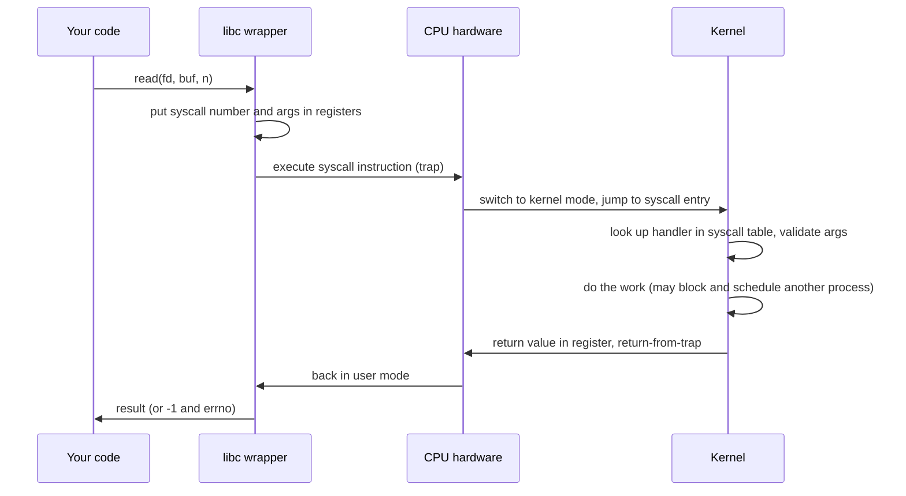
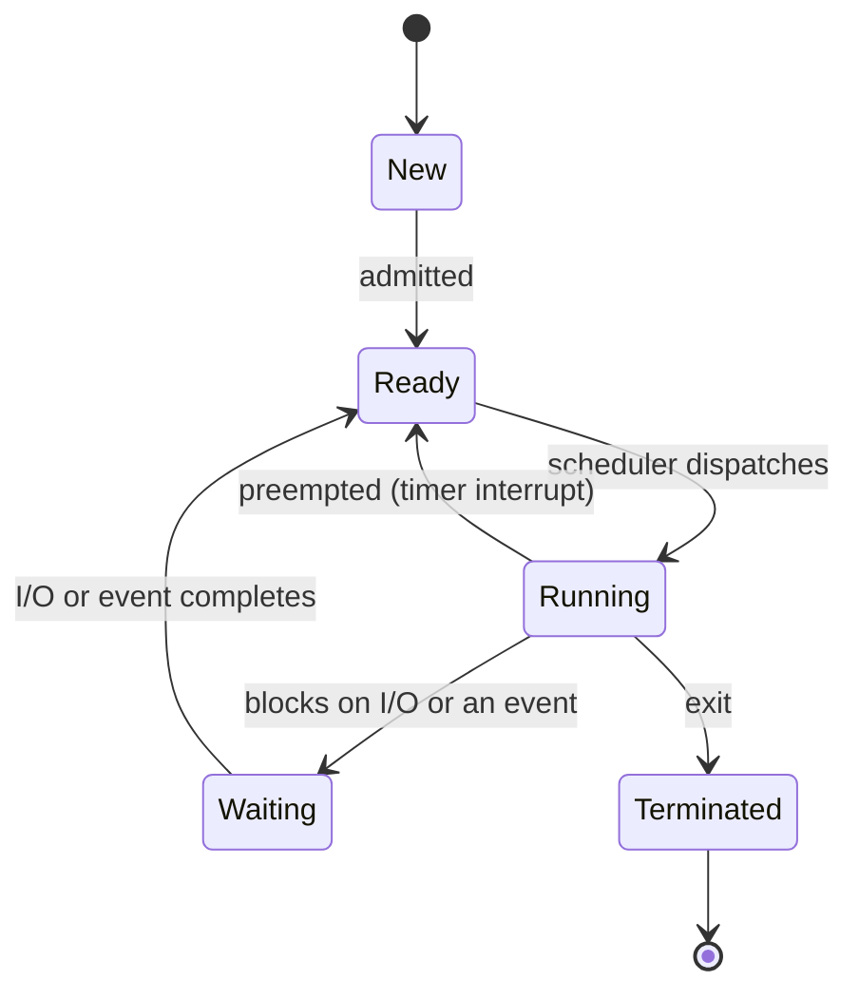
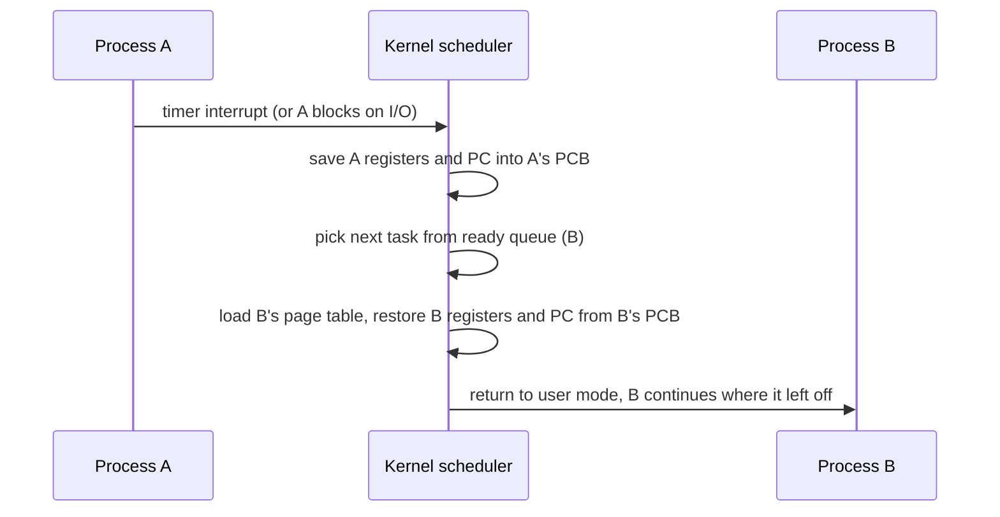
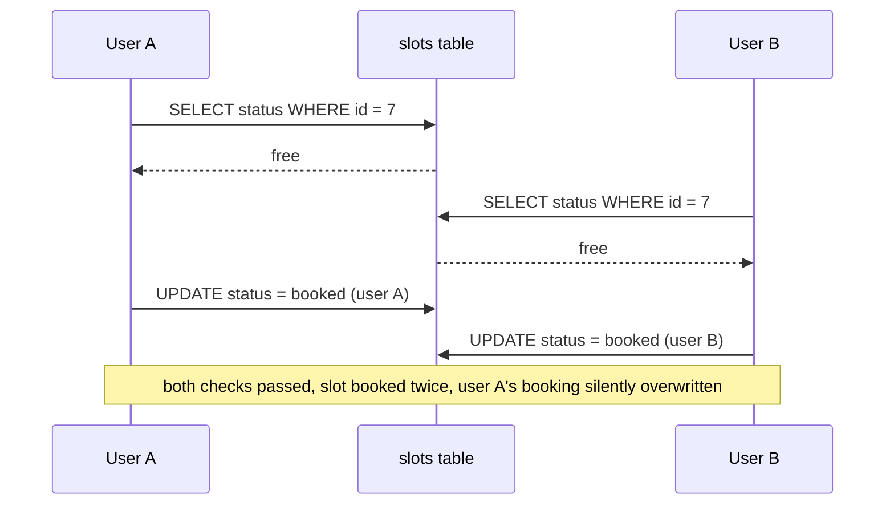
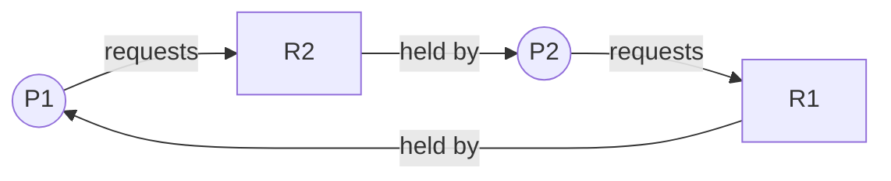
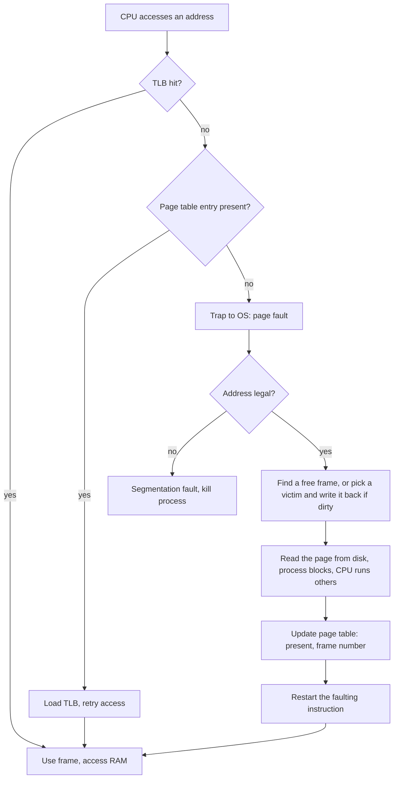

# Study Volume 1: Operating Systems and Concurrency

This is the in-depth study layer. The earlier documents are your quick-revision sheets. These volumes are where you actually learn each topic properly: the idea, the internals, a diagram, a worked example, code you can run, the loopholes where people go wrong, and the follow-up questions interviewers ask. Every topic ends with a **Revise in 30 seconds** box, so before an interview or OA you only reread those boxes for the topics that matter.

## How each topic is organised

1. **The idea:** what it is and why it exists, in plain words.
2. **How it works:** the mechanism, step by step.
3. **Diagram:** drawn so you can redraw it on a whiteboard.
4. **Worked example or code:** run the code yourself, change a number, break it on purpose.
5. **Loopholes:** the common wrong answers, edge cases and traps.
6. **Interview questions:** the follow-ups, with short model answers.
7. **Revise in 30 seconds:** the five lines to reread before an interview.

## Contents of this volume

- Part 1: OS basics, kernel and user mode, system calls, interrupts
- Part 2: Process vs thread, PCB, states, IPC, Python's GIL
- Part 3: Context switching
- Part 4: CPU scheduling with worked numeric examples
- Part 5: Concurrency, race conditions, locks, semaphores, monitors, CAS, TOCTOU, thread safety
- Part 6: Deadlocks, Banker's algorithm, livelock, starvation, priority inversion
- Part 7: Memory management, paging, virtual memory, page replacement, thrashing

Parts 1 to 3 are in this first section, and the rest follow below.

## Part 1: OS basics, kernel mode, system calls

### 1.1 What an operating system really is

**The idea.** Without an OS every program would have to drive the disk, the network card and the memory directly, and any bug in one program could corrupt another. The OS sits between programs and hardware to do three jobs: **abstraction** (a file instead of disk sectors, a process instead of raw CPU time), **resource management** (sharing CPU, memory and devices fairly between many programs) and **protection** (one program cannot read or wreck another's memory).

```text
+-------------------------------------------------------------+
|   Applications:  browser   editor   your Flask app   shell   |
+-------------------------------------------------------------+
|   Libraries (libc, Python runtime)  <- wrappers for syscalls  |
+=============== system call boundary (trap) ==================+
|   KERNEL                                                      |
|   process mgmt | memory mgmt | file systems | networking      |
|   scheduler    | virtual mem | VFS          | TCP/IP stack    |
|   device drivers | interrupt handlers                          |
+-------------------------------------------------------------+
|   HARDWARE:  CPU   RAM   disk   NIC   timer                  |
+-------------------------------------------------------------+
```

**Loopholes.** The OS is not 'the GUI' or 'Windows'. The kernel is the privileged core, and the shell, GUI and utilities are ordinary user programs that happen to ship with it. Another trap: saying the OS 'runs programs'. Precisely, it creates processes, schedules them onto CPUs and gives them resources.

### 1.2 Kernel mode and user mode

**The idea.** If any program could execute any instruction, one buggy program could halt the machine or read your passwords. The CPU therefore has at least two **privilege levels**, selected by a hardware **mode bit**. User code runs in user mode and cannot execute **privileged instructions** (disable interrupts, change page tables, talk to I/O ports, halt the CPU). The kernel runs in kernel mode and can do everything. x86 has four rings (0 to 3) but Linux and Windows use only ring 0 (kernel) and ring 3 (user).

**How the switch happens.** User code cannot simply set the mode bit to 'kernel', or protection would be pointless. The only ways in are controlled entry points: a **system call** instruction, an **interrupt** or an **exception**. Each of them makes the hardware set the mode bit, jump to a fixed address the kernel registered at boot, and save the old state. Returning uses a special instruction that restores user mode.

**Loopholes.**

- Running in kernel mode does not mean 'a different process'. A system call runs kernel code on behalf of the same process, using that process's kernel stack. That is a **mode switch**, which is much cheaper than a **context switch** (Part 3).
- Each process has a separate kernel stack. This is why a blocked system call (a read waiting for the network) does not block other processes: the kernel can park that process's kernel stack and run another.

### 1.3 System calls

**The idea.** A system call is the only door from user programs into the kernel. Anything that touches a resource the kernel protects goes through it: files, processes, memory mapping, sockets, time, signals.

**The path of one call, say `read(fd, buf, n)`:**



- The kernel must **validate every argument**. A user can pass a bad pointer, a negative length or a file descriptor that is not theirs, and the kernel must never trust it.
- Arguments are passed in registers (or a memory block for many arguments). Results come back in a register, and errors are reported as a negative value that the library turns into `-1` plus `errno`.

**Common system calls by group.**

| Group | Calls |
| --- | --- |
| Process control | `fork`, `execve`, `wait`/`waitpid`, `exit`, `kill`, `getpid` |
| Files | `open`, `read`, `write`, `close`, `lseek`, `stat`, `unlink` |
| Memory | `brk`, `mmap`, `munmap` |
| Devices and pipes | `ioctl`, `pipe`, `dup2` |
| Networking | `socket`, `bind`, `listen`, `accept`, `connect`, `send`, `recv` |
| Info and time | `getuid`, `gettimeofday`, `nanosleep` |

**Worked example: fork, exec, wait (how a shell runs a command).**

```python
import os, sys

pid = os.fork()                    # one call, TWO returns
if pid == 0:
    # child: pid is 0 here
    os.execvp('ls', ['ls', '-l'])   # replaces this process image; never returns on success
    os._exit(127)                   # only reached if exec failed
else:
    # parent: pid is the child's PID
    finished, status = os.waitpid(pid, 0)
    print('child', finished, 'exited with', os.WEXITSTATUS(status))
```

What happens: `fork` duplicates the calling process. The child gets a copy of the parent's memory (implemented lazily, see copy-on-write in Part 7) and its own PID. `execvp` throws away the child's program and loads `ls` in the same process, keeping the PID and open file descriptors. `waitpid` makes the parent sleep until the child ends and collects its exit status. A shell is just this loop, with `dup2` calls between `fork` and `exec` to implement redirection (`> out.txt`) and pipes.

You can watch real system calls on Linux with `strace -c python3 script.py` (counts per call) or `strace -e trace=openat,read,write ls`.

**Loopholes and traps.**

- `fork` returns twice: `0` in the child, the child's PID in the parent, `-1` on failure. Forgetting the third case causes fork bombs and confusing crashes.
- `exec` does not return on success. Code after it only runs on failure.
- **Zombie:** a child that has exited but whose parent has not called `wait`. Its PCB entry stays so the parent can read the exit status. Many zombies exhaust the process table. **Orphan:** a child whose parent died first. It is adopted by `init` (PID 1), which reaps it.
- `printf` or Python `print` is a **library** function that buffers output, and `write` is the **system call**. A classic puzzle: `printf('x'); fork();` can print `x` twice because the unflushed buffer is copied into the child.
- A system call is not a function call. It costs hundreds to thousands of cycles because of the mode switch, so I/O libraries batch data (buffered I/O) to make fewer calls.
- Forking a multithreaded program copies only the calling thread into the child. Locks held by other threads at that moment stay locked forever in the child, a well-known source of deadlocks.

### 1.4 Interrupts, traps and exceptions

- **Interrupt (asynchronous, from hardware):** a device or the timer signals the CPU. The CPU finishes the current instruction, saves its state, and jumps to an **interrupt service routine** found through the **interrupt vector table**. Examples: keyboard, network packet arrival, disk finished, timer tick.
- **Trap or software interrupt (synchronous, intentional):** the `syscall` instruction.
- **Exception or fault (synchronous, accidental):** divide by zero, invalid memory access, **page fault**. A page fault is recoverable (the OS loads the page and re-runs the instruction), a segmentation fault is not (the OS kills the process).
- **The timer interrupt is what makes preemptive multitasking possible.** Without it, a program in an infinite loop would own the CPU forever, because the kernel would never get control back.
- Interrupt handlers are split into a quick top half (acknowledge the device) and a deferred bottom half (the heavy processing), so interrupts stay disabled only briefly.

### 1.5 Kernel designs

- **Monolithic (Linux, traditional Unix):** all services (scheduler, file systems, drivers, networking) run in kernel space as one big program. Fast, because calls between components are plain function calls. Downside: a bug in a driver can crash the whole system. Linux softens this with loadable kernel modules.
- **Microkernel (Minix, QNX, L4):** only the minimum (address spaces, scheduling, IPC) lives in the kernel, and file systems and drivers run as user-space servers. More robust and easier to verify, but every service request becomes IPC, which costs performance.
- **Hybrid (Windows NT, macOS):** microkernel-style structure with many services kept in kernel space for speed.

### Interview questions on OS basics

- **Why two modes?** Protection: privileged instructions and hardware access are denied to user code, so a faulty or malicious program cannot compromise the system or other programs.
- **How can user code enter the kernel if it cannot change the mode itself?** Only through hardware-controlled entry points (syscall instruction, interrupts, exceptions) that jump to addresses the kernel set up at boot.
- **What is the difference between a system call and a library function?** A library function (like `printf`, `malloc`, `strlen`) runs in user space and may or may not call the kernel. A system call crosses into the kernel. `malloc` calls `brk` or `mmap` only when it needs more memory from the OS.
- **What happens on `fork()` then `exec()`?** Duplicate the process, then replace the child's program image. Explain why they are separate calls: it lets the parent set up redirection and file descriptors in the child before running the new program.
- **Why does a zombie exist?** To hold the exit status until the parent collects it.

### Revise in 30 seconds: OS basics

- OS = abstraction + resource management + protection. Kernel is the privileged core.
- Mode bit separates user and kernel mode. Entry only via syscall, interrupt or exception, never by user choice.
- Syscall path: wrapper, trap, syscall table, validate arguments, work, return. It is a mode switch, not a context switch.
- `fork` returns twice, `exec` does not return, zombie = exited child not yet waited for, orphan adopted by init.
- Timer interrupt enables preemption. Monolithic is fast, microkernel is safe but slower.

## Part 2: Processes and threads

### 2.1 A process in memory

**The idea.** A program is a file on disk. A **process** is a program in execution: its code plus its current state (registers, stack, heap, open files). The same program can run as many processes at once.

```text
high addresses  +---------------------+
                |   kernel space      |  (not accessible from user mode)
                +---------------------+
                |   stack             |  function frames, locals, return addresses
                |        |            |  grows DOWN
                |        v            |
                |   (free space)      |
                |        ^            |
                |        |            |  grows UP
                |   heap              |  malloc / new / dynamic objects
                +---------------------+
                |   BSS               |  uninitialised globals (zero-filled)
                |   data              |  initialised globals and statics
                |   text (code)       |  read-only machine instructions
low addresses   +---------------------+
```

The stack and heap grow toward each other. Stack overflow means the stack ran into its limit (runaway recursion). The text segment is shared read-only between processes running the same program.

### 2.2 The Process Control Block (PCB)

The PCB (called `task_struct` in Linux) is the kernel's record of a process. It holds: process ID and parent ID, process **state**, saved **CPU registers and program counter**, scheduling information (priority, accumulated CPU time), **memory management** information (page table pointer), the table of **open file descriptors**, accounting data, and signal handlers. Everything the OS needs to pause the process and resume it later lives in the PCB, which is exactly why context switching works.

### 2.3 Process states



- **Ready:** could run, waiting for a CPU. **Running:** executing now. **Waiting (blocked):** cannot run until something happens, so it is not wasting CPU in a queue. A process moves from Waiting to **Ready, never straight to Running**: the scheduler decides who runs.
- The kernel keeps these processes in queues: a **ready queue**, and a **wait queue per device or event**. Linux distinguishes `R` running or runnable, `S` interruptible sleep, `D` uninterruptible sleep (usually disk I/O), `T` stopped, `Z` zombie in the `ps` output.
- Some textbooks add **suspended** states (swapped out to disk) to handle memory pressure.

### 2.4 Inter-process communication (IPC)

Processes have separate address spaces, so they cannot share variables. The OS provides explicit channels.

| Mechanism | How it works | Good for | Watch out |
| --- | --- | --- | --- |
| Pipe | Kernel buffer, one direction, byte stream. Parent and child usually. | Shell pipelines | Related processes only. Named pipes (FIFO) lift that. |
| Message queue | Kernel-managed queue of discrete messages | Structured messages between unrelated processes | Size limits, kernel copies data |
| Shared memory | Same physical pages mapped into two address spaces | Fastest, bulk data | **You must synchronise yourself** (race conditions) |
| Socket | Endpoints, local or across the network | Client-server, any machine | Higher overhead |
| Signal | Tiny asynchronous notification (`SIGTERM`, `SIGINT`) | Control events | Carries almost no data, handlers must be tiny and safe |
| File | Shared on-disk data | Persistence | Needs locking, slow |

```python
import os
r, w = os.pipe()
if os.fork() == 0:               # child writes
    os.close(r)
    os.write(w, b'hello from child')
    os._exit(0)
else:                            # parent reads
    os.close(w)
    print(os.read(r, 100))       # b'hello from child'
    os.wait()
```

**Loopholes.** Shared memory is fastest because there is no kernel copy per message, but all correctness burden moves to you. Closing the unused pipe ends matters: if the parent keeps the write end open, `read` never sees end-of-file. A pipe has a finite buffer, and writing to a full pipe blocks, which can cause a deadlock if both sides write before either reads.

### 2.5 Threads

**The idea.** A thread is a unit of execution inside a process. Threads of one process share the **code, heap, globals and open files**, but each has its **own stack, registers and program counter**. Sharing memory makes communication trivial and creation cheap, and also makes bugs (races) possible.

```text
   ONE PROCESS
  +-----------------------------------------------+
  | shared: code | heap | globals | open files      |
  |                                                 |
  |  thread 1        thread 2        thread 3       |
  |  [own stack]     [own stack]     [own stack]    |
  |  [own regs/PC]   [own regs/PC]   [own regs/PC]  |
  +-----------------------------------------------+
```

**Thread models.** *User-level threads* are managed by a library, so switching is very cheap, but the kernel sees one process, so one blocking call blocks every thread and they cannot use several cores. *Kernel-level threads* are scheduled by the OS, giving real parallelism and independent blocking. Mappings: many-to-one (user threads on one kernel thread), **one-to-one** (what Linux and Windows use), many-to-many (flexible, complex). Go goroutines and Java virtual threads are many-to-few designs layered on top of kernel threads.

**Process vs thread.**

|  | Process | Thread |
| --- | --- | --- |
| Address space | Private | Shared with its process |
| Creation cost | High (copy structures, page tables) | Low |
| Communication | IPC (pipes, sockets, shared memory) | Direct memory access |
| Isolation | Strong, a crash stays contained | Weak, a bad thread can crash the whole process |
| Context switch | Heavier (address space changes, TLB effects) | Lighter |

### 2.6 The Python GIL (very common in interviews for Python candidates)

CPython has a **Global Interpreter Lock**: only one thread executes Python bytecode at any moment, because CPython's memory management (reference counting) is not thread safe. Consequences:

- **CPU-bound** Python code does not speed up with threads, since the threads take turns.
- **I/O-bound** code does speed up, because a thread blocked on I/O releases the GIL and others run. Many C extensions (NumPy, hashing, compression) also release the GIL during heavy work.
- For CPU-bound parallelism use `multiprocessing` or `concurrent.futures.ProcessPoolExecutor` (separate processes, each with its own GIL and memory), or move work to workers such as Celery processes.
- The GIL does **not** make your code thread safe. It switches threads between bytecodes, and `counter += 1` is several bytecodes (load, add, store), so updates can still be lost (see Part 5).

```python
import time
from concurrent.futures import ThreadPoolExecutor, ProcessPoolExecutor

def burn(n):                       # CPU-bound work
    s = 0
    for i in range(n): s += i * i
    return s

if __name__ == '__main__':
    jobs = [5_000_000] * 4
    for Pool in (ThreadPoolExecutor, ProcessPoolExecutor):
        t = time.perf_counter()
        with Pool(4) as ex: list(ex.map(burn, jobs))
        print(Pool.__name__, round(time.perf_counter() - t, 2), 's')
# Typical result: processes are several times faster than threads on a multicore machine.
```

Free-threaded (no-GIL) CPython builds exist as an opt-in in recent versions, but do not assume them in an interview unless asked. Say that the standard interpreter has a GIL.

### 2.7 Concurrency models for servers

- **Process per connection** (old Apache prefork): isolation, heavy. **Thread per connection:** lighter, but thousands of threads cost memory and switching. **Thread pool:** a bounded set of workers takes jobs from a queue, which is the standard fix. **Event loop** (`asyncio`, Node.js, nginx): one thread multiplexes many connections with non-blocking I/O (`epoll`), great for I/O-bound work, terrible if a handler blocks or computes for long.
- This is the reasoning behind your stack: Flask or FastAPI handles requests quickly, and heavy work goes to Celery worker processes.

### Loopholes in this part

- 'Threads are always faster than processes' is false in Python for CPU work, and false whenever the bottleneck is contention on shared state.
- Threads share the heap but **not the stack**: never return a pointer to a local variable to another thread.
- A process crash does not take down other processes, but a segfault in any thread kills all threads in its process.
- `fork` after starting threads is dangerous (Part 1). Use `spawn` start methods in `multiprocessing` when threads exist.

### Interview questions

- **What is in a PCB and why is it needed?** State, PID, registers and program counter, page table pointer, open files, scheduling data. It lets the OS stop and resume a process.
- **What is the difference between a program, a process and a thread?** Program: file. Process: running instance with its own address space. Thread: execution path inside a process sharing its address space.
- **Which resources do threads share and which are private?** Shared: code, heap, globals, files. Private: stack, registers, program counter, thread-local storage.
- **Why can a Python program with 8 threads not use 8 cores for computation?** GIL. Use processes.
- **Which IPC is fastest and what is the catch?** Shared memory, but you must synchronise.

### Revise in 30 seconds: processes and threads

- Process = program in execution, private address space. Layout: text, data, BSS, heap up, stack down.
- PCB stores state, registers, PC, page table, open files. States: new, ready, running, waiting, terminated. Waiting goes to ready, not running.
- IPC: pipes, message queues, shared memory (fastest, needs sync), sockets, signals.
- Threads share code, heap, globals and files, and keep their own stack and registers. Cheaper to create and switch, weaker isolation.
- GIL: one bytecode thread at a time. Good for I/O, useless for CPU work. Does not make code thread safe.

## Part 3: Context switching

**The idea.** One CPU core runs one thread at a time. To give the illusion that many run together, the OS keeps switching. A **context switch** saves the state of the running task and restores the state of the next task.

**What is the 'context'?** The CPU registers (general purpose, stack pointer, program counter, flags), plus for a process switch the pointer to its page table. Floating-point or vector registers are often saved lazily.



**When it happens.** *Involuntary (preemptive):* the timer interrupt ends a time slice, or a higher-priority task becomes ready. *Voluntary:* the task blocks (I/O, lock, sleep) or yields or exits.

**The cost has two parts.**

- **Direct cost:** saving and restoring registers, running the scheduler, switching the page table. A few microseconds at most.
- **Indirect cost:** the new task finds the **CPU caches and TLB full of the old task's data**, so it suffers cache misses and TLB misses until it warms up. For a process switch the TLB is flushed (or tagged with address-space IDs on modern CPUs). This hidden cost is often larger than the direct one.

**Thread switch vs process switch.** Switching between threads of the same process keeps the same address space, so there is no page-table change and the TLB stays valid. That is why it is cheaper.

**Loopholes.**

- A **system call is not a context switch.** It is a mode switch inside the same process. A context switch happens only if the call blocks and the scheduler picks someone else.
- An **interrupt is not automatically a context switch** either. The handler runs and returns to the same task unless the scheduler decides otherwise.
- Context switching is pure overhead: no useful program work happens during it. Too many threads and too short a time quantum make the system spend its time switching. This is the real cost behind 'don't create a thread per request'.
- You can measure switches with `vmstat 1` (the `cs` column) or `pidstat -w`. Voluntary switches suggest I/O or lock waits, involuntary ones suggest CPU contention.

**Interview questions.**

- **What gets saved and where?** Registers and program counter, into the PCB (or the kernel stack of the thread).
- **Why is a thread switch cheaper than a process switch?** Same address space, no page-table swap, TLB and cache contents remain valid.
- **Can you avoid context switches?** Fewer threads than cores, thread pools, event-loop designs, CPU affinity, lock-free structures that do not block.

### Revise in 30 seconds: context switching

- Save the running task's registers and PC into its PCB, load the next task's. Process switch also changes the page table.
- Triggers: timer (preempt), blocking I/O or lock, exit, higher-priority arrival.
- Direct cost is small, the indirect cost (cold caches and TLB) is the big one.
- Thread switch is cheaper than process switch. System call and interrupt are not context switches by themselves.
- Overhead grows with too many threads or too small a quantum.

## Part 4: CPU scheduling

### 4.1 The idea and the vocabulary

More processes are ready than there are CPU cores. The **scheduler** decides which ready process runs next, and the **dispatcher** is the small piece of kernel code that actually performs the switch (context switch, switch to user mode, jump to the right instruction). The time between the dispatcher stopping one process and starting another is **dispatch latency**.

Processes alternate between **CPU bursts** (computing) and **I/O bursts** (waiting for a device). Most bursts are short, with a few long ones. Scheduling algorithms are tuned around that shape.

**Preemptive vs non-preemptive.** A non-preemptive scheduler lets a process keep the CPU until it blocks or finishes. A preemptive scheduler can take the CPU away (timer interrupt, or a higher-priority process becoming ready). Preemption is needed for responsiveness, and it brings the problem of shared data being interrupted halfway (Part 5).

**Metrics, with exact formulas** (memorise these, exams and interviews both ask for numbers):

- **Completion time (CT):** the clock time when the process finishes.
- **Turnaround time (TAT)** = CT - arrival time.
- **Waiting time (WT)** = TAT - burst time (total time spent in the ready queue).
- **Response time (RT)** = time of first CPU allocation - arrival time.
- **Throughput** = processes completed per unit time. **CPU utilisation** = fraction of time the CPU is busy.

Different goals pull in different directions: batch systems care about throughput and turnaround, interactive systems care about response time, real-time systems care about meeting deadlines.

### 4.2 One data set, every algorithm

We use the same four processes for every algorithm so you can compare them.

| Process | Arrival | Burst |
| --- | --- | --- |
| P1 | 0 | 8 |
| P2 | 1 | 4 |
| P3 | 2 | 9 |
| P4 | 3 | 5 |

Total CPU work is 26 time units.

**FCFS (First Come First Served), non-preemptive.** Run in arrival order.

```text
Gantt:  | P1        | P2    | P3          | P4      |
        0           8      12            21        26
```

|  | CT | TAT | WT | RT |
| --- | --- | --- | --- | --- |
| P1 | 8 | 8 | 0 | 0 |
| P2 | 12 | 11 | 7 | 7 |
| P3 | 21 | 19 | 10 | 10 |
| P4 | 26 | 23 | 18 | 18 |

Average TAT 15.25, average WT 8.75. Simple and fair in order, but suffers the **convoy effect**: short jobs wait behind a long one (P2 with burst 4 waits 7 units).

**SJF (Shortest Job First), non-preemptive.** When the CPU is free, pick the ready process with the smallest burst. At time 0 only P1 is there, so it runs to 8. Then P2 (4), P4 (5), P3 (9) are ready, so P2, then P4, then P3.

```text
Gantt:  | P1        | P2    | P4      | P3          |
        0           8      12        17            26
```

Average TAT 14.25, average WT 7.75 (P1 0, P2 7, P4 9, P3 15). SJF gives the **minimum average waiting time** among non-preemptive algorithms. Proof idea (exchange argument): if a longer job runs before a shorter one, swapping them reduces the shorter one's wait by more than it increases the longer one's.

**SRTF (Shortest Remaining Time First), the preemptive SJF.** Whenever a process arrives, compare its burst to the remaining time of the running process, and preempt if it is shorter. At time 1, P2 (4) beats P1's remaining 7, so P1 is preempted.

```text
Gantt:  |P1| P2    | P4      | P1           | P3          |
        0  1       5        10             17            26
```

|  | CT | TAT | WT | RT |
| --- | --- | --- | --- | --- |
| P1 | 17 | 17 | 9 | 0 |
| P2 | 5 | 4 | 0 | 0 |
| P3 | 26 | 24 | 15 | 15 |
| P4 | 10 | 7 | 2 | 2 |

Average TAT 13.0, average WT 6.5, average RT 4.25. Best average waiting time of all four, but P3 (the long job) waits the longest, which is the starvation risk.

**Round Robin (RR), preemptive, time quantum 3.** Ready queue is FIFO. A process runs for at most one quantum, then goes to the back of the queue. Convention used here: processes that arrive during a slice are queued **before** the preempted process.

```text
Gantt:  | P1  | P2  | P3  | P4  | P1  | P2| P3  | P4 | P1 | P3  |
        0     3     6     9     12    15  16    19   21   23    26
```

|  | CT | TAT | WT | RT |
| --- | --- | --- | --- | --- |
| P1 | 23 | 23 | 15 | 0 |
| P2 | 16 | 15 | 11 | 2 |
| P3 | 26 | 24 | 15 | 4 |
| P4 | 21 | 18 | 13 | 6 |

Average TAT 20.0, average WT 13.5, **average RT 3.0**. RR has the worst turnaround and waiting here, but the best response time, which is precisely what an interactive system wants.

**Comparison of the four runs:**

| Algorithm | Avg WT | Avg RT | Character |
| --- | --- | --- | --- |
| FCFS | 8.75 | 8.75 | Simple, convoy effect |
| SJF | 7.75 | 7.75 | Optimal average wait (non-preemptive), needs burst knowledge, can starve |
| SRTF | 6.5 | 4.25 | Optimal average wait overall, many switches, starvation |
| RR (q=3) | 13.5 | 3.0 | Fair, great response, higher average wait |

**Verify it yourself with code.** Run this, then change the arrival times, the bursts and the quantum:

```python
from collections import deque

def fcfs(procs):
    t, comp, first = 0, {}, {}
    for n, (at, bt) in sorted(procs.items(), key=lambda x: x[1][0]):
        t = max(t, at); first[n] = t; t += bt; comp[n] = t
    return comp, first

def sjf(procs):                                     # non-preemptive
    left, t, comp, first = dict(procs), 0, {}, {}
    while left:
        ready = [n for n, (at, bt) in left.items() if at <= t]
        if not ready:
            t = min(at for at, bt in left.values()); continue
        n = min(ready, key=lambda x: (left[x][1], left[x][0]))
        first[n] = t; t += left[n][1]; comp[n] = t; del left[n]
    return comp, first

def srtf(procs):                                    # preemptive, 1-unit steps
    rem = {n: bt for n, (at, bt) in procs.items()}
    t, comp, first = 0, {}, {}
    while rem:
        ready = [n for n in rem if procs[n][0] <= t]
        if not ready:
            t += 1; continue
        n = min(ready, key=lambda x: (rem[x], procs[x][0]))
        first.setdefault(n, t)
        rem[n] -= 1; t += 1
        if rem[n] == 0:
            del rem[n]; comp[n] = t
    return comp, first

def rr(procs, q):
    order = sorted(procs, key=lambda n: procs[n][0])
    rem = {n: procs[n][1] for n in procs}
    t, i, dq, comp, first = 0, 0, deque(), {}, {}
    def admit():
        nonlocal i
        while i < len(order) and procs[order[i]][0] <= t:
            dq.append(order[i]); i += 1
    admit()
    while dq or i < len(order):
        if not dq:
            t = procs[order[i]][0]; admit(); continue
        n = dq.popleft(); first.setdefault(n, t)
        run = min(q, rem[n]); t += run; rem[n] -= run
        admit()                          # arrivals during the slice queue first
        if rem[n] > 0: dq.append(n)
        else: comp[n] = t
    return comp, first

def report(name, procs, comp, first):
    tat = {n: comp[n] - procs[n][0] for n in procs}
    wt = {n: tat[n] - procs[n][1] for n in procs}
    rt = {n: first[n] - procs[n][0] for n in procs}
    avg = lambda d: round(sum(d.values()) / len(d), 2)
    print(f'{name:6} avg TAT {avg(tat):6}  avg WT {avg(wt):6}  avg RT {avg(rt):6}')

procs = {'P1': (0, 8), 'P2': (1, 4), 'P3': (2, 9), 'P4': (3, 5)}
report('FCFS', procs, *fcfs(procs))
report('SJF', procs, *sjf(procs))
report('SRTF', procs, *srtf(procs))
report('RR q=3', procs, *rr(procs, 3))
```

### 4.3 Priority scheduling and aging

Each process has a priority, and the CPU goes to the highest. Priorities can be internal (computed from memory use, I/O to CPU ratio) or external (set by the user, `nice`). It can be preemptive or not. SJF is simply priority scheduling where priority equals the inverse of predicted burst length.

**Loophole: starvation.** A low-priority process may wait forever while high-priority ones keep arriving (a legend says one system found a job from 1967 still waiting in 1973). **Aging** fixes it by gradually raising a waiting process's priority.

### 4.4 Predicting the next burst

SJF needs the next burst length, which is unknowable, so the OS predicts it with **exponential averaging**: `tau(n+1) = alpha * t(n) + (1 - alpha) * tau(n)`, where `t(n)` is the measured last burst and `tau(n)` the previous prediction. With `alpha = 0.5`, recent and historical behaviour weigh equally. `alpha = 0` ignores recent history, `alpha = 1` uses only the last burst.

### 4.5 Choosing the quantum for Round Robin

- Quantum too **large** and RR degenerates into FCFS (response time suffers).
- Quantum too **small** and context-switch overhead dominates. With switch cost `c` and quantum `q`, the useful fraction of CPU time is `q / (q + c)`. A 1 ms quantum with 0.1 ms switch cost wastes about 9 percent.
- A rule of thumb: the quantum should be longer than most CPU bursts (around 80 percent of them), typically 10 to 100 ms in classic systems.

### 4.6 Multilevel queue and multilevel feedback queue (MLFQ)

Several ready queues with different priorities and possibly different algorithms (interactive jobs in a high-priority RR queue, batch jobs in a low-priority FCFS queue). In **MLFQ** processes move between queues based on behaviour, so the scheduler learns who is who without knowing burst lengths in advance:

1. A new job enters the top queue (shortest quantum).
2. If it uses its entire quantum, it is probably CPU-bound, so it is demoted one level.
3. If it blocks for I/O before the quantum ends, it stays (interactive jobs keep high priority).
4. Higher queues always run before lower ones.
5. Periodically, boost everything to the top to prevent starvation and to let a job that changed behaviour be reclassified.

**Loophole in naive MLFQ:** a smart program can issue an I/O call just before its quantum expires to stay at high priority forever (gaming the scheduler). Fix: account for total CPU used at a level, not just per-slice behaviour.

### 4.7 Linux's Completely Fair Scheduler (CFS)

Linux does not use a textbook algorithm. CFS tracks **virtual runtime (`vruntime`)** per task, which advances more slowly for higher-weight (lower `nice`) tasks. Runnable tasks sit in a **red-black tree** ordered by `vruntime`, and the scheduler always picks the leftmost (smallest `vruntime`), meaning the task that has had the least fair share. Selection is O(1) from the cached leftmost node, insertion O(log n). Recent kernels replaced CFS with **EEVDF**, which keeps the same fairness idea with better latency handling, so say 'CFS-style fair scheduling' and mention you know the concept rather than claiming details of a specific kernel version.

### 4.8 Real-time and multiprocessor notes

- **Hard real-time** must never miss a deadline (airbag controller), **soft real-time** tolerates occasional misses (video playback). Classic algorithms: **Rate Monotonic** (static priority, shorter period gets higher priority, schedulable if CPU utilisation is under about 69 percent for many tasks) and **Earliest Deadline First** (dynamic priority, optimal on one CPU, up to 100 percent utilisation).
- **Multiprocessor:** per-core run queues with **load balancing** (migrating tasks between cores) and **processor affinity** (keeping a task on one core to reuse its warm cache). The two goals conflict.

### Loopholes and common wrong answers

- 'SJF is the best algorithm' ignores that it needs the future burst length and starves long jobs.
- Lower average waiting time does not mean better user experience. RR had the worst waiting time here and the best response time.
- Always state the **tie-breaking convention** (arrival order, and where newly arrived processes go relative to the preempted one in RR), or your Gantt chart may differ from the expected answer.
- With **preemption**, response time and waiting time differ. With non-preemptive FCFS they are equal for a process that never blocks, which is a useful sanity check.
- CPU idle gaps: if no process has arrived yet, the clock jumps to the next arrival. Remember to include idle time in the Gantt chart.
- Do not mix up TAT and WT: `WT = TAT - BT`.

### Interview questions

- **Which algorithm gives minimum average waiting time, and what is its catch?** SJF (SRTF when preemptive). It needs the burst length in advance, and it can starve long jobs.
- **How does RR behave as the quantum goes to infinity? To zero?** To infinity it becomes FCFS. To zero, context-switch overhead dominates and throughput collapses (ideal processor sharing in theory).
- **How do you stop starvation?** Aging, or periodic priority boost in MLFQ.
- **How would you schedule both interactive and batch jobs?** MLFQ: interactive jobs stay in the high-priority queues because they block early.
- **What does CFS do?** Gives each task a fair share by always running the task with the smallest virtual runtime, stored in a red-black tree.

### Revise in 30 seconds: CPU scheduling

- TAT = CT - AT, WT = TAT - BT, RT = first run - AT.
- FCFS: convoy effect. SJF: minimum average wait, needs burst prediction (exponential average), starves. SRTF: preemptive SJF. RR: fair, best response, quantum trade-off (q too big is FCFS, too small is overhead).
- Priority scheduling starves low priority, aging fixes it. MLFQ learns behaviour by demotion on full-quantum use, periodic boost.
- Linux uses fair scheduling with vruntime and a red-black tree, not a textbook algorithm.
- On our sample: avg WT FCFS 8.75, SJF 7.75, SRTF 6.5, RR(q=3) 13.5 but RR response time 3.0.

## Part 5: Concurrency and synchronisation

### 5.1 Race conditions: why this topic exists

**The idea.** A **race condition** is a bug where the result depends on the exact timing of how threads or processes interleave. It appears whenever two or more threads touch the same data, at least one of them writes, and nothing orders their accesses. The data being shared is the **shared mutable state**, and the code that touches it is a **critical section**.

**Why `counter += 1` is not one step.** It compiles to three: load the value, add 1, store it back.

```text
Thread A                 Thread B                 counter in memory
load counter  (reads 5)                           5
                         load counter (reads 5)   5
add 1 (6)                                         5
                         add 1 (6)                5
store 6                                           6
                         store 6                  6     <- two increments, one effect
```

A lost update. You can reproduce it even in Python, despite the GIL, by forcing a thread switch between the read and the write:

```python
import threading, time

counter = 0
lock = threading.Lock()

def unsafe(n):
    global counter
    for _ in range(n):
        tmp = counter
        time.sleep(0)            # give up the GIL: simulates a preemption at the worst moment
        counter = tmp + 1

def safe(n):
    global counter
    for _ in range(n):
        with lock:               # the read-modify-write is now one indivisible critical section
            tmp = counter
            counter = tmp + 1

for fn in (unsafe, safe):
    counter = 0
    ts = [threading.Thread(target=fn, args=(5000,)) for _ in range(4)]
    [t.start() for t in ts]; [t.join() for t in ts]
    print(fn.__name__, counter, 'expected 20000')
```

Run it: `unsafe` prints a number far below 20000, `safe` prints exactly 20000.

**Loopholes.**

- 'The GIL makes Python thread safe' is wrong. It protects the interpreter's internal structures, not your multi-step logic. Even `counter += 1` and `if key not in d: d[key] = ...` are races.
- Races are **non-deterministic**: a test can pass a thousand times and fail in production. Absence of failure is not proof of safety. Stress tests, many iterations and tools such as ThreadSanitizer help.
- A **data race** (unsynchronised conflicting access) and a **race condition** (a logic bug dependent on timing) are related but not identical. You can have a race condition with perfectly locked individual operations (two separate locked steps with a gap between them, which is exactly TOCTOU, see 5.9).

### 5.2 The critical section problem

A correct solution must satisfy three properties:

1. **Mutual exclusion:** at most one thread inside the critical section.
2. **Progress:** if nobody is inside and some want in, the decision about who enters cannot be postponed forever, and only threads that want in take part in it.
3. **Bounded waiting:** a thread that asks to enter is guaranteed to get in after a bounded number of others have gone ahead (no starvation).

A code structure to remember: `entry section`, `critical section`, `exit section`, `remainder section`.

**Peterson's algorithm (two threads, software only).** Each thread has a `flag` saying 'I want in', and a shared `turn` says 'after you'.

```python
flag = [False, False]
turn = 0

def enter(i):                       # i is 0 or 1
    global turn
    j = 1 - i
    flag[i] = True                  # I want to enter
    turn = j                        # but you go first if you also want to
    while flag[j] and turn == j:    # wait while the other wants in AND it is their turn
        pass

def leave(i):
    flag[i] = False
```

It satisfies all three properties on paper. **Loophole:** on real modern CPUs it is *broken* unless you add memory barriers, because the compiler and CPU may reorder the store to `flag[i]` after the load of `flag[j]`. That is why hardware atomic instructions are used instead, and why you should cite Peterson as a teaching algorithm, not production code.

**Hardware support.** Atomic instructions do a read and a write as one indivisible step:

- **Test-and-Set:** set a flag to 1 and return the old value.
- **Compare-and-Swap (CAS):** `if (*addr == expected) { *addr = new; return true } else return false`, atomically. Details in 5.7.

A **spinlock** built on test-and-set:

```text
acquire():  while (test_and_set(&lock) == 1) { /* spin */ }
release():  lock = 0
```

Spinlocks burn CPU while waiting, so they suit very short critical sections on multicore machines (kernel code, lock-free structure internals). For longer waits the thread should sleep, which is what a mutex does. On a single core a spinlock is nearly useless, because the lock holder cannot run while you spin.

### 5.3 Mutex vs semaphore

**Mutex (mutual exclusion lock).** A lock with **ownership**: the thread that locked it must be the one to unlock it. Purpose: mutual exclusion around a critical section. A waiting thread sleeps instead of spinning. Good implementations support **priority inheritance** (the owner temporarily inherits the priority of the highest waiter, which fixes priority inversion in Part 6).

**Semaphore.** An integer counter `S` plus two atomic operations:

```text
wait(S)   (also P, down, acquire):  S = S - 1;  if S < 0: block this thread in S's queue
signal(S) (also V, up, release):    S = S + 1;  if S <= 0: wake one blocked thread
```

- **Counting semaphore** initialised to N guards a pool of N identical resources (database connections, parking spaces).
- **Binary semaphore** (0 or 1) can act like a mutex, but with **no ownership**: any thread can signal it.
- Used for **signalling**: initialise to 0, thread A does `wait` and sleeps until thread B does `signal` ('the data is ready').

|  | Mutex | Semaphore |
| --- | --- | --- |
| Purpose | Mutual exclusion | Count resources, signal between threads |
| Ownership | Yes, the locker must unlock | No |
| Value | Locked or unlocked | Integer count |
| Typical misuse | Unlocking from another thread | Using a binary semaphore as a lock and losing priority-inheritance protection |

**Loopholes.**

- Wrong order of `wait` calls causes deadlock, for example in producer-consumer, `wait(mutex)` before `wait(empty)` makes a producer sleep while holding the mutex, so the consumer can never enter.
- Forgetting a `signal` on an error path leaks the resource. Use `with lock:` or `try/finally`.
- Semaphores are easy to misuse because the code that acquires and the code that releases can be far apart. Monitors (next) give structure.

### 5.4 Monitors and condition variables

**The idea.** A **monitor** packages shared data with the procedures that operate on it, and guarantees that only one thread executes inside the monitor at a time (an implicit mutex). Inside, a thread can wait for a condition using a **condition variable**, which atomically releases the monitor lock and sleeps, then reacquires the lock on wake-up. Java's `synchronized` methods with `wait/notify`, and Python's `threading.Condition`, are monitor-style tools.

**The rule you must never break:** always wait in a **`while` loop**, never an `if`.

```python
with cond:
    while not predicate():      # re-check after every wake-up
        cond.wait()
    ...use the shared state...
```

Reasons: **spurious wakeups** (a thread can wake with no signal), and **stolen wakeups** (between the signal and your reacquiring the lock, another thread consumed the item, so the condition is false again).

- `notify` wakes one waiter, `notify_all` wakes all. Use `notify_all` when different waiters wait for different conditions on one condition variable, otherwise a wake-up may go to the wrong thread and the right one sleeps forever (a **lost wake-up**).
- Always change the shared state **while holding the lock**, then signal.

### 5.5 The classic problems, with working code

**Producer-consumer (bounded buffer).** Producers add items, consumers remove them. Constraints: never add to a full buffer, never take from an empty one, never corrupt the buffer.

```python
import threading
from collections import deque

class BoundedBuffer:
    def __init__(self, capacity):
        self.q, self.cap = deque(), capacity
        self.lock = threading.Lock()
        self.not_full = threading.Condition(self.lock)
        self.not_empty = threading.Condition(self.lock)

    def put(self, item):
        with self.not_full:
            while len(self.q) >= self.cap:      # wait in a while loop
                self.not_full.wait()
            self.q.append(item)
            self.not_empty.notify()

    def get(self):
        with self.not_empty:
            while not self.q:
                self.not_empty.wait()
            item = self.q.popleft()
            self.not_full.notify()
            return item
```

The semaphore version, for exams:

```text
semaphores:  empty = N (free slots),  full = 0 (filled slots),  mutex = 1
producer:    wait(empty); wait(mutex); insert item; signal(mutex); signal(full)
consumer:    wait(full);  wait(mutex); remove item; signal(mutex); signal(empty)
```

Swap the two `wait` calls in either side and you get a deadlock. In real Python code just use `queue.Queue(maxsize=N)`, which is this exact structure already built and tested.

**Readers-writers.** Many readers may read together, but a writer needs exclusive access.

```python
class RWLock:                                    # readers-preference version
    def __init__(self):
        self.readers = 0
        self.mutex = threading.Lock()            # protects the readers count
        self.room = threading.Lock()             # held by a writer, or by the group of readers
    def acquire_read(self):
        with self.mutex:
            self.readers += 1
            if self.readers == 1:
                self.room.acquire()              # first reader locks writers out
    def release_read(self):
        with self.mutex:
            self.readers -= 1
            if self.readers == 0:
                self.room.release()              # last reader lets writers in
    def acquire_write(self):  self.room.acquire()
    def release_write(self):  self.room.release()
```

**Loophole:** this favours readers, so a steady stream of readers can **starve writers**. A writers-preference version starves readers. A fair version queues requests in arrival order, at some cost in throughput. Databases use read-write locks and MVCC for this reason.

**Dining philosophers.** Five philosophers, five forks, each needs both adjacent forks to eat. If everyone grabs the left fork first, all hold one and wait for another: deadlock (circular wait).

```python
forks = [threading.Lock() for _ in range(5)]

def philosopher(i):
    first, second = sorted((i, (i + 1) % 5))      # always take the lower-numbered fork first
    for _ in range(3):
        with forks[first]:
            with forks[second]:
                pass                               # eat
```

The fix is a **global lock ordering**, which breaks the circular-wait condition. Other fixes: allow at most four philosophers to sit at once (a counting semaphore of 4), or pick up both forks atomically. This is the generic lesson: **acquire multiple locks in a consistent global order.**

### 5.6 Memory visibility and reordering

On a multicore machine, a write by one thread is not automatically seen by another, because of CPU caches, store buffers and compiler or CPU reordering. A **memory model** defines what is guaranteed. Locks, atomics and keywords like Java's `volatile` insert **memory barriers** that force ordering and visibility. Practical consequences:

- A plain `while not done: pass` loop may never see `done` change, since the compiler can hoist the read. Use a lock, an `Event`, or an atomic.
- Releasing a lock publishes all writes made before it, and acquiring it makes them visible. This 'happens-before' relation is why correct locking gives you correctness without thinking about barriers.

### 5.7 Atomics, compare-and-swap, lock-free code, the ABA problem

**Compare-and-swap (CAS):** one hardware instruction (`cmpxchg` on x86), atomically: if the memory holds `expected`, store `new` and report success, otherwise change nothing and report failure. Usage is a **retry loop**: read the old value, compute the new value, try CAS, and retry if someone else changed it in between.

```python
import threading

class AtomicInt:                     # SIMULATES an atomic: Python exposes no raw CAS instruction
    def __init__(self, v=0):
        self._v, self._lock = v, threading.Lock()
    def get(self):
        return self._v
    def compare_and_set(self, expected, new):
        with self._lock:
            if self._v == expected:
                self._v = new
                return True
            return False

def increment(a):
    while True:                      # optimistic retry loop
        old = a.get()
        if a.compare_and_set(old, old + 1):
            return old + 1
```

In Java use `AtomicInteger.incrementAndGet()`, in C++ `std::atomic<int>`, in Go `sync/atomic`. A CAS loop never blocks, so a stalled thread cannot hold everyone else up (that is what 'lock-free' means: some thread always makes progress).

**The ABA problem.** A thread reads value A, gets descheduled, other threads change it A to B and back to A, and the first thread's CAS succeeds because the value 'looks' unchanged, although the world changed. In a lock-free stack this can corrupt the structure (the node you saw on top was popped, freed, and reused). **Fix:** attach a version counter and CAS on `(value, version)` pairs, or use hazard pointers or garbage collection to prevent reuse.

**CAS in databases.** The same idea shows up as an **atomic conditional update**: `UPDATE ... SET ... WHERE id = :id AND <expected state>`, then check how many rows changed. And as **optimistic locking** with a `version` column: `UPDATE ... SET qty = :new, version = version + 1 WHERE id = :id AND version = :seen`. Zero rows updated means someone else got there first, so re-read and retry.

**Optimistic vs pessimistic.** Pessimistic: lock first, work, unlock (safe, can block, can deadlock). Optimistic: work, then validate and commit with CAS or a version check (no blocking, wasted work and retries under heavy contention). Pick optimistic for low contention and short operations, pessimistic when conflicts are common or retries are costly.

### 5.8 Thread safety

Code is **thread safe** if it behaves correctly when called from several threads at once, whatever the interleaving. Ways to achieve it, from best to worst:

1. **Do not share:** keep state local to a function, or thread-local (`threading.local()`), or give each worker its own copy.
2. **Share immutable data:** objects that cannot change need no locks (tuples, frozen dataclasses, strings).
3. **Message passing:** threads communicate through queues and no data is shared directly (`queue.Queue`, Go channels, actors).
4. **Confine mutation to one owner thread**, or use atomics for single variables.
5. **Lock** the shared state with the smallest correct critical section.

**Loopholes.**

- **Thread safe is not the same as reentrant.** A reentrant function can be interrupted and called again before the first call finishes (signal handlers), and cannot rely on a non-reentrant lock or static state. A `threading.RLock` lets the same thread re-acquire a lock it already holds.
- **Composing thread-safe operations is not thread safe.** `if key not in cache: cache[key] = compute()` on a thread-safe dict still lets two threads both compute. Use one lock around the check and the act, or an atomic `setdefault`.
- **Too-coarse locks** destroy parallelism, **too-fine locks** invite deadlock and bugs. Start coarse, measure, then refine.
- **Never call unknown code (callbacks, I/O) while holding a lock.** It can take arbitrarily long or take another lock in the opposite order.
- **Double-checked locking** for lazy singletons is subtle in languages with weaker memory models (Java before `volatile` was fixed, C++). In Python, create the object at import time or use a module-level instance.

```python
class Singleton:
    _inst, _lock = None, threading.Lock()
    @classmethod
    def get(cls):
        if cls._inst is None:               # fast path without the lock
            with cls._lock:
                if cls._inst is None:       # check again inside the lock
                    cls._inst = cls()
        return cls._inst
```

### 5.9 TOCTOU: time-of-check to time-of-use

**The idea.** You **check** a condition, then **use** the result to act, and the world changes between those two steps. The check is stale by the time you act on it. It is a race condition built from two individually correct steps.



**Three classic forms:**

1. **File system:** `if os.path.exists(p): open(p)`. Between the check and the open, an attacker replaces `p` with a symlink to a sensitive file. This is a real security vulnerability class (privileged programs writing to temp files).
2. **Business logic:** check a seat or slot is free, then book it (above). Also check balance then debit, check stock then decrement, check username free then insert.
3. **Permissions:** check authorisation, then perform the action later, after the permission was revoked.

**The fixes, all of which make check and act a single atomic step:**

```python
# FILES: do not check, just try, and handle failure
try:
    f = open(path)
except FileNotFoundError:
    ...
# create only if it does not already exist, atomically
fd = os.open(path, os.O_CREAT | os.O_EXCL | os.O_WRONLY, 0o600)
```

```python
import sqlite3

def book_unsafe(conn, slot_id, user):               # TOCTOU: check, then act
    row = conn.execute('SELECT status FROM slots WHERE id = ?', (slot_id,)).fetchone()
    if row and row[0] == 'free':
        conn.execute('UPDATE slots SET status = ?, user = ? WHERE id = ?', ('booked', user, slot_id))
        conn.commit()
        return True
    return False

def book_safe(conn, slot_id, user):                 # atomic compare-and-swap in SQL
    cur = conn.execute(
        'UPDATE slots SET status = ?, user = ? WHERE id = ? AND status = ?',
        ('booked', user, slot_id, 'free'))
    conn.commit()
    return cur.rowcount == 1                        # exactly one winner, everyone else sees 0
```

The database serialises the conditional update on that row, so only one request can change it from `free` to `booked`. The loser sees `rowcount == 0` and tells the user the slot is gone. This is the exact technique in your appointment system, and it also works with a **unique constraint** (a second insert fails), a **`SELECT ... FOR UPDATE`** row lock inside a transaction, or **serializable isolation** with retry.

**Loopholes.**

- Wrapping the `SELECT` and `UPDATE` in a transaction is not enough at the default isolation level (Read Committed): both transactions can still read `free`. You need a row lock, a conditional update, a constraint, or serializable isolation.
- A check in application code plus a lock *around the check only* is still wrong. The lock must cover the **check and the act together**.
- A per-process Python lock does nothing across several app servers. Cross-process safety must live in the shared store (the database), or use a distributed lock with a TTL and fencing token (see the system-design volume).
- Always check the **affected row count**. Ignoring it makes the atomic update useless.

### Interview questions on concurrency

- **What is a race condition? Give a real example.** Result depends on interleaving. Lost update on `counter++`, double booking on check-then-act.
- **Mutex vs semaphore?** Mutex: ownership, mutual exclusion. Semaphore: counter, no ownership, resource counting and signalling. A binary semaphore is not quite a mutex.
- **Why wait in a `while` and not an `if`?** Spurious wakeups and stolen wakeups: the condition must be re-checked after waking.
- **How do you prevent deadlock among several locks?** Acquire in a global order, hold as few locks as possible, use timeouts or `try_lock`.
- **What is CAS, and when does it fail?** Atomic compare-and-set. Fails when the value changed since you read it, so you retry. ABA is the subtle failure, fixed with version stamps.
- **Optimistic vs pessimistic locking?** Validate at commit time versus lock up front. Optimistic wins under low contention.
- **How did you prevent double booking?** Atomic conditional update on a status column and a row count check. Explain TOCTOU and why check-then-act fails.
- **Does the GIL make `x += 1` safe?** No. Multi-bytecode, interleavable.

### Revise in 30 seconds: concurrency

- Race condition = outcome depends on interleaving. `x += 1` is load, add, store. The GIL does not save you.
- Critical section needs mutual exclusion, progress, bounded waiting. Peterson is teaching only (needs barriers). Real locks use atomic hardware instructions.
- Mutex has an owner, a semaphore is a counter without one. Always wait in a `while`. Producer-consumer: empty, full, mutex, never swap the waits.
- Readers-writers can starve one side. Dining philosophers is fixed by a global lock order.
- CAS = atomic compare-and-set, retry loop, ABA fixed by version. DB equivalents: conditional UPDATE, version column.
- TOCTOU = check then act with a gap. Make it one atomic step (conditional UPDATE, unique constraint, `O_EXCL`, `SELECT FOR UPDATE`) and check the row count.

## Part 6: Deadlocks

### 6.1 The idea, with a bug you can run

A **deadlock** is a state where a set of threads or processes are each waiting for a resource held by another member of the set, so none of them can ever proceed. Nothing is broken in any single thread. The cycle is the bug.

```python
import threading, time

lock_a, lock_b = threading.Lock(), threading.Lock()

def t1():
    with lock_a:
        time.sleep(0.1)                 # widen the window so the bug shows every time
        with lock_b:
            print('t1 done')

def t2():
    with lock_b:                        # opposite order: the cause of the deadlock
        time.sleep(0.1)
        with lock_a:
            print('t2 done')

for f in (t1, t2):
    threading.Thread(target=f, daemon=True).start()
time.sleep(2)
print('stuck: neither thread finished')   # t1 holds A wants B, t2 holds B wants A
```

The fix is one line of discipline: make both functions take `lock_a` first, then `lock_b`.

### 6.2 The four necessary conditions (Coffman conditions)

A deadlock can occur only if **all four** hold at the same time:

1. **Mutual exclusion:** at least one resource is non-shareable (only one holder at a time).
2. **Hold and wait:** a process holds some resources while waiting for others.
3. **No preemption:** a resource can be released only voluntarily by the holder, not taken away.
4. **Circular wait:** a cycle P0 waits for P1, P1 waits for P2, ..., Pn waits for P0.

These are **necessary, not sufficient**: all four together with a single instance per resource type guarantee a deadlock, but with several instances of a resource a cycle may not be fatal.

**Resource allocation graph (RAG).** Draw processes as circles and resources as boxes. An arrow from a process to a resource means 'requests', from a resource to a process means 'is held by'. A cycle with single-instance resources means deadlock.



If resources have multiple instances, a cycle is necessary but not sufficient, so you need the matrix-based detection below.

### 6.3 Four ways to handle deadlock

| Strategy | Idea | Used by |
| --- | --- | --- |
| Ignore (the ostrich approach) | Assume deadlocks are rare, reboot or kill when they happen | General-purpose OSes for most kernel resources |
| Prevention | Design so at least one Coffman condition can never hold | Application code (lock ordering) |
| Avoidance | Grant a request only if the resulting state is safe | Mostly theoretical (Banker's algorithm) |
| Detection and recovery | Let it happen, find it, break it | Databases, some schedulers |

### 6.4 Prevention: break one condition

- **Break mutual exclusion:** make resources shareable (read-only files, lock-free structures). Often impossible, since a printer or a write lock is inherently exclusive.
- **Break hold and wait:** request all resources at once, or release everything before asking for more. Downsides: low resource utilisation and **starvation** of a process that needs a popular combination.
- **Break no preemption:** if a request fails, release what you hold and retry (or the OS takes it away). Works for state that can be saved and restored (CPU registers, memory pages), badly for things like a half-written file.
- **Break circular wait:** give every resource a global number and require acquisition in increasing order. This is **the practical technique** you should use in application code.

```python
import threading

def acquire_in_order(*locks):
    ordered = sorted(locks, key=id)         # any fixed global order works: id, name, account number
    for l in ordered: l.acquire()
    return ordered

def transfer(src, dst, amount):             # classic bank-transfer deadlock, fixed
    held = acquire_in_order(src.lock, dst.lock)
    try:
        src.balance -= amount; dst.balance += amount
    finally:
        for l in reversed(held): l.release()
```

Without the ordering, `transfer(a, b)` and `transfer(b, a)` running at once deadlock. Another practical tool is a **timeout with back-off**: `lock.acquire(timeout=0.5)`; if it fails, release everything, sleep a random short time and retry, which breaks hold-and-wait and avoids livelock with the random delay.

### 6.5 Avoidance: safe states and the Banker's algorithm

**Safe state:** there exists an order (a **safe sequence**) in which every process can run to completion using the currently free resources plus those released by processes that finish earlier. **Unsafe is not deadlocked**: it only means deadlock is possible. **Safe guarantees no deadlock.** The Banker's algorithm grants a request only if the state after granting remains safe.

**Requirements:** each process declares its **maximum** need in advance, the number of processes and resources is fixed, and processes must eventually release what they hold. This is why it is a teaching tool and rarely used in real systems.

**Data (m resource types, n processes):**

- `Available`: free units of each resource.
- `Max[i]`: the most process `i` may ever need.
- `Allocation[i]`: what `i` holds now.
- `Need[i] = Max[i] - Allocation[i]`.

**Safety algorithm:** `Work = Available`. Repeatedly find an unfinished process whose `Need <= Work`, pretend it runs to completion (`Work += Allocation[i]`), mark it finished. If all finish, the state is safe, and the order is the safe sequence.

**Worked example.** Three resource types A, B, C with totals 10, 5, 7.

| Process | Allocation (A B C) | Max (A B C) | Need (A B C) |
| --- | --- | --- | --- |
| P0 | 0 1 0 | 7 5 3 | 7 4 3 |
| P1 | 2 0 0 | 3 2 2 | 1 2 2 |
| P2 | 3 0 2 | 9 0 2 | 6 0 0 |
| P3 | 2 1 1 | 2 2 2 | 0 1 1 |
| P4 | 0 0 2 | 4 3 3 | 4 3 1 |

Available = (3, 3, 2). Check: allocations sum to (7, 2, 5), plus available gives (10, 5, 7), matching the totals.

Safety check, step by step:

```text
Work = (3,3,2)
P1 need (1,2,2) <= work  -> run, Work = (3,3,2)+(2,0,0) = (5,3,2)
P3 need (0,1,1) <= work  -> run, Work = (5,3,2)+(2,1,1) = (7,4,3)
P4 need (4,3,1) <= work  -> run, Work = (7,4,3)+(0,0,2) = (7,4,5)
P0 need (7,4,3) <= work  -> run, Work = (7,4,5)+(0,1,0) = (7,5,5)
P2 need (6,0,0) <= work  -> run, Work = (7,5,5)+(3,0,2) = (10,5,7)
Safe sequence: P1, P3, P4, P0, P2   (any valid order is fine, there can be several)
```

**Resource requests, using the same state:**

- **P1 requests (1, 0, 2).** Request is within its Need (1,2,2) and within Available (3,3,2). Pretend to grant: Available (2,3,0), P1 Allocation (3,0,2), P1 Need (0,2,0). Run the safety check: it finds a safe sequence (P1, P3, P4, P0, P2), so **grant**.
- **Then P4 requests (3, 3, 0).** Within its Need, but Available is (2,3,0) and 3 > 2 for resource A, so **P4 must wait**.
- **Then P0 requests (0, 2, 0).** Within Need and Available. Pretend: Available (2,1,0), P0 Need (7,2,3). Now no process has a Need that fits inside (2,1,0), so the state is **unsafe**: **deny**, even though a deadlock has not happened yet.

```python
def is_safe(avail, alloc, need):
    n, m = len(alloc), len(avail)
    work, done, order = avail[:], [False] * n, []
    progress = True
    while progress:
        progress = False
        for i in range(n):
            if not done[i] and all(need[i][j] <= work[j] for j in range(m)):
                work = [work[j] + alloc[i][j] for j in range(m)]
                done[i] = True; order.append(i); progress = True
    return all(done), order

def request(pid, req, avail, alloc, need):
    if any(r > nd for r, nd in zip(req, need[pid])):
        raise ValueError('process exceeded its declared maximum')
    if any(r > a for r, a in zip(req, avail)):
        return False                                   # not available now: wait
    a2 = [a - r for a, r in zip(avail, req)]           # pretend to grant
    al2 = [row[:] for row in alloc]; ne2 = [row[:] for row in need]
    al2[pid] = [x + r for x, r in zip(al2[pid], req)]
    ne2[pid] = [x - r for x, r in zip(ne2[pid], req)]
    return is_safe(a2, al2, ne2)[0]                    # grant only if still safe

alloc = [[0,1,0],[2,0,0],[3,0,2],[2,1,1],[0,0,2]]
max_  = [[7,5,3],[3,2,2],[9,0,2],[2,2,2],[4,3,3]]
need  = [[m - a for m, a in zip(mr, ar)] for mr, ar in zip(max_, alloc)]
print(is_safe([3,3,2], alloc, need))                   # (True, [1, 3, 4, 0, 2])
print(request(1, [1,0,2], [3,3,2], alloc, need))       # True
```

### 6.6 Detection and recovery

**Single instance per resource:** build a **wait-for graph** (process Pi to Pj if Pi waits for a resource held by Pj) and search it for a cycle with DFS (the 3-colour cycle detection from the DSA volume). Run it periodically or when a request has waited too long.

**Multiple instances:** use the Banker-style matrix algorithm with the current `Request` matrix in place of `Need` (no declared maximums). Processes left unfinished at the end are deadlocked.

**Recovery:** *terminate* all deadlocked processes (drastic) or one at a time until the cycle breaks (choose the victim by priority, work done so far, resources held, cost to restart). Or *preempt* resources and *roll back* the victim to a checkpoint. Danger: the same process being chosen repeatedly (starvation), so factor in how many times it has been a victim.

**This is exactly how databases behave.** Two transactions lock rows in opposite order, the database builds a wait-for graph, finds the cycle, aborts one transaction (the victim) with an error such as PostgreSQL's `deadlock detected`, and the application must **catch it and retry the transaction**. To reduce them: touch rows in a consistent order, keep transactions short, and index the columns you lock by so fewer rows are locked.

### 6.7 Livelock, starvation and priority inversion

|  | Deadlock | Livelock | Starvation |
| --- | --- | --- | --- |
| State of threads | Blocked, waiting forever | Running and reacting, but making no progress | Runnable, but never gets the resource |
| Cause | Circular wait | Threads keep yielding or retrying in sync | Unfair scheduling or priority rules |
| Analogy | Two cars nose to nose in a narrow lane | Two people in a corridor both stepping aside the same way, repeatedly | A low-priority task behind an endless stream of high-priority ones |
| Fix | Ordering, timeouts, detection | Random back-off, a tie-breaker | Aging, fair queues |

**Priority inversion.** A high-priority task H needs a lock held by a low-priority task L, while a medium-priority task M (which does not need the lock) keeps preempting L. So H, the most important task, is effectively waiting on M. **Real incident:** the 1997 Mars Pathfinder lander kept resetting itself for exactly this reason. A low-priority meteorological task held a shared mutex, a medium-priority communications task preempted it, and the high-priority bus-management task timed out, tripping a watchdog reset. Engineers fixed it remotely by enabling **priority inheritance** on that mutex: the lock holder temporarily inherits the priority of the highest-priority waiter, so L finishes quickly and M cannot starve it.

### 6.8 Loopholes and practical traps

- **Unsafe state is not deadlock.** And a deadlock needs all four conditions, so one broken condition suffices.
- **Self-deadlock:** a thread re-acquiring a non-reentrant lock it already holds (`threading.Lock` is not reentrant, `RLock` is). A function that takes the lock calling another function that takes the same lock is a classic cause.
- **Hidden lock order:** lock ordering is easy within one function and invisible across modules, callbacks and library calls. Never call unknown code while holding a lock.
- **Thread pool starvation deadlock:** a task running in a bounded pool submits a subtask to the *same* pool and blocks waiting for it. If every worker is blocked this way, no worker is free to run the subtasks. Avoid blocking on futures from inside the pool that will run them.
- **Producer-consumer deadlock with bounded buffers:** if both sides block on a full buffer (for example two stages writing to each other's queue), no one reads.
- **Joining a thread while holding a lock the thread needs.**
- **Fork while another thread holds a lock** (Part 1) leaves a lock locked forever in the child.
- **Detection is only half the story:** you also need logging that records lock acquisition order, thread dumps (`py-spy dump`, `jstack`, `faulthandler.dump_traceback_later`) to see where threads are stuck.

### Interview questions

- **State the four conditions and how to break each.** Mutual exclusion (make shareable), hold and wait (request all at once), no preemption (allow preemption or release and retry), circular wait (global lock order). The last is the practical one.
- **Is an unsafe state a deadlock?** No, it only means a deadlock may occur. A safe state guarantees none.
- **How would you avoid deadlock in a money transfer between two accounts?** Always lock the lower-id account first, or use a single atomic database transaction with consistent row-locking order, and retry on deadlock errors.
- **Deadlock vs livelock vs starvation?** Blocked forever on a cycle, running but not progressing, never being chosen.
- **What is priority inversion, and how is it fixed?** A low-priority holder blocks a high-priority waiter while a medium task preempts the holder. Fixed by priority inheritance or ceiling. The Pathfinder bug is the usual example.
- **How do databases handle deadlocks?** Detect via wait-for graph, abort a victim, the application retries.

### Revise in 30 seconds: deadlocks

- Four conditions, all needed: mutual exclusion, hold and wait, no preemption, circular wait. Break one to prevent.
- In code: acquire locks in one global order, hold few locks, use timeouts with random back-off, never call unknown code under a lock.
- Banker's: Need = Max - Allocation, find a process whose Need fits in Work, add its Allocation back. Safe = a full order exists. Unsafe is not deadlock.
- Detection = cycle in the wait-for graph. Recovery = kill or roll back a victim. Databases do this and you retry.
- Livelock moves without progress, starvation never gets served, priority inversion is fixed by priority inheritance (Mars Pathfinder).

## Part 7: Memory management

### 7.1 The problem and the vocabulary

Many processes share limited RAM. The OS must give each one memory, keep them from touching each other's memory, and let programs be larger than RAM. The central trick is **indirection**: programs use **logical (virtual) addresses**, and hardware called the **MMU (memory management unit)** translates them to **physical addresses** on every access. The OS controls the translation tables, so it controls what each process can see.

The simplest form of protection is a **base and limit register pair**: the physical address is `base + logical`, and any logical address at or above `limit` raises a fault. Paging generalises this.

### 7.2 Contiguous allocation and fragmentation

Give each process one contiguous block. The OS tracks **holes** (free blocks) and must choose which hole to use for a request:

- **First fit:** the first hole big enough. Fast, tends to litter the start of memory with small leftovers.
- **Best fit:** the smallest hole that fits. Leaves the smallest leftover but needs a full search and creates many tiny unusable slivers.
- **Worst fit:** the largest hole, hoping the leftover stays useful. In practice the worst performer.

**Worked example.** Holes in memory order: 100, 500, 200, 300, 600 KB. Processes arrive: 212, 417, 112, 426 KB.

```text
First fit: 212 -> 500 (leaves 288)   417 -> 600 (leaves 183)   112 -> 288 (leaves 176)   426 -> NO HOLE >= 426, must wait
Best fit:  212 -> 300 (leaves 88)    417 -> 500 (leaves 83)    112 -> 200 (leaves 88)    426 -> 600 (leaves 174)  all placed
Worst fit: 212 -> 600 (leaves 388)   417 -> 500 (leaves 83)    112 -> 388 (leaves 276)   426 -> NO HOLE >= 426, must wait
```

Best fit wins here, but that depends on the input. No fit strategy always wins.

**Fragmentation, two kinds (a favourite question):**

- **External fragmentation:** enough total free memory exists, but it is split into holes too small to use. Cure: **compaction** (slide processes together, expensive, requires relocatable addresses) or non-contiguous allocation (paging).
- **Internal fragmentation:** memory handed out in fixed-size units is partly unused inside the unit (a 4 KB page holding 100 bytes wastes 3,996). Average waste is half a unit per allocation.

### 7.3 Paging

**The idea.** Cut the logical address space into fixed-size **pages** and physical memory into same-size **frames**. Any page can go in any frame, so there is **no external fragmentation**. A per-process **page table** maps page numbers to frame numbers.

**Address translation.** A logical address splits into **page number (p)** and **offset (d)**. With page size 2^k the offset is the low k bits.

```text
logical address = [ page number p | offset d ]
                          |              |
                          v              |
                    +------------+       |
   page table  -->  | p -> frame f|      |
                    +------------+       |
                          |              |
                          v              v
physical address = [   frame number f | offset d ]
```

**Worked example.** Page size 4 KB (4096 bytes, so k = 12 bits of offset). Logical address `0x00003A7C`. Page number = address >> 12 = `0x3`, offset = `0xA7C`. Suppose the page table says page 3 is in frame 9. Physical address = (9 << 12) + 0xA7C = `0x9000 + 0xA7C = 0x9A7C`.

**Page table entry (PTE) contents:** the frame number plus control bits: **valid or present** (is the page in RAM?), **read/write/execute** permissions, **user/supervisor**, **referenced** (accessed recently, for replacement) and **dirty** (modified, so it must be written back before eviction). Hardware enforces the permission bits, which is how a write to read-only code becomes a segmentation fault.

**Size of a flat page table.** 32-bit addresses with 4 KB pages give 2^20 pages. At 4 bytes per entry that is 4 MB **per process**, mostly wasted for sparse address spaces. Solutions:

- **Multi-level page tables:** a page table of page tables, allocated only where the process actually uses memory. A two-level 32-bit split is 10 bits, 10 bits, 12 bits offset. x86-64 uses four levels (9 + 9 + 9 + 9 + 12 offset = 48 bits). The price is more memory accesses per translation, which the TLB hides.
- **Inverted page table:** one entry per physical frame, searched with a hash. Saves space, makes sharing and lookup harder.
- **Hashed page tables** for very large sparse spaces.

**The TLB (translation lookaside buffer).** Without help, every memory access costs an extra one (or several with multi-level tables) to read the page table. The TLB is a small, fast, associative hardware cache of recent translations.

**Effective access time (EAT), a favourite numeric question.** With TLB lookup 10 ns, memory access 100 ns and a hit ratio of 80 percent:

```text
hit : 10 + 100       = 110 ns
miss: 10 + 100 + 100 = 210 ns   (extra access to read the page table)
EAT = 0.80 * 110 + 0.20 * 210 = 88 + 42 = 130 ns
With a 99% hit ratio: 0.99 * 110 + 0.01 * 210 = 111 ns
```

A high hit ratio matters enormously, which is why locality of reference matters. On a context switch the TLB is flushed (or entries are tagged with an address-space ID, ASID), which is part of the process-switch cost from Part 3.

**Segmentation vs paging.** Segmentation divides memory into variable-size logical units (code, stack, heap) which matches how programmers think and gives easy per-segment protection, but suffers external fragmentation. Paging is invisible to the programmer and removes external fragmentation but has internal fragmentation. Some architectures combine them. Modern 64-bit systems are essentially paging-only.

### 7.4 Virtual memory and demand paging

**The idea.** Keep only the pages a process is *currently using* in RAM, and the rest on disk (swap or the executable file). The process sees a huge contiguous address space. Benefits: programs larger than RAM, more processes in memory at once, faster startup (load pages only when touched), and easy sharing.

**Demand paging:** a page is brought in **only when first accessed**. The page table's valid bit marks pages not in RAM.

**What happens on a page fault:**



A page fault is an **exception**, not an error: the instruction restarts and succeeds. Reading from disk takes milliseconds, millions of times slower than RAM, so the fault rate must be tiny.

**Effective access time with faults:** `EAT = (1 - p) * memory_time + p * fault_time`, where `p` is the page fault probability. Take memory 200 ns and fault service 8 ms (8,000,000 ns). If just 1 access in 1000 faults (`p = 0.001`): `0.999 * 200 + 0.001 * 8,000,000 = 199.8 + 8000 = 8199.8 ns`, a **slowdown of about 40 times**. To keep the slowdown under 10 percent you need `p` below roughly 2.5 in a million. This is why thrashing is catastrophic.

**Copy-on-write (COW).** After `fork`, parent and child share the same physical pages marked read-only. The first write by either triggers a fault, the OS copies just that page, and each gets a private one. That makes `fork` cheap, and it is also why `fork` followed immediately by `exec` wastes almost nothing.

**Memory-mapped files (`mmap`).** Map a file into the address space and access it like memory, letting the paging system do the I/O. Used by databases, loaders (shared libraries are mapped, not copied) and fast file reading.

### 7.5 Page replacement

When memory is full and a page fault needs a frame, the OS evicts a **victim**. Goal: minimise future faults. All algorithms are judged on a **reference string** (the sequence of pages accessed) and a number of frames.

- **FIFO:** evict the oldest loaded page. Easy, ignores usage, and suffers **Belady's anomaly**.
- **Optimal (OPT or MIN):** evict the page whose next use is farthest in the future. The best possible, impossible to implement (needs the future), used as a benchmark.
- **LRU:** evict the page unused for the longest time. Close to OPT in practice. Exact LRU needs per-access bookkeeping (a counter or a stack), too costly in hardware, so systems approximate it.
- **Clock (second chance):** pages sit in a circular list with a reference bit. The hand sweeps: if the bit is 1, clear it and move on, if 0, evict. A cheap LRU approximation (used in many real kernels, usually with enhancements).
- **LFU and MFU:** count references. LFU can keep stale-but-once-hot pages forever.
- **Aging:** shift reference bits into a counter each tick, approximating LRU in software.

**Worked example (the classic reference string, 3 frames):**

Reference string: `7 0 1 2 0 3 0 4 2 3 0 3 2 1 2 0 1 7 0 1`

```text
FIFO frame states after each fault (F = fault):
7:[7] F  0:[7 0] F  1:[7 0 1] F  2:[2 0 1] F  0:hit  3:[2 3 1] F  0:[2 3 0] F  4:[4 3 0] F
2:[4 2 0] F  3:[4 2 3] F  0:[0 2 3] F  3:hit  2:hit  1:[0 1 3] F  2:[0 1 2] F  0:hit  1:hit
7:[7 1 2] F  0:[7 0 2] F  1:[7 0 1] F                                        => 15 faults

LRU: 12 faults.      OPT: 9 faults.
```

So OPT 9 is the floor, LRU 12 is respectable, FIFO 15 is the worst of the three. Try the simulator below and change the frame count.

```python
from collections import OrderedDict

def fifo(refs, k):
    frames, order, faults = set(), [], 0
    for r in refs:
        if r not in frames:
            faults += 1
            if len(frames) == k:
                frames.remove(order.pop(0))
            frames.add(r); order.append(r)
    return faults

def lru(refs, k):
    cache, faults = OrderedDict(), 0
    for r in refs:
        if r in cache:
            cache.move_to_end(r)                       # most recently used goes to the end
        else:
            faults += 1
            if len(cache) == k:
                cache.popitem(last=False)              # evict the least recently used
            cache[r] = True
    return faults

def opt(refs, k):
    frames, faults = [], 0
    for i, r in enumerate(refs):
        if r in frames:
            continue
        faults += 1
        if len(frames) < k:
            frames.append(r); continue
        def next_use(p):
            try: return refs.index(p, i + 1)
            except ValueError: return float('inf')     # never used again: perfect victim
        frames.remove(max(frames, key=next_use))
        frames.append(r)
    return faults

refs = [7,0,1,2,0,3,0,4,2,3,0,3,2,1,2,0,1,7,0,1]
print(fifo(refs, 3), lru(refs, 3), opt(refs, 3))       # 15 12 9
belady = [1,2,3,4,1,2,5,1,2,3,4,5]
print(fifo(belady, 3), fifo(belady, 4))                # 9 10  <- MORE frames, MORE faults
```

**Belady's anomaly:** for FIFO, increasing the number of frames can *increase* page faults (the string above: 9 faults with 3 frames, 10 with 4). LRU and OPT never do this, because they are **stack algorithms**: the set of pages in memory with `n` frames is always a subset of the set with `n + 1` frames.

**Global vs local replacement.** Global: a process can steal a frame from any process (better utilisation, one greedy process can hurt others). Local: a process evicts only its own pages (more predictable, may underuse memory).

### 7.6 Thrashing and the working set

**Thrashing:** the combined **working sets** (pages processes actively need) exceed physical memory, so processes fault constantly, spend nearly all their time waiting on the disk, and CPU utilisation collapses. A nasty feedback loop follows: the scheduler sees low CPU usage and **admits more processes**, which makes it worse.

```text
CPU
utilisation   ____
   |        /    \
   |       /      \______   <- thrashing: more processes, less useful work
   |      /
   +-----------------------> degree of multiprogramming
```

**Why demand paging works at all: locality of reference.** Programs mostly reuse a small set of pages for a while (temporal locality) and touch nearby addresses (spatial locality). The **working-set model** keeps, for each process, the pages referenced in the last Delta accesses in memory. If the sum of working sets exceeds RAM, **suspend a process** rather than let everyone thrash. A related approach is **page-fault frequency (PFF)** control: give a process more frames if its fault rate is too high, take frames away if it is too low.

**Practical cures:** reduce the number of concurrent processes, add RAM, fix the program's access pattern (traverse a 2D array row by row, not column by column, so each loaded page is fully used), and limit memory per container.

### 7.7 Stack, heap and allocators

- **Stack:** one contiguous region per thread. Function calls push a **frame** (locals, saved registers, return address) and returns pop it. Allocation is a pointer bump, automatic, very fast, and limited in size (a typical default is a few megabytes), so deep or unbounded recursion ends in **stack overflow**.
- **Heap:** memory requested at runtime (`malloc`, `new`, Python objects). The allocator obtains big chunks from the OS (`brk` or `mmap` system calls) and subdivides them using **free lists**, size-class bins, or a **buddy system** (blocks split and merged in powers of two, fast coalescing, internal fragmentation). Kernels also use a **slab allocator** (caches of pre-built objects of one type).
- **Classic memory bugs (C and C++):** **leak** (allocated, never freed), **double free**, **use after free** (a dangling pointer to freed memory), **buffer overflow** (writing past an array, historically the root of many security exploits), **uninitialised read**. Tools: Valgrind, AddressSanitizer.
- **Python:** objects live on the heap and are reclaimed by **reference counting**, plus a **cyclic garbage collector** for reference cycles. You can still leak by keeping references alive (unbounded caches, global lists, lingering closures). `tracemalloc` and `objgraph` help find them.

### 7.8 Other facts worth knowing

- **Swap space** is the disk area that holds evicted anonymous pages. Heavy swapping is the visible symptom of thrashing.
- **Linux OOM killer:** when memory is truly exhausted, the kernel kills a process chosen by a badness score. Linux also **overcommits** by default: `malloc` can succeed even when RAM plus swap cannot back it, since pages are only backed when first touched. So an out-of-memory failure may appear later, at a random write, not at allocation time.
- **Shared libraries** are mapped into many processes sharing the same physical read-only pages. **Page cache:** the OS caches file data in free RAM, which is why 'free memory' looks low on a healthy Linux server.
- **Huge pages** (2 MB or 1 GB) reduce TLB misses for big working sets such as databases.

### Loopholes and common wrong answers

- Paging has no external fragmentation, but it **does** have internal fragmentation. Segmentation is the reverse.
- A page fault is not always an error, and a **minor fault** (page already in memory, just needs mapping) is far cheaper than a **major fault** (needs disk I/O).
- Virtual memory is not 'using disk as RAM' only. It is the translation and protection mechanism, and swapping is one use of it.
- OPT is a benchmark, never an implementation. Be careful claiming FIFO is 'bad': it is simply cheap and can show Belady's anomaly.
- In EAT questions, say exactly what a TLB miss costs. Some textbooks add one extra memory access, some two (two-level tables), so state your assumption.
- Thrashing is a system-level state caused by overcommitted working sets, not a property of one algorithm, although a poor replacement policy makes it worse.
- Logical address space size is set by the CPU's address width, not by the amount of RAM installed.

### Interview questions

- **Walk through virtual to physical translation.** Split into page number and offset, look in the TLB, on a miss walk the page table, check present and permission bits, combine frame number and offset, fault if absent.
- **Why is a TLB needed?** Page-table lookups cost extra memory accesses. The TLB caches translations so most accesses cost one lookup.
- **What is thrashing and how do you detect and fix it?** Excessive paging, low CPU, high disk activity (`vmstat` shows high `si` and `so`). Reduce multiprogramming, add RAM, use the working-set model.
- **How does `fork` stay cheap with a big process?** Copy-on-write sharing of pages.
- **Why does 'free' show almost no free memory on a healthy Linux box?** The page cache uses spare RAM and is released on demand.
- **FIFO vs LRU vs OPT?** FIFO is simple but can suffer Belady's anomaly, LRU approximates OPT using the past as a predictor of the future, OPT is the unreachable optimum.

### Revise in 30 seconds: memory management

- MMU translates logical to physical addresses. Contiguous allocation: first, best, worst fit, with external fragmentation. Paging: fixed pages and frames, page table, internal fragmentation only.
- Address = page number plus offset, frame number plus offset. Flat table is huge, so multi-level tables. TLB caches translations: EAT = hit \* (t + m) + miss \* (t + 2m).
- Virtual memory + demand paging: valid bit, page fault, OS loads the page, restart instruction. Fault cost is milliseconds, so keep the fault rate tiny. COW makes fork cheap.
- Replacement: FIFO (Belady's anomaly), OPT (benchmark), LRU (good, approximated by Clock). Sample string: FIFO 15, LRU 12, OPT 9 faults on 3 frames.
- Thrashing = working sets exceed RAM, cures: fewer processes, more RAM, working-set model. Stack is automatic and small, heap is dynamic and leak-prone.

## What this volume covers, and what comes next

This volume covers the operating systems and concurrency items from your checklist in depth: OS basics, system calls, processes and threads, context switching, scheduling, synchronisation primitives, race conditions, CAS, TOCTOU, thread safety, deadlocks and memory management. The other volumes follow the same template, in this order: DBMS and SQL, computer networks and the web, OOP and design patterns, system design, backend and DevOps, ML and GenAI, and DSA patterns.
