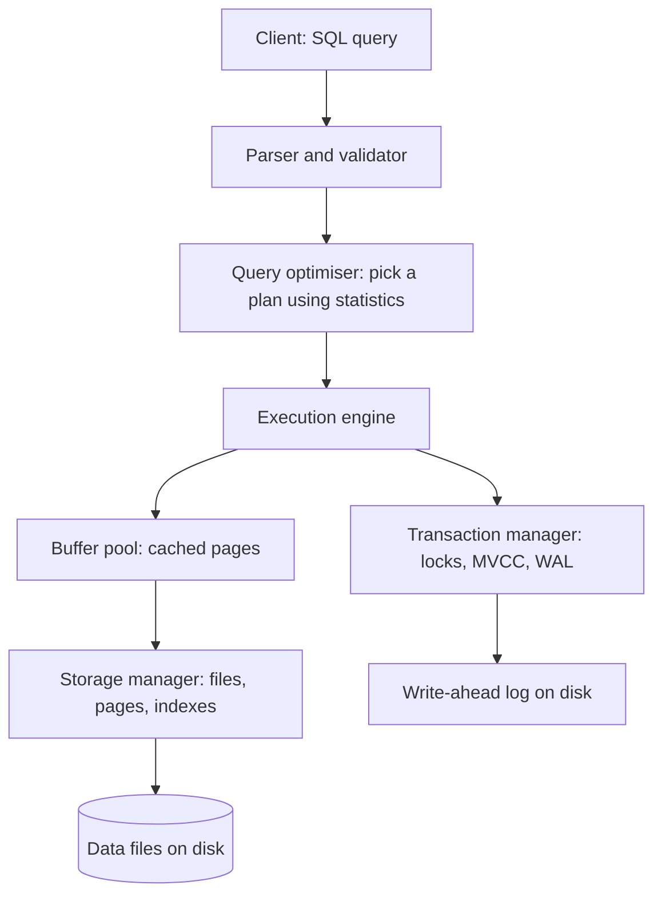
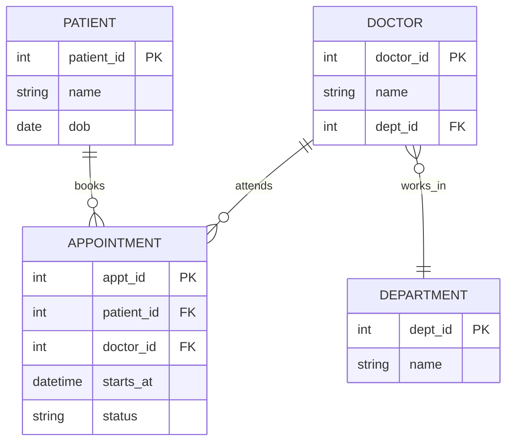
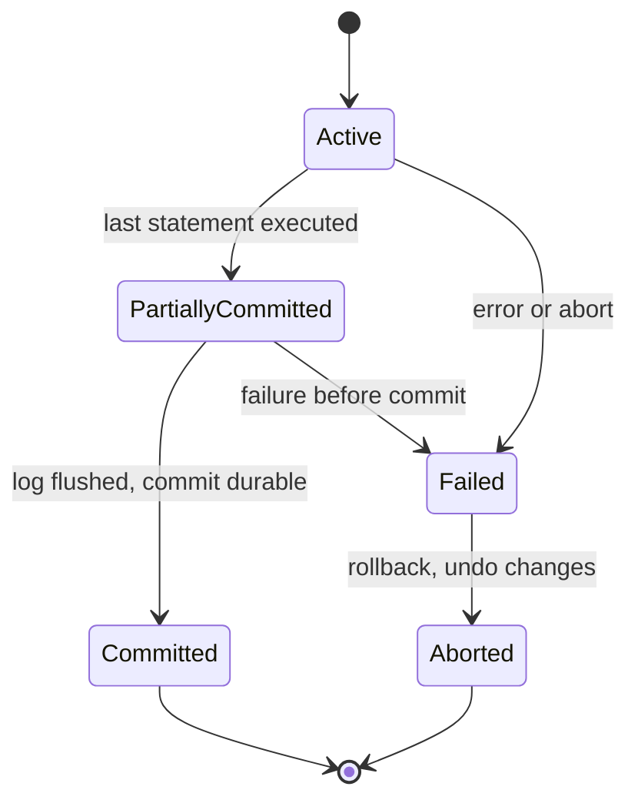
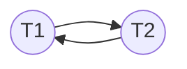
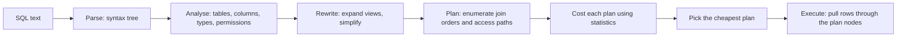
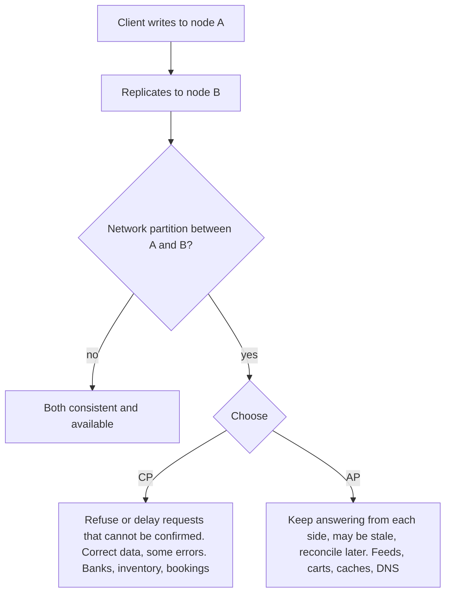

# Study Volume 2: DBMS and SQL

Second volume of the in-depth study set. Same template as Volume 1: the idea, how it works, a diagram, a worked example or runnable code, the loopholes where people go wrong, interview questions, and a **Revise in 30 seconds** box at the end of each topic. SQL examples use PostgreSQL syntax, with notes where MySQL differs.

## Contents of this volume

- Part 1: DBMS fundamentals, architecture, keys, relational algebra, ER modelling
- Part 2: Normalisation and functional dependencies, with worked problems
- Part 3: Transactions, ACID, isolation levels, anomalies, serializability, locking, MVCC, recovery
- Part 4: Indexing, B+ trees, query processing, EXPLAIN, join algorithms
- Part 5: SQL in depth on one sample database, with expected outputs
- Part 6: SQL vs NoSQL, CAP, and how to choose

Parts 1 and 2 are in this first section, and the rest follow below.

## Part 1: DBMS fundamentals

### 1.1 What a DBMS gives you over files

**The idea.** A **database** is an organised collection of data. A **DBMS** (database management system) is the software that stores it, controls access and answers queries. If you keep data in plain files, every program must re-implement storage format, searching, concurrent access, crash recovery and security. A DBMS provides these once, properly:

- **Reduced redundancy and inconsistency**, because data lives in one place.
- **Integrity constraints** (types, keys, foreign keys, checks) enforced centrally.
- **Concurrent access** with isolation, so two users do not corrupt each other's work.
- **Atomic updates and crash recovery** through transactions and logs.
- **Declarative querying** (SQL says what you want, the optimiser decides how).
- **Security** (users, roles, privileges) and **data independence** (change storage without rewriting programs).

**Three-schema architecture and data independence.**

```text
  View level        what each user sees        (views, per-role subsets)
       |  external/conceptual mapping
  Logical level     tables, columns, keys      (the schema you design)
       |  conceptual/internal mapping
  Physical level    files, pages, indexes      (how bytes are stored)
```

- **Logical data independence:** change the logical schema (add a column) without breaking existing views and programs.
- **Physical data independence:** change storage (add an index, move a file) without changing the logical schema. This is why adding an index never requires changing a query.

### 1.2 Inside a DBMS



- Data is stored in fixed-size **pages** (commonly 8 KB). The **buffer pool** caches hot pages in RAM, since disk is thousands of times slower. Reading a row means reading its whole page.
- **Row stores** (PostgreSQL, MySQL) keep all columns of a row together, ideal for OLTP (many small reads and writes). **Column stores** (ClickHouse, Redshift, Parquet) keep each column together, ideal for OLAP (scanning a few columns across millions of rows, with strong compression).
- **OLTP** = many short transactions, normalised schema, correctness first. **OLAP** = few heavy analytical queries, denormalised or star schema, throughput first.

**Loophole.** Saying 'the database reads one row' is not how it works physically: it reads a page. This is why index design, row width and locality matter.

### 1.3 Keys, with one running example

Take `Employee(emp_id, email, ssn, name, dept_id, phone)`.

- **Super key:** any set of attributes that uniquely identifies rows. `{emp_id}`, `{emp_id, name}`, `{email}`, `{ssn, phone}` are all super keys. There are many.
- **Candidate key:** a *minimal* super key (remove any attribute and uniqueness is lost). `{emp_id}`, `{email}`, `{ssn}` are candidate keys. `{emp_id, name}` is not minimal.
- **Primary key:** the one candidate key you choose as the main identifier. It cannot be NULL and is unique. Say `emp_id`.
- **Alternate key:** candidate keys not chosen as primary (`email`, `ssn`). Declare them `UNIQUE NOT NULL`.
- **Foreign key:** attributes referencing a key of another (or the same) table, enforcing **referential integrity** (`dept_id` must exist in `Department`). Actions on delete or update of the parent: `CASCADE`, `SET NULL`, `RESTRICT` or `NO ACTION`.
- **Composite key:** a key made of several attributes (`{student_id, course_id}` in an enrolment table).
- **Surrogate key:** an artificial identifier with no business meaning (auto-increment id, UUID). **Natural key:** a real-world attribute (email, ISBN). Surrogate keys are stable, natural keys can change (people change emails).

**Loopholes.**

- A `UNIQUE` column may allow **multiple NULLs** (PostgreSQL and MySQL do, SQL Server allows only one). A primary key never allows NULL.
- Using a mutable natural key as primary key forces cascading updates everywhere. Prefer a surrogate primary key plus a unique constraint on the natural key.
- Random UUIDv4 primary keys scatter inserts across a B+ tree (page splits, poor cache locality). Time-ordered ids (UUIDv7, ULID, bigint sequences) index better.

**Constraints:** `NOT NULL`, `UNIQUE`, `PRIMARY KEY`, `FOREIGN KEY`, `CHECK (salary > 0)`, `DEFAULT`. Put rules in the database whenever you can, because application-level checks can be bypassed and cannot see concurrent requests (see TOCTOU in Volume 1).

### 1.4 Relational model and relational algebra

A **relation** is a table: a set of tuples (rows) over named attributes (columns). Properly a relation is a *set*, so no duplicate rows and no row order, whereas SQL tables are *bags* unless you use `DISTINCT` and a key.

| Operator | Symbol | SQL equivalent |
| --- | --- | --- |
| Selection | sigma(condition)(R) | `WHERE` |
| Projection | pi(columns)(R) | `SELECT col1, col2` (with `DISTINCT` for set semantics) |
| Union, intersection, difference | R union S, ... | `UNION`, `INTERSECT`, `EXCEPT` |
| Cartesian product | R x S | `CROSS JOIN` |
| Join | R join S | `JOIN ... ON` |
| Rename | rho | `AS` |
| Division | R / S | 'for all' queries, written with double `NOT EXISTS` or `GROUP BY ... HAVING COUNT` |

Worked idea for **division** (a classic): 'find students who took *every* course in a set'. In SQL: group the enrolments by student and keep those whose count of distinct required courses equals the size of the required set.

```sql
SELECT student_id
FROM enrolments
WHERE course_id IN (SELECT course_id FROM required_courses)
GROUP BY student_id
HAVING COUNT(DISTINCT course_id) = (SELECT COUNT(*) FROM required_courses);
```

### 1.5 ER modelling and conversion to tables

**Concepts:** entity (thing), attribute (property, may be composite, multivalued or derived), relationship (association), cardinality (1:1, 1:N, M:N), participation (total means every entity must take part, partial means optional), **weak entity** (cannot be identified by its own attributes, depends on an owner and has a partial key).



**Conversion rules:**

1. Each strong entity becomes a table, its key becomes the primary key.
2. **1:N:** put the foreign key on the 'many' side.
3. **M:N:** create a **junction table** holding both foreign keys (as a composite primary key or with its own id) plus any attributes of the relationship. In the diagram, `APPOINTMENT` is the M:N between patients and doctors, with extra attributes `starts_at` and `status`.
4. **1:1:** put a foreign key with a `UNIQUE` constraint on either side (usually the side with total participation), or merge the tables.
5. **Weak entity:** table whose primary key is the owner's key plus its partial key, with a foreign key to the owner (cascade delete).
6. **Multivalued attribute:** its own table (`employee_phone(emp_id, phone)`).
7. **Inheritance (ISA):** single table with a type column, one table per subclass, or one table per concrete class. Trade-off between NULL-heavy rows and joins.

**Loophole:** do not put a repeating group in one column ('phones: 123, 456'). It breaks first normal form, cannot be indexed or constrained, and is painful to query.

### Interview questions on fundamentals

- **Super key, candidate key, primary key?** Any unique set, minimal unique set, the chosen minimal set which is not NULL.
- **Why use a surrogate key?** Stability and compact joins, with a unique constraint still protecting the natural key.
- **Row store vs column store?** Row for OLTP point access, column for analytics scanning few columns.
- **How do you model a many-to-many relationship?** A junction table with two foreign keys, composite primary key or its own id.
- **What is referential integrity and what does `ON DELETE CASCADE` do?** A foreign key must point to an existing parent. Cascade deletes children when the parent goes, which is convenient and dangerous on large trees.

### Revise in 30 seconds: DBMS fundamentals

- DBMS = integrity, concurrency, recovery, declarative queries, security, data independence. Data is read in pages through a buffer pool.
- Super key (unique), candidate (minimal), primary (chosen, not NULL), alternate, foreign (referential integrity), composite, surrogate.
- Relational algebra: select (`WHERE`), project (`SELECT`), join, set ops, division (for-all queries).
- ER to tables: 1:N foreign key on many side, M:N junction table, weak entity key = owner key + partial key, multivalued attribute = own table.
- Row store for OLTP, column store for OLAP.

## Part 2: Normalisation

### 2.1 Why normalise: the three anomalies

Start with one badly designed table:

| student\_id | student\_name | course\_id | course\_name | instructor | grade |
| --- | --- | --- | --- | --- | --- |
| 1 | Asha | C1 | Databases | Dr. Rao | A |
| 1 | Asha | C2 | Networks | Dr. Iyer | B |
| 2 | Bala | C1 | Databases | Dr. Rao | B |

The student's name is repeated for every course, and the course's name and instructor for every student. That redundancy causes:

- **Update anomaly:** change Dr. Rao's name and you must edit many rows. Miss one and the data contradicts itself.
- **Insertion anomaly:** you cannot record a new course that nobody has enrolled in yet (no student\_id for the row).
- **Deletion anomaly:** if Bala drops C1, you may lose the only record that course C1 is taught by Dr. Rao (if he was its only row).

Normalisation removes these by splitting the data into tables where each fact is stored once.

### 2.2 Functional dependencies and closure

A **functional dependency** `X -> Y` means: any two rows that agree on X also agree on Y (X determines Y). Examples: `student_id -> student_name`, `course_id -> course_name, instructor`, `{student_id, course_id} -> grade`.

**Armstrong's axioms** generate all implied dependencies: *reflexivity* (if Y is a subset of X then X -> Y), *augmentation* (X -> Y implies XZ -> YZ), *transitivity* (X -> Y and Y -> Z imply X -> Z). Derived rules: union, decomposition, pseudo-transitivity.

**Attribute closure `X+`** is the set of all attributes determined by X. It is the main tool for finding keys and testing normal forms.

**Worked example.** `R(A, B, C, D, E, F)` with `A -> B`, `B -> C`, `C -> D`, `DE -> F`.

```text
A+  : start {A}; A->B gives {A,B}; B->C gives {A,B,C}; C->D gives {A,B,C,D}.  DE->F needs E, so stop. A+ = {A,B,C,D}
AE+ : {A,E} -> {A,B,C,D,E} (as above plus E) -> DE->F gives F -> {A,B,C,D,E,F} = all attributes
```

To find the **candidate keys**: attributes that never appear on the right side of any dependency (here A and E) must be in every key. `AE+` is everything, so `AE` is the only candidate key. A quick routine: (1) list attributes never on a right-hand side, (2) compute their closure, (3) if not everything, add more attributes and repeat.

**Minimal (canonical) cover:** a smallest equivalent set of dependencies: right sides are single attributes, no extraneous left-side attribute, no redundant dependency. Used by the 3NF synthesis algorithm.

### 2.3 The normal forms, with a test for each

- **1NF:** every column holds a single atomic value, and there are no repeating groups. A column `phones = '123, 456'` violates it. Fix: one row per phone, or a child table.
- **2NF:** 1NF and **no partial dependency**: no non-prime attribute depends on *part* of a candidate key. It only matters when a key is composite. In the table above, with key `{student_id, course_id}`, `student_name` depends only on `student_id`: a partial dependency. Fix: move it to a `student` table.
- **3NF:** 2NF and **no transitive dependency**: for every non-trivial `X -> A`, either X is a super key, or A is a **prime** attribute (part of some candidate key). Informally: every non-key attribute depends on *the key, the whole key and nothing but the key*.
- **BCNF (Boyce-Codd):** for every non-trivial `X -> A`, **X must be a super key**. Stricter than 3NF: it drops the 'or A is prime' escape.
- **4NF** removes non-trivial multivalued dependencies (a person with independent sets of skills and languages stored in one table creates a cross product of rows). **5NF** removes join dependencies not implied by keys. Both are rare in interviews, but know what they say.

**Worked problem 1: 3NF violation.** `R(A, B, C, D)`, `AB -> C`, `C -> D`. Key: `AB` (AB+ = ABCD). `C -> D` has C not a super key and D not prime, so R violates 3NF (and BCNF): D depends on C which depends on the key (transitive). Decompose: `R1(C, D)` with `C -> D`, and `R2(A, B, C)` with `AB -> C`. Common attribute C is the key of R1, so the join is **lossless**, and both dependencies live inside a table, so the decomposition is **dependency preserving**.

**Worked problem 2: in 3NF but not in BCNF.** `R(Student, Course, Teacher)`: a student takes a course with one teacher (`{Student, Course} -> Teacher`), and each teacher teaches exactly one course (`Teacher -> Course`). Candidate keys: `{Student, Course}` and `{Student, Teacher}`. The dependency `Teacher -> Course` violates BCNF (Teacher is not a super key), but Course is a prime attribute, so 3NF holds. BCNF decomposition: `R1(Teacher, Course)`, `R2(Student, Teacher)`. It is lossless, but **`{Student, Course} -> Teacher` can no longer be checked inside one table** without a join: dependency preservation is lost. This is the textbook trade-off: BCNF always gives lossless decomposition, may lose dependency preservation. 3NF always gives both.

**Lossless-join test for a binary decomposition of R into R1 and R2:** it is lossless iff `R1 intersect R2` determines all of R1 or all of R2 (the shared attributes form a key of one side).

### 2.4 Denormalisation: breaking the rules on purpose

Normalised designs need joins. For read-heavy paths you may deliberately duplicate data: store a computed `order_total`, a counter, a materialised summary table, or copy a customer's name onto each order for historical accuracy (the name at the time of the order). Costs: more complex writes, risk of drift, extra storage. Rules of thumb: normalise first, **measure**, denormalise only the proven hot path, and keep one source of truth with a job or trigger that refreshes the copy. A summary table refreshed by a background job from the main tables is a controlled denormalisation.

### Loopholes and common wrong answers

- 'BCNF is always better than 3NF' ignores dependency preservation.
- 2NF is only violated with composite keys. A table whose key is a single column is automatically in 2NF if it is in 1NF.
- Normal forms are about **dependencies**, not about 'having many tables'. You cannot assess a table's normal form without knowing its functional dependencies, which come from the business rules, not from the data you see.
- A table can look fine on sample data and still violate a dependency that the business rule demands. Dependencies are constraints, not observations.
- Over-normalising hurts: splitting a one-to-one address into its own table for no reason just adds joins.

### Interview questions

- **Explain 1NF, 2NF, 3NF, BCNF with one example.** Use the student, course, instructor table: atomic values, then remove partial dependencies, then transitive dependencies, then require every determinant to be a super key.
- **Difference between 3NF and BCNF?** 3NF lets a dependency through if its right side is a prime attribute. BCNF requires the left side to be a super key. BCNF may lose dependency preservation.
- **How do you find candidate keys?** Attributes never on a right-hand side must be included, compute closure, add attributes until the closure is everything.
- **What is a lossless join decomposition?** Joining the pieces gives back exactly the original rows, which holds if the shared attributes are a key of one side.
- **When would you denormalise?** A measured read bottleneck where a join or aggregate dominates, keeping a refresh mechanism so the copy stays correct.

### Revise in 30 seconds: normalisation

- Anomalies: update, insert, delete. FD `X -> Y`, closure `X+`, key = minimal set whose closure is everything.
- 1NF atomic. 2NF no partial dependency on part of a composite key. 3NF no transitive dependency (or RHS is prime). BCNF every determinant is a super key.
- Lossless: shared attributes form a key of one side. BCNF is always lossless but may lose dependency preservation. 3NF keeps both.
- Teacher -> Course example is the 3NF-not-BCNF case. Denormalise only on measured hot paths with a refresh mechanism.

## Part 3: Transactions and concurrency control

### 3.1 Transactions and ACID

**The idea.** A **transaction** is a group of operations treated as one logical unit: either all take effect or none do, and other transactions never see a half-finished state. The standard example is a bank transfer.

```sql
BEGIN;
UPDATE accounts SET balance = balance - 500 WHERE id = 1;   -- debit
UPDATE accounts SET balance = balance + 500 WHERE id = 2;   -- credit
COMMIT;                                                      -- or ROLLBACK on any error
```

If the server crashes after the debit but before the credit, the database must come back with **neither** applied.



**ACID, with how each is actually implemented:**

| Property | Meaning | Mechanism |
| --- | --- | --- |
| **Atomicity** | All or nothing | Undo information (undo log, old row versions), rollback on failure |
| **Consistency** | Moves from one valid state to another, respecting constraints | Constraints, triggers, plus correct application logic. The database enforces rules you declare. |
| **Isolation** | Concurrent transactions behave as if run one after another | Locks or MVCC, controlled by the isolation level |
| **Durability** | Committed data survives crashes | Write-ahead log flushed to disk before commit is acknowledged |

**Loopholes.**

- Consistency is the odd one out: A, I and D are guaranteed by the engine, but C depends on **you** declaring constraints. An app-level 'balance must not go negative' without a `CHECK` constraint is not enforced when another client writes directly.
- **Autocommit:** by default many clients run each statement as its own transaction. Two separate statements are two transactions, not atomic together.
- ACID does not mean 'no concurrency problems' unless the isolation level is Serializable. The default levels allow some anomalies (3.2).
- A long-lived open transaction is harmful: it holds locks, blocks cleanup of old row versions (table bloat in PostgreSQL), and can stall the system. Keep transactions short and never wait on a user or an external API inside one.

### 3.2 Concurrency anomalies and isolation levels

When transactions overlap, several things can go wrong. Each one below comes with the interleaving that produces it. Time runs downward.

**Dirty read:** reading another transaction's **uncommitted** change, which may later roll back.

```text
A: UPDATE accounts SET balance = 0 WHERE id = 1;   (not committed)
B: SELECT balance FROM accounts WHERE id = 1;      -> 0   (dirty: A may roll back)
A: ROLLBACK;
```

**Non-repeatable read:** the same row read twice in one transaction gives different values, because someone else committed in between.

```text
A: BEGIN; SELECT balance WHERE id = 1;   -> 100
B: UPDATE ... SET balance = 50 WHERE id = 1; COMMIT;
A: SELECT balance WHERE id = 1;          -> 50   (changed under A's feet)
```

**Phantom read:** the same *range query* returns different rows, because someone inserted or deleted matching rows.

```text
A: BEGIN; SELECT COUNT(*) FROM employees WHERE dept_id = 1;   -> 3
B: INSERT INTO employees (..., dept_id) VALUES (..., 1); COMMIT;
A: SELECT COUNT(*) FROM employees WHERE dept_id = 1;          -> 4   (a phantom row)
```

**Lost update:** two transactions read, modify and write the same value, and one overwrites the other.

```text
A: SELECT balance -> 100       B: SELECT balance -> 100
A: balance = 100 + 10 = 110    B: balance = 100 + 30 = 130
A: UPDATE SET balance = 110; COMMIT
                               B: UPDATE SET balance = 130; COMMIT     final 130, correct is 140
```

**Write skew:** two transactions read overlapping data, each makes a decision from what it read, and each writes *different* rows, so no write-write conflict is detected, yet the combined result breaks a rule. Classic: a hospital requires at least one doctor on call.

```text
A: SELECT COUNT(*) FROM doctors WHERE on_call = true;   -> 2      B: same query -> 2
A: 2 > 1, so I can leave:  UPDATE doctors SET on_call = false WHERE id = 1;
                                                         B: 2 > 1, so I can leave: UPDATE ... WHERE id = 2;
A: COMMIT;                                               B: COMMIT;       -> zero doctors on call
```

**The standard isolation levels** (what each prevents, per the SQL standard):

| Level | Dirty read | Non-repeatable read | Phantom |
| --- | --- | --- | --- |
| Read Uncommitted | possible | possible | possible |
| Read Committed | prevented | possible | possible |
| Repeatable Read | prevented | prevented | possible (by the standard) |
| Serializable | prevented | prevented | prevented |

**What real databases actually do (important, textbooks hide this):**

- **PostgreSQL:** Read Uncommitted behaves as Read Committed (no dirty reads ever). **Read Committed** (the default): each *statement* sees a fresh snapshot of committed data. **Repeatable Read** is **snapshot isolation**: the whole transaction sees one snapshot, so no phantoms, but **write skew is still possible**, and a concurrent update of the same row aborts you with a serialization error. **Serializable** uses SSI (serializable snapshot isolation), detects dangerous patterns and aborts one transaction with error `40001`, so **you must retry**.
- **MySQL InnoDB:** the default is **Repeatable Read**, with consistent snapshot reads, and next-key (gap) locks for locking reads to block phantoms. Read Uncommitted truly allows dirty reads.
- Higher isolation costs throughput (more blocking or more aborts), so use the **weakest level that is correct** for each operation.

**Fixes for lost update and write skew, in order of preference:**

1. **Atomic update:** `UPDATE accounts SET balance = balance + 10 WHERE id = 1` (the read-modify-write happens inside the database).
2. **Optimistic locking** with a version column (3.5).
3. **Pessimistic row lock:** `SELECT ... FOR UPDATE` inside the transaction, so the second transaction waits.
4. **Serializable isolation** plus retry. This also handles write skew.
5. For write skew specifically: lock the rows the decision reads (`SELECT ... FOR UPDATE` on all on-call doctors), or turn the rule into a database constraint or a single guarded update.

### 3.3 Schedules and serializability

A **schedule** is an interleaving of the operations of several transactions. A **serial** schedule runs them one at a time (always correct, slow). A schedule is **serializable** if its result equals that of some serial schedule. Two operations **conflict** if they belong to different transactions, touch the same item, and at least one is a write (read-write, write-read, write-write).

**Conflict serializability test: the precedence graph.** Draw a node per transaction. For each conflicting pair where Ti's operation comes first, add an edge Ti to Tj. **A cycle means not conflict serializable. No cycle means serializable**, and a topological order of the graph is an equivalent serial order.

**Worked example A (serializable).** `R1(A) W1(A) R2(A) W2(A) R1(B) W1(B) R2(B) W2(B)`. On item A, T1 operates before T2 (T1 to T2). On item B, T1 operates before T2 again (T1 to T2). The graph has the single edge T1 to T2, no cycle, so it is equivalent to running T1 then T2.

**Worked example B (not serializable, the lost update).** `R1(A) R2(A) W1(A) W2(A)`. Conflicts: `R1(A)` before `W2(A)` gives T1 to T2. `R2(A)` before `W1(A)` gives T2 to T1. The two edges form a **cycle**, so the schedule is not serializable. No serial order could give it.



**View serializability** is a weaker, more general condition (same reads-from relationships and same final writes). Every conflict-serializable schedule is view serializable, but not conversely, and testing it is NP-complete, so databases use conflict serializability.

**Recoverability (what happens when a transaction aborts):**

- **Recoverable:** a transaction commits only after every transaction it read from has committed.
- **Cascadeless (ACA):** transactions read only committed data, so an abort never forces others to abort.
- **Strict:** no transaction reads *or overwrites* an item written by an uncommitted one. Strict schedules make rollback simple (restore the old value). Strict 2PL produces them.

### 3.4 Concurrency control mechanisms

**Locking basics.** **Shared (S)** lock for reading (many allowed together), **exclusive (X)** lock for writing (one only). Compatibility: S with S is fine, anything with X conflicts. **Intention locks** (IS, IX) on a table announce 'I will lock some rows inside', so a table-level lock request can be checked quickly without scanning row locks.

| held \\ requested | IS | IX | S | X |
| --- | --- | --- | --- | --- |
| IS | yes | yes | yes | no |
| IX | yes | yes | no | no |
| S | yes | no | yes | no |
| X | no | no | no | no |

**Two-phase locking (2PL):** every transaction has a **growing phase** (acquire locks, never release) then a **shrinking phase** (release, never acquire). 2PL guarantees conflict serializability. Variants: **strict 2PL** (hold exclusive locks until commit or abort, gives strict schedules) and **rigorous 2PL** (hold all locks until the end). The cost: blocking and **deadlocks** (handled by detection, Volume 1 Part 6).

**Timestamp ordering:** each transaction gets a timestamp, each item remembers the last read and write timestamps, and an operation that would violate timestamp order aborts its transaction. No blocking, no deadlocks, but more aborts.

**MVCC (multi-version concurrency control).** Instead of overwriting, the database keeps several **versions** of a row. A reader uses a **snapshot** and sees the versions that were committed when its snapshot was taken, so **readers do not block writers and writers do not block readers**. Writers still conflict with each other.

```text
PostgreSQL row version metadata:  xmin = transaction that created this version
                                  xmax = transaction that deleted/replaced it (0 if still live)
UPDATE = insert a NEW version + set xmax on the old one.   A snapshot sees a version if
         xmin is committed and visible to it, and xmax is not.
Old versions are removed later by VACUUM.  Heavy updates without vacuum => table bloat.
InnoDB stores old versions in the undo log instead and rebuilds them on demand.
```

**Optimistic vs pessimistic concurrency control:** pessimistic (locks) assumes conflicts are common. Optimistic (version checks) lets transactions proceed and validates at commit, retrying on conflict. Optimistic is great when conflicts are rare, bad when they are frequent (wasted work).

### 3.5 Locking and concurrency patterns in SQL, copy-ready

**Pattern 1: atomic update (best when it fits).**

```sql
UPDATE accounts SET balance = balance - 500 WHERE id = 1 AND balance >= 500;
-- affected rows = 0  means insufficient funds (check the row count)
```

**Pattern 2: optimistic locking with a version column.**

```sql
UPDATE tasks SET title = 'New title', version = version + 1
WHERE id = 42 AND version = 7;          -- 7 is the version you read
-- 0 rows updated: someone changed it first. Reload and retry, or return HTTP 409 Conflict.
```

**Pattern 3: pessimistic row lock.**

```sql
BEGIN;
SELECT balance FROM accounts WHERE id = 1 FOR UPDATE;   -- other writers (and FOR UPDATE readers) wait
UPDATE accounts SET balance = balance - 500 WHERE id = 1;
COMMIT;
```

**Pattern 4: a job queue that many workers share (`SKIP LOCKED`).**

```sql
BEGIN;
SELECT id, payload FROM jobs
WHERE status = 'pending'
ORDER BY id LIMIT 1
FOR UPDATE SKIP LOCKED;                  -- skip rows other workers already locked, do not wait
-- process the job, then
UPDATE jobs SET status = 'done' WHERE id = :id;
COMMIT;
```

**Pattern 5: claim a slot or seat exactly once** (the compare-and-swap from Volume 1, in SQL):

```sql
UPDATE slots SET status = 'held', held_until = now() + interval '10 minutes'
WHERE id = :id AND status = 'free';       -- rowcount 1 = you got it, 0 = someone else did
```

**Pattern 6: retry on serialization failures and deadlocks.** PostgreSQL error codes `40001` (serialization failure) and `40P01` (deadlock detected) mean 'retry the whole transaction'.

```python
import time, random

RETRYABLE = {'40001', '40P01'}

def run_tx(connect, work, attempts=5):
    for i in range(attempts):
        conn = connect()
        try:
            with conn:                         # commits on success, rolls back on exception
                return work(conn)
        except Exception as e:
            code = getattr(e, 'pgcode', None) or getattr(e, 'sqlstate', None)
            if code in RETRYABLE and i < attempts - 1:
                time.sleep(random.uniform(0, 0.05 * 2 ** i))   # exponential backoff with jitter
                continue
            raise
        finally:
            conn.close()
```

**Loopholes.**

- `SELECT ... FOR UPDATE` only locks rows that **exist**. It cannot stop someone inserting a new row (a phantom). For 'insert if not exists' use a **unique constraint** and handle the duplicate-key error, or `INSERT ... ON CONFLICT DO NOTHING`.
- Lock ordering matters in the database too: lock rows in a consistent order (by primary key) to avoid deadlocks.
- Doing `SELECT` then `UPDATE` in one transaction at Read Committed does **not** prevent a lost update. It needs a row lock, an atomic update, a version check or a higher isolation level.
- Always check **affected row counts** after conditional updates.
- A retry must re-run the **entire** transaction including the reads, not just the failed statement.

### 3.6 Recovery and durability: the write-ahead log

**The problem.** Writing every change to the data file at commit time would be slow (random disk writes) and unsafe if the crash hits halfway. Databases instead keep changes in memory (the buffer pool) and write a sequential **log** first.

**Write-ahead logging (WAL) rule:** a log record describing a change must reach disk **before** the changed data page does, and a transaction counts as committed only after its commit record is **flushed to the log on disk** (`fsync`). Sequential log writes are fast, and data pages are written lazily in the background.

**Buffer policies that shape recovery:**

- **STEAL:** the buffer manager may write dirty pages of *uncommitted* transactions to disk (to free memory). So after a crash you must **undo** them.
- **NO-FORCE:** dirty pages are *not* forced to disk at commit. So after a crash you must **redo** committed changes that were only in memory.
- STEAL plus NO-FORCE (what practical systems use) needs both redo and undo, hence undo/redo logging.

**ARIES recovery (the industry-standard algorithm), three passes after a crash:**

1. **Analysis:** read the log from the last checkpoint to rebuild which transactions were active and which pages were dirty.
2. **Redo:** replay the log forward, reapplying every change whose effect is missing from the page (compared using log sequence numbers, **LSNs**). This 'repeats history', including changes of transactions that will be undone.
3. **Undo:** roll back the transactions that had not committed, writing **compensation log records** so a crash during recovery is also safe.

**Checkpoints** periodically record the state so recovery does not need to read the log from the beginning. **Group commit** batches several transactions' commit records into one disk flush for throughput.

**Loopholes.**

- Durability depends on actually flushing to stable storage. Disabling `fsync` (or `synchronous_commit` in PostgreSQL) makes commits fast and risks losing recent commits on a crash. Some systems offer this on purpose for speed.
- The log is also what **replication** ships to replicas (physical or logical replication), and what point-in-time recovery replays on top of a backup. Backups without tested restores are a hope, not a plan.
- A write-ahead log is the same idea as the outbox and event-log patterns you use at application level: record the intent durably first, apply it afterwards.

### Interview questions on transactions

- **Explain ACID with an example.** Bank transfer: both updates or neither (A), no negative balance (C), no half-done transfer visible to others (I), survives a crash after commit (D).
- **Which anomalies does each isolation level prevent?** The table above. Add that PostgreSQL's Repeatable Read is snapshot isolation (no phantoms, write skew possible) and MySQL's default is Repeatable Read.
- **What is a lost update and how do you prevent it?** Overwritten read-modify-write. Atomic update, optimistic version column, `FOR UPDATE`, or serializable with retry.
- **What is write skew?** Decisions based on overlapping reads, writes to different rows, an invariant broken. Needs serializable isolation, locking the read rows, or a constraint.
- **How does MVCC let readers not block writers?** Keeps multiple row versions and gives each transaction a snapshot.
- **What is 2PL and why strict 2PL?** Grow then shrink locks guarantees serializability. Holding write locks to commit prevents cascading aborts.
- **How does the database survive a crash?** WAL: log flushed before commit is acknowledged, redo committed work, undo uncommitted work (ARIES).
- **How do you handle a deadlock error in your application?** Catch the specific error, roll back, retry the whole transaction with backoff.

### Revise in 30 seconds: transactions

- ACID: atomicity (undo), consistency (constraints you declared), isolation (locks or MVCC), durability (WAL flushed at commit).
- Anomalies: dirty read, non-repeatable read, phantom, lost update, write skew. Standard levels RU, RC, RR, Serializable. PostgreSQL RR = snapshot isolation (write skew possible), Serializable needs retry on `40001`.
- Fixes: atomic update, version column, `FOR UPDATE`, `SKIP LOCKED` for queues, unique constraints for insert-if-absent, serializable plus retry.
- Serializable test: precedence graph, cycle means not serializable. 2PL guarantees it, strict 2PL avoids cascading aborts. MVCC: readers and writers do not block each other.
- Recovery: write-ahead log, steal plus no-force means undo and redo, ARIES = analysis, redo, undo. Deadlock: detect, abort victim, retry.

## Part 4: Indexing and query processing

### 4.1 Why indexes exist

Without an index, finding rows where `user_id = 7` means reading **every page** of the table (a sequential or **full table scan**), which costs O(N) page reads. An **index** is a separate sorted structure that maps column values to row locations, so the database jumps straight to the matching rows. The usual structure is a **B+ tree**, which finds a row in a handful of page reads even in a table of hundreds of millions of rows.

The price: every index takes disk space and must be updated on every `INSERT`, `UPDATE` of an indexed column and `DELETE`. Indexes speed up reads and slow down writes.

### 4.2 B+ trees in depth

**Structure.**

- A balanced tree where all leaves are at the same depth, and each node is one **disk page** holding many keys (a node is wide, not binary).
- **Internal nodes** store only keys and child pointers, to guide the search. **Leaf nodes** store the keys together with the row pointers (or the rows themselves in a clustered index).
- Leaves are linked in a **sorted linked list**, so range scans and `ORDER BY` follow the chain without going back up the tree.
- Every node (except the root) is at least half full, which keeps the tree shallow and space efficient.

**Why so shallow: fanout.** An 8 KB page holding keys of 8 bytes plus pointers of 8 bytes fits roughly 500 entries, so the **fanout is about 500**. Height 3 addresses about 500^3 = 125 million keys, height 4 about 62 billion. So a lookup in a huge table is **3 to 4 page reads**, and the top levels are always cached in memory, so often only 1 or 2 real disk reads.

**Operations and cost.** Search, insert and delete are all O(log\_f N) page accesses, where f is the fanout. Range query: find the start key (O(log N)), then walk the leaves.

**Worked insertion example (max 3 keys per node).** Insert 10, 20, 30, 40, 50, 60, 70, 80, 90, 100 in order:

```text
after 10,20,30:   leaf [10 20 30]
insert 40:        leaf overflows [10 20 30 40] -> split into [10 20] [30 40], copy up 30 to a new root [30]
insert 50:        goes to right leaf [30 40 50]
insert 60:        [30 40 50 60] overflows -> [30 40] [50 60], push up 50: root [30 50]
insert 70, 80:    [50 60 70 80] overflows -> [50 60] [70 80], push up 70: root [30 50 70]
insert 90, 100:   [70 80 90 100] overflows -> [70 80] [90 100], push up 90: root would be [30 50 70 90] = 4 keys, overflow!
                  split the root: left [30 50], middle key 70 moves up, right [90]. Tree grows one level.

final tree:                 [70]
                    /                 \
              [30 | 50]                [90]
             /    |     \              /    \
        [10 20] [30 40] [50 60]    [70 80]  [90 100]      leaves linked left to right
```

The tree grows **upward from the root** (all leaves stay at the same depth), which is why it stays balanced without rotations. Deletion removes a key from a leaf and, if the node falls below half full, **borrows** from a sibling or **merges** with it.

**Why B+ tree and not other structures:**

- **Binary search tree:** one key per node means about 30 levels for a billion keys, each a disk read. B+ trees pack hundreds of keys per page.
- **B tree:** stores row data in internal nodes too, so internal nodes hold fewer keys (lower fanout) and range scans are awkward. B+ trees keep internal nodes lean and leaves linked.
- **Hash index:** O(1) equality lookup but **no range queries and no ordering**. Good for pure key lookups only.
- **LSM trees** (RocksDB, Cassandra): turn random writes into sequential appends, fast writes, reads may check several levels. Used where write throughput dominates.

**Loopholes.**

- Random keys (UUIDv4) insert all over the tree, causing page splits and cache misses. Sequential keys append to the right edge (fast, but a hot spot under extreme concurrency).
- Page splits leave pages about half full, so indexes can bloat. Rebuild (`REINDEX`) after heavy churn.
- A B+ tree gives sorted order for free, so an index on the `ORDER BY` column can avoid a sort.

### 4.3 Index types and when to use them

- **Clustered index:** the table rows themselves are stored in the index order (leaf = the row). One per table. In MySQL InnoDB the primary key is the clustered index. A lookup by the clustered key goes straight to the row.
- **Non-clustered (secondary) index:** a separate tree whose leaves hold a pointer to the row. In PostgreSQL, all indexes are secondary and point to a tuple location in the heap. In InnoDB, secondary index leaves store the **primary key**, so a secondary lookup needs a second descent through the clustered index. This is one reason wide or random primary keys hurt InnoDB (every secondary index carries them).
- **Covering index (index-only scan):** the index contains every column the query needs, so the table is never touched. In PostgreSQL: `CREATE INDEX ... ON t (a) INCLUDE (b, c)`.
- **Composite (multi-column) index:** sorted by the first column, then the second within it, and so on, like a phone book sorted by last name then first name.
- **Unique index:** enforces uniqueness (this is how `UNIQUE` and primary keys are implemented).
- **Partial index:** indexes only rows matching a condition, small and fast: `CREATE INDEX ON slots (start_time) WHERE status = 'free'`.
- **Expression index:** `CREATE INDEX ON users (lower(email))` supports `WHERE lower(email) = ...`.
- **Other PostgreSQL types:** **GIN** (inverted index for full-text search, arrays, JSONB containment), **GiST** (geometric and range data), **BRIN** (tiny index for huge naturally ordered tables like logs by time), **hash**.

**The leftmost-prefix rule, with a worked example.** Index on `tasks (user_id, status, due_at)`:

| Query | Uses the index well? | Why |
| --- | --- | --- |
| `WHERE user_id = 1 AND status = 'open' ORDER BY due_at` | **Yes, ideal** | Equality on the first two, then already sorted by the third: no sort step |
| `WHERE user_id = 1` | Yes | Leading column matches |
| `WHERE user_id = 1 AND due_at > 100` | Partly | Seeks on `user_id`, but must scan across all statuses for the range |
| `WHERE status = 'open'` | **No (poorly)** | The leading column is missing, the tree is not sorted by status alone |
| `WHERE user_id = 1 AND status > 'a' AND due_at = 5` | Partly | After a **range** on the second column, the third cannot be used to seek |

**Design rule:** put **equality** columns first, then the **range or sort** column last. Order among equality columns by selectivity and query frequency. This is the shape of the `(user_id, status, due_at)` index in your TaskFlow design, so you can explain exactly which queries it serves.

**Selectivity (cardinality).** An index helps when the condition selects a small fraction of rows. An index on a boolean or a column with 3 distinct values is rarely used, because reading most of the table through the index (random page jumps) is slower than a sequential scan. Rough rule: below about 5 to 10 percent of rows returned, an index scan wins.

**When the database ignores your index (the usual reasons):**

- A **function or expression on the column**: `WHERE YEAR(created_at) = 2026`, `WHERE lower(email) = 'a@b.c'`. The condition is not **sargable** (search-ARGument-able). Rewrite as a range (`created_at >= '2026-01-01' AND created_at < '2027-01-01'`) or create an expression index.
- **Implicit type conversion**: comparing a string column to a number.
- **Leading wildcard**: `LIKE '%abc'`. A `LIKE 'abc%'` can use a B-tree, a leading `%` needs a trigram (`pg_trgm`) or full-text index.
- **Low selectivity** or a tiny table, where a scan is cheaper.
- **Stale statistics**, so the planner misjudges the row count (run `ANALYZE`).
- `OR` across different columns, `!=`, and `NOT IN` are often not index-friendly.

**See it with your own eyes (runnable, uses only Python's built-in SQLite):**

```python
import sqlite3, random, time

con = sqlite3.connect(':memory:')
con.execute('CREATE TABLE tasks (id INTEGER PRIMARY KEY, user_id INT, status TEXT, due_at INT)')
rows = [(random.randint(1, 1000), random.choice(['open', 'done']), random.randint(1, 10**6)) for _ in range(300000)]
con.executemany('INSERT INTO tasks (user_id, status, due_at) VALUES (?, ?, ?)', rows)

q = 'SELECT * FROM tasks WHERE user_id = 7 AND status = ? ORDER BY due_at'

def run(label):
    t = time.perf_counter()
    for _ in range(200): con.execute(q, ('open',)).fetchall()
    plan = con.execute('EXPLAIN QUERY PLAN ' + q, ('open',)).fetchall()
    print(label, round(time.perf_counter() - t, 3), 's for 200 queries')
    for p in plan: print('   ', p[-1])

run('no index   ')               # SCAN tasks + USE TEMP B-TREE FOR ORDER BY
con.execute('CREATE INDEX idx_tasks ON tasks (user_id, status, due_at)')
run('with index ')               # SEARCH tasks USING INDEX idx_tasks (user_id=? AND status=?), no temp b-tree
```

Expect the indexed run to be orders of magnitude faster, and the plan to change from `SCAN` to `SEARCH ... USING INDEX`, with the sort step disappearing because the index already provides the order.

### 4.4 Query processing and the optimiser



The **cost-based optimiser** estimates, for each candidate plan, the I/O and CPU cost, using **statistics** about each table (row count, number of distinct values, most common values, histograms). Wrong statistics lead to wrong estimates and bad plans. Command to refresh: `ANALYZE` (PostgreSQL), `ANALYZE TABLE` (MySQL). Standard heuristics: apply filters and projections as early as possible, choose a good join order, pick an index scan over a sequential scan when selective.

**Join algorithms:**

| Algorithm | How it works | Cost | Best when |
| --- | --- | --- | --- |
| **Nested loop** | For each row of the outer table, look for matches in the inner table | O(N x M), or O(N x log M) with an index on the inner join column | Small outer side, or indexed inner side (typical OLTP lookup by key) |
| **Hash join** | Build an in-memory hash table on the smaller input, stream the larger one and probe | O(N + M), needs memory (spills to disk if too big) | Large, unsorted inputs with an equality join |
| **Merge (sort-merge) join** | Sort both inputs on the join key, then merge them in one pass | O(N log N + M log M), or O(N + M) if already sorted (an index provides order) | Large inputs already sorted, or range-style joins |

**Reading `EXPLAIN` (PostgreSQL).** `EXPLAIN` shows the chosen plan, `EXPLAIN ANALYZE` actually **runs** the query and adds real timings (so wrap data-modifying statements in a transaction you roll back). An illustrative plan:

```text
Sort  (cost=1234.5..1240.2 rows=2300 width=64) (actual time=45.1..46.0 rows=2150 loops=1)
  Sort Key: due_at
  ->  Index Scan using idx_tasks on tasks  (cost=0.43..1100.0 rows=2300 width=64)
                                            (actual time=0.05..40.2 rows=2150 loops=1)
        Index Cond: ((user_id = 7) AND (status = 'open'::text))
  Planning Time: 0.2 ms     Execution Time: 46.5 ms
```

Read it bottom-up, innermost first. `cost=startup..total` is in the planner's abstract units, `rows` is the **estimate**, `actual rows` is the truth.

**What to look for:**

- **Estimated rows far from actual rows** (say 10 vs 100,000): stale statistics or correlated columns. Run `ANALYZE`.
- **`Seq Scan` on a big table with a very selective filter** (`Rows Removed by Filter` huge): a missing or unusable index.
- **`Sort` using external disk merge:** increase `work_mem`, or add an index that provides the order.
- **Nested loop with a large outer side and no index on the inner side:** add the index on the join column.
- **Many loops of a tiny query** (N+1 from the application): batch it with a join or an `IN` list.

### 4.5 Practical performance checklist and anti-patterns

- **N+1 queries:** one query for the list, then one per row for details. Fix with a join, an `IN (...)` batch, or the ORM's eager loading (`joinedload`, `selectinload`, `select_related`, Prisma `include`). It is the most common real-world slowness.
- **`SELECT *`:** reads and ships columns you do not need, and prevents index-only scans.
- **Offset pagination** (`OFFSET 100000`) scans and discards rows. Use **keyset pagination**: `WHERE id > :last_id ORDER BY id LIMIT 20`.
- **`COUNT(*)` on huge tables** is a scan in PostgreSQL (MVCC prevents a cheap exact count). Use estimates, a counter table, or filtered counts with an index.
- **Missing index on a foreign key column:** deletes on the parent table scan the child, and locks last longer. Index your foreign keys.
- **Too many indexes:** every one slows writes and uses memory. Drop unused indexes (look at `pg_stat_user_indexes`).
- **Long transactions and big batch updates:** break into chunks, to keep locks and WAL manageable.
- **Connection management:** each PostgreSQL connection is a process with real memory cost. Use a **connection pool** (PgBouncer or the driver's pool) and keep the pool size modest. Serverless platforms need pooling even more, since many short-lived instances can exhaust connections (this is why Prisma plus Neon pooling matters in your InventoryPro).
- **Measure, do not guess:** use `EXPLAIN ANALYZE` and slow-query logs (`log_min_duration_statement`, `pg_stat_statements`) before adding indexes.

### Interview questions on indexing

- **Why a B+ tree and not a binary tree or hash?** High fanout means few page reads, sorted leaves linked for range scans. Hash is equality-only.
- **Clustered vs non-clustered?** Clustered stores the rows in index order (one per table). Non-clustered is a separate structure pointing to the row, so a lookup may need a second step.
- **What is a covering index?** One that holds all columns a query needs, enabling an index-only scan.
- **Explain the leftmost-prefix rule.** A composite index is sorted by its first column then the next, so it helps filters that use a leading prefix of its columns.
- **Why might the database not use my index?** Function on the column, type mismatch, leading wildcard, low selectivity, stale statistics, tiny table.
- **How would you debug a slow query?** `EXPLAIN ANALYZE`, compare estimated and actual rows, check scans, joins and sorts, then add or change an index or rewrite the query, and measure again.
- **Indexes on a write-heavy table?** Each index adds write cost, keep only the ones justified by measured queries.

### Revise in 30 seconds: indexing and query processing

- B+ tree: balanced, wide pages (fanout about 500, height 3 to 4 for billions), data in linked sorted leaves, grows upward by splitting. Great for equality, range and ordering.
- Clustered = rows in index order (one per table). Secondary points to the row (InnoDB: to the primary key). Covering index avoids the table. Partial and expression indexes for targeted cases.
- Composite index: equality columns first, then range or sort. Leftmost prefix. Selectivity decides if an index is worth it.
- Not sargable: function on column, leading `%`, type cast. Fix with ranges, expression indexes, trigram indexes.
- Optimiser is cost-based on statistics. Joins: nested loop (indexed small), hash (big unsorted equality), merge (sorted). Read `EXPLAIN ANALYZE`: estimated vs actual rows, seq scans, sorts, loops.
- Watch for N+1, `SELECT *`, offset pagination, missing foreign key indexes, too many indexes.

## Part 5: SQL in depth, on one sample database

Every query below runs against the same small database, and the expected results are written out so you can check your understanding. Run the setup in PostgreSQL (or any recent SQL engine, a few features noted) and try each query yourself.

```sql
CREATE TABLE departments (id INT PRIMARY KEY, name TEXT NOT NULL);
CREATE TABLE employees (
  id INT PRIMARY KEY, name TEXT NOT NULL,
  dept_id INT REFERENCES departments(id),
  salary INT NOT NULL,
  manager_id INT REFERENCES employees(id)
);
INSERT INTO departments VALUES (1,'Engineering'), (2,'Sales'), (3,'HR'), (4,'Legal');
INSERT INTO employees VALUES
  (1,'Asha',1,120,NULL), (2,'Bala',1,100,1), (3,'Chen',1,90,1),
  (4,'Dina',2,80,1),    (5,'Eli',2,80,4),   (6,'Farah',2,60,4),
  (7,'Gita',NULL,70,6);
```

| id | name | dept\_id | salary | manager\_id |
| --- | --- | --- | --- | --- |
| 1 | Asha | 1 | 120 | NULL |
| 2 | Bala | 1 | 100 | 1 |
| 3 | Chen | 1 | 90 | 1 |
| 4 | Dina | 2 | 80 | 1 |
| 5 | Eli | 2 | 80 | 4 |
| 6 | Farah | 2 | 60 | 4 |
| 7 | Gita | NULL | 70 | 6 |

Departments: 1 Engineering, 2 Sales, 3 HR, 4 Legal. Note the two deliberate traps in the data: **Gita has no department (NULL)**, and **HR and Legal have no employees**.

### 5.1 Logical order of execution

You write `SELECT` first, but the database logically processes clauses in this order, which explains most 'why can't I use that here' errors:

```text
1 FROM / JOIN      build the row set
2 WHERE            filter rows (cannot use aggregates or SELECT aliases)
3 GROUP BY         form groups
4 HAVING           filter groups (can use aggregates)
5 SELECT           compute expressions, window functions, aliases appear here
6 DISTINCT
7 ORDER BY         can use SELECT aliases
8 LIMIT / OFFSET
```

Consequences: a `SELECT` alias cannot be used in `WHERE` or `GROUP BY` (in standard SQL), a window function cannot be filtered in `WHERE` (wrap it in a subquery or CTE), and `WHERE` filters rows *before* grouping while `HAVING` filters *after*.

### 5.2 Joins, with the exact results

```sql
SELECT e.name, d.name AS dept FROM employees e JOIN departments d ON d.id = e.dept_id ORDER BY e.id;
```

**INNER JOIN** returns 6 rows (Asha, Bala, Chen in Engineering, Dina, Eli, Farah in Sales). **Gita is missing** because her `dept_id` is NULL and NULL never equals anything.

```sql
SELECT e.name, d.name AS dept FROM employees e LEFT JOIN departments d ON d.id = e.dept_id ORDER BY e.id;
```

**LEFT JOIN** returns all 7 employees, and Gita appears with `dept = NULL`. Use a left join whenever you must keep every row of the left table.

```sql
-- count employees per department, including empty departments
SELECT d.name, COUNT(*) AS wrong_count, COUNT(e.id) AS right_count
FROM departments d LEFT JOIN employees e ON e.dept_id = d.id
GROUP BY d.name ORDER BY d.name;
```

| name | wrong\_count | right\_count |
| --- | --- | --- |
| Engineering | 3 | 3 |
| HR | **1** | **0** |
| Legal | **1** | **0** |
| Sales | 3 | 3 |

**The loophole:** `COUNT(*)` counts rows, and the left join manufactures one all-NULL row for an empty department, so it reports 1. `COUNT(e.id)` counts non-NULL values, so it correctly reports 0.

**Join types in one list:** `INNER` (matches only), `LEFT` (all left rows), `RIGHT` (mirror), `FULL OUTER` (all rows of both), `CROSS` (every combination, N times M rows), **self join** (a table joined to itself via aliases, for hierarchies and comparisons), **anti join** (`LEFT JOIN ... WHERE right.id IS NULL` or `NOT EXISTS`) and **semi join** (`EXISTS`).

**Where a filter goes matters in outer joins.** `LEFT JOIN d ON ... WHERE d.name = 'Sales'` turns the left join into an inner join (the NULL rows fail the filter). To filter the right side while keeping all left rows, put the condition in `ON`.

```sql
-- self join: employees who earn more than their manager
SELECT e.name, e.salary, m.name AS manager, m.salary AS mgr_salary
FROM employees e JOIN employees m ON e.manager_id = m.id
WHERE e.salary > m.salary;
```

Result: **Gita (70) with manager Farah (60)**. Eli earns the same as his manager Dina (80), and `>` is strict, so Eli is not returned.

### 5.3 Aggregation, GROUP BY and HAVING

```sql
SELECT dept_id, COUNT(*) AS n, ROUND(AVG(salary), 2) AS avg_sal
FROM employees GROUP BY dept_id ORDER BY dept_id;
```

| dept\_id | n | avg\_sal |
| --- | --- | --- |
| 1 | 3 | 103.33 |
| 2 | 3 | 73.33 |
| NULL | 1 | 70.00 |

`GROUP BY` puts all NULLs into **one group**. Adding `HAVING AVG(salary) > 75` keeps only dept 1.

**Rules to remember.** Every non-aggregated column in `SELECT` must appear in `GROUP BY` (PostgreSQL enforces it, old MySQL modes silently pick an arbitrary value, which is a classic bug source). Aggregates (`SUM`, `AVG`, `MIN`, `MAX`, `COUNT`) **ignore NULLs**, except `COUNT(*)`. `AVG` over an empty set is NULL. `COUNT(DISTINCT col)` counts unique non-NULL values.

**Conditional aggregation** (pivot-style counts in one pass):

```sql
SELECT SUM(CASE WHEN salary >= 90 THEN 1 ELSE 0 END) AS high,
       SUM(CASE WHEN salary <  90 THEN 1 ELSE 0 END) AS low
FROM employees;           -- high = 3, low = 4   (PostgreSQL also has COUNT(*) FILTER (WHERE ...))
```

### 5.4 Subqueries, EXISTS, and the NOT IN trap

A **scalar subquery** returns one value, a **row/table subquery** returns rows (used with `IN`, `EXISTS`, or in `FROM`), and a **correlated subquery** references the outer row and is conceptually re-run per outer row (the optimiser often rewrites it as a join).

```sql
-- employees paid more than their department's average (correlated)
SELECT name FROM employees e
WHERE salary > (SELECT AVG(salary) FROM employees WHERE dept_id = e.dept_id);
```

Result: Asha (120 > 103.33) and Bala (100 > 103.33 is false, so not Bala). Only **Asha** in Engineering. In Sales, Dina and Eli (80 > 73.33) qualify. Gita's `dept_id` is NULL, so `dept_id = NULL` matches nothing and the subquery is NULL, so she is excluded. Final: **Asha, Dina, Eli**.

**The most famous SQL trap: `NOT IN` with a NULL.**

```sql
-- Departments with no employees. WRONG:
SELECT name FROM departments WHERE id NOT IN (SELECT dept_id FROM employees);
-- returns ZERO rows, because dept_id contains NULL (Gita).
-- 3 NOT IN (1, 2, NULL) is evaluated as 3<>1 AND 3<>2 AND 3<>NULL = UNKNOWN, so the row is rejected.

-- RIGHT (NOT EXISTS is NULL-safe):
SELECT d.name FROM departments d
WHERE NOT EXISTS (SELECT 1 FROM employees e WHERE e.dept_id = d.id);      -- HR, Legal

-- also right (anti join):
SELECT d.name FROM departments d LEFT JOIN employees e ON e.dept_id = d.id WHERE e.id IS NULL;
```

`EXISTS` stops at the first match and ignores the selected values. `IN` with a list or a NULL-free subquery is fine. Prefer `NOT EXISTS` over `NOT IN` always.

### 5.5 NULL semantics, all in one place

- NULL means 'unknown', so any comparison with it (`= <> < >`) yields **UNKNOWN**, and `WHERE` keeps only rows where the condition is TRUE. `NULL = NULL` is not true. Use `IS NULL`, `IS NOT NULL`, or `IS DISTINCT FROM` (NULL-safe inequality, in MySQL `<=>` is NULL-safe equality).
- `WHERE dept_id <> 1` **drops NULL rows** too (Gita), which surprises people. Add `OR dept_id IS NULL` if you want her.
- Boolean logic is three-valued: `TRUE AND UNKNOWN = UNKNOWN`, `FALSE AND UNKNOWN = FALSE`, `TRUE OR UNKNOWN = TRUE`, `NOT UNKNOWN = UNKNOWN`.
- `COALESCE(x, 0)` replaces NULL, `NULLIF(a, b)` returns NULL if equal (handy for avoiding division by zero: `x / NULLIF(y, 0)`).
- `ORDER BY` places NULLs last in ascending order in PostgreSQL (first in MySQL). Control it with `NULLS FIRST` or `NULLS LAST` in PostgreSQL.
- `UNIQUE` columns allow multiple NULLs in PostgreSQL and MySQL. `DISTINCT` and `GROUP BY` treat NULLs as equal to each other.

### 5.6 Window functions

A window function computes a value **per row using a set of related rows (the window), without collapsing rows** like `GROUP BY` does. Syntax: `function() OVER (PARTITION BY ... ORDER BY ... frame)`.

**Ranking functions on ties.** For Sales (salaries 80, 80, 60):

```sql
SELECT name, salary,
  ROW_NUMBER() OVER w AS rn, RANK() OVER w AS rnk, DENSE_RANK() OVER w AS drnk
FROM employees WHERE dept_id = 2
WINDOW w AS (PARTITION BY dept_id ORDER BY salary DESC, id);
```

| name | salary | rn | rnk | drnk |
| --- | --- | --- | --- | --- |
| Dina | 80 | 1 | 1 | 1 |
| Eli | 80 | 2 | 1 | 1 |
| Farah | 60 | 3 | 3 | 2 |

`ROW_NUMBER` is always unique (add a tie-breaker like `id` for deterministic output), `RANK` gives ties the same rank and **skips** the next, `DENSE_RANK` gives ties the same rank and **does not skip**. `NTILE(n)` splits into n buckets, `PERCENT_RANK` and `CUME_DIST` give relative positions.

**Top N per group, and why tie handling matters:**

```sql
SELECT name, dept_id, salary FROM (
  SELECT name, dept_id, salary,
         DENSE_RANK() OVER (PARTITION BY dept_id ORDER BY salary DESC) AS r
  FROM employees) t
WHERE r <= 2;
```

Result (6 rows): Asha and Bala (Engineering); **Dina, Eli and Farah** (Sales: ranks 1, 1, 2); Gita (her own `NULL` partition). With `ROW_NUMBER` you would get only Dina and Eli for Sales. Choose by the requirement: 'exactly 2 rows per group' is `ROW_NUMBER`, 'top 2 salary levels' is `DENSE_RANK`.

**Nth highest salary, three ways** (result for N = 2 is **100**):

```sql
SELECT DISTINCT salary FROM employees ORDER BY salary DESC LIMIT 1 OFFSET 1;     -- no row if fewer than 2 distinct values
SELECT MAX(salary) FROM employees WHERE salary < (SELECT MAX(salary) FROM employees);   -- returns NULL if none
SELECT MAX(salary) FROM (SELECT salary, DENSE_RANK() OVER (ORDER BY salary DESC) AS r FROM employees) t WHERE r = 2;
```

**Running totals and differences with `SUM() OVER` and `LAG`:**

```sql
SELECT id, name, salary,
       SUM(salary) OVER (ORDER BY id) AS running_total,
       salary - LAG(salary) OVER (ORDER BY id) AS change_from_prev
FROM employees;
```

| id | name | salary | running\_total | change\_from\_prev |
| --- | --- | --- | --- | --- |
| 1 | Asha | 120 | 120 | NULL |
| 2 | Bala | 100 | 220 | -20 |
| 3 | Chen | 90 | 310 | -10 |
| 4 | Dina | 80 | 390 | -10 |
| 5 | Eli | 80 | 470 | 0 |
| 6 | Farah | 60 | 530 | -20 |
| 7 | Gita | 70 | 600 | 10 |

**Frames.** With `ORDER BY`, the default frame is `RANGE BETWEEN UNBOUNDED PRECEDING AND CURRENT ROW`, and **`RANGE` treats rows with equal ORDER BY values as peers**, so a running total ordered by a non-unique column jumps for ties. Use `ROWS BETWEEN ...` for strict row-by-row behaviour, e.g. a 3-row moving average: `AVG(x) OVER (ORDER BY d ROWS BETWEEN 2 PRECEDING AND CURRENT ROW)`. Also useful: `LEAD`, `FIRST_VALUE`, `LAST_VALUE` (its default frame stops at the current row, a common surprise), `NTH_VALUE`.

### 5.7 CTEs and recursive queries

A **CTE** (`WITH name AS (...)`) names a subquery so a complex query reads top to bottom. In PostgreSQL 12 and later, simple CTEs are inlined like subqueries, and data-modifying CTEs (`WITH ... INSERT ... RETURNING`) are useful for multi-step writes.

**Recursive CTE for hierarchies** (the org chart):

```sql
WITH RECURSIVE chain AS (
  SELECT id, name, manager_id, 0 AS depth FROM employees WHERE manager_id IS NULL     -- anchor
  UNION ALL
  SELECT e.id, e.name, e.manager_id, c.depth + 1                                       -- recursive step
  FROM employees e JOIN chain c ON e.manager_id = c.id
)
SELECT id, name, depth FROM chain ORDER BY depth, id;
```

Result: Asha depth 0; Bala, Chen, Dina depth 1; Eli, Farah depth 2 (under Dina); **Gita depth 3** (under Farah). The anchor seeds the result, the recursive part keeps joining the previous level until no new rows appear. **Loophole:** a cycle in the data (A manages B manages A) makes it loop forever. Guard with a depth limit (`WHERE c.depth < 20`) or track the visited path in an array.

### 5.8 Gaps and islands, duplicates, retention (the pattern questions)

**Consecutive login streaks (gaps and islands).** Idea: subtract a row number from the date. Consecutive dates give the same difference, which identifies each island.

```sql
CREATE TABLE logins (user_id INT, login_date DATE);
INSERT INTO logins VALUES (1,'2026-10-01'),(1,'2026-10-02'),(1,'2026-10-03'),(1,'2026-10-05'),(1,'2026-10-06');

SELECT user_id, MIN(login_date) AS streak_start, MAX(login_date) AS streak_end, COUNT(*) AS days
FROM (
  SELECT user_id, login_date,
         login_date - CAST(ROW_NUMBER() OVER (PARTITION BY user_id ORDER BY login_date) AS int) AS grp
  FROM (SELECT DISTINCT user_id, login_date FROM logins) d
) t
GROUP BY user_id, grp ORDER BY streak_start;
```

The `grp` values are 09-30, 09-30, 09-30, 10-01, 10-01 (date minus 1, 2, 3, 4, 5). Result: `1, 2026-10-01, 2026-10-03, 3` and `1, 2026-10-05, 2026-10-06, 2`. Always `DISTINCT` the dates first, or duplicates break the trick. In MySQL use `DATE_SUB(login_date, INTERVAL rn DAY)`.

**Find and delete duplicates:**

```sql
SELECT email, COUNT(*) FROM users GROUP BY email HAVING COUNT(*) > 1;              -- find
DELETE FROM users WHERE id IN (
  SELECT id FROM (SELECT id, ROW_NUMBER() OVER (PARTITION BY email ORDER BY id) AS rn FROM users) x
  WHERE rn > 1);                                                                    -- keep the lowest id per email
```

**Day-1 retention:** share of users who logged in the day after their first login.

```sql
WITH first_login AS (SELECT user_id, MIN(login_date) AS d0 FROM logins GROUP BY user_id)
SELECT COUNT(DISTINCT l.user_id) * 1.0 / COUNT(DISTINCT f.user_id) AS day1_retention
FROM first_login f LEFT JOIN logins l ON l.user_id = f.user_id AND l.login_date = f.d0 + 1;
```

### 5.9 Writes, upserts, DDL, views, injection

- **Upsert:** PostgreSQL `INSERT ... ON CONFLICT (email) DO UPDATE SET name = EXCLUDED.name`, or `DO NOTHING`. MySQL `INSERT ... ON DUPLICATE KEY UPDATE`. This is the safe way to 'insert if absent' (a check-then-insert is a TOCTOU race).
- **`RETURNING`** (PostgreSQL) gives back the inserted or updated rows in the same statement: `UPDATE ... RETURNING id, status`.
- **`DELETE` vs `TRUNCATE` vs `DROP`:** DELETE removes chosen rows (DML, logged, fires triggers, can roll back). TRUNCATE empties a table fast (DDL-like, resets identity, no `WHERE`). DROP removes the table. A forgotten `WHERE` on `UPDATE` or `DELETE` hits every row, so run it in a transaction first and check the affected count.
- **Views** are saved queries (no storage), good for abstraction and permissions. **Materialised views** store the result and need `REFRESH`, a controlled form of denormalisation. **Triggers** run code on row changes (powerful, hidden side effects, use sparingly). **Stored procedures and functions** keep logic in the database (fewer round trips, harder to version and test).
- **Union rules:** `UNION` removes duplicates (extra sort or hash), `UNION ALL` keeps them and is faster, so use it when duplicates are impossible or acceptable.
- **SQL injection.** If you build SQL by pasting user input into the string, an input like `x' OR '1'='1` changes the meaning of the query:

```text
built text:   SELECT * FROM users WHERE email = '<input>'
input:        x' OR '1'='1
becomes:      SELECT * FROM users WHERE email = 'x' OR '1'='1'      -- returns every user
```

```python
# SAFE: parameters travel separately from the SQL text, so input is always data, never code
cur.execute('SELECT * FROM users WHERE email = %s', (email,))      # psycopg style placeholder
cur.execute('SELECT * FROM users WHERE email = ?', (email,))       # sqlite style placeholder
```

Always use parameterised queries or an ORM's bound parameters. Identifiers (table and column names) cannot be parameters, so validate those against an allow-list.

### Loopholes: the short list of SQL mistakes that cost marks

- `NOT IN` with NULLs, `COUNT(*)` after a left join, filtering the right table of a left join in `WHERE`.
- `= NULL` instead of `IS NULL`. `<> 1` dropping NULLs.
- Using `HAVING` where `WHERE` belongs (slower, filters after grouping) or the reverse.
- Selecting non-grouped columns, relying on an engine that silently allows it.
- `ROW_NUMBER` instead of `DENSE_RANK` (or the reverse) when ties matter, and nondeterministic output without a tie-breaker.
- `LAST_VALUE` with the default frame, running totals over non-unique order keys.
- Integer division: `1 / 2 = 0` in PostgreSQL. Cast first (`1.0 / 2`) when you want a ratio.
- Comparing dates with timestamps: `created_at = '2026-10-01'` matches only midnight. Use a half-open range `>= '2026-10-01' AND < '2026-10-02'`.
- Relying on row order without `ORDER BY`. Without it the order is undefined and can change.

### Interview questions on SQL

- **WHERE vs HAVING?** `WHERE` filters rows before grouping and cannot use aggregates, `HAVING` filters groups after aggregation.
- **INNER vs LEFT JOIN, and what does a RIGHT JOIN add?** Matches only versus keep all left rows. Right is a mirror and rarely needed, swap the table order and use a left join.
- **RANK vs DENSE\_RANK vs ROW\_NUMBER?** Skips after ties, does not skip, always unique.
- **IN vs EXISTS?** Both express a semi join. `EXISTS` stops early and handles NULLs safely. Modern optimisers often produce the same plan, but `NOT EXISTS` is safer than `NOT IN`.
- **Find the second highest salary / duplicates / consecutive days / employees above their manager's salary.** All solved above, say the approach before writing the query.
- **UNION vs UNION ALL? DELETE vs TRUNCATE?** Covered above.
- **How do you prevent SQL injection?** Parameterised queries, least-privilege database users, allow-lists for identifiers.

### Revise in 30 seconds: SQL

- Execution order: FROM, WHERE, GROUP BY, HAVING, SELECT, ORDER BY, LIMIT. Aliases are not visible in WHERE.
- Left join keeps all left rows. Filter the right table in `ON`. `COUNT(col)` not `COUNT(*)` after an outer join.
- NULL: comparisons give UNKNOWN, use `IS NULL`, `NOT IN` with NULLs returns nothing so use `NOT EXISTS`.
- Windows: `ROW_NUMBER` unique, `RANK` skips, `DENSE_RANK` does not. Top-N per group via a subquery on rank. Running total and `LAG`. Default frame is `RANGE`.
- Patterns: second highest (distinct plus offset or dense rank), duplicates (group, having), gaps and islands (date minus row number), recursive CTE for hierarchies, upsert for insert-if-absent.
- Safety: parameterised queries, transaction for risky updates, check affected rows.

## Part 6: SQL vs NoSQL, CAP, and choosing a database

### 6.1 What 'NoSQL' really means

'NoSQL' (often read as 'not only SQL') is a label for databases that drop some relational features to gain flexibility, scale or speed for specific access patterns. Common trade-offs: a flexible or absent schema, limited or no joins, weaker multi-row transactions, and easier horizontal scaling. They are **specialised tools**, not a replacement for relational databases.

| Family | Model | Examples | Strong at | Weak at |
| --- | --- | --- | --- | --- |
| **Key-value** | key to opaque value (or structure) | Redis, DynamoDB, Memcached | Very fast lookups, caches, sessions, counters, rate limits, queues | Querying by anything except the key |
| **Document** | JSON-like documents in collections | MongoDB, Firestore, CouchDB | Nested, evolving records read as a whole, flexible schema | Many-to-many relationships, cross-document transactions and joins |
| **Wide-column** | rows with a flexible set of column families, partitioned by key | Cassandra, HBase, Bigtable | Huge write throughput, time series, linear horizontal scale | Ad-hoc queries, strong consistency, joins |
| **Graph** | nodes and edges | Neo4j, Neptune | Relationship-heavy queries (friends of friends, fraud rings, recommendations) | Bulk analytics, simple tabular data |
| **Search** | inverted index | Elasticsearch, OpenSearch | Full-text search, filtering, faceting | Source-of-truth storage, transactions |
| **Time series** | time-partitioned measurements | TimescaleDB, InfluxDB | Metrics, IoT, logs with retention | General-purpose relational work |

### 6.2 Data modelling differences, with code

**Relational:** model the **data** (normalised, entities and relationships), then query it any way you like with joins. **Document and wide-column:** model for the **queries** you will run (denormalised, one document or row shaped to serve one access pattern), because joins are weak or missing. This is the biggest mental shift.

**Document example (MongoDB-style): embed or reference?** A blog post with comments.

```python
# EMBED: comments inside the post. One read gets everything, atomic single-document update.
post = {
    '_id': 1, 'title': 'Intro to MVCC', 'author': {'id': 7, 'name': 'Asha'},   # copy of author name
    'comments': [{'user': 'Bala', 'text': 'Nice'}, {'user': 'Chen', 'text': 'Thanks'}],
}
# REFERENCE: comments in their own collection, linked by post_id.
comment = {'_id': 101, 'post_id': 1, 'user': 'Bala', 'text': 'Nice'}
```

Rule of thumb: **embed** when the child data is read together with the parent, is bounded in size and belongs to one parent. **Reference** when the child grows without bound (millions of comments), is shared by many parents, or is updated independently. MongoDB documents have a size limit (16 MB), and an unbounded embedded array is a classic design bug.

```python
# pymongo: index and aggregation pipeline (the document-database version of GROUP BY)
from pymongo import MongoClient
db = MongoClient()['shop']
db.orders.create_index([('user_id', 1), ('created_at', -1)])       # compound index, same leftmost-prefix logic
list(db.orders.aggregate([
    {'$match': {'status': 'paid'}},                                # WHERE
    {'$group': {'_id': '$user_id', 'total': {'$sum': '$amount'}}}, # GROUP BY + SUM
    {'$sort': {'total': -1}}, {'$limit': 5},                       # ORDER BY ... LIMIT
]))
```

**Redis key-value structures, each for a purpose:**

```python
import redis
r = redis.Redis()
r.set('session:abc', 'user42', ex=1800)                  # string with TTL: sessions, cache entries
r.hset('user:42', mapping={'name': 'Asha', 'plan': 'pro'})   # hash: small objects
r.zadd('leaderboard', {'asha': 120, 'bala': 95})         # sorted set: rankings, scheduled jobs by time
r.zrevrange('leaderboard', 0, 2, withscores=True)
r.incr('ratelimit:42:minute')                            # atomic counter: rate limiting
r.set('lock:slot:7', 'worker-1', nx=True, px=10000)      # SET NX PX: simple lock with expiry (SETNX semantics)
r.lpush('queue', 'job1'); r.brpop('queue', timeout=5)    # list: simple queue
```

Each Redis command is **atomic** because the server executes commands one at a time on a single thread, which is why `INCR` and `SET NX` are safe building blocks for counters and locks. Multi-step logic needs a Lua script or `MULTI/EXEC` to stay atomic. **Persistence:** RDB snapshots (periodic point-in-time) and AOF (append-only log of writes, with `fsync` policy). Without persistence a restart empties the cache, so treat Redis as a cache or a fast secondary store unless you configured durability on purpose. The stampede lock in your TaskFlow design (`SETNX` plus TTL) is this exact primitive, and the TTL is what prevents a crashed holder from locking forever.

**PostgreSQL is also a document store.** `JSONB` columns with GIN indexes give flexible nested data inside a relational database, with transactions and joins. For many apps this removes the need for a second database. Use JSONB for genuinely variable attributes, and keep core, queried and constrained fields as real columns.

### 6.3 The CAP theorem, stated correctly

In a distributed data store, when a **network partition** (nodes cannot talk to each other) occurs, you must choose between:

- **Consistency (C):** every read sees the latest write (linearisability), or the system returns an error.
- **Availability (A):** every request to a working node gets a non-error response, but it may return stale data.

**Partition tolerance (P)** is not optional in a real network, since partitions happen. So the true statement is: **during a partition you choose CP or AP.** When there is no partition, you can have both.



**PACELC** extends it: if there is a **P**artition choose **A** or **C**; **E**lse (normal operation) choose **L**atency or **C**onsistency. Even with no failure, stronger consistency costs latency (waiting for replicas). Examples: DynamoDB and Cassandra lean PA/EL, a single-leader PostgreSQL with synchronous replicas leans PC/EC.

**Consistency models, weakest to strongest:** eventual (replicas converge if writes stop), read-your-writes (you see your own writes), monotonic reads (no going back in time), causal, sequential, linearisable (behaves like one copy). **ACID vs BASE:** ACID favours correctness inside one database. BASE (basically available, soft state, eventually consistent) favours availability at scale, and requires application-level handling of conflicts and duplicates (idempotency, versioning, merge rules).

**Loopholes and common wrong answers.**

- 'Pick any two of C, A, P' is the misleading slogan. You cannot give up P, so it is a CP versus AP choice *during a partition only*.
- The 'C' in CAP (linearisability) is not the 'C' in ACID (constraint validity). They are different ideas.
- 'NoSQL has no schema' is loose. The schema moves into the application (**schema-on-read**), and you still need to manage versions of the document shape.
- 'NoSQL is faster' is wrong as a blanket claim. A well-indexed relational database is fast for its workload. A key-value store is faster for key lookups, because it does less.
- 'MongoDB has no transactions' is outdated: it supports multi-document transactions, with performance caveats.
- 'Eventually consistent means wrong data' is wrong. It means a bounded window of staleness, which is fine for many features and unacceptable for others.

### 6.4 How to choose, and how to say it in an interview

Start from the **access patterns and consistency needs**, not from a brand name.

| If you need... | Reach for... |
| --- | --- |
| Transactions across several rows, constraints, joins, reporting | Relational (PostgreSQL, MySQL) |
| Money, bookings, inventory, anything where double-spending is unacceptable | Relational with strong consistency |
| Sub-millisecond reads for hot data, sessions, counters, rate limiting | Redis in front of the main database |
| Flexible nested records, rapid schema change, whole-document reads | Document database, or PostgreSQL `JSONB` |
| Millions of writes per second, time series, linear scale | Wide-column (Cassandra) or a time series store |
| Full-text search with ranking and filters | Elasticsearch or OpenSearch as a *secondary* index |
| Relationship traversal as the core query | Graph database |
| Large files and media | Object storage (S3) with metadata in the database |

**The strong default answer: polyglot persistence.** PostgreSQL is the **system of record** (correctness, transactions), Redis caches hot reads and holds ephemeral state, a search index serves text queries, object storage holds blobs. Each store is derived from or complements the source of truth, and you rebuild the derived ones if they are lost. **Always justify each store by its access pattern**, name the trade-off you accepted, and mention how you keep them in sync (cache invalidation on write, an outbox feeding the search index).

Example answers that use your own work: your appointment system keeps slots in PostgreSQL because booking needs an atomic conditional update (a compare-and-swap with a transaction-safe guarantee), and uses Redis only for caching and rate limiting where failing open is acceptable. TaskFlow separates write and read models (CQRS): writes go to normalised tables, and a scheduled job fills a denormalised weekly summary table for fast reads, which is a controlled denormalisation.

### Interview questions on SQL vs NoSQL

- **When would you choose MongoDB over PostgreSQL?** Variable, nested documents read as a unit, schema in flux, no multi-record invariants. Otherwise PostgreSQL (with `JSONB` if needed) is the safer default.
- **Explain CAP in one minute.** During a partition you choose consistency (reject or delay requests) or availability (answer, maybe stale). Partitions are unavoidable, so the real choice is CP or AP.
- **What is eventual consistency and where is it acceptable?** Replicas converge after writes stop. Fine for feeds, counters, recommendations. Not fine for payments or seat booking.
- **How would you design for a read-heavy product page?** Relational source of truth, Redis cache-aside with TTL and stampede protection, CDN for static assets, search index if needed.
- **Redis is single-threaded. Why is it still fast?** In-memory data, simple data structures, no lock contention, event-loop I/O. Atomic commands come for free. Heavy single commands (large sorts, `KEYS *`) block everyone.
- **How do you keep a cache and a database in sync?** Cache-aside with delete-on-write, short TTLs as a safety net, and awareness of the stale-refill race.

### Revise in 30 seconds: SQL vs NoSQL

- NoSQL families: key-value (Redis, fast lookups), document (MongoDB, nested records), wide-column (Cassandra, write-heavy scale), graph, search, time series. Each trades features for a specific strength.
- Relational: model the data, query flexibly. Document and wide-column: model for the queries. Embed bounded, co-read data, reference unbounded or shared data.
- CAP: during a partition choose consistency or availability. PACELC: else latency versus consistency. ACID's C and CAP's C are different.
- Redis commands are atomic (single thread): `INCR`, `SET NX PX`. Persistence is optional (RDB, AOF).
- Default design: PostgreSQL as source of truth, Redis cache, search index and object storage derived from it. Justify each by access pattern.

## What this volume covers, and what comes next

This volume covers the DBMS and SQL items from your checklist in depth: relational fundamentals, ER modelling, normalisation with worked problems, transactions and isolation with anomalies, serializability, locking, MVCC, recovery, indexing and query plans, a full set of SQL patterns with checked outputs, and SQL versus NoSQL with CAP. Next in the series is Volume 3: computer networks and the web (TCP, DNS, HTTP and TLS, REST, auth, what happens when you type a URL).
