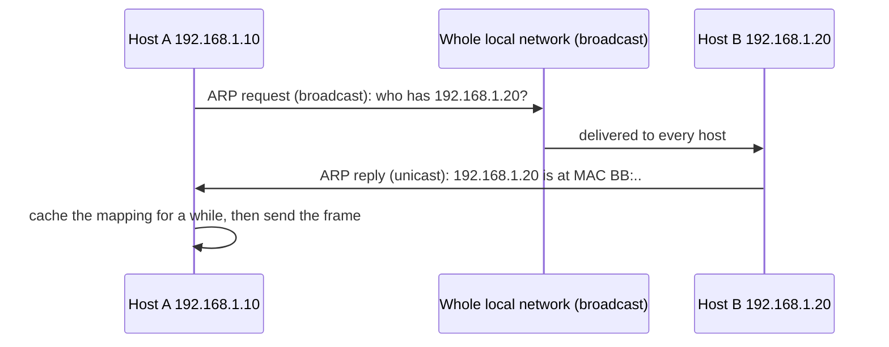
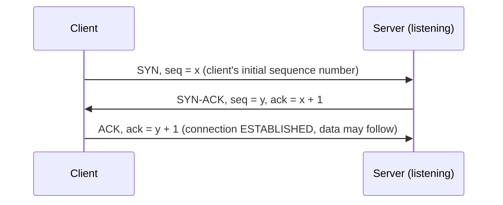
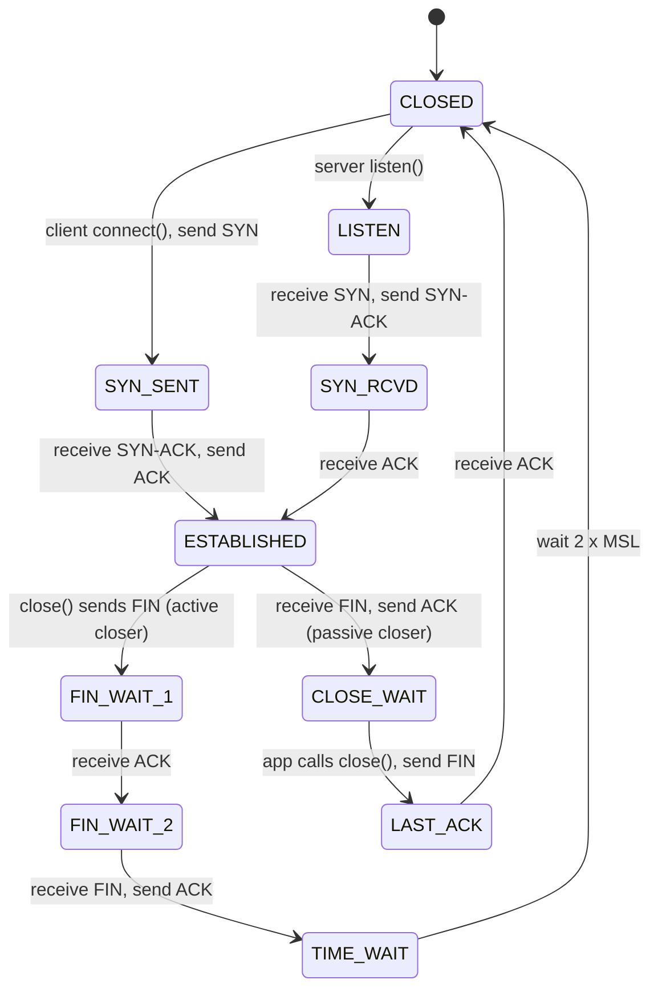
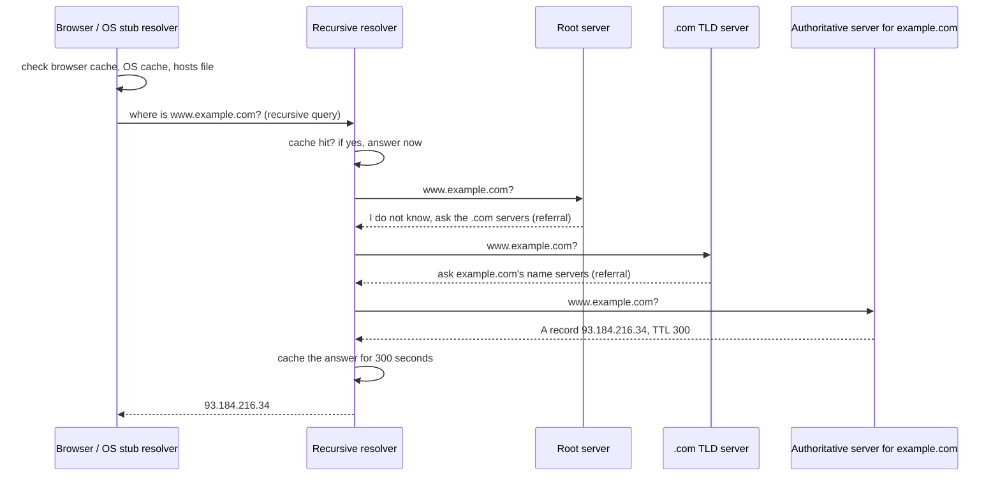
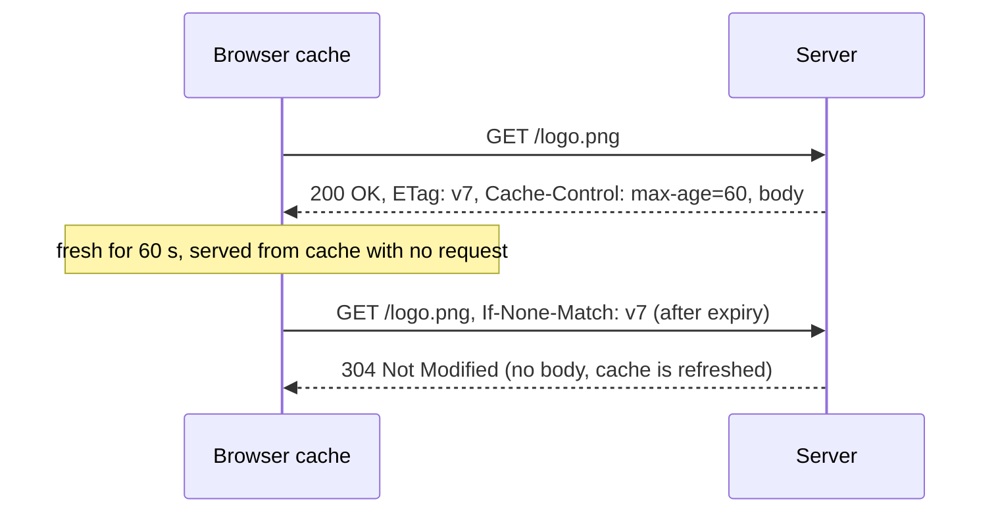
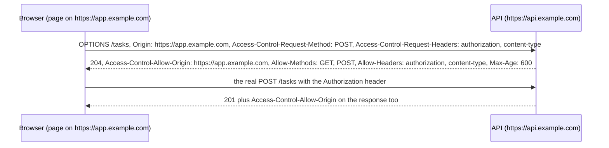
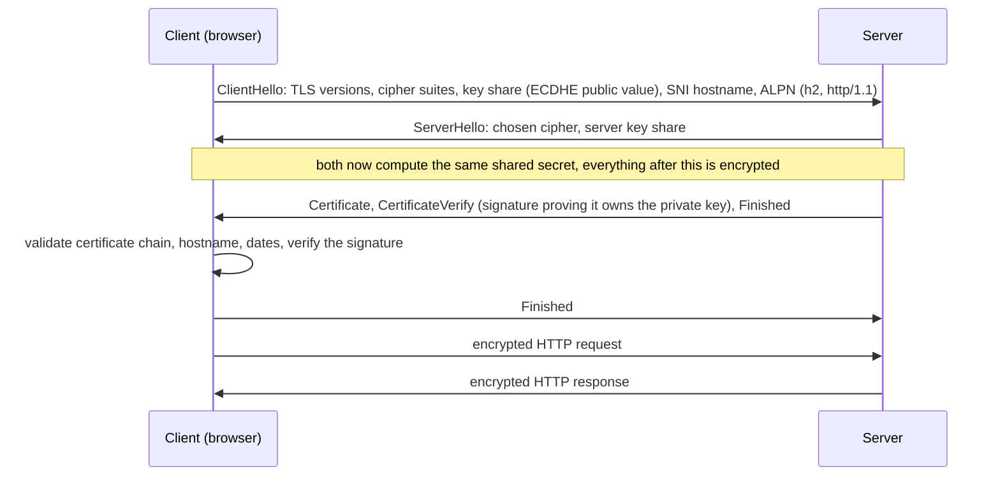
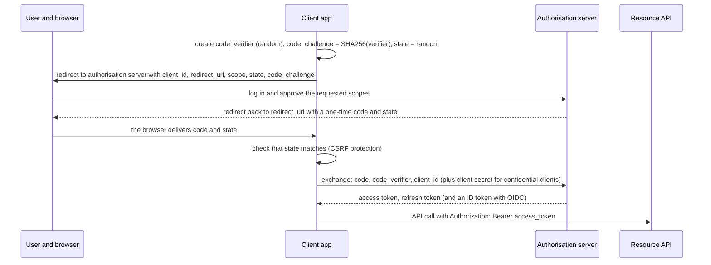
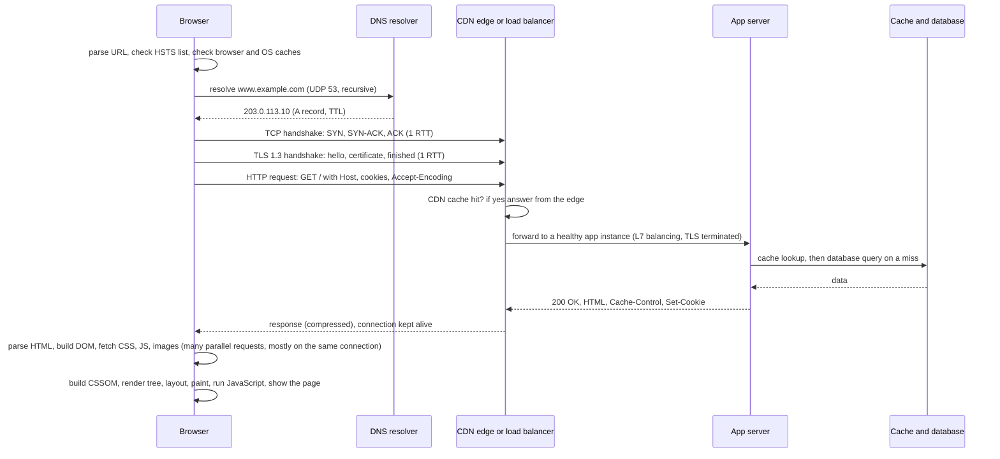

# Study Volume 3: Computer Networks and the Web

Third volume of the in-depth study set, same template as before: the idea, how it works, a diagram, a worked example or runnable code, the loopholes where people go wrong, interview questions, and a **Revise in 30 seconds** box. This volume follows a request from the browser to the server and back, layer by layer, and then covers web security, authentication and API design.

## Contents of this volume

- Part 1: Network models, layering, encapsulation, delay and throughput
- Part 2: Link and network layers: Ethernet, ARP, IP, subnetting, NAT, DHCP, routing, ICMP
- Part 3: Transport layer: TCP, UDP, handshakes, reliability, flow and congestion control, sockets
- Part 4: DNS and HTTP: messages, methods, status codes, caching, cookies, CORS, HTTP/1.1, 2 and 3
- Part 5: TLS, certificates and web security
- Part 6: Authentication, REST, real-time protocols, load balancers and CDNs
- Part 7: What happens when you type a URL, and how to debug a network problem

Parts 1 and 2 are in this first section, and the rest follow below.

## Part 1: Network models and fundamentals

### 1.1 Why layers

**The idea.** Sending a web page across the world involves electrical signals, local delivery, global routing, reliable delivery and application meaning. No single protocol does all of it. Networks are built as a **stack of layers**, where each layer offers a service to the layer above and uses the layer below, and layers can be replaced independently (Wi-Fi to Ethernet, IPv4 to IPv6, HTTP/1.1 to HTTP/3) without the others noticing.

| OSI layer (7) | TCP/IP layer (4) | What it does | Unit of data | Examples |
| --- | --- | --- | --- | --- |
| 7 Application | Application | Protocols that programs speak | Message | HTTP, DNS, SMTP, SSH, FTP |
| 6 Presentation | (in Application) | Encoding, compression, encryption |  | TLS, JSON, UTF-8 |
| 5 Session | (in Application) | Dialogue management |  | sessions, RPC |
| 4 Transport | Transport | Process-to-process delivery, reliability, ports | Segment (TCP), datagram (UDP) | TCP, UDP, QUIC |
| 3 Network | Internet | Host-to-host delivery across networks, routing, logical addresses | Packet | IP, ICMP, routers |
| 2 Data link | Link | Delivery within one network, physical addresses | Frame | Ethernet, Wi-Fi, ARP, switches |
| 1 Physical |  | Bits as signals | Bit | cables, radio, fibre |

The **OSI model** is a teaching model with 7 layers. The **TCP/IP model** is what the internet actually uses, with 4 (sometimes 5) layers. In interviews, use TCP/IP names but know the OSI numbers, because people say 'layer 4 load balancer' and 'layer 7 firewall'.

**Loopholes.** TLS does not fit cleanly into any layer (it sits between transport and application). ARP is awkward too (it needs link and network layer knowledge). Do not argue about exact placement, explain what each does.

### 1.2 Encapsulation: how data is wrapped

Each layer adds its own **header** (and the link layer a trailer) around the data from the layer above. The receiver strips them in reverse order.

```text
application:   [ HTTP request                                        ]
transport:     [ TCP hdr | HTTP request                              ]   segment
network:       [ IP hdr  | TCP hdr | HTTP request                    ]   packet
link:          [ Eth hdr | IP hdr  | TCP hdr | HTTP request | Eth FCS ]   frame
```

**Key header fields to know:**

- **Ethernet frame:** destination MAC, source MAC, type (IPv4, IPv6, ARP), payload (up to 1500 bytes, the **MTU**), frame check sequence (CRC).
- **IPv4 header (20 bytes minimum):** version, header length, total length, identification and fragment offset, **TTL**, protocol (6 = TCP, 17 = UDP, 1 = ICMP), header checksum, source IP, destination IP.
- **TCP header (20 bytes minimum):** source port, destination port, sequence number, acknowledgement number, flags (SYN, ACK, FIN, RST, PSH), window size, checksum, options (MSS, window scale, SACK, timestamps).
- **UDP header (8 bytes):** source port, destination port, length, checksum. That is all.

**Worked number:** MTU 1500 bytes, minus 20 (IP) and 20 (TCP) leaves **1460 bytes** of data per segment. That is the **MSS** (maximum segment size) typically negotiated by TCP.

**Loophole:** the MAC addresses change at every hop (each link has its own frame), while the **IP addresses stay the same end to end** (except where NAT rewrites them). This is the single most common thing candidates get wrong about routing.

### 1.3 Delay, throughput, bandwidth

**Four components of packet delay at each hop:**

1. **Processing delay:** inspecting the header, deciding where to send it (microseconds).
2. **Queuing delay:** waiting in the router's buffer, varies with congestion and is the source of **jitter**.
3. **Transmission delay** = packet size / link rate (time to push all bits onto the wire).
4. **Propagation delay** = distance / signal speed (about 2 x 10^8 m/s in fibre or copper).

**Worked example.** A 1500-byte packet (12,000 bits) on a 10 Mbps link: transmission = 12,000 / 10,000,000 = **1.2 ms**. Over a 1,000 km link, propagation = 1,000,000 m / 200,000,000 m/s = **5 ms**. Doubling the bandwidth halves the first number and does nothing to the second, which is why **faster links do not fix high latency**.

- **Bandwidth** is the maximum rate a link can carry. **Throughput** is the rate you actually achieve (lower: protocol overhead, loss, congestion, window limits). **Latency** is the delay for one packet. **RTT** is the round trip time. **Goodput** counts useful application bytes only.
- **Bandwidth-delay product (BDP)** = bandwidth x RTT = the amount of data 'in flight' needed to keep the pipe full. Used in Part 3.

**Packet switching vs circuit switching:** the internet uses **packet switching** (data split into packets, each routed independently, links shared by statistical multiplexing, efficient for bursty traffic, no setup, but variable delay and possible loss). **Circuit switching** (old telephone) reserves a path, with guaranteed capacity but wasted when idle.

### 1.4 Network devices and where they work

| Device | Layer | Forwards by | Notes |
| --- | --- | --- | --- |
| Hub | 1 | repeats to all ports | Obsolete, one collision domain |
| Switch | 2 | MAC address | Learns which MAC is on which port, separates collision domains |
| Router | 3 | IP address (routing table) | Connects different networks, separates broadcast domains |
| Load balancer | 4 or 7 | IP and port (L4), or URL, headers, cookies (L7) | Spreads traffic over servers |
| Firewall | 3 to 7 | rules on IPs, ports, sometimes content | Packet filter, stateful, application-aware |
| Proxy | 7 | requests | Forward proxy (for clients), reverse proxy (for servers) |

### Revise in 30 seconds: models and fundamentals

- TCP/IP layers: application, transport, internet, link. Data wraps as segment, packet, frame (encapsulation).
- MAC addresses change at every hop, IP addresses stay end to end (except NAT).
- MSS = MTU 1500 - 20 IP - 20 TCP = 1460. UDP header is 8 bytes, TCP at least 20, IPv4 at least 20.
- Delay = processing + queuing + transmission (size / rate) + propagation (distance / speed). Bandwidth does not fix latency.
- Switch = layer 2 (MAC), router = layer 3 (IP). L4 load balancer sees IP and port, L7 sees HTTP.

## Part 2: Link and network layers

### 2.1 Ethernet, MAC addresses and switches

A **MAC address** is a 48-bit hardware address of a network interface (like `3C:22:FB:1A:09:7E`), meaningful only on the local network. A **switch** forwards frames by MAC address and **learns** automatically:

```text
1. A frame arrives on port 3 with source MAC AA:..  -> the switch records  AA:.. is on port 3.
2. For the destination MAC: if it is in the table, send out of that port only.
3. If unknown (or the broadcast address FF:FF:FF:FF:FF:FF), flood to all ports except the one it came from.
```

**Loophole:** the switch table is just a cache with an ageing timer. A **broadcast domain** is the set of devices that receive each other's broadcasts, and a router (or a VLAN) separates them. **VLANs** split one physical switch into separate logical networks.

### 2.2 ARP: finding a MAC for an IP

Host A (192.168.1.10) wants to send to B (192.168.1.20) on the same network. It knows B's IP but needs B's MAC.



**For a destination outside the local network**, A sends the frame to the **default gateway's MAC** (found with ARP too), while the IP header still carries the final destination IP. The router then routes it onward.

**Loophole: ARP spoofing.** ARP has no authentication, so a malicious host can answer with its own MAC and become a man in the middle on the local network. Defences: dynamic ARP inspection, switch port security, and (most importantly) end-to-end encryption such as TLS.

### 2.3 IPv4 addressing, CIDR and subnetting

An IPv4 address is **32 bits**, written as four bytes (`192.168.1.10`). It has a **network part** and a **host part**. The boundary is given by the **subnet mask** or the **prefix length** (CIDR notation): `/24` means the first 24 bits are the network, so the mask is `255.255.255.0`.

**Formulas you must know:**

- Host bits `h = 32 - prefix`.
- Addresses in the subnet = `2^h`. **Usable hosts = `2^h - 2`** (the all-zeros host is the **network address**, the all-ones host is the **broadcast address**).
- **Network address** = IP AND mask. **Broadcast address** = network address with all host bits set to 1.

| Prefix | Mask | Usable hosts |
| --- | --- | --- |
| /8 | 255.0.0.0 | 16,777,214 |
| /16 | 255.255.0.0 | 65,534 |
| /24 | 255.255.255.0 | 254 |
| /25 | 255.255.255.128 | 126 |
| /26 | 255.255.255.192 | 62 |
| /27 | 255.255.255.224 | 30 |
| /28 | 255.255.255.240 | 14 |
| /30 | 255.255.255.252 | 2 |

**Special and private ranges:** private (not routable on the internet) `10.0.0.0/8`, `172.16.0.0/12`, `192.168.0.0/16`. Loopback `127.0.0.0/8` (`127.0.0.1` is localhost). Link-local `169.254.0.0/16` (what a machine assigns itself when DHCP fails). `0.0.0.0` means 'any address' or 'this host'. Old class A, B and C addressing is replaced by CIDR.

**Worked problem 1: find the network, broadcast and range for `172.16.35.77/20`.**

```text
prefix 20 -> mask 255.255.240.0 (third octet: 11110000, so block size 16 in the third octet)
third octet 35: 35 - (35 mod 16) = 32        -> network address 172.16.32.0
broadcast: third octet 32 + 16 - 1 = 47      -> 172.16.47.255
usable range: 172.16.32.1 to 172.16.47.254    hosts = 2^12 - 2 = 4094
```

**Worked problem 2: subnet `192.168.1.0/24` into 4 equal subnets.** Need 2 extra bits, so the new prefix is /26 (62 hosts each): `192.168.1.0/26`, `.64/26`, `.128/26`, `.192/26`.

**Worked problem 3: VLSM (variable length subnet masks).** Split `192.168.1.0/24` for three LANs needing 100, 50 and 25 hosts. Allocate **largest first** to keep blocks aligned: 100 hosts needs `/25` (126 usable) = `192.168.1.0/25` (0 to 127). 50 hosts needs `/26` (62 usable) = `192.168.1.128/26` (128 to 191). 25 hosts needs `/27` (30 usable) = `192.168.1.192/27` (192 to 223). The range 224 to 255 is still free for later.

**Check your answers in Python:**

```python
import ipaddress

net = ipaddress.ip_interface('172.16.35.77/20').network
print(net, net.netmask, net.broadcast_address, net.num_addresses - 2)
# 172.16.32.0/20 255.255.240.0 172.16.47.255 4094

print(list(ipaddress.ip_network('192.168.1.0/24').subnets(new_prefix=26)))
# [.0/26, .64/26, .128/26, .192/26]

print(ipaddress.ip_address('10.0.1.5') in ipaddress.ip_network('10.0.0.0/24'))   # False: different subnet
```

**Same subnet or not?** Two hosts are on the same subnet if `IP AND mask` is equal. If so, they talk directly (ARP, then frames). If not, they go through the default gateway.

**Loopholes.** A /31 has no usable broadcast and is allowed for point-to-point links, a /32 is a single host. Always check whether a question counts usable hosts (subtract 2) or total addresses. Cloud providers reserve extra addresses in each subnet (for example AWS reserves 5), so a /28 gives 11 usable, not 14.

### 2.4 Routing and longest prefix match

A router holds a **routing table** of `(destination prefix, next hop, interface, metric)` entries. For each packet it picks the entry with the **longest matching prefix** (the most specific route). If nothing matches, it uses the **default route** `0.0.0.0/0`.

```text
routes:   10.0.0.0/8 -> R1      10.1.0.0/16 -> R2      10.1.2.0/24 -> R3      0.0.0.0/0 -> ISP
10.1.2.9   matches /8, /16, /24 -> longest is /24 -> R3
10.1.9.9   matches /8, /16      -> longest is /16 -> R2
10.200.0.1 matches /8           -> R1
8.8.8.8    matches none          -> default route to ISP
```

Each router only decides the **next hop**, so a packet is forwarded hop by hop. The **TTL** field is decremented at every router, and when it reaches 0 the packet is dropped and an ICMP 'time exceeded' message is sent back. This prevents routing loops from circulating packets forever, and it is exactly what `traceroute` exploits (it sends packets with TTL 1, 2, 3 and records who answers).

**Routing protocols (high level):** **interior** (inside one organisation): **OSPF** (link-state, every router knows the whole topology and runs Dijkstra), **RIP** (distance-vector, Bellman-Ford, hop count, slow convergence, count-to-infinity problem). **Exterior**: **BGP** is the protocol of the internet, exchanging routes between autonomous systems (ASes) using policy, not just shortest path. BGP misconfigurations and hijacks have taken large services offline.

### 2.5 NAT, DHCP, ICMP, IPv6

- **NAT (network address translation):** a router with one public IP lets many private hosts share it by rewriting source address and port and keeping a translation table. **PAT** (port address translation) is the common form. Effect: hosts behind NAT are not directly reachable from outside (no unsolicited inbound connections without port forwarding), which complicates peer-to-peer and is why techniques like STUN and hole punching exist. NAT also saved IPv4 from exhaustion.
- **DHCP:** automatically assigns an IP address, mask, gateway and DNS server to a joining host, in four steps called **DORA**: **D**iscover (client broadcasts), **O**ffer (server proposes), **R**equest (client accepts), **A**cknowledge (server confirms, with a lease time).
- **ICMP:** the network layer's error and diagnostic protocol (not a transport). `ping` uses echo request and reply. `traceroute` uses TTL expiry. Messages include destination unreachable and time exceeded. Many firewalls block ICMP, so 'ping fails' does not prove the host is down.
- **IPv6:** 128-bit addresses (written in hex, like `2001:db8::1`), a vast space (no NAT needed), simpler header with no fragmentation by routers, built-in autoconfiguration (SLAAC). Dual-stack deployments run IPv4 and IPv6 side by side.
- **Fragmentation:** if a packet is larger than a link's MTU, IPv4 may fragment it. Fragmentation is inefficient and fragile, so modern stacks use **path MTU discovery** (set the Don't Fragment bit and adapt on ICMP feedback). Blocked ICMP can break it, producing connections that hang on large transfers only (a classic 'black hole' bug).

### Interview questions on link and network layers

- **Switch vs router?** Switch forwards frames by MAC inside one network, router forwards packets by IP between networks.
- **How does a host on one subnet reach a host on another?** It detects the destination is off-subnet, ARPs for the default gateway's MAC, sends the frame to the gateway with the destination IP unchanged, and routers forward hop by hop.
- **What changes and what stays the same as a packet crosses routers?** MAC addresses change per hop, IP addresses stay (apart from NAT), TTL decreases.
- **How many hosts in a /26? Find the broadcast address of 172.16.35.77/20.** 62. 172.16.47.255. Show the steps.
- **What is NAT and what are its drawbacks?** Shares one public IP by rewriting addresses and ports. Breaks end-to-end addressing and inbound connections.
- **How does traceroute work?** Increasing TTL values and reading the ICMP time-exceeded replies from each router.
- **DHCP steps?** Discover, Offer, Request, Acknowledge.

### Revise in 30 seconds: link and network layers

- Switch learns MAC to port, floods unknown and broadcast. ARP maps IP to MAC by broadcast request, unicast reply. Off-subnet traffic goes to the gateway's MAC.
- Usable hosts = 2^(32 - prefix) - 2. Network = IP AND mask. Broadcast = all host bits 1. VLSM: allocate largest subnets first.
- Private ranges 10/8, 172.16/12, 192.168/16. Routers use longest prefix match and the default route. TTL stops loops and powers traceroute.
- NAT shares one public IP using ports. DHCP = DORA. ICMP for errors and ping. IPv6 = 128 bits. BGP routes between ASes, OSPF inside one.
- Path MTU discovery depends on ICMP, so blocking ICMP can cause hangs on large transfers.

## Part 3: The transport layer: TCP and UDP

### 3.1 What the transport layer adds

The network layer delivers packets **host to host** on a best-effort basis: packets can be lost, duplicated, reordered or delayed. The transport layer adds **process-to-process** delivery using **port numbers**, and optionally reliability, ordering and congestion control.

- A **port** is a 16-bit number (0 to 65535) identifying a service or connection endpoint on a host. **Well-known** ports 0 to 1023 (80 HTTP, 443 HTTPS, 22 SSH, 53 DNS, 25 SMTP), **registered** 1024 to 49151 (5432 PostgreSQL, 6379 Redis, 3306 MySQL), **ephemeral** (dynamic) ports for the client side of connections (Linux default about 32768 to 60999).
- A **socket** is an endpoint. A TCP connection is uniquely identified by the **4-tuple (source IP, source port, destination IP, destination port)** plus the protocol. That is why one server port (443) can serve thousands of clients at once: every connection has a different source IP or port.

### 3.2 TCP vs UDP

|  | TCP | UDP |
| --- | --- | --- |
| Connection | Connection-oriented (handshake first) | Connectionless, just send |
| Delivery | Reliable, ordered, no duplicates | Best effort, may lose, duplicate or reorder |
| Data model | **Byte stream** (no message boundaries) | **Datagrams** (each send is one message, boundaries kept) |
| Control | Flow control, congestion control | None |
| Header | 20 bytes or more | 8 bytes |
| Latency | Higher (handshake, retransmissions, head-of-line blocking) | Lowest |
| Typical use | HTTP/1.1 and 2, databases, email, SSH, file transfer | DNS, video and voice calls, games, streaming, QUIC (HTTP/3), DHCP |

UDP is not 'bad TCP'. It is the right base when the application wants control (real-time media prefers a late packet to be dropped, not waited for) or wants to build its own transport (QUIC).

### 3.3 TCP connection establishment: the three-way handshake



**Why three steps and not two:** each side must announce its **initial sequence number (ISN)** and have it acknowledged. Two steps would let the server believe a connection exists after a delayed, duplicate SYN from the past, and would not confirm the client can *receive*. ISNs are random, to prevent old packets and spoofing attacks from being accepted.

**Cost:** one full round trip before the first byte of data (and HTTPS adds the TLS handshake on top, see Part 5). This is why **connection reuse (keep-alive, pooling)** matters so much for performance.

**Worked sequence and acknowledgement numbers.** The client's ISN is 1000 and the server's is 5000:

```text
C -> S  SYN      seq=1000
S -> C  SYN-ACK  seq=5000 ack=1001      (SYN consumes one sequence number)
C -> S  ACK      seq=1001 ack=5001
C -> S  DATA 100 bytes   seq=1001       (next expected byte for the server is 1101)
S -> C  ACK      ack=1101               ('I have everything below byte 1101')
```

TCP numbers **bytes**, not segments. The acknowledgement number is **the next byte expected** (cumulative acknowledgement).

### 3.4 Connection termination and the TCP states

Each direction is closed separately, so closing takes four steps (FIN, ACK, FIN, ACK), which allows a **half-close** (one side finished sending but can still receive).



- **TIME\_WAIT:** the side that closes first lingers for **2 x MSL** (maximum segment lifetime, commonly 60 seconds in total on Linux). Purpose: absorb late duplicate segments so they cannot corrupt a new connection with the same 4-tuple, and make sure the final ACK can be retransmitted if lost.
- **Production consequences you can speak about:** a client or proxy opening **many short-lived connections** to the same server accumulates TIME\_WAIT sockets and can run out of **ephemeral ports** (only about 28,000 per destination IP and port). Fixes: connection pooling and keep-alive (the real fix), widening the port range, allowing safe reuse (`tcp_tw_reuse` for outgoing connections), and letting the *server* not be the active closer. A server restarting and failing to bind its port because of old connections needs `SO_REUSEADDR`.
- **CLOSE\_WAIT piling up** is a bug in **your application**: the peer closed, the kernel is waiting for your app to call `close()`, and it never does (a leaked connection or missing `finally`). Seeing thousands of CLOSE\_WAIT is a classic diagnostic question.
- **RST** (reset) aborts a connection immediately: sent when a packet arrives for a closed port or a crashed process. 'Connection reset by peer' is the error you see.
- **SYN flood attack:** an attacker sends many SYNs and never completes the handshake, filling the server's half-open queue (SYN\_RCVD). Defence: **SYN cookies** (encode state in the sequence number so the server stores nothing until the final ACK), rate limiting, and upstream filtering.

Check on Linux: `ss -tan | awk '{print $1}' | sort | uniq -c` counts connections by state, `ss -ltnp` lists listening sockets with processes.

### 3.5 Reliability: how TCP recovers from loss

- Every byte has a sequence number, the receiver sends **cumulative ACKs**, and the sender keeps unacknowledged data buffered.
- **Retransmission timeout (RTO):** if an ACK does not arrive in time, resend. The timer adapts to measured round trip time: `RTO = SRTT + 4 x RTTVAR` (smoothed RTT plus a safety margin from its variance). On each timeout the RTO doubles (**exponential backoff**).
- **Fast retransmit:** if the sender sees **3 duplicate ACKs** (the receiver keeps acking the same byte because a later segment arrived but an earlier one is missing), it resends the missing segment right away without waiting for the timer.
- **Selective acknowledgement (SACK):** the receiver tells the sender exactly which blocks it has, so only the missing ones are resent.
- **Ordering:** the receiver buffers out-of-order segments and delivers bytes to the application strictly in order. This is why one lost segment **blocks everything behind it (TCP head-of-line blocking)**, the problem HTTP/3 over QUIC solves.
- A **checksum** catches corruption.

### 3.6 Flow control vs congestion control (do not mix them up)

**Flow control protects the receiver.** The receiver advertises its free buffer space as the **receive window (rwnd)** in every ACK. The sender never has more unacknowledged data in flight than `rwnd`. If it reaches zero the sender pauses and probes (**zero window**).

**Congestion control protects the network.** The sender keeps its own **congestion window (cwnd)** and sends at most `min(cwnd, rwnd)` bytes unacknowledged. It *infers* congestion from loss or delay, since the network does not tell it directly.

- **Slow start:** begin with a small `cwnd` (modern default 10 segments) and **double it every RTT** (it grows by one segment per ACK) until reaching the **slow-start threshold (`ssthresh`)** or a loss.
- **Congestion avoidance:** above `ssthresh`, grow **linearly**, about one segment per RTT (additive increase).
- **On loss detected by 3 duplicate ACKs (mild):** halve (`ssthresh = cwnd / 2`, `cwnd = ssthresh`) and continue (**fast recovery**). **On a timeout (severe):** `cwnd = 1` segment and restart slow start.
- This pattern is **AIMD (additive increase, multiplicative decrease)**, and it draws the famous **sawtooth** graph. AIMD makes competing flows converge toward a fair share of a link.

```text
cwnd (segments)   slow start        congestion avoidance        loss
 1 -> 2 -> 4 -> 8 -> 16 (= ssthresh) -> 17 -> 18 -> 19 -> 20  X  (3 dup ACKs)
                                                               ssthresh = 10, cwnd = 10, grow +1 per RTT again
```

Real systems use variants: **CUBIC** (Linux default, grows as a cubic function, good on high bandwidth-delay links) and **BBR** (Google, builds a model of bottleneck bandwidth and RTT rather than reacting to loss).

**Worked example: why window size limits throughput.** Throughput can never exceed `window / RTT`. With the classic maximum 64 KB window (65,535 bytes) and a 50 ms RTT: `65,535 / 0.05 = 1.31 MB/s`, about **10.5 Mbps**, however fast the link is. To fill a 100 Mbps link at 50 ms you need a window of the **bandwidth-delay product**: `100,000,000 bits/s x 0.05 s = 5,000,000 bits = 625,000 bytes`. That is why the **window scaling** option exists (windows up to about 1 GB), and why long-distance transfers are slow without it.

### 3.7 Nagle, delayed ACK, keep-alive

- **Nagle's algorithm** batches small writes into fuller segments to reduce overhead. Combined with the receiver's **delayed ACK** (waits up to about 40 ms hoping to piggyback the ACK), it can create a stall of tens of milliseconds for request-response protocols that send small messages in two writes. Latency-sensitive services (databases, RPC, games) set **`TCP_NODELAY`** to disable Nagle.
- **TCP keep-alive** sends periodic probes on an idle connection to detect a dead peer or keep a NAT or firewall mapping alive. Do not confuse it with **HTTP keep-alive**, which means *reusing* a connection for more requests. Idle load balancers and NATs silently drop long-idle connections, so long-lived connections need application-level heartbeats.

### 3.8 Sockets in code, and the byte-stream trap

```python
import socket, threading

def handle(conn, addr):
    with conn:
        while data := conn.recv(1024):         # b'' (empty) means the peer closed: FIN received
            conn.sendall(data)                 # echo; sendall loops until every byte is queued

def serve(host='127.0.0.1', port=9000):
    with socket.socket(socket.AF_INET, socket.SOCK_STREAM) as s:
        s.setsockopt(socket.SOL_SOCKET, socket.SO_REUSEADDR, 1)   # restart without waiting for TIME_WAIT
        s.bind((host, port))
        s.listen(128)                                              # backlog of pending connections
        while True:
            conn, addr = s.accept()                                # blocks until a client completes the handshake
            threading.Thread(target=handle, args=(conn, addr), daemon=True).start()

# client
with socket.create_connection(('127.0.0.1', 9000)) as c:
    c.sendall(b'hello'); print(c.recv(1024))
```

Run the server in one terminal and the client in another, then watch it with `ss -tan | grep 9000`.

**The trap: TCP is a byte stream, not a message stream.** If the client sends `hello` then `world`, one `recv(1024)` on the server may return `helloworld`, or just `hel`, because TCP preserves order but **not boundaries**. Protocols need **framing**: a delimiter (HTTP headers end with a blank line), or a **length prefix**:

```python
import struct

def send_msg(sock, payload: bytes):
    sock.sendall(struct.pack('!I', len(payload)) + payload)      # 4-byte big-endian length, then data

def recv_exact(sock, n):
    buf = b''
    while len(buf) < n:
        chunk = sock.recv(n - len(buf))
        if not chunk:
            raise ConnectionError('peer closed mid-message')
        buf += chunk
    return buf

def recv_msg(sock):
    (n,) = struct.unpack('!I', recv_exact(sock, 4))
    return recv_exact(sock, n)
```

**Other socket facts.** `listen(backlog)` sets the queue of connections that finished the handshake but have not been `accept`ed. `accept` returns a **new socket** for each client while the listening socket keeps listening. A blocking `recv` with no timeout can hang forever, so set timeouts (`sock.settimeout(5)`). One-thread-per-connection does not scale to tens of thousands of connections, so high-concurrency servers use **I/O multiplexing** (`select`, `poll`, `epoll`) with an event loop (`asyncio`, Node.js, nginx), or a bounded thread pool.

**UDP in code (note the preserved datagram boundaries):**

```python
import socket
rx = socket.socket(socket.AF_INET, socket.SOCK_DGRAM); rx.bind(('127.0.0.1', 9001))
tx = socket.socket(socket.AF_INET, socket.SOCK_DGRAM)
tx.sendto(b'one', ('127.0.0.1', 9001)); tx.sendto(b'two', ('127.0.0.1', 9001))
print(rx.recvfrom(1024), rx.recvfrom(1024))     # two separate datagrams: (b'one', ...) then (b'two', ...)
```

### 3.9 UDP uses, risks, and QUIC

- **Good fit:** DNS (one question, one answer), DHCP, VoIP and video calls, online games, live streaming, telemetry, and **QUIC** (the transport under HTTP/3).
- **Risk, amplification attacks:** UDP has no handshake, so source addresses can be forged. An attacker sends a small query with the *victim's* address as the source to a DNS or NTP server that sends back a much bigger reply, flooding the victim. Mitigations: response rate limiting, ingress filtering, and not running open resolvers.
- **QUIC:** reliable, multiplexed, encrypted transport built **on UDP in user space**. It integrates TLS 1.3 (1-RTT handshake, 0-RTT for repeat connections), provides independent **streams** (loss on one stream does not block others, ending TCP-style head-of-line blocking), supports **connection migration** (a connection ID survives a phone switching from Wi-Fi to mobile data), and can evolve without waiting for operating systems to update.

### Loopholes and common wrong answers

- 'TCP guarantees delivery' is imprecise: it guarantees **in-order delivery of bytes if the connection survives**, or tells you it failed. A successful `send` only means the data reached the local kernel buffer, not that the peer processed it. Application-level acknowledgement is still needed for important operations.
- Flow control and congestion control are different (receiver versus network).
- TCP does not preserve message boundaries. UDP does.
- UDP is not 'unreliable and therefore unused'. A huge share of modern traffic (HTTP/3) runs over it.
- The handshake is **not** a security step. Authentication and encryption come from TLS.
- A closed connection can sit in TIME\_WAIT for a minute, and that is correct behaviour, not a leak.

### Interview questions on the transport layer

- **Walk through the TCP three-way handshake and say why three steps.** SYN, SYN-ACK, ACK, to exchange and confirm both initial sequence numbers and prove both directions work.
- **TCP vs UDP, and when would you choose UDP?** Reliability and ordering versus low latency and control. Real-time media, DNS, custom protocols such as QUIC.
- **What is TIME\_WAIT and why does it exist? When does it cause trouble?** Absorbs stray late packets and ensures the final ACK. Many short outbound connections exhaust ephemeral ports. Use connection pooling.
- **What does a pile-up of CLOSE\_WAIT sockets mean?** The application is not closing sockets after the peer closed.
- **Flow control vs congestion control?** rwnd protects the receiver, cwnd protects the network. Slow start, AIMD, fast retransmit.
- **Why is my transfer slow on a fast long-distance link?** Window / RTT limit: need window scaling and a window at least the bandwidth-delay product. Also check loss and congestion control.
- **How does TCP detect and repair loss?** Cumulative ACKs and RTO timers, fast retransmit on 3 duplicate ACKs, SACK.
- **Why does one lost packet delay unrelated data on a TCP connection?** In-order delivery (head-of-line blocking). QUIC streams avoid it.

### Revise in 30 seconds: the transport layer

- Ports address processes. A connection is the 4-tuple (src IP, src port, dst IP, dst port). TCP is a reliable ordered **byte stream** (needs framing), UDP is unreliable **datagrams**.
- Handshake SYN, SYN-ACK, ACK exchanges ISNs and costs 1 RTT. Close is FIN, ACK, FIN, ACK. TIME\_WAIT lasts 2 x MSL (exhausts ephemeral ports under many short connections), CLOSE\_WAIT pile-up is an application bug, SYN cookies stop SYN floods.
- Reliability: sequence numbers, cumulative ACK, RTO with backoff, fast retransmit on 3 duplicate ACKs, SACK. Loss blocks later data (head-of-line blocking).
- Flow control = rwnd (receiver). Congestion control = cwnd: slow start (double per RTT), AIMD, halve on 3 dup ACKs, reset on timeout. Throughput <= window / RTT, fill a link with window >= bandwidth x RTT.
- `TCP_NODELAY` disables Nagle. TCP keep-alive is not HTTP keep-alive. QUIC = UDP plus streams plus TLS 1.3, no TCP-style head-of-line blocking.

## Part 4: DNS and HTTP

### 4.1 DNS: the internet's phone book

**The idea.** Computers route by IP address, people remember names. **DNS (Domain Name System)** is a globally distributed, hierarchical database that maps names to records (mostly IP addresses). Without it, nothing human-friendly works, and when it breaks, 'the internet is down' even though every server is healthy.

**The hierarchy.** Read a name right to left: `www.example.com.` has the invisible **root** (`.`), then the **TLD** (top-level domain, `com`), then the **domain** (`example`), then a **host** (`www`). Responsibility is delegated down the tree: the root servers know who runs `.com`, the `.com` servers know who runs `example.com`, and that domain's **authoritative name servers** hold the real records.

**Who is involved:**

- **Stub resolver:** the small client in your OS or browser.
- **Recursive resolver:** a server (your ISP's, or a public one like 1.1.1.1 or 8.8.8.8) that does the hunting on your behalf and caches the answers.
- **Root, TLD and authoritative servers:** answer **iteratively**, meaning they reply with an answer or a referral ('ask this server'), never doing the chase themselves.



**Record types:**

| Type | Meaning | Example |
| --- | --- | --- |
| A | name to IPv4 address | `api.example.com -> 203.0.113.10` |
| AAAA | name to IPv6 address | `api.example.com -> 2001:db8::10` |
| CNAME | alias to another name (canonical name) | `www.example.com -> example.com` |
| MX | mail servers for the domain, with priority | `example.com -> 10 mail.example.com` |
| NS | the name servers responsible for the zone | `example.com -> ns1.provider.net` |
| TXT | free text: SPF, DKIM, domain verification | `v=spf1 include:...` |
| SOA | zone metadata (serial, refresh, negative-caching TTL) |  |
| PTR | reverse lookup, IP to name |  |
| SRV | service location with host and port |  |

**Caching and TTL.** Every record has a **TTL** (time to live, in seconds), and every cache along the way may reuse the answer until it expires. Caching is what makes DNS scalable (the root servers would melt otherwise) and also why changes are not instant.

**Loopholes and production facts.**

- **'DNS propagation'** is a myth in the sense that nothing is pushed. Old answers simply live in caches until their TTL runs out. To migrate a service smoothly: **lower the TTL days before** the change, make the change, wait, then raise the TTL again.
- **A CNAME cannot coexist with other records at the same name**, and it is not allowed at the zone apex (`example.com` itself, which must hold SOA and NS). Providers offer 'ALIAS' or 'ANAME' flattening for that case.
- **Negative caching:** a 'name does not exist' (NXDOMAIN) answer is also cached, for a time set by the SOA. So creating a record right after a lookup failed can still appear missing.
- **DNS-based load balancing and failover:** return several A records (round robin) or different answers by client location (GeoDNS). It is coarse: clients cache answers, so failover takes at least a TTL, and clients do not know which server is unhealthy.
- **Transport:** normally **UDP port 53**, falling back to **TCP** for large answers (and DNSSEC). Encrypted variants: **DNS over HTTPS (DoH)** and **DNS over TLS (DoT)** hide queries from the local network.
- **Security:** **cache poisoning** (feeding a resolver forged answers, mitigated by random source ports and transaction IDs, and **DNSSEC** signatures that let a resolver verify authenticity), **DNS amplification** attacks (Part 3), and **domain hijacking** (losing control of the registrar account).
- DNS is a classic hidden cause of slowness: a missing or failing resolver adds seconds to every first connection. When debugging, always separate 'name resolution time' from 'connect time' (`curl -w` shows both).

```python
import socket
# the OS resolver (what your programs use): returns all addresses with their families
for fam, _, _, _, addr in socket.getaddrinfo('example.com', 443, proto=socket.IPPROTO_TCP):
    print(fam.name, addr[0])
```

Command line: `dig example.com A +noall +answer` (shows records and TTL), `dig +trace example.com` (walks root, TLD, authoritative like the diagram), `dig @1.1.1.1 example.com` (ask a specific resolver), `nslookup`, `host`.

### 4.2 HTTP basics

**The idea.** HTTP is a **text-based, stateless, request-response** protocol between a client (browser, app, `curl`) and a server. **Stateless** means each request is independent: the server keeps no memory of earlier ones unless you add state yourself (cookies, tokens, sessions). It runs over TCP (HTTP/1.1, HTTP/2) or QUIC (HTTP/3), and over TLS for HTTPS.

**Request:**

```text
POST /api/tasks HTTP/1.1                  <- request line: method, path, version
Host: api.example.com                     <- headers (Host is mandatory in HTTP/1.1)
Content-Type: application/json
Content-Length: 27
Authorization: Bearer eyJhbGciOi...
                                          <- blank line ends the headers
{'title': 'Write notes'}                  <- body (JSON uses double quotes in real life)
```

**Response:**

```text
HTTP/1.1 201 Created                      <- status line: version, status code, reason
Content-Type: application/json
Location: /api/tasks/42                   <- where the new resource lives
Content-Length: 38

{'id': 42, 'title': 'Write notes'}
```

A **URL** has the parts `scheme://host:port/path?query#fragment`. The **fragment** (`#section`) is never sent to the server. The **query string** carries parameters, and must be URL-encoded (`%20` for space).

**Methods and their properties** (this table is a favourite):

| Method | Purpose | Safe (no state change) | Idempotent (repeat = same effect) | Has request body |
| --- | --- | --- | --- | --- |
| GET | Read a resource | yes | yes | no |
| HEAD | Like GET, headers only | yes | yes | no |
| POST | Create, or run a non-idempotent action | no | **no** | yes |
| PUT | Replace a resource entirely (or create at a known URL) | no | yes | yes |
| PATCH | Partially modify a resource | no | not guaranteed | yes |
| DELETE | Remove a resource | no | yes | rarely |
| OPTIONS | Ask what is allowed (CORS preflight) | yes | yes | no |

**Why idempotency matters in practice:** networks fail, clients and proxies retry. Retrying a `PUT /tasks/42` ten times leaves the same result, but retrying `POST /orders` can create ten orders. For POST that must be retry-safe, accept an **`Idempotency-Key`** header and remember the result per key. **Never change state on GET**, because browsers, crawlers and prefetchers will call it freely.

### 4.3 Status codes, and the confusions to avoid

| Class | Meaning | Codes to know |
| --- | --- | --- |
| 1xx | Informational | 101 Switching Protocols (WebSocket upgrade) |
| 2xx | Success | 200 OK, 201 Created, 202 Accepted (queued, not finished), 204 No Content |
| 3xx | Redirection | 301, 302, 303, 304 Not Modified, 307, 308 |
| 4xx | **Client** error | 400, 401, 403, 404, 405, 409, 410, 415, 422, 429 |
| 5xx | **Server** error | 500, 502, 503, 504 |

- **401 vs 403:** **401 Unauthorized** really means *unauthenticated* (no or invalid credentials, the response should say how to authenticate). **403 Forbidden** means *authenticated but not allowed*. Returning 404 instead of 403 for resources a user must not even know exist is a deliberate privacy choice.
- **400 vs 422:** 400 for a malformed request (bad JSON, missing parameter), 422 for well-formed but semantically invalid data (an email that fails validation). FastAPI returns 422 for validation errors by default.
- **409 Conflict:** the request conflicts with current state (duplicate unique value, stale version in optimistic locking, slot already booked). Pair this with the atomic updates in Volume 1 and Volume 2.
- **Redirects:** **301** permanent (clients and search engines cache it), **302** temporary. Historically clients switched POST to GET on 301 and 302, so **307** (temporary) and **308** (permanent) were defined to **preserve the method**. **303 See Other** says 'fetch the result with GET' (the post-redirect-get pattern after a form submit).
- **404 vs 410:** not found versus intentionally gone for good.
- **429 Too Many Requests** with a **`Retry-After`** header: rate limiting.
- **500** server bug, **502 Bad Gateway** (the proxy got an invalid response from the upstream, often the app crashed), **503 Service Unavailable** (overloaded or in maintenance, may include `Retry-After`), **504 Gateway Timeout** (the upstream was too slow). Knowing 502 versus 504 helps you decide whether to look at crashes or at slow handlers.
- **202 Accepted** fits the background-job pattern: validate, enqueue, answer 202 with a status URL, let a worker finish.

### 4.4 Important headers

- **Request:** `Host` (which site, lets one IP serve many), `Accept` (formats the client understands), `Accept-Encoding: gzip, br`, `Authorization`, `Cookie`, `Content-Type` and `Content-Length`, `User-Agent`, `Origin` (for CORS), `If-None-Match` and `If-Modified-Since` (conditional requests), `Range`.
- **Response:** `Content-Type` (with charset), `Content-Encoding`, `Set-Cookie`, `Location` (redirects and created resources), `Cache-Control`, `ETag`, `Last-Modified`, `Retry-After`, `WWW-Authenticate`, CORS headers (`Access-Control-Allow-Origin` and friends), security headers (Part 5).
- **Content negotiation:** the client states preferences (`Accept`, `Accept-Language`, `Accept-Encoding`), the server picks and tells which with `Content-Type` and `Content-Encoding`, and `Vary` tells caches which request headers influenced the choice. Compression (gzip, Brotli) usually shrinks text responses by 70 percent or more.
- **Body framing:** `Content-Length` announces the size, or `Transfer-Encoding: chunked` streams a body whose size is unknown in advance. **Range requests** (`Range: bytes=0-999`, answered with `206 Partial Content`) enable resumable downloads and video seeking.

**See a real exchange:** `curl -v https://example.com` prints the request and response headers, `curl -I` fetches headers only, and `curl -w '%{time_namelookup} %{time_connect} %{time_appconnect} %{time_starttransfer} %{time_total}\n' -o /dev/null -s https://example.com` splits the total time into DNS, TCP connect, TLS, first byte and total, the standard way to find which phase is slow.

**HTTP by hand with raw sockets, to remove the magic:**

```python
import socket, ssl

req = 'GET / HTTP/1.1\r\nHost: example.com\r\nConnection: close\r\n\r\n'      # CRLF line endings, blank line ends headers
ctx = ssl.create_default_context()
with socket.create_connection(('example.com', 443)) as raw:
    with ctx.wrap_socket(raw, server_hostname='example.com') as s:     # TLS on top of TCP, with SNI
        s.sendall(req.encode())
        data = b''
        while chunk := s.recv(4096):
            data += chunk
head, _, body = data.partition(b'\r\n\r\n')
print(head.decode())                                                   # status line and headers
```

### 4.5 HTTP caching

Caching is the cheapest performance win, and the source of many bugs. Caches exist in the browser, in shared proxies and CDNs, and in your own reverse proxy.

**Two mechanisms:**

1. **Freshness:** the response says how long it can be reused without asking. `Cache-Control: max-age=3600` means reuse for an hour with zero network traffic.
2. **Validation (conditional requests):** when stale, the cache asks the server 'has it changed?' using a validator, and gets a tiny **304 Not Modified** if not.



**`Cache-Control` directives:**

- `max-age=N` fresh for N seconds (browser and shared caches), `s-maxage=N` the same for shared caches (CDNs) only.
- **`no-cache`** does **not** mean 'do not cache'. It means 'you may store it, but **revalidate with the server before every reuse**'.
- **`no-store`** means do not store at all (sensitive data).
- `private` only the user's own browser may cache (never a shared cache), `public` anyone may.
- `immutable` it will never change (hashed asset names like `app.3f9a1c.js`), so do not even revalidate.
- `stale-while-revalidate=N` serve a stale copy instantly while refreshing it in the background.
- **Validators:** `ETag` (an opaque version identifier, often a content hash) with `If-None-Match`, and `Last-Modified` with `If-Modified-Since`.
- **`Vary: Accept-Encoding`** (or `Accept-Language`, `Cookie`) tells caches the response differs by that request header, so they must store one copy per variant. A missing `Vary` can serve one user's variant to another.

**Practical recipe:** static assets with content hashes in their names get `Cache-Control: public, max-age=31536000, immutable`. HTML pages get `no-cache` (always revalidate, usually a cheap 304). Personalised API responses get `private` or `no-store`. When you change a cached file, **change its URL** (cache busting), because you cannot reach into every browser to purge it.

```python
import requests
r = requests.get('https://example.com/')
etag = r.headers.get('ETag')
r2 = requests.get('https://example.com/', headers={'If-None-Match': etag}) if etag else None
print(r.status_code, etag, r2.status_code if r2 else 'no ETag offered')   # expect 200 ... then 304
```

### 4.6 Cookies, same-origin policy and CORS

**Cookies** let a stateless protocol carry state. The server sends `Set-Cookie: session=abc123; Path=/; Max-Age=3600; Secure; HttpOnly; SameSite=Lax`, and the browser attaches `Cookie: session=abc123` to later requests to that site.

| Attribute | Effect |
| --- | --- |
| `Domain`, `Path` | Which URLs receive the cookie |
| `Max-Age` / `Expires` | Lifetime (omit for a session cookie, gone when the browser closes) |
| `Secure` | Sent only over HTTPS |
| `HttpOnly` | JavaScript cannot read it (blunts XSS cookie theft) |
| `SameSite=Strict` | Never sent on cross-site requests |
| `SameSite=Lax` | Sent on cross-site top-level navigations (clicking a link), not on cross-site subrequests or form POSTs (default in modern browsers) |
| `SameSite=None` | Sent everywhere, requires `Secure` (needed for third-party embeds) |

**Same-origin policy (SOP).** Browser JavaScript from one **origin** may not read responses from another origin. An **origin** is the exact triple **scheme + host + port**: `https://app.example.com` and `https://api.example.com` are different origins, and so are `http://x` and `https://x`, or ports 3000 and 8000. SOP is what stops a malicious page from reading your bank's pages using your logged-in cookies.

**CORS (Cross-Origin Resource Sharing)** is the controlled **relaxation** of SOP. The server declares which other origins may read its responses, through response headers. It is enforced **by the browser**, not by the server.

- **Simple requests** (GET, HEAD, or POST with a form-like content type and no custom headers) are sent directly, and the browser then checks the response's `Access-Control-Allow-Origin`.
- **Preflighted requests** (methods like PUT or DELETE, custom headers such as `Authorization`, or `Content-Type: application/json`) trigger an automatic **`OPTIONS` preflight** first:



- With cookies or HTTP auth (**credentials**), the server must send `Access-Control-Allow-Credentials: true` and a **specific origin**, never the wildcard `*`.

```python
# FastAPI (relevant to your stack): allow only your known frontend origin
from fastapi import FastAPI
from fastapi.middleware.cors import CORSMiddleware
app = FastAPI()
app.add_middleware(CORSMiddleware,
    allow_origins=['https://app.example.com'],
    allow_credentials=True,
    allow_methods=['GET', 'POST', 'PUT', 'DELETE'],
    allow_headers=['Authorization', 'Content-Type'])
```

**CORS loopholes and wrong answers.**

- **CORS is not server-side security.** `curl`, Postman and any backend ignore it. It only stops *other websites' scripts running in the user's browser* from reading your responses. Real protection still needs authentication and authorisation.
- The famous dev error 'blocked by CORS policy' is the **browser refusing to show you the response**. The request often did reach the server and may have run (for simple requests), so a state-changing endpoint is still hit.
- `Access-Control-Allow-Origin: *` together with credentials is rejected by browsers. **Blindly echoing the request's `Origin` header** with credentials enabled is a real vulnerability, since it trusts every site.
- A CORS error on an API call is frequently a **preflight failure** (the `OPTIONS` request returned 401, 404 or no CORS headers because auth middleware ran first). The fix is to answer the preflight before authentication.
- CORS is unrelated to SameSite cookies, which are a separate (and also CSRF-relevant) browser rule.

### 4.7 HTTP/1.1 vs HTTP/2 vs HTTP/3

|  | HTTP/1.1 | HTTP/2 | HTTP/3 |
| --- | --- | --- | --- |
| Format | Text | **Binary frames** | Binary frames |
| Transport | TCP | TCP | **QUIC over UDP** |
| Concurrency | One request at a time per connection (browsers open about 6 connections per host) | **Many multiplexed streams** on one connection | Multiplexed streams, **independent** of each other |
| Head-of-line blocking | At the HTTP level (and TCP) | Solved at HTTP level, **still present at TCP level** (one lost packet stalls every stream) | **Solved** (loss affects only its stream) |
| Headers | Repeated, uncompressed | **HPACK** compression | QPACK compression |
| Handshake | TCP + TLS (2 to 3 round trips) | TCP + TLS | 1 round trip, 0-RTT on resumption |
| Other | Keep-alive, chunked | Server push (now mostly deprecated), prioritisation | Connection migration |

HTTP/1.1 workarounds such as domain sharding and sprite sheets become *anti-patterns* under HTTP/2, because one connection already multiplexes. Servers and CDNs negotiate the version automatically (ALPN during the TLS handshake, or the `Alt-Svc` header for HTTP/3).

### Interview questions on DNS and HTTP

- **Walk through a DNS lookup.** Caches (browser, OS), the recursive resolver, then root, TLD and authoritative servers by referral, with TTL-based caching at each step.
- **A DNS change is not taking effect. Why?** Cached answers until the TTL expires (also negative caching), so lower the TTL beforehand.
- **GET vs POST? PUT vs PATCH? Which are idempotent?** Covered in the methods table. PUT replaces and is idempotent, PATCH modifies and is not guaranteed to be, POST is not.
- **401 vs 403? 502 vs 503 vs 504?** Unauthenticated versus not allowed. Bad upstream response, unavailable or overloaded, upstream timed out.
- **`no-cache` vs `no-store`?** Revalidate before each reuse versus never store.
- **How do ETags and 304 work?** The server sends a version identifier. The client sends it back in `If-None-Match`, and gets an empty 304 if unchanged.
- **What is CORS and why does a preflight happen?** Controlled relaxation of the browser's same-origin policy. Non-simple requests are pre-checked with `OPTIONS` because they could have side effects. It does not protect the API from non-browser clients.
- **What does HTTP/2 improve and what does HTTP/3 fix further?** Multiplexing and header compression on one connection, then QUIC removes TCP head-of-line blocking and speeds up the handshake.
- **Stateless HTTP, so how do logins work?** The client carries a credential on every request: a session cookie, or a token in the `Authorization` header (Part 6).

### Revise in 30 seconds: DNS and HTTP

- DNS: stub resolver, recursive resolver, then root, TLD and authoritative by referral. TTL caching everywhere, 'propagation' is just expiry. No CNAME at the apex. Lower TTL before migrations. UDP 53, TCP for large answers.
- HTTP is stateless, text (1.1) or binary (2, 3), request line plus headers plus body. Safe: GET, HEAD. Idempotent: GET, PUT, DELETE. POST is not, so use idempotency keys. Never mutate on GET.
- Status: 401 unauthenticated, 403 forbidden, 409 conflict, 422 invalid, 429 rate limited, 502 bad upstream, 503 unavailable, 504 upstream timeout. 307 and 308 keep the method, 303 means GET the result.
- Caching: `max-age` freshness, `ETag` and `If-None-Match` give 304, `no-cache` = revalidate, `no-store` = never store, `Vary` for variants, hashed filenames with `immutable`.
- Cookies: `Secure`, `HttpOnly`, `SameSite`. Origin = scheme + host + port. CORS relaxes SOP, is browser-enforced, preflight `OPTIONS` for non-simple requests, no `*` with credentials, not a replacement for auth.
- HTTP/2 multiplexes over TCP (TCP head-of-line blocking remains), HTTP/3 uses QUIC over UDP and fixes it.

## Part 5: TLS, certificates and web security

### 5.1 Cryptography building blocks (just enough to explain HTTPS)

Plain HTTP sends everything readable, so anyone on the path (Wi-Fi owner, ISP, a compromised router) can read it and alter it. HTTPS adds three guarantees: **confidentiality** (nobody can read it), **integrity** (nobody can change it unnoticed) and **authentication** (you are really talking to the real server). Four tools provide them.

**1. Hash functions** (SHA-256): turn any input into a fixed-size fingerprint. Properties: deterministic, fast, one-way (cannot recover the input), tiny input changes produce a totally different output, collisions are infeasible. A hash is **not encryption** (there is no key, nothing to decrypt). Uses: integrity checks, content addressing, signatures. **Password storage needs a slow, salted hash** (bcrypt, scrypt, argon2), not plain SHA-256, because fast hashes can be brute-forced at billions per second.

**2. MAC / HMAC:** a hash combined with a **secret key**, proving both integrity and that the sender knows the key. Used to sign cookies, webhooks and JWTs with a shared secret.

```python
import hmac, hashlib
sig = hmac.new(b'shared-secret', b'amount=100&to=42', hashlib.sha256).hexdigest()
print(hmac.compare_digest(sig, sig))     # always compare signatures in constant time, never with ==
```

**3. Symmetric encryption** (AES-GCM, ChaCha20-Poly1305): **one shared key** encrypts and decrypts. Very fast, ideal for bulk data. Problem: how do two strangers agree on the key safely? Modern modes are **authenticated (AEAD)**: they provide integrity as well as secrecy.

**4. Asymmetric (public-key) cryptography** (RSA, elliptic curves): a **key pair**, where the **public key** is shared openly and the **private key** is secret. Two uses: **key agreement** (Diffie-Hellman: two parties derive the same secret over a public channel) and **digital signatures** (sign with the private key, anyone verifies with the public key, proving who signed and that the data did not change). It is slow, so it is used only to set up keys.

**Hybrid design (what TLS does):** use asymmetric cryptography to **authenticate the server and agree on a fresh secret**, then use **symmetric encryption** with that secret for all the data.

```python
# Fernet: authenticated symmetric encryption (AES-128-CBC + HMAC-SHA256), from the 'cryptography' package
from cryptography.fernet import Fernet
key = Fernet.generate_key()              # keep in a secrets manager or environment, never in the repository
f = Fernet(key)
token = f.encrypt(b'oauth-refresh-token')
print(f.decrypt(token))                  # tampering raises InvalidToken
```

This is the kind of at-rest encryption your appointment system uses for stored calendar refresh tokens. Say what it protects (a database leak does not reveal tokens) and what it does not (an attacker who also steals the key).

### 5.2 Certificates and the chain of trust

**The problem:** a public key alone proves nothing. Anyone can say 'here is example.com's public key'. A **certificate (X.509)** binds a public key to an identity (a domain name), and is **digitally signed by a Certificate Authority (CA)** that browsers already trust.

```text
Root CA certificate   (self-signed, pre-installed in your OS and browser trust store)
   signs -> Intermediate CA certificate
                signs -> Server (leaf) certificate for www.example.com
```

**What the browser checks:**

1. The **chain** leads to a root in its trust store (the server sends the leaf and intermediates).
2. Every signature in the chain verifies.
3. The **hostname** matches the certificate's **Subject Alternative Name (SAN)** list (wildcards like `*.example.com` cover one label only).
4. The certificate is **within its validity dates** (expired certificates are a top cause of outages, now typically 90 days to about a year).
5. It has **not been revoked** (CRLs, **OCSP**, and **OCSP stapling**, where the server attaches a fresh signed status).
6. Optional: **Certificate Transparency** logs show publicly that the certificate was issued.

- **Domain Validation (DV)** certificates, issued automatically by **Let's Encrypt** via the **ACME** protocol (prove you control the domain with a DNS or HTTP challenge), are free and the norm. EV and OV certs add organisation checks.
- **Self-signed certificates** work for internal use if clients are told to trust them. **mTLS (mutual TLS)** makes the *client* present a certificate too, common between internal services.
- **Certificate pinning** (app trusts only a specific key) raises security but makes rotation painful.

**Loophole:** HTTPS proves you reached the owner of that *domain*, not that the site is honest. A phishing site can have a valid certificate for its own look-alike domain.

### 5.3 The TLS handshake (TLS 1.3)

TLS 1.3 (2018) needs **one round trip** before encrypted application data flows. TLS 1.2 needed two.



- **Key exchange:** an **ephemeral Diffie-Hellman (ECDHE)** share from each side produces a secret that never travels the network. Because the keys are **ephemeral** (fresh per connection and discarded), recorded traffic cannot be decrypted later even if the server's long-term private key leaks: that is **forward secrecy**.
- **Authentication:** the server signs the handshake transcript with the private key matching its certificate (`CertificateVerify`). Only the real owner can do that, which defeats a man in the middle who has merely copied the certificate.
- **Then symmetric:** traffic uses AES-GCM or ChaCha20-Poly1305 with keys derived from the shared secret.
- **SNI (Server Name Indication):** the client names the host it wants in the (unencrypted) hello, so one IP can serve many certificates. It leaks which site you visit unless **Encrypted Client Hello (ECH)** is used.
- **ALPN** picks HTTP/2 or HTTP/1.1 inside the handshake.
- **Session resumption and 0-RTT:** a returning client can send data in the first flight using a saved secret. **0-RTT data can be replayed by an attacker**, so only idempotent requests should be allowed in it.
- **TLS termination:** commonly a load balancer or reverse proxy terminates TLS and forwards plain HTTP (or re-encrypted HTTP) to the app servers. State where TLS ends in a design, and remember the internal hop is then plaintext unless you encrypt it.
- **HSTS** (`Strict-Transport-Security: max-age=31536000; includeSubDomains`) tells browsers to **only use HTTPS** for the site, defeating downgrade attacks (an attacker forcing `http://`).

**Inspect a live handshake:** `openssl s_client -connect example.com:443 -servername example.com` shows the certificate chain, protocol and cipher. `curl -vI https://example.com` shows the TLS lines too.

```python
import ssl, socket
ctx = ssl.create_default_context()                 # verifies certificates and hostnames by default
with socket.create_connection(('example.com', 443)) as raw:
    with ctx.wrap_socket(raw, server_hostname='example.com') as s:
        print(s.version(), s.cipher()[0])          # e.g. TLSv1.3 TLS_AES_256_GCM_SHA384
        print(s.getpeercert()['notAfter'])         # expiry date: monitor this in production
```

**Loopholes (real-world mistakes).**

- Disabling certificate checks (`requests.get(url, verify=False)`, `curl -k`) to 'fix' an error. It removes authentication entirely, so a man in the middle succeeds. Fix the trust chain instead.
- Expired certificate, missing intermediate certificate (works in some browsers that fetch it, fails in `curl` and mobile apps), hostname mismatch.
- Mixed content: an HTTPS page loading `http://` scripts or images is blocked or weakened.
- Old protocol versions: disable SSL 3 and TLS 1.0 and 1.1, prefer TLS 1.2 and 1.3.

### 5.4 Common web attacks and their defences

Use these as a vocabulary. The pattern in every row is: **where does untrusted input end up, and who trusts it?**

| Attack | How it works | Main defences |
| --- | --- | --- |
| **XSS** (cross-site scripting) | Attacker's script runs in a victim's browser in your site's origin, by injecting HTML or JS that you render (stored in the database, reflected from a URL, or DOM-based). It can steal tokens, act as the user, rewrite the page. | **Escape output** for its context (HTML, attribute, JS, URL), frameworks' auto-escaping, avoid `innerHTML`, `v-html` and `dangerouslySetInnerHTML` with untrusted data, **Content-Security-Policy**, `HttpOnly` cookies, sanitise rich text with an allow-list library |
| **CSRF** (cross-site request forgery) | A malicious page makes the victim's browser send a request to your site, and the browser **automatically attaches the session cookie**, so the server believes the user did it. | `SameSite` cookies (Lax or Strict), **anti-CSRF tokens**, require a custom header or `Content-Type: application/json` (forces a CORS preflight), re-authenticate for sensitive actions, never mutate state on GET |
| **SQL injection** | User input becomes part of SQL text (Volume 2). | Parameterised queries, ORM bound parameters, least-privilege DB account |
| **SSRF** (server-side request forgery) | You fetch a URL supplied by the user, and the attacker points it at internal services or cloud metadata (`http://169.254.169.254/`). | Allow-list destinations, block private and link-local ranges after DNS resolution, no redirects, isolate the fetcher |
| **Clickjacking** | Your site is loaded invisibly in an iframe and the user is tricked into clicking. | `Content-Security-Policy: frame-ancestors 'none'` (or `X-Frame-Options`) |
| **IDOR / broken access control** | Changing an id in the URL (`/orders/124`) reveals another user's data because the server only checked that you are logged in. | **Authorise every object access** on the server (ownership checks), use unguessable ids as a secondary measure only |
| **Brute force and credential stuffing** | Automated login attempts, often with leaked passwords from other sites. | Rate limiting, lockouts with care, MFA, breached-password checks, slow password hashing, bot protection |
| **MITM** (man in the middle) | Attacker sits on the path and reads or alters traffic (open Wi-Fi, ARP spoofing). | TLS with certificate validation, HSTS |
| **DDoS** | Overwhelm bandwidth (volumetric, UDP floods, amplification), the transport (SYN floods), or the application (expensive requests). | CDN and anycast absorption, SYN cookies, rate limiting, WAF, caching, autoscaling, cheap rejection paths |
| **Path traversal, open redirect, insecure deserialisation, secrets in the repository, vulnerable dependencies** | Untrusted data reaching the file system, redirect targets, object loaders, or leaked credentials. | Canonicalise and restrict paths, allow-list redirects, never deserialise untrusted pickle or similar formats, secret scanning, dependency updates |

**XSS in code:** if you build HTML from user input without escaping, the input becomes code.

```python
from markupsafe import escape       # what Jinja and Flask use when auto-escaping is on
user_input = '<script>steal(document.cookie)</script>'
print(escape(user_input))           # &lt;script&gt;steal(document.cookie)&lt;/script&gt;   rendered as harmless text
```

React and Vue escape interpolated values by default (`{{ value }}` in Vue). The danger is the escape hatches: **`v-html`** in Vue 3, **`dangerouslySetInnerHTML`** in React, and `innerHTML` in plain JavaScript.

**CSRF in one scene:** you are logged in to `bank.com` (session cookie). You open `evil.com`, which contains a hidden form that POSTs to `bank.com/transfer`. Your browser dutifully attaches the `bank.com` cookie, and the transfer happens. Defences work by adding something the attacker's page **cannot** supply: a secret token tied to your session, or a header that triggers a CORS preflight, and `SameSite=Lax` stops the cookie from being attached to the cross-site POST in the first place.

**Cookie vs `localStorage` for storing a login token (a classic trade-off):**

- **`HttpOnly` cookie:** JavaScript (and therefore XSS) cannot read it, but the browser attaches it automatically, so you need CSRF defences (`SameSite`, tokens).
- **`localStorage` plus an `Authorization: Bearer` header:** immune to classic CSRF (the browser does not attach it by itself), but **any XSS can read and steal it**.
- Neither is universally right. State the threat each one is vulnerable to and the mitigations. A strong CSP and no XSS matter in both cases.

**Security headers worth knowing:**

- `Strict-Transport-Security` (force HTTPS), `Content-Security-Policy` (which scripts, styles and frames are allowed, the strongest XSS mitigation), `X-Content-Type-Options: nosniff` (do not guess content types), `Referrer-Policy`, `Permissions-Policy`, `Cross-Origin-Opener-Policy` and friends, and secure cookie flags.

### 5.5 Security principles to quote

- **Defence in depth:** several independent layers, so one failure is not fatal.
- **Least privilege:** every user, service and database account gets only what it needs.
- **Never trust client input**, validate and encode on the server. Client-side checks are for usability only.
- **Fail closed** on security decisions, and log security events without logging secrets.
- **Do not invent cryptography.** Use maintained libraries and standard algorithms.
- **Secrets management:** keep keys and tokens in a secrets manager or environment, rotate them, and scan the repository for leaks (a secret that was ever committed must be treated as compromised, deleting the line is not enough).
- Know the **OWASP Top 10** list by name (broken access control, cryptographic failures, injection, insecure design, security misconfiguration, vulnerable components, authentication failures, integrity failures, logging failures, SSRF).

### Interview questions on TLS and security

- **How does HTTPS work?** Certificate validation for authentication, ephemeral key exchange for a shared secret, symmetric encryption for the data. Walk through the TLS 1.3 diagram.
- **Why both asymmetric and symmetric encryption?** Asymmetric solves key agreement and authentication but is slow, symmetric is fast for bulk data.
- **What is forward secrecy?** Ephemeral keys per session, so a later private-key leak cannot decrypt recorded traffic.
- **What does a certificate prove and how is it validated?** Binds a public key to a domain, signed by a trusted CA. Chain, hostname, dates, revocation.
- **XSS vs CSRF?** XSS runs attacker script in your origin (the site trusts the user input too much). CSRF forges a request using the victim's automatic credentials (the site trusts the browser too much).
- **Where do you store a JWT in a browser?** Compare `HttpOnly` cookie versus `localStorage` honestly, including CSRF and XSS exposure.
- **How do you secure a login endpoint?** HTTPS, slow salted hashing, rate limiting, MFA, generic error messages, secure cookies, protection against enumeration.
- **Does `verify=False` ever make sense?** Only in an isolated test, never in production, because it removes server authentication.

### Revise in 30 seconds: TLS and security

- Hash (no key, one-way), HMAC (hash plus secret), symmetric (one key, fast, AES-GCM), asymmetric (key pair, key agreement and signatures, slow). TLS = asymmetric to authenticate and agree on a key, symmetric for data.
- Certificate = public key bound to a domain, signed by a CA chain to a trusted root. Checks: chain, hostname (SAN), dates, revocation. Let's Encrypt automates it, mTLS authenticates clients too.
- TLS 1.3: 1 round trip, ECDHE gives forward secrecy, server proves key ownership, SNI names the host, 0-RTT is replayable, HSTS forces HTTPS.
- XSS = escape output and CSP. CSRF = SameSite, tokens, custom headers. SQLi = parameters. SSRF = allow-lists. IDOR = authorise every object. DDoS = CDN, rate limits, SYN cookies.
- Cookie (`HttpOnly`, needs CSRF defence) versus `localStorage` (XSS can steal). Never `verify=False` in production. Escape hatches: `v-html`, `dangerouslySetInnerHTML`, `innerHTML`.

## Part 6: Authentication, REST design, real-time protocols, proxies

### 6.1 Authentication, authorisation and sessions

**Authentication (authN)** answers 'who are you?', **authorisation (authZ)** answers 'what are you allowed to do?'. HTTP is stateless, so after a user logs in once, every later request must **carry proof of identity**. There are two families.

**Server-side sessions.** The server stores the session state and gives the browser an opaque **session id** in a cookie.

```mermaid
sequenceDiagram
    participant B as Browser
    participant S as App server
    participant R as Session store (Redis or DB)
    B->>S: POST /login (username, password)
    S->>S: verify the password hash
    S->>R: create session abc123 -> {user: 42, role: student}, TTL 30 min
    S-->>B: Set-Cookie: sid=abc123; HttpOnly; Secure; SameSite=Lax
    B->>S: GET /profile (Cookie: sid=abc123)
    S->>R: look up abc123
    R-->>S: {user: 42, role: student}
    S-->>B: 200 profile
```

**Token-based (JWT).** The server issues a **signed token** containing the claims, and the client sends it back (usually `Authorization: Bearer <token>`). The server verifies the signature and trusts the claims, with **no lookup** and no session storage.

A **JWT** is three base64url parts: `header.payload.signature`. The header names the algorithm, the payload holds claims (`sub` subject, `exp` expiry, `iat`, `iss` issuer, `aud` audience, plus your own like `role`), and the signature covers both. **It is signed, not encrypted: anyone can read the payload**, so never put secrets in it.

```python
import jwt, time                                      # pip install pyjwt
SECRET = 'load-this-from-the-environment'

token = jwt.encode({'sub': '42', 'role': 'student', 'exp': int(time.time()) + 900}, SECRET, algorithm='HS256')
claims = jwt.decode(token, SECRET, algorithms=['HS256'])   # verifies signature AND expiry; ALWAYS pin algorithms
print(claims['sub'], claims['role'])
```

|  | Server-side session | JWT |
| --- | --- | --- |
| State | On the server (store lookup per request) | In the token (stateless verification) |
| Revocation | Instant: delete the session | Hard: valid until it expires |
| Scaling | Needs a shared store (Redis) across servers | Any server can verify with the key |
| Size per request | Tiny id | Larger token on every request |
| Best fit | Browser web apps, easy logout and control | APIs, mobile, service-to-service, microservices |

**Access and refresh tokens.** Make the **access token short-lived** (5 to 15 minutes), limiting the damage of a theft. A longer-lived **refresh token** (days or weeks) is stored more carefully and exchanged for new access tokens. **Refresh token rotation** issues a new refresh token on each use and invalidates the old one, so a stolen, reused token is detected. Revocation options for JWT systems: short expiry, a deny-list of token ids in Redis, a per-user `token_version` claim checked against the database, or switching to sessions for sensitive apps.

**JWT pitfalls (a favourite interview area):**

- **`alg: none`** and **algorithm confusion** (a server expecting RS256 tricked into verifying with HS256 using the public key as the secret). Defence: **always pass an explicit list of allowed algorithms** and use maintained libraries.
- Not checking `exp`, `iss` or `aud`. Not verifying the signature at all (decoding is not verifying).
- Secrets in the payload. A weak or default signing key. Storing the token in `localStorage` (XSS exposure, Part 5).
- Treating a JWT as a session: you cannot log a user out or change their role until it expires, unless you add the revocation mechanism above.
- Using symmetric HS256 when many services must verify: they all hold the signing secret, so any can forge tokens. Prefer asymmetric (RS256 or ES256) so only the issuer holds the private key.

**Authorisation models.** **RBAC** (role-based access control): permissions attach to roles, users have roles (`student`, `company`, `admin`). **ABAC** (attribute-based): decisions use attributes of user, resource and context ('a user may edit documents they own, during business hours'). Enforce on the **server**, on **every request**, and at the **object level** (the IDOR defence). Hiding a button in the UI is not authorisation.

**Storing passwords correctly** (never recoverable, always salted, deliberately slow):

```python
import hashlib, hmac, os

def hash_password(pw: str) -> bytes:
    salt = os.urandom(16)                                         # unique random salt per user
    return salt + hashlib.scrypt(pw.encode(), salt=salt, n=2**14, r=8, p=1)

def verify_password(pw: str, stored: bytes) -> bool:
    salt, digest = stored[:16], stored[16:]
    return hmac.compare_digest(digest, hashlib.scrypt(pw.encode(), salt=salt, n=2**14, r=8, p=1))
```

In production use `bcrypt`, `argon2-cffi` or `passlib`, which wrap the same idea. The salt defeats precomputed rainbow tables and makes identical passwords hash differently, and the slowness defeats brute force.

**Login hardening checklist:** HTTPS only, rate limit and monitor failed attempts, **identical error message** for 'unknown user' and 'wrong password' (avoids user enumeration), MFA (**TOTP** codes are an HMAC of a shared secret and the current 30-second time step), secure password reset (single-use, short-lived, unguessable token sent to the verified email), rotate the session id on login (prevents session fixation), invalidate sessions on password change.

### 6.2 OAuth 2.0 and OpenID Connect

**The problem OAuth solves:** let an app act on your behalf at another service (read your calendar) **without giving it your password**, with limited scope, and revocable. Roles: **resource owner** (you), **client** (the app), **authorisation server** (issues tokens, e.g. Google's), **resource server** (the API holding the data).

**Authorisation Code flow with PKCE** (the recommended flow for web, mobile and single-page apps):



- **Why a code and a back-channel exchange:** tokens never travel through the browser's URL. **PKCE** proves the party redeeming the code is the one that started the flow, defeating code interception.
- **`state`** ties the response to the request (CSRF protection on the redirect). **`redirect_uri`** must match a pre-registered value **exactly**, otherwise an attacker gets codes sent to their server.
- **Scopes** limit what the token may do (`calendar.readonly`). **Access token:** short-lived, sent to the API. **Refresh token:** long-lived, only sent to the authorisation server, to get new access tokens. Offline access to a user's data (a background sync job) depends on holding a refresh token, so **store refresh tokens encrypted at rest** (the Fernet approach in 5.1) and handle revocation and expiry gracefully.
- **OpenID Connect (OIDC)** adds an **identity layer** on top of OAuth 2.0: an **ID token** (a JWT) saying who the user is (`sub`, `email`), which is what 'Sign in with Google' uses. **OAuth is about authorisation (access to resources), OIDC is about authentication (who is this).**
- **Client credentials flow:** a service authenticating as itself (machine to machine), no user involved.
- **Avoid:** the old **implicit flow** (token in the URL fragment, deprecated), and the **resource owner password flow** (the app handles the user's password, defeats the point).
- **API keys** identify an application or a developer for simple access and rate limiting. They are bearer secrets with no user context and no scoping, so treat them like passwords, send them in headers (not URLs), and allow rotation.

### 6.3 REST API design

**Principles.** Model **resources** (nouns) with URLs, and use HTTP methods for verbs. Be **stateless**, make responses **cacheable** where possible, keep a **uniform interface**.

```text
GET    /tasks            list (with pagination and filters)
POST   /tasks            create            -> 201 Created + Location: /tasks/42
GET    /tasks/42         read one          -> 200, or 404
PUT    /tasks/42         replace           -> 200 or 204
PATCH  /tasks/42         partial update    -> 200
DELETE /tasks/42         delete            -> 204
GET    /users/7/tasks    nested collection (limit nesting to one level)
POST   /tasks/42/complete   an action that does not fit CRUD: model as a sub-resource, keep it idempotent
```

**Design rules worth stating in interviews:**

- Plural nouns, lowercase, no verbs in paths (`/tasks`, not `/getTasks`). Consistent naming.
- Correct status codes (Part 4.3) and a **consistent error body**: a machine-readable code, a human message, and field-level details, for example `{ 'error': { 'code': 'SLOT_TAKEN', 'message': 'This slot was booked by someone else', 'details': [] } }`. The standard format is **problem+json (RFC 7807)**.
- **Pagination** is mandatory on lists. **Offset** (`?limit=20&offset=40`) is simple but slow on deep pages and drifts when rows are inserted. **Cursor / keyset** (`?limit=20&after=<opaque cursor>`) is stable and fast because it translates to `WHERE id > :last_id ORDER BY id LIMIT 20` (Volume 2). Return the next cursor in the response.
- **Filtering and sorting** with query parameters (`?status=open&sort=-due_at`), and allow-list the sortable fields.
- **Versioning:** a URL prefix (`/v1/`) is the most common and the simplest. Never break existing clients inside a version, only add fields.
- **Idempotency and retries:** `PUT` and `DELETE` are naturally idempotent. For `POST`, take an **`Idempotency-Key`** header. Rate limiting returns `429` with `Retry-After`, and often `X-RateLimit-Remaining`.
- **Long operations:** answer `202 Accepted` with a status URL, process in a worker, let the client poll or receive a webhook.
- **Validation at the boundary** with a schema (Pydantic in FastAPI, Marshmallow in Flask), document with **OpenAPI** (FastAPI generates `/docs` for free).

```python
from fastapi import FastAPI, Header, status
from pydantic import BaseModel

app = FastAPI()
results = {}                                   # idempotency key -> stored response. In production: Redis or a DB table

class OrderIn(BaseModel):
    sku: str
    qty: int

@app.post('/orders', status_code=status.HTTP_201_CREATED)
def create_order(body: OrderIn, idempotency_key: str = Header(...)):    # read from the Idempotency-Key header
    if idempotency_key in results:
        return results[idempotency_key]                                 # a retry gets the same answer, no second order
    order = {'id': len(results) + 1, 'sku': body.sku, 'qty': body.qty}
    results[idempotency_key] = order
    return order
```

**The loophole in that code is the same TOCTOU from Volume 1:** two simultaneous retries can both pass the `in results` check. The production version stores the key with a **unique constraint** (or `SET key value NX` in Redis) and treats a duplicate-key error as 'someone else is already handling it'.

**More REST loopholes.**

- **PUT vs PATCH:** PUT sends the whole resource, so missing fields are treated as removed, which surprises clients. PATCH changes only what is sent.
- Returning 200 with an error message inside the body breaks clients, monitoring and caches. Use real status codes.
- Leaking internals in errors (stack traces, SQL), and returning different errors for 'not found' versus 'forbidden' when that reveals existence.
- Big unbounded lists, N+1 style chatty APIs (many round trips), and exposing database ids where authorisation is weak.
- **REST vs GraphQL vs gRPC:** REST is simple, cacheable and universal (public and web APIs). GraphQL lets the client choose fields, good for varied clients, harder to cache and to rate limit. gRPC uses binary protobuf over HTTP/2 with strong contracts and streaming, good for service-to-service.

### 6.4 Real-time communication

| Technique | How | Direction | Good for | Trade-offs |
| --- | --- | --- | --- | --- |
| **Short polling** | Client asks every N seconds | Pull | Simple dashboards | Wasteful, delayed |
| **Long polling** | Server holds the request until there is data, client reconnects | Pull, feels like push | Works everywhere, modest real-time | A held connection per client, reconnect overhead |
| **Server-Sent Events (SSE)** | One long HTTP response streaming `text/event-stream`, auto-reconnect | Server to client only | Notifications, live feeds, progress bars | One-way, limited by connections per browser on HTTP/1.1 |
| **WebSocket** | HTTP upgrade to a persistent **full-duplex** TCP channel | Both | Chat, collaboration, games, trading | Stateful connections, harder to scale, proxies and timeouts need care |

**WebSocket handshake:** the client sends a normal HTTP request with `Upgrade: websocket`, `Connection: Upgrade` and a random `Sec-WebSocket-Key`. The server answers **`101 Switching Protocols`** with `Sec-WebSocket-Accept` (derived from the key), and from then on both sides exchange framed messages over the same TCP connection.

```python
# FastAPI WebSocket echo
from fastapi import FastAPI, WebSocket, WebSocketDisconnect
app = FastAPI()

@app.websocket('/ws')
async def ws(sock: WebSocket):
    await sock.accept()
    try:
        while True:
            msg = await sock.receive_text()
            await sock.send_text('echo: ' + msg)
    except WebSocketDisconnect:
        pass                                      # client went away: clean up per-connection state here
```

**SSE wire format** (plain text, each event ends with a blank line):

```text
HTTP/1.1 200 OK
Content-Type: text/event-stream
Cache-Control: no-cache

id: 17
event: task_updated
data: {'task': 42, 'status': 'done'}

```

**Operating them (loopholes):**

- Connections are **stateful**, so a message must reach the server that holds the recipient's socket. Scale with **pub-sub** (Redis or a broker) between app servers, and either sticky routing or a connection registry.
- Proxies, load balancers and NATs drop **idle connections** (often after 60 seconds), so send **heartbeats** (ping and pong frames) and **reconnect with exponential backoff and jitter** on the client, resuming from the last event id.
- Authenticate **at connection time** (a token in the first message or a short-lived ticket in the URL), and re-check authorisation for subscriptions. Browsers cannot set custom headers on the WebSocket constructor.
- **Graceful degradation:** fall back from WebSocket to long polling or SSE where sockets are blocked. Your TaskFlow design already does this by falling back to HTTP polling.
- Remember backpressure: a slow client must not make the server buffer unboundedly. Drop or coalesce messages.

### 6.5 Reverse proxies, load balancers, CDNs, gateways

- A **reverse proxy** (nginx, Envoy, HAProxy, Caddy) sits in front of your servers, accepting client connections and forwarding them. It terminates TLS, serves static files, compresses, caches, rate limits, and hides the backend topology.
- A **load balancer** spreads requests across several instances and removes unhealthy ones. **Layer 4** balancers route on IP and port (very fast, protocol-agnostic, cannot see HTTP). **Layer 7** balancers read the HTTP request and can route by path or host (`/api` to one pool, `/static` to another), add headers, and do smarter health checks. Algorithms: round robin, weighted, **least connections**, IP hash, and consistent hashing for caches. **Health checks** (an HTTP `/health` endpoint) take failing servers out of rotation, **connection draining** lets in-flight requests finish during deploys.
- **Sticky sessions** pin a client to one server, which is a crutch for stateful servers. Prefer stateless app servers with shared session storage.
- A **CDN** is a global network of edge caches near users. It caches static (and sometimes dynamic) responses, absorbs traffic spikes and DDoS floods (anycast routing sends users to the nearest edge), and terminates TLS close to users. Concerns: the **cache key** (which headers and query parameters make responses differ), **purging** or versioned URLs, and an **origin shield** layer to protect your origin from cache-miss storms.
- An **API gateway** is a reverse proxy specialised for APIs: authentication, rate limiting, routing, request transformation, observability.

```nginx
upstream app {
    least_conn;
    server 10.0.0.11:8000;
    server 10.0.0.12:8000 max_fails=3 fail_timeout=10s;      # passive health check
}
server {
    listen 443 ssl http2;
    server_name api.example.com;
    location / {
        proxy_pass http://app;
        proxy_set_header Host $host;
        proxy_set_header X-Forwarded-For $proxy_add_x_forwarded_for;
        proxy_set_header X-Forwarded-Proto $scheme;
        proxy_read_timeout 30s;
    }
}
```

**Loopholes behind a proxy.**

- Your app sees the **proxy's IP**, not the client's. The real client IP is in **`X-Forwarded-For`** (a list, leftmost is the original claimant). It is **client-controllable**, so only trust it when it was set by *your own* proxy, and configure your framework's trusted-proxy setting. Rate limiting or IP allow-lists built on a spoofable header are bypassable.
- Redirect and cookie logic must use `X-Forwarded-Proto` to know the original scheme, otherwise you generate `http://` links or redirect loops behind a TLS-terminating balancer.
- **Timeout mismatches:** the load balancer's idle timeout must be longer than your keep-alive timeout (or you see random 502s on reused connections), and request timeouts should be consistent through the chain.
- **Request size limits and slow clients:** buffer or limit bodies (`client_max_body_size`), because a slow-loris attacker can hold many connections open.

### Interview questions on auth, APIs and proxies

- **Session vs JWT, which do you pick?** Sessions for browser apps needing easy revocation. JWT for stateless APIs across services, with short expiry, refresh tokens and a plan for revocation.
- **What can go wrong with JWTs?** `alg` confusion, missing `exp` and `aud` checks, secrets in the payload, XSS-exposed storage, no revocation, shared HS256 secrets across services.
- **Explain OAuth 2.0 authorisation code flow with PKCE.** Use the diagram: redirect, consent, code, back-channel exchange with the verifier, tokens. State protects against CSRF, exact redirect URIs.
- **OAuth vs OIDC?** Authorisation to access resources versus authentication and identity via the ID token.
- **How do you design pagination and why prefer cursors?** Stable and fast, no deep offset scans or drift.
- **How do you make a POST retry-safe?** Idempotency key with an atomic unique store, return the saved result.
- **WebSocket vs SSE vs long polling? How do you scale WebSockets?** Compare the table. Scale with pub-sub, connection registry, heartbeats and reconnect backoff.
- **What does a load balancer do besides spreading traffic? L4 vs L7?** Health checks, TLS termination, draining. L4 routes by IP and port, L7 by HTTP content.
- **Why must you not trust `X-Forwarded-For` blindly?** Clients can set it, so only trust it from your own proxies.

### Revise in 30 seconds: auth, REST, real-time, proxies

- Sessions: server stores state, instant revoke, needs shared store. JWT: signed (not encrypted) claims, stateless, hard to revoke. Short access token plus rotating refresh token. Pin algorithms, check `exp`, `iss`, `aud`.
- Hash passwords with salted slow hashes (bcrypt, scrypt, argon2). Same error for unknown user and wrong password. Authorise every object on the server (RBAC, ABAC).
- OAuth 2.0: code flow plus PKCE, `state`, exact `redirect_uri`, scopes, access and refresh tokens. OIDC adds the ID token for login. Encrypt refresh tokens at rest.
- REST: nouns, correct methods and status codes, consistent errors, cursor pagination, versioning, idempotency keys (store with a unique constraint), `202` for long jobs, validate with schemas.
- Real-time: short polling, long polling, SSE (one-way), WebSocket (full-duplex, stateful, needs pub-sub to scale, heartbeats, reconnect with backoff).
- Proxy and balancer: L4 versus L7, health checks, TLS termination, draining. Trust `X-Forwarded-For` only from your own proxy. CDN caches at the edge, mind the cache key and purge strategy.

## Part 7: Putting it together

### 7.1 What happens when you type a URL and press Enter

The most common networking interview question, because every layer appears in it. Learn it as one story, then know how deep you can go at each step.



**The story in order:**

1. **URL parsing:** scheme, host, port (443 for https), path, query. If the host is on the **HSTS** list, `http://` is upgraded to `https://` locally. If the input is not a URL, the browser searches instead.
2. **Cache checks:** HTTP cache (a fresh copy needs no network), then the browser's DNS cache, the OS cache and `hosts` file.
3. **DNS resolution:** recursive resolver, root, TLD, authoritative (Part 4.1). Result: one or more IPs, often via a CDN's DNS that picks a nearby edge.
4. **Route to the server:** the OS decides whether the IP is on the local subnet. Usually not, so it ARPs for the **default gateway's MAC** and sends frames there. The packet crosses many routers (longest prefix match, TTL decrement, BGP across networks, NAT at your home router), with the destination IP constant and MAC addresses changing per hop.
5. **TCP handshake** (1 RTT), then **TLS handshake** (1 RTT with TLS 1.3, and the certificate is validated). With HTTP/3 the transport and encryption are set up together in 1 RTT.
6. **HTTP request:** `GET / HTTP/2` with `Host`, cookies and negotiation headers.
7. **Server side:** the CDN may answer from cache. Otherwise a **load balancer** picks an instance, a **reverse proxy** forwards the request, the **application** authenticates it, checks **Redis**, queries the **database**, renders HTML or JSON, and returns the response (compressed, with cache headers).
8. **Browser rendering:** parse HTML into the **DOM**, parse CSS into the **CSSOM**, combine into a **render tree**, compute **layout**, **paint** pixels. **JavaScript** can block parsing unless `defer` or `async` is used, and CSS blocks rendering. Each subresource is another request, usually over the same multiplexed connection.
9. **Afterwards:** the connection stays open (keep-alive) for later requests, and cached resources make the next visit faster.

**Worked latency example** (RTT 40 ms, DNS 30 ms, server processing 60 ms):

```text
first visit, HTTP/2 over TLS 1.3:   DNS 30 + TCP 40 + TLS 40 + request and first byte (40 + 60) = 210 ms to first byte
same connection, second request:                                   40 + 60                     = 100 ms
HTTP/3 (transport and TLS together): DNS 30 + QUIC/TLS 40 + request 100                         = 170 ms
```

This is why **connection reuse, a CDN (reducing RTT), caching and HTTP/3** are the top levers for latency, and why a faster server only fixes the 60 ms part.

**How deep can the interviewer go? Prepare a one-minute deep dive for each:** DNS recursion and caching, ARP and the default gateway, TCP handshake and TIME\_WAIT, TLS certificates and key exchange, HTTP caching and cookies, load balancing and CDN, the browser rendering pipeline. Pick the layer that matches the role (a backend role should linger on TCP, TLS, load balancers and caching).

### 7.2 The debugging toolbox

| Tool | Command | Answers |
| --- | --- | --- |
| Reachability | `ping host` | Is the host reachable, round trip time, packet loss. A failed ping can also be blocked ICMP |
| Path | `traceroute host`, `mtr host` | Which hops, where delay or loss starts |
| DNS | `dig host`, `dig +trace host`, `nslookup` | What it resolves to, TTL, which resolver answers |
| Port test | `nc -vz host 443`, `telnet host 443` | Can a TCP connection be opened to that port |
| HTTP | `curl -v URL`, `curl -I URL`, `curl --resolve host:443:IP URL` | Headers, redirects, status, TLS details, bypass DNS or test a specific server |
| Timing | `curl -o /dev/null -s -w 'dns %{time_namelookup} connect %{time_connect} tls %{time_appconnect} ttfb %{time_starttransfer} total %{time_total}\n' URL` | Which phase is slow |
| TLS | `openssl s_client -connect host:443 -servername host` | Certificate chain, expiry, protocol, cipher |
| Local sockets | `ss -tanp`, `ss -ltnp`, `lsof -i :8000` | Listening ports and owners, connection states (TIME\_WAIT, CLOSE\_WAIT counts) |
| Local network | `ip addr`, `ip route`, `ip neigh` (or `ifconfig`, `route`, `arp -a`) | Addresses, default gateway, ARP table |
| Packet capture | `tcpdump -i any port 443 -nn`, Wireshark | The actual packets: handshake, resets, retransmissions |
| Browser | DevTools Network tab | Per-request waterfall: queueing, DNS, connect, TLS, waiting (TTFB), download, plus cache and CORS details |

### 7.3 Reading the error: which layer is the problem?

| Symptom or message | Usually means | Look at |
| --- | --- | --- |
| `Could not resolve host`, `NXDOMAIN` | **DNS** problem: wrong name, missing record, resolver down | `dig`, resolver settings, record TTL |
| `Network is unreachable`, `No route to host` | Local routing problem, no default route, or the gateway cannot find the host | `ip route`, interface up, VPN |
| `Connection timed out` | Packets sent, **no reply at all**: firewall or security group dropping, wrong IP, routing blackhole, host down | Firewall rules, security groups, `traceroute`, correct IP and port |
| `Connection refused` | Host reached, but **nothing is listening** on that port (the OS replied with RST), or the service is bound to `127.0.0.1` only | `ss -ltn`, service status, bind address (`0.0.0.0`), port mapping |
| `Connection reset by peer` | The peer or a middlebox **aborted** the connection (crash, idle timeout, proxy limit) | Server logs, load balancer idle timeout, max body size |
| `SSL certificate problem`, handshake failure | Expired, wrong hostname, missing intermediate, unknown CA, protocol mismatch | `openssl s_client`, certificate dates and chain, system time |
| `502 Bad Gateway` | The proxy got a **bad or no response from the upstream** (app crashed, wrong port, resets) | App logs, upstream health, keep-alive mismatch |
| `503 Service Unavailable` | Overloaded or no healthy upstream or maintenance | Capacity, health checks, deploy |
| `504 Gateway Timeout` | The upstream was **too slow** | Slow queries, timeouts, dependency latency |
| Browser: 'blocked by CORS policy' while `curl` works | Missing or wrong CORS headers (often a failed preflight) | Response headers on the `OPTIONS` request, auth middleware order |

**Method: bisect the path.** Follow the layers: can I resolve the name, reach the IP, open the port, complete TLS, get an HTTP response, and is the application response correct? Add a timing split (`curl -w`) to see which phase eats the time, check logs at the **first component that should have seen the request**, and change one thing at a time.

**Typical scenarios, solved:**

1. **Works by IP but not by name:** DNS. Check the record, TTL, the resolver, and whether the right search domain or `/etc/hosts` entry is used.
2. **Small responses work, large ones hang:** an **MTU or path-MTU-discovery black hole** (ICMP blocked, or a VPN or tunnel lowering the MTU). Test with `ping -M do -s 1472 host`, lower the MSS or MTU, allow ICMP 'fragmentation needed'.
3. **Random 502s right after a deploy or on idle connections:** a keep-alive or idle timeout mismatch (the proxy reuses a connection the app already closed) or instances killed without draining. Make upstream keep-alive longer than the proxy's, and drain connections on deploy.
4. **Only the first request is slow:** DNS plus TCP plus TLS cold start, a cold cache, or a sleeping serverless instance. Use pooling, keep-alive, warm-up and caches.
5. **Thousands of TIME\_WAIT sockets:** many short outbound connections. Add pooling and keep-alive. **Thousands of CLOSE\_WAIT:** your application is not closing sockets.
6. **A service works locally but is unreachable on the cloud host:** bound to `127.0.0.1` instead of `0.0.0.0`, port not exposed or mapped, security group or firewall closed, or the platform expects a specific port or environment variable.
7. **Intermittent failures only for some users:** DNS caching or geo-routing, one bad instance behind the load balancer (health check too lax), or IPv6 versus IPv4 differences.

### 7.4 Performance basics for the web

- **Reduce round trips:** keep-alive and connection pooling, HTTP/2 or HTTP/3, a CDN near users, `preconnect` and DNS prefetch hints, fewer redirects, TLS session resumption.
- **Reduce bytes:** compression (gzip or Brotli), image formats and sizing, minification, pagination, field selection in APIs.
- **Cache aggressively and correctly:** immutable hashed assets, `ETag` revalidation, CDN edge caching, application caches (Redis).
- **Do less work on the critical path:** defer non-critical JavaScript, lazy-load below-the-fold content, move slow work to background jobs and answer `202`.
- **Measure the right thing:** latency percentiles (p50, p95, p99), time to first byte, and the user-centric **Core Web Vitals** (loading, interactivity, layout stability). Averages hide the slow tail.

### 7.5 Practice drills, with answers

Try each before reading the answer.

1. Usable hosts in a /27? **30** (2^5 - 2).
2. Network and broadcast of `10.20.30.130/26`? Block size 64 in the last octet, 130 falls in 128 to 191: network **10.20.30.128**, broadcast **10.20.30.191**.
3. Are `192.168.5.200/23` and `192.168.4.10/23` in the same subnet? A /23 spans two /24s: network 192.168.4.0, range 192.168.4.0 to 192.168.5.255. **Yes**, both fall inside.
4. Maximum TCP throughput with a 128 KB window and 100 ms RTT? 131,072 bytes / 0.1 s = 1,310,720 bytes/s, about **10.5 Mbps**.
5. Bandwidth-delay product of a 1 Gbps link with 20 ms RTT? 10^9 x 0.02 = 2 x 10^7 bits = **2.5 MB** in flight needed to fill it.
6. Time to push a 10 MB file onto a 100 Mbps link (ignoring latency)? 80,000,000 bits / 100,000,000 = **0.8 s**.
7. Which status code: user is logged in but not allowed to see the page? **403**. Slot already booked by someone else? **409**. Rate limit exceeded? **429**. Upstream app took too long behind a proxy? **504**.
8. Which header lets a browser reuse a file for a year without asking? `Cache-Control: public, max-age=31536000, immutable`.
9. Why can one lost packet stall unrelated HTTP/2 requests? They share one TCP connection, and TCP delivers bytes in order (head-of-line blocking). HTTP/3 over QUIC fixes it.
10. `Connection refused` versus `Connection timed out`? Refused: reached the host, nothing listening (RST). Timed out: no reply, usually a firewall drop or wrong address.

### Loopholes to avoid when answering networking questions

- Mixing layers: saying a switch routes by IP, or that MAC addresses are end to end.
- Saying TCP 'guarantees delivery' without the caveat, or that UDP is 'always unreliable and slow'.
- Treating CORS as server security, or `no-cache` as 'do not cache'.
- Forgetting the cost of the first connection (DNS, TCP, TLS) when explaining performance.
- Claiming HTTPS makes a site trustworthy, or that JWTs are encrypted.
- Calling DNS 'propagation' a push. It is cache expiry.

### Revise in 30 seconds: the whole journey

- URL, HSTS, caches, DNS, route (ARP to gateway, IP constant, MAC per hop), TCP (1 RTT), TLS 1.3 (1 RTT), HTTP request, CDN or load balancer, app, cache, database, response, DOM and CSSOM, render tree, layout, paint.
- First-byte time = DNS + TCP + TLS + request RTT + server time. Reuse connections, use a CDN, cache, HTTP/3.
- Errors by layer: resolve failure = DNS, refused = nothing listening, timeout = dropped or unreachable, reset = peer aborted, cert error = TLS, 502 = bad upstream, 504 = slow upstream.
- Tools: `dig`, `ping`, `traceroute`, `nc`, `curl -v` and `-w`, `openssl s_client`, `ss`, `tcpdump`, DevTools waterfall.

## What this volume covers, and what comes next

This volume covers the networking and web items from your checklist in depth: layered models, Ethernet and ARP, IP addressing and subnetting with worked problems, routing, NAT and DHCP, TCP and UDP in detail, DNS, HTTP, caching, cookies, CORS, TLS and certificates, web attacks, authentication (sessions, JWT, OAuth), REST design, WebSockets and SSE, proxies, load balancers and CDNs, plus a debugging toolbox. Next in the series is Volume 4: OOP, SOLID, design patterns and low-level design.
