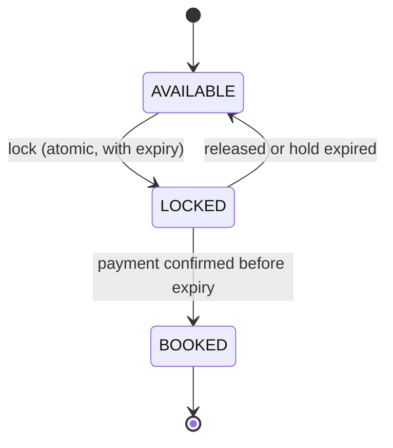

# Study Volume 4 (continued): LLD designs 4 to 9

This page continues **Part 4 of Study Volume 4** right after the vending machine design (4.4). It covers the remaining worked designs with code (elevator, movie booking, task scheduler, logging framework, rate limiter), short design sketches for the other checklist items (LRU/TTL cache angle, library, food delivery, notification framework), the LLD interview questions, and a closing revision box. Same template as before: requirements, entities, patterns, runnable code, design points, edge cases.

## 4.5 Worked design 4: Elevator system

**Requirements.** A building with several elevator cars. Users press a **hall button** (floor and direction) or an **in-car button** (destination). The system assigns a car, and each car serves its stops efficiently. **Out of scope:** door hardware, weight sensors (mention as extensions).

**Entities:** `Elevator` (car: current floor, direction, pending stops), `Request`, `Dispatcher` (chooses which car serves a hall call), `Direction` enum. **Patterns:** **Strategy** for dispatching (nearest car, least loaded), **State** for the car (moving up, moving down, idle, doors open, maintenance), **Observer** for floor displays.

**The core algorithm is the elevator or SCAN algorithm:** keep moving in the current direction, stopping at requested floors on the way, and only reverse when nothing remains ahead. It is efficient and avoids starvation. Keep two **sorted lists of stops**, those above and those below.

```python
from enum import Enum
import bisect

class Direction(Enum):
    UP = 1; DOWN = -1; IDLE = 0

class Elevator:
    def __init__(self, eid):
        self.id, self.floor, self.direction = eid, 0, Direction.IDLE
        self.up_stops, self.down_stops = [], []            # sorted floors still to visit

    def request(self, floor):
        if floor == self.floor: return                      # already here: doors would open
        stops = self.up_stops if floor > self.floor else self.down_stops
        if floor not in stops: bisect.insort(stops, floor)   # ignore duplicates, keep sorted
        if self.direction == Direction.IDLE:
            self.direction = Direction.UP if floor > self.floor else Direction.DOWN

    def step(self):
        """Advance one floor. Returns the floor number if the car stopped there."""
        if self.direction == Direction.UP:
            if not self.up_stops:                           # nothing above: reverse or go idle
                self.direction = Direction.DOWN if self.down_stops else Direction.IDLE
                return None
            self.floor += 1
            if self.floor == self.up_stops[0]:
                self.up_stops.pop(0)
                if not self.up_stops and not self.down_stops: self.direction = Direction.IDLE
                return self.floor
        elif self.direction == Direction.DOWN:
            if not self.down_stops:
                self.direction = Direction.UP if self.up_stops else Direction.IDLE
                return None
            self.floor -= 1
            if self.floor == self.down_stops[-1]:
                self.down_stops.pop()
                if not self.up_stops and not self.down_stops: self.direction = Direction.IDLE
                return self.floor
        return None

class Dispatcher:                                           # strategy: lowest estimated cost wins
    def __init__(self, cars): self.cars = cars
    def cost(self, car, floor, direction):
        if car.direction == Direction.IDLE:
            return abs(car.floor - floor)
        on_the_way = (car.direction == Direction.UP and floor >= car.floor) or \
                     (car.direction == Direction.DOWN and floor <= car.floor)
        if on_the_way and car.direction == direction:       # moving toward the caller in the wanted direction
            return abs(car.floor - floor)
        return 100 + abs(car.floor - floor)                  # must finish its sweep first: penalise
    def assign(self, floor, direction):
        car = min(self.cars, key=lambda c: self.cost(c, floor, direction))
        car.request(floor)
        return car.id

e = Elevator(1)
for f in (5, 3): e.request(f)                               # both above floor 0, stored sorted as [3, 5]
stops = []
while e.direction != Direction.IDLE:
    s = e.step()
    if s is not None: stops.append(s)
print(stops)                                                # [3, 5]   served in floor order, not request order
```

**Design points to say:**

- Why two sorted lists: a request is classified relative to the car's current floor, so serving the 'up' list upward and the 'down' list downward is the SCAN sweep. Insert is O(log n) search plus shifting, fine for a building (use a heap or a sorted container for very large cases).
- **Hall calls need a direction**, because someone going down should not make a car going up stop for them and then continue up. The dispatcher uses it in its cost function.
- **Concurrency:** requests arrive from many buttons at once. The simplest correct design is a **single control loop** (one thread owns each car's state, others only enqueue requests into a thread-safe queue, the actor style). Alternatively guard the stop lists with a lock.
- **Extensions:** capacity and overload, door open and close timing as states, emergency stop and maintenance states, priority (fire service), zoning (express cars to high floors), and observers updating floor displays.
- **Edge cases:** a request for the current floor, duplicate presses, invalid floors, and cars with a full load that should skip hall calls.

## 4.6 Worked design 5: Movie ticket booking (BookMyShow style)

**Requirements.** Browse shows, pick seats, **hold the seats for a few minutes** while paying, then confirm. Two users must **never** book the same seat. Held seats that are not paid for return to the pool automatically.

**Entities:** `Theatre`, `Screen`, `Movie`, `Show` (movie, screen, time), `Seat`, **`ShowSeat`** (the status of one seat **for one show**, the key modelling idea), `Booking`, `Payment`, `User`.

**Seat states:** `AVAILABLE`, `LOCKED` (held by a user with an expiry), `BOOKED`.



This is the same **two-phase hold** as the appointment slot design (free, held, booked), and the same atomic claim from Volume 1 and Volume 2.

```python
from enum import Enum
import threading, time

class SeatStatus(Enum):
    AVAILABLE = 'available'; LOCKED = 'locked'; BOOKED = 'booked'

class SeatError(Exception): pass

class ShowSeats:
    LOCK_TTL = 300                                             # seconds a hold lasts
    def __init__(self, seat_ids, clock=time.time):
        self.clock = clock
        self.status = {s: SeatStatus.AVAILABLE for s in seat_ids}
        self.held_by, self.expires = {}, {}
        self._lock = threading.Lock()

    def _release_expired(self):                                 # call with the lock held
        now = self.clock()
        for s, exp in list(self.expires.items()):
            if exp <= now:
                self.status[s] = SeatStatus.AVAILABLE
                del self.held_by[s], self.expires[s]

    def lock(self, user, seats):                                # ALL seats or none
        with self._lock:
            self._release_expired()
            if any(self.status[s] != SeatStatus.AVAILABLE for s in seats):
                return False
            for s in seats:
                self.status[s] = SeatStatus.LOCKED
                self.held_by[s] = user
                self.expires[s] = self.clock() + self.LOCK_TTL
            return True

    def confirm(self, user, seats):                             # called after payment succeeds
        with self._lock:
            self._release_expired()
            if any(self.status[s] != SeatStatus.LOCKED or self.held_by.get(s) != user for s in seats):
                raise SeatError('seats not held by you (hold expired or taken)')
            for s in seats:
                self.status[s] = SeatStatus.BOOKED
                del self.held_by[s], self.expires[s]

    def release(self, user, seats):
        with self._lock:
            for s in seats:
                if self.held_by.get(s) == user:
                    self.status[s] = SeatStatus.AVAILABLE
                    del self.held_by[s], self.expires[s]

now = [0]
show = ShowSeats(['A1', 'A2', 'A3'], clock=lambda: now[0])
print(show.lock('u1', ['A1', 'A2']))      # True
print(show.lock('u2', ['A2', 'A3']))      # False: A2 is held, and nothing was locked for u2, so A3 stays free
now[0] = 301                              # u1's hold expires
print(show.lock('u2', ['A2', 'A3']))      # True
try:
    show.confirm('u1', ['A1', 'A2'])      # u1 pays too late
except SeatError as e:
    print('u1 failed:', e)
```

**Design points to say:**

- **All-or-nothing locking** avoids a user holding half of the seats they want, and prevents deadlocks from partial acquisition (the same lock-ordering lesson from Volume 1).
- **Expiry** is evaluated lazily on each operation (as above) and also swept by a background job, so abandoned holds do not block seats forever.
- **Atomicity across servers:** the in-memory lock only protects one process. With several servers, make the claim a single database statement inside a transaction: `UPDATE show_seats SET status = 'LOCKED', locked_by = :u, locked_until = now() + interval '5 minutes' WHERE show_id = :s AND seat_id = ANY(:seats) AND (status = 'AVAILABLE' OR (status = 'LOCKED' AND locked_until < now()))`, then check that the **row count equals the number of requested seats**, otherwise roll back. A Redis `SET seat:show:A1 user NX PX 300000` per seat is the other common approach.
- **Payment is the dangerous step:** the user may pay after the hold expired, or the payment callback may arrive twice. Use an **idempotency key** per booking, confirm only if the hold is still valid, and **refund** automatically when confirmation fails after payment.
- **Booking states:** `PENDING`, `CONFIRMED`, `CANCELLED`, `EXPIRED` (State pattern), with notifications through **Observer**, pricing through **Strategy** (weekend, premium seats, coupons).
- **Scale:** seat maps are read constantly, so cache them and refresh on change, but the lock and confirm path must always go to the source of truth.

## 4.7 Worked design 6: Task scheduler (delayed and recurring jobs)

**Requirements.** Run functions **after a delay** or **repeatedly**, on a pool of worker threads. Tasks can be **cancelled**. A failing task must not kill the scheduler. **Out of scope:** persistence across restarts, cron syntax (mention as extensions).

**Core idea.** Keep tasks in a **min-heap ordered by run time**. Worker threads wait on a **condition variable** until the earliest task is due (or until a newer, earlier task arrives, which wakes them to re-evaluate). Heap insert and pop are O(log n).

```python
import heapq, itertools, threading, time

class Scheduler:
    def __init__(self, workers=2, clock=time.monotonic):
        self.clock = clock
        self._heap, self._ids = [], itertools.count()
        self._cv = threading.Condition()
        self._cancelled, self._stopped = set(), False
        for _ in range(workers):
            threading.Thread(target=self._worker, daemon=True).start()

    def schedule(self, fn, delay=0.0, every=None):
        tid = next(self._ids)
        with self._cv:
            heapq.heappush(self._heap, (self.clock() + delay, tid, fn, every))   # tid breaks ties, fn is never compared
            self._cv.notify()                                                    # an earlier task may now be first
        return tid

    def cancel(self, tid):
        with self._cv: self._cancelled.add(tid)

    def stop(self):
        with self._cv:
            self._stopped = True
            self._cv.notify_all()

    def _worker(self):
        while True:
            with self._cv:
                while True:                                    # wait until the earliest task is due
                    if self._stopped: return
                    if not self._heap:
                        self._cv.wait(); continue
                    run_at, tid, fn, every = self._heap[0]
                    wait = run_at - self.clock()
                    if wait <= 0: break
                    self._cv.wait(timeout=wait)                # woken early if a sooner task is added
                heapq.heappop(self._heap)
                if tid in self._cancelled: continue
                if every is not None:                          # recurring: re-queue the next run before executing
                    heapq.heappush(self._heap, (run_at + every, tid, fn, every))
                    self._cv.notify()
            try:
                fn()                                           # run OUTSIDE the lock so tasks do not block scheduling
            except Exception as e:
                print('task failed:', e)                       # one bad task must not kill the worker

s = Scheduler()
s.schedule(lambda: print('hello'), delay=0.1)
tid = s.schedule(lambda: print('tick'), delay=0.05, every=0.1)
time.sleep(0.35); s.cancel(tid); s.stop()                      # prints tick, hello, then tick a couple more times
```

**Design points to say:**

- **Why a condition variable with a timeout**, not polling: workers sleep until needed, no busy loop, and an urgent new task wakes them immediately.
- **Run tasks outside the lock**, otherwise one long task blocks scheduling and cancellation.
- **Cancellation** uses a set checked when a task is popped (lazy deletion, since removing from the middle of a heap is O(n)).
- **Use a monotonic clock** so system time changes do not reorder or stall tasks, and inject it for tests.
- **Recurring semantics:** this is **fixed rate** (the next run is `run_at + every`). If a task takes longer than its interval, runs can overlap or pile up. **Fixed delay** (schedule the next run after the previous finishes) avoids overlap. State which one you chose.
- **Extensions:** retries with exponential backoff and jitter, priorities (tie-break key), task timeouts, a **dead-letter** list for tasks that keep failing, persistence (store tasks in a database or a Redis sorted set scored by run time, which is how Celery Beat and similar schedulers survive restarts), **leader election** so only one node schedules in a cluster, and **idempotent tasks** because delivery is at-least-once. The **Command** pattern fits naturally: a task is a serialisable action plus arguments.

## 4.8 Worked design 7: Logging framework

**Requirements.** Several named **loggers** emit messages at **levels** (DEBUG, INFO, WARNING, ERROR). Messages go to one or more **destinations** (console, file, a test list), each with its own minimum level and **format** (plain text, JSON). Adding a new destination or format must not change existing classes. Logging must be **cheap when disabled** and must **never block or crash the application**.

**Entities:** `Level` (ordered enum), `Record` (an immutable log event), `Formatter`, `Handler` (destination), `Logger`. **Patterns:** **Strategy** for formatters and handlers, **Observer** in effect (a logger notifies all its handlers), **Decorator** (an async handler wrapping any handler), **Singleton or registry** for a logger manager (one logger per name).

```python
import json, queue, sys, threading, time
from dataclasses import dataclass
from enum import IntEnum

class Level(IntEnum):                                  # ordered, so comparisons like level >= threshold just work
    DEBUG = 10; INFO = 20; WARNING = 30; ERROR = 40

@dataclass(frozen=True)
class Record:                                          # immutable: safe to share between handlers and threads
    level: Level
    name: str
    msg: str
    ts: float

class Formatter:
    def format(self, r: Record) -> str:
        return f'{r.ts:.0f} [{r.level.name}] {r.name}: {r.msg}'

class JsonFormatter(Formatter):                        # new format = new class, nothing else changes (OCP)
    def format(self, r: Record) -> str:
        return json.dumps({'ts': r.ts, 'level': r.level.name, 'logger': r.name, 'msg': r.msg})

class Handler:
    def __init__(self, level=Level.DEBUG, formatter=None):
        self.level, self.formatter = level, formatter or Formatter()
    def handle(self, r: Record):
        if r.level >= self.level:                      # each destination filters by its own level
            self.emit(self.formatter.format(r))
    def emit(self, text: str): raise NotImplementedError

class ConsoleHandler(Handler):
    def emit(self, text): print(text, file=sys.stdout)

class ListHandler(Handler):                            # collects lines: ideal for tests
    def __init__(self, *args, **kwargs):
        super().__init__(*args, **kwargs); self.lines = []
    def emit(self, text): self.lines.append(text)

class AsyncHandler(Handler):                           # decorator: wraps any handler so callers never wait on slow I/O
    def __init__(self, inner: Handler, maxsize=10000):
        super().__init__(Level.DEBUG)
        self.inner, self.q = inner, queue.Queue(maxsize)
        threading.Thread(target=self._drain, daemon=True).start()
    def handle(self, r):
        try: self.q.put_nowait(r)
        except queue.Full: pass                        # under overload drop (and count) rather than block the app
    def _drain(self):
        while True: self.inner.handle(self.q.get())

class Logger:
    def __init__(self, name, level=Level.INFO, handlers=None, clock=time.time):
        self.name, self.level, self.handlers, self.clock = name, level, list(handlers or []), clock
    def log(self, level, msg, *args):
        if level < self.level: return                  # cheap early exit BEFORE any formatting work
        text = msg % args if args else msg             # lazy formatting: only paid when the record is emitted
        record = Record(level, self.name, text, self.clock())
        for h in self.handlers:
            try: h.handle(record)
            except Exception: pass                     # a broken sink must never crash the application
    def debug(self, msg, *a): self.log(Level.DEBUG, msg, *a)
    def info(self, msg, *a):  self.log(Level.INFO, msg, *a)
    def error(self, msg, *a): self.log(Level.ERROR, msg, *a)

sink = ListHandler(level=Level.ERROR)
log = Logger('booking', Level.INFO, [ConsoleHandler(), sink], clock=lambda: 1700000000)
log.debug('ignored')                 # below the logger's level: dropped immediately
log.info('slot %s held', 7)          # console prints: 1700000000 [INFO] booking: slot 7 held
log.error('payment failed')          # console prints it too, and the sink keeps it
print(len(sink.lines))               # 1
```

**Design points to say:**

- **Two levels of filtering:** the logger drops cheap, irrelevant records early, and each handler applies its own threshold (errors to a pager, everything to a file).
- **Lazy formatting** (`msg % args` only after the level check) avoids building strings for disabled debug logs on hot paths.
- **Async handler:** disk and network are slow, so a bounded queue and a background thread keep the caller fast. **Bounded** is essential, an unbounded queue becomes a memory leak under load. State what you do when it is full (drop, count, or block) and flush on shutdown.
- **Hierarchy:** real frameworks name loggers `app.booking.payments` and let children inherit parent level and handlers. A **manager** (registry or singleton) returns the same logger for the same name.
- **Context:** attach a **request id** or user id to every record (Python's `contextvars`), so one request can be traced across modules and services. **Structured (JSON) logs** are searchable by field.
- **Operational concerns:** log rotation and retention, never log secrets or personal data, thread safety of handlers that write to a shared file, time zones (log UTC), and sampling for very high-volume messages.

## 4.9 Worked design 8: Rate limiter

**Requirements.** Allow at most N requests per user (or key) over time, reject the rest with a clear signal, add negligible latency, and be correct when many threads call it. The algorithm must be swappable. **Out of scope** for the first version: the distributed deployment (covered after the code).

**Pattern:** **Strategy**, with a common `allow()` interface and interchangeable algorithms.

| Algorithm | Idea | Pros | Cons |
| --- | --- | --- | --- |
| **Token bucket** | Tokens refill at a steady rate up to a capacity, each request spends one | Allows controlled bursts, O(1) memory per key | Two parameters to explain |
| **Leaky bucket** | Requests drain at a constant rate | Smooth output | No bursts |
| **Fixed window counter** | Count per time window | Simple | Up to 2x burst across a window boundary |
| **Sliding window log** | Keep timestamps of recent requests | Exact | Memory grows with the limit |
| **Sliding window counter** | Weighted blend of the current and previous window | Good accuracy, small memory | Approximate |

```python
import threading, time
from collections import deque

class TokenBucket:
    def __init__(self, rate, capacity, clock=time.monotonic):
        self.rate, self.capacity, self.clock = rate, capacity, clock       # tokens per second, max burst
        self.tokens, self.last = capacity, clock()
        self._lock = threading.Lock()
    def allow(self, cost=1):
        with self._lock:                                                    # refill and spend as ONE atomic step
            now = self.clock()
            self.tokens = min(self.capacity, self.tokens + (now - self.last) * self.rate)
            self.last = now
            if self.tokens >= cost:
                self.tokens -= cost
                return True
            return False

class SlidingWindowLog:
    def __init__(self, limit, window, clock=time.monotonic):
        self.limit, self.window, self.clock, self.hits = limit, window, clock, deque()
        self._lock = threading.Lock()
    def allow(self):
        with self._lock:
            now = self.clock()
            while self.hits and self.hits[0] <= now - self.window:
                self.hits.popleft()                                         # forget requests outside the window
            if len(self.hits) < self.limit:
                self.hits.append(now); return True
            return False

class RateLimiter:                                                          # one limiter per key (user, API key, IP)
    def __init__(self, make_limiter):
        self.make, self.limiters, self._lock = make_limiter, {}, threading.Lock()
    def allow(self, key):
        with self._lock:
            limiter = self.limiters.setdefault(key, self.make())
        return limiter.allow()

now = [0]
b = TokenBucket(rate=1, capacity=3, clock=lambda: now[0])       # 1 token per second, burst of 3
print([b.allow() for _ in range(4)])                           # [True, True, True, False]  the burst is spent
now[0] = 2                                                     # two seconds pass: two tokens refill
print([b.allow() for _ in range(3)])                           # [True, True, False]
```

**Design points to say:**

- **Refill lazily** (compute tokens from elapsed time on each call) rather than running a timer thread per bucket. It is O(1) and has no background work.
- **Atomicity matters:** without the lock, two threads could both see one token and both spend it (a check-then-act race, the same TOCTOU as everywhere else in these notes).
- **Memory:** a dictionary of limiters per key grows forever. Evict idle keys (a TTL or an LRU), otherwise an attacker rotating keys exhausts memory.
- **Response contract:** return HTTP **429 Too Many Requests** with a **`Retry-After`** header, and optionally `X-RateLimit-Remaining`, so clients can back off.
- **Where to put it:** at the edge (API gateway or reverse proxy) for coarse protection, in the application for per-user business limits. Limit by the right key: user id after authentication, IP before it (careful with shared NATs and spoofable `X-Forwarded-For`).

**Distributed version (many app servers share one limit).** Keep the bucket in **Redis** and make the read-refill-spend sequence **one atomic Lua script**, otherwise two servers race:

```lua
-- KEYS[1] = bucket key; ARGV = rate, capacity, now (from the Redis TIME command), cost
local d = redis.call('HMGET', KEYS[1], 'tokens', 'ts')
local capacity, rate, now, cost = tonumber(ARGV[2]), tonumber(ARGV[1]), tonumber(ARGV[3]), tonumber(ARGV[4])
local tokens = tonumber(d[1]) or capacity
local ts = tonumber(d[2]) or now
tokens = math.min(capacity, tokens + (now - ts) * rate)
local allowed = 0
if tokens >= cost then tokens = tokens - cost; allowed = 1 end
redis.call('HSET', KEYS[1], 'tokens', tokens, 'ts', now)
redis.call('EXPIRE', KEYS[1], 120)          -- idle buckets disappear on their own
return allowed
```

Decide what happens when Redis is unreachable: **fail open** (allow, favouring availability, which your appointment system does) or **fail closed** (reject, favouring protection). Say which you chose and why. Use Redis's own clock (or one source of time) to avoid skew between app servers.

## 4.10 Design sketches for the remaining checklist problems

For each of these you should be able to produce, in 15 to 20 minutes, the requirements list, the class list with responsibilities, the main flow in code, the patterns, the concurrency fix, and one extension.

### LRU cache and TTL cache (the design angle)

The full implementations are in the Interview Notes document, Part 4. For the design discussion:

- **Structure:** a hash map for O(1) lookup plus a **doubly linked list** ordered by recency (head = most recent). `get` moves a node to the head, `put` inserts at the head and evicts the tail when full. Both operations are O(1).
- **Eviction as a Strategy:** an `EvictionPolicy` interface (LRU, LFU, FIFO) lets the same cache class support several policies without changes.
- **TTL:** store an expiry with each entry, expire **lazily** on access plus a **background sweep** (or a min-heap of expiry times), and use an injected monotonic clock for tests.
- **Concurrency:** a single lock is correct but serialises everything. For throughput use **sharded locks** (hash the key to one of N independent caches). `get` mutates the recency list, so even reads need the lock in strict LRU.
- **Extensions:** generics and type hints, metrics (hit ratio, evictions), a loader function for **read-through**, per-entry size accounting, stampede protection (one thread loads a missing key while others wait).

### Library management system

- **Entities:** `Book` (title, ISBN, authors) versus **`BookItem`** (one physical copy with a barcode and status). Mixing them up is the classic mistake. Also `Member`, `Librarian`, `Loan` (issue date, due date, return date), `Reservation`, `Fine`.
- **Rules:** maximum books per member, loan period, renewal limits, one reservation queue per title (first in, first served), fine = overdue days times a rate.
- **Patterns:** **Strategy** for fine calculation (flat per day, tiered, by membership type), **Observer** to notify the first member in the reservation queue when a copy is returned, **Factory** for member types, **Repository** for storage.
- **The atomic step:** checking out a copy is a claim: `UPDATE book_items SET status = 'LOANED' WHERE id = :id AND status = 'AVAILABLE'`, then check the row count. Check the member's limit and unpaid fines **inside the same transaction**.
- **Core code shape:**

```python
from datetime import date, timedelta

class Library:
    def __init__(self, loan_days=14, max_loans=5, fine_per_day=2, today=date.today):
        self.loan_days, self.max_loans, self.fine_per_day, self.today = loan_days, max_loans, fine_per_day, today
        self.available = {}          # barcode -> title for copies on the shelf
        self.loans = {}              # barcode -> (member, due_date)

    def checkout(self, member, barcode):
        if barcode not in self.available: raise ValueError('copy not available')
        if sum(1 for m, _ in self.loans.values() if m == member) >= self.max_loans:
            raise ValueError('loan limit reached')
        title = self.available.pop(barcode)                  # claim the copy (atomic in the real database)
        self.loans[barcode] = (member, self.today() + timedelta(days=self.loan_days))
        return title

    def return_copy(self, barcode, title=''):
        member, due = self.loans.pop(barcode)
        self.available[barcode] = title
        late = (self.today() - due).days
        return max(0, late) * self.fine_per_day               # fine owed (0 if on time)
```

- **Edge cases:** returning a copy that was never loaned, a reserved book being checked out by someone else (check the queue first), lost or damaged copies (a status), search by title, author and subject (index each field).

### Food delivery system

- **Entities:** `Customer`, `Restaurant`, `MenuItem`, `Cart`, `Order`, `OrderItem`, `DeliveryAgent`, `Payment`, `Address`.
- **State machine for the order:** `PLACED -> ACCEPTED -> PREPARING -> READY -> PICKED_UP -> DELIVERED`, with `CANCELLED` and `REJECTED` branches. Keep the legal transitions in **one table** (see the State pattern) and enforce each transition with an atomic conditional update.
- **Strategy:** agent assignment (nearest available, least loaded, rating-weighted) and delivery fee (distance, surge). **Observer:** status changes notify the customer, restaurant and agent. **Factory:** payment methods. **Command or events:** order lifecycle events for auditing.
- **Hard parts:** assigning an agent atomically (an agent must not receive two simultaneous orders, same claim pattern), what happens when no agent accepts (widen the radius, retry, escalate), price calculation fixed at order time (snapshot prices, never recompute from the live menu), cancellation windows and refunds, payment failure after the restaurant accepted, and idempotent order creation (idempotency key) so a retry never double-orders.

### Notification framework

- **Entities:** `Notification` (recipient, template, data, priority), `Channel` interface (`EmailChannel`, `SmsChannel`, `PushChannel`), `Template` renderer, `UserPreference` (allowed channels, quiet hours), `NotificationService`.
- **Patterns:** **Strategy** per channel, **Factory** (registry) to resolve a channel by name, **Observer** or an event bus so domain events trigger notifications without the sender knowing channels, **Decorator** to wrap any channel with **retry with backoff**, **rate limiting** or logging (this is the same retry decorator from Part 3, so remember the idempotency warning).
- **Flow:** event arrives, load recipient preferences, render the template, pick channels, enqueue one job per channel (asynchronous, never in the request path), channel workers send and record the status, failures retry with backoff and finally go to a dead-letter list.
- **Hard parts:** **at-least-once delivery means duplicates**, so give every notification an id and de-duplicate at the sender and provider (idempotency), priorities (a one-time password must not wait behind a newsletter), quiet hours, provider failover (try SMS provider B when A fails), template versioning, and **outbox** writes so a notification is recorded in the same transaction as the business change that caused it.
- **Extensibility test:** adding WhatsApp is one new `Channel` class and one registry entry, with no change to the service.

## 4.11 Cross-cutting checklist for any LLD answer

Run this list in the last five minutes before you finish, aloud:

1. **Requirements restated**, with what is out of scope.
2. **Entities and responsibilities:** each class has one reason to change (SRP).
3. **Variation points are interfaces** (Strategy, State, Factory), so new types are new classes (OCP).
4. **Dependencies are injected**, including the clock, so the code is testable (DIP).
5. **Invariants live inside the objects** (encapsulation), money is integer, state is an enum, no stringly-typed status.
6. **The one hard problem** is named and solved (usually: two actors claiming one resource, a state machine, or time and expiry).
7. **Concurrency:** what is shared, what protects it, and the database equivalent for multiple servers (atomic conditional update, unique constraint, row lock, Redis `SET NX`).
8. **Failure paths:** invalid input, limits, expiry, payment failure after a hold, partial failure and compensation.
9. **Idempotency:** what happens if the same request arrives twice.
10. **Extensions:** one new feature added without editing existing classes, and what changes at scale.

### Which patterns appeared where

| Design | Main patterns | The hard part |
| --- | --- | --- |
| Parking lot | Strategy (allocation, pricing), Factory | Atomic pick-and-claim of a spot |
| Splitwise | Strategy (split types), Observer (notifications) | Integer money, rounding, debt simplification |
| Vending machine | State | Legal operations per state, change-making |
| Elevator | Strategy (dispatch), State, Observer | SCAN scheduling, concurrent requests |
| Movie booking | State, Strategy (pricing), Observer | Seat hold with expiry, atomic multi-seat claim, payment after expiry |
| Task scheduler | Command, Strategy (retry) | Heap plus condition variable, lazy cancel, recurring semantics |
| Logging framework | Strategy, Decorator, Observer, Singleton or registry | Cheap when disabled, non-blocking, never crash the app |
| Rate limiter | Strategy | Atomic refill and spend, memory per key, distributed atomicity |
| LRU or TTL cache | Strategy (eviction) | O(1) design, locking, expiry |
| Library | Strategy (fines), Observer | Copy versus title, atomic checkout |
| Food delivery | State, Strategy, Observer | Atomic agent assignment, price snapshots |
| Notification framework | Strategy, Factory, Decorator, Observer | Duplicates, priorities, retries |

### Interview questions on LLD

- **How do you start an LLD problem?** Clarify requirements and scope, list entities from the nouns and behaviours from the verbs, then sketch classes and relationships before writing any code.
- **How do you decide what becomes a class?** A concept with its own state and rules that change for their own reasons. A value with no behaviour can be a field or a small value object.
- **Where do you use Strategy versus State?** Strategy: interchangeable algorithm chosen by the client. State: the object's own lifecycle changes its behaviour and transitions are part of the design.
- **How do you make your design thread safe?** Identify shared mutable state, protect check-and-act sequences as one atomic step, keep lock scope small, never call unknown code under a lock, and describe the distributed equivalent (atomic database update, unique constraint, Redis `SET NX`).
- **How do you design for testability?** Inject dependencies and the clock, use interfaces, keep I/O at the edges, prefer fakes to mocks.
- **How would you extend this design with a new feature?** Show it added as a new class behind an existing interface, with no edits to existing classes.
- **What would change if this had to scale to many servers?** In-memory state moves to a database or Redis, locks become atomic conditional updates, work goes through queues, and idempotency plus outbox patterns protect against retries.
- **What did you deliberately leave out?** State out-of-scope items and why, which shows judgement instead of over-engineering.

### Revise in 30 seconds: LLD

- Method: clarify, entities, relationships, core flows in code, patterns with reasons, concurrency, extensions. Start with enums and interfaces, finish with a runnable demo.
- Parking lot: Strategy for allocation and pricing, lock around pick-and-claim. Splitwise: integer money, rounding remainder, simplify via net balances and two heaps. Vending machine: State classes. Elevator: SCAN with two sorted stop lists, dispatcher cost strategy.
- Movie booking: ShowSeat status per show, all-or-nothing lock with expiry, confirm only while held, payment idempotency and refund. Scheduler: min-heap plus condition variable, run tasks outside the lock, lazy cancel, fixed rate versus fixed delay.
- Logger: levels, handlers, formatters, early exit and lazy formatting, bounded async handler, never crash the app. Rate limiter: token bucket with lazy refill, lock or Redis Lua for atomicity, evict idle keys, 429 plus Retry-After.
- Always: inject the clock, money as integers, enums for states, atomic claim for shared resources, idempotency for retries.

## What Volume 4 covers, and what comes next

Volume 4 covers the OOP and design items from your checklist in depth: OOP fundamentals, SOLID with refactors, creational, structural and behavioural patterns with code and traps, the LLD method, and twelve worked or sketched designs. Next in the series is **Volume 5: backend engineering and deployment** (Git and collaboration, Docker and Compose, CI/CD, Redis caching and background jobs, configuration, logging and observability, cloud deployment and troubleshooting), followed by system design (HLD), ML and GenAI, DSA patterns, and the systems and programming volume (C++, Linux, compilers, architecture).