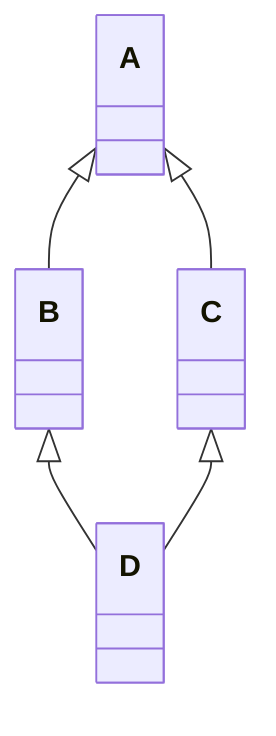
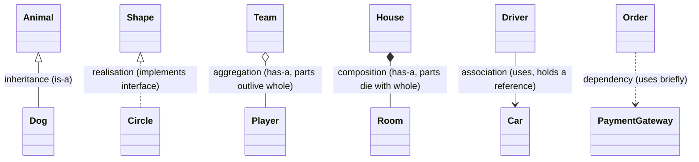
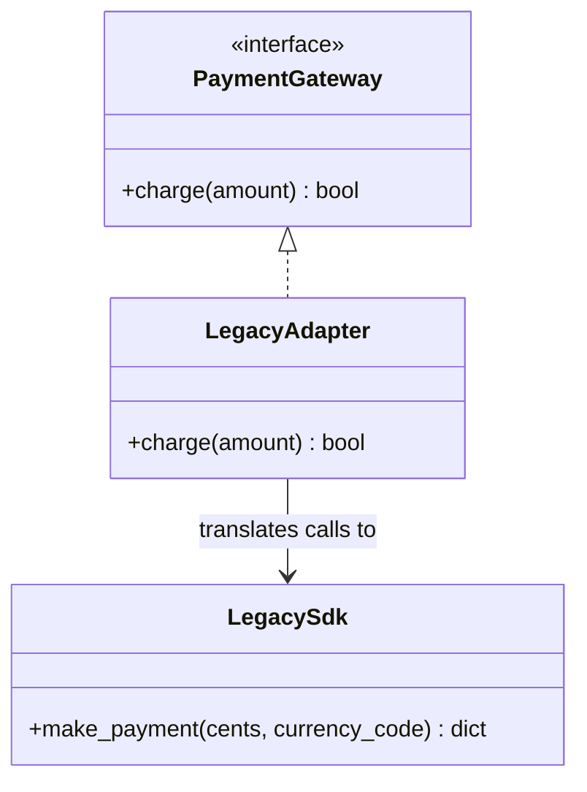
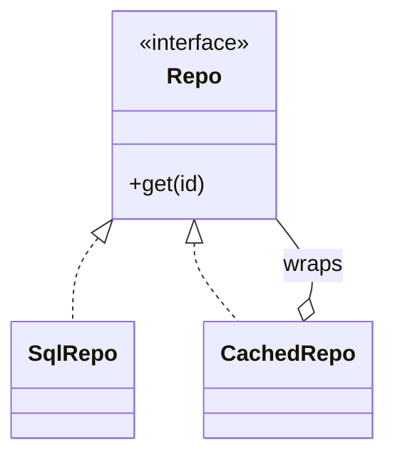
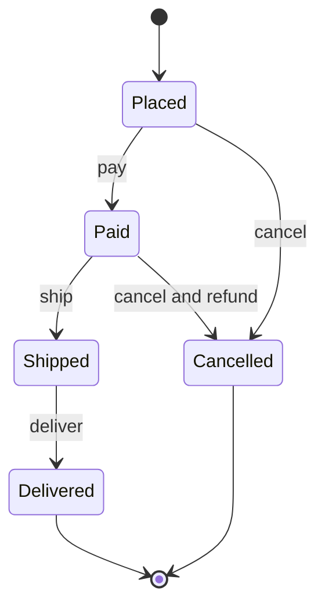
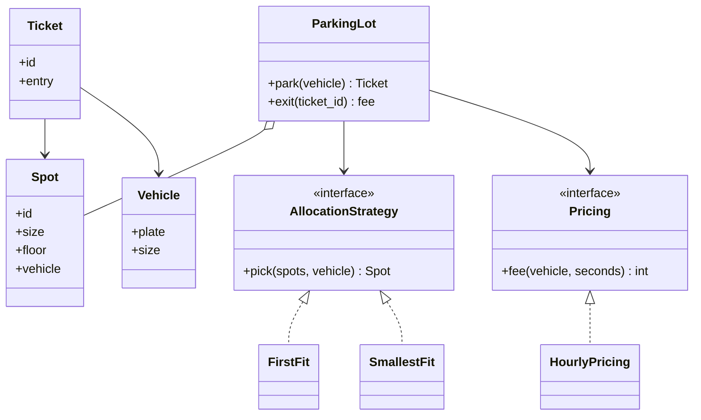
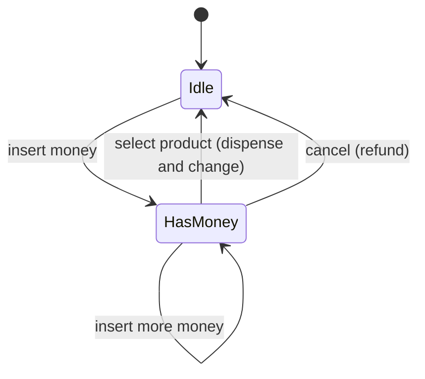

# Study Volume 4: OOP, SOLID, Design Patterns and Low-Level Design

Fourth volume of the in-depth study set, same template as before: the idea, how it works, a diagram, runnable code, the loopholes where people go wrong, interview questions, and a **Revise in 30 seconds** box. Code is Python, because that is your main language, with notes where Java or C++ differ. This volume is the foundation for the LLD round, where you design classes for a parking lot, a booking system or a cache on a whiteboard.

## Contents of this volume

- Part 1: OOP fundamentals: classes, encapsulation, abstraction, inheritance, polymorphism, object relationships, composition, dependency injection
- Part 2: SOLID, each principle with a violation, a refactor and a detection rule
- Part 3: Design patterns: creational, structural and behavioural, with code and the traps
- Part 4: The LLD method, then worked designs with full code: parking lot, Splitwise, vending machine, elevator, movie booking, task scheduler, logging framework, rate limiter, and sketches of the rest

Part 1 is in this first section, and the rest follow below.

## Part 1: OOP fundamentals

### 1.1 What object-oriented design is really for

**The idea.** A program is a pile of state and the operations on it. OOP bundles **state together with the behaviour that is allowed to change it**, so that the rules (invariants) live in one place. A `BankAccount` that can never go negative is enforced by the account's own methods, not by every caller remembering to check. Its payoff is managing complexity: small objects with clear responsibilities, replaceable behind interfaces, tested in isolation.

**Loophole.** OOP is a tool, not a goal. Interviewers do not want maximum classes, they want the **smallest design that keeps change cheap**. Over-engineering (a factory for a single class) is as bad as a 600-line `Manager` class.

### 1.2 Classes and objects in Python, with the traps

A **class** is a blueprint (attributes plus methods). An **object** (instance) is one concrete thing built from it, with its own state. `self` is the instance passed to each method.

```python
class Task:
    count = 0                        # class attribute: shared by all instances
    def __init__(self, title):       # initialiser: runs when the object is created
        self.title = title           # instance attribute: one per object
        Task.count += 1
    def __repr__(self):              # unambiguous debug text, shown in the REPL and logs
        return f'Task({self.title!r})'
```

**Traps you should be able to explain:**

```python
# 1. A mutable CLASS attribute is shared by every instance
class Bad:
    items = []                       # ONE list for all instances
    def add(self, x): self.items.append(x)
a, b = Bad(), Bad(); a.add(1)
print(b.items)                       # [1]   b sees a's data. Create the list in __init__ instead.

# 2. A mutable DEFAULT argument is created once, when the function is defined
def add_item(x, bucket=[]):
    bucket.append(x); return bucket
print(add_item(1), add_item(2))      # [1, 2] [1, 2]   same list both times
# fix: def add_item(x, bucket=None): bucket = [] if bucket is None else bucket

# 3. Defining __eq__ removes the default __hash__
class P:
    def __init__(self, x): self.x = x
    def __eq__(self, o): return isinstance(o, P) and self.x == o.x
# hash(P(1)) raises TypeError: unhashable type. Define __hash__ consistently, or use a frozen dataclass.
```

- **Equality vs identity:** `a == b` calls `__eq__` (same value), `a is b` tests the same object. The contract: **objects that are equal must have equal hashes**, and a mutable object used as a dict key or set member must not change the fields its hash depends on.
- **Methods by kind:** instance method (gets `self`), `@classmethod` (gets the class, used for alternative constructors like `Task.from_dict`), `@staticmethod` (no implicit argument, a plain function namespaced under the class).
- **`@property`** turns a method into an attribute, so you can add validation later without changing callers.
- **`@dataclass`** generates `__init__`, `__repr__` and `__eq__`. With `frozen=True` the object is **immutable and hashable**, ideal for value objects such as `Money`.

```python
from dataclasses import dataclass

@dataclass(frozen=True)
class Money:                         # a value object: equal if the fields are equal, cannot be changed
    amount: int                      # keep money in integer minor units (paise, cents), never floats
    currency: str = 'INR'
    def add(self, other: 'Money') -> 'Money':
        if other.currency != self.currency: raise ValueError('currency mismatch')
        return Money(self.amount + other.amount, self.currency)
```

- **`__slots__`** fixes the attribute set and saves memory when you create millions of small objects.
- **Copying:** assignment copies the *reference*. `copy.copy` is **shallow** (new outer object, same inner objects). `copy.deepcopy` copies the whole graph. Mixing these up causes spooky shared-state bugs.
- **Context managers** (`__enter__`, `__exit__`, `with`) are RAII in Python: acquire in `__enter__`, release in `__exit__`, even if an exception occurs (files, locks, transactions).

### 1.3 Encapsulation

**The idea.** Hide the internal representation, expose a small interface, and keep **invariants** (rules that must always hold) enforced inside the class. Callers cannot put the object into an invalid state because the only way in is through methods that check.

```python
class InsufficientFunds(Exception): pass

class Account:
    def __init__(self, owner: str, balance: int = 0):
        if balance < 0: raise ValueError('opening balance cannot be negative')
        self._owner, self._balance = owner, balance      # leading underscore: internal, by convention

    @property
    def balance(self) -> int:                            # read-only from outside
        return self._balance

    def deposit(self, amount: int) -> None:
        if amount <= 0: raise ValueError('amount must be positive')
        self._balance += amount

    def withdraw(self, amount: int) -> None:
        if amount > self._balance: raise InsufficientFunds(f'balance {self._balance}, asked {amount}')
        self._balance -= amount
```

**Loopholes and nuances.**

- Python has **no true private members**. `_x` is a convention, and `__x` only triggers **name mangling** (`_Account__x`) to avoid clashes in subclasses, it is not security. Java and C++ enforce `private` at compile time.
- Getters and setters on everything is not encapsulation, it is just verbose public fields. Real encapsulation exposes **behaviour** (`withdraw`), not raw state.
- **Tell, don't ask:** instead of `if account.balance >= x: account.balance -= x`, tell the object to do it (`account.withdraw(x)`), so the rule lives in one place. The `if` outside also has a race condition in concurrent code (Volume 1: TOCTOU).
- **Law of Demeter** (principle of least knowledge): a method should talk only to its own fields, parameters and objects it creates, not reach through chains like `order.customer.address.city.pincode`. Long chains couple you to internal structure.
- The class above is **not thread safe**. Two threads calling `withdraw` can interleave. Add a lock, or make the database do an atomic conditional update.

### 1.4 Abstraction, interfaces, abstract classes

**The idea.** Expose **what** something does, hide **how**. Code depends on a contract, so implementations can change.

```python
from abc import ABC, abstractmethod
from typing import Protocol

class PaymentMethod(ABC):                      # abstract base class: cannot be instantiated
    @abstractmethod
    def pay(self, amount: int) -> bool: ...
    def receipt(self, amount: int) -> str:     # shared, concrete behaviour
        return f'paid {amount} via {type(self).__name__}'

class Card(PaymentMethod):
    def pay(self, amount): return True

# PaymentMethod() raises TypeError. A subclass that forgets pay() also cannot be instantiated.

class Notifier(Protocol):                      # structural typing: anything with send(...) qualifies, no inheritance needed
    def send(self, to: str, msg: str) -> None: ...
```

- **Interface** (pure contract, no state). **Abstract class** (contract plus shared code and state). Java: a class can implement many interfaces but extend one class. Python has no `interface` keyword: use `ABC` for explicit contracts (nominal, checked at instantiation) or `typing.Protocol` for **structural** contracts (duck typing with static checking).
- Choose an interface for a **capability** ('can be paid', 'can be serialised'), an abstract base class for a **family with shared behaviour**.

### 1.5 Inheritance and the method resolution order

**The idea.** A subclass **is a** specialised version of its parent and reuses its code. It gives code reuse and polymorphism, at the price of tight coupling to the parent (the **fragile base class** problem: changing the parent can break every child).

```python
class A:
    def hello(self): return 'A'
class B(A):
    def hello(self): return 'B' + super().hello()
class C(A):
    def hello(self): return 'C' + super().hello()
class D(B, C):                                  # the diamond
    def hello(self): return 'D' + super().hello()

print(D().hello())                              # DBCA
print([k.__name__ for k in D.__mro__])          # ['D', 'B', 'C', 'A', 'object']
```



- Python resolves methods with **C3 linearisation (MRO)**: children before parents, and left-to-right order of bases preserved. `super()` means 'the **next class in the MRO**', not 'the parent', which is why it cooperates correctly in the diamond and calls `A.hello` only once.
- **Mixins** are small classes adding one capability (`LoggingMixin`) meant to be combined by multiple inheritance. Keep them stateless and focused.
- **Rules for good inheritance:** use it only for a true **is-a** relationship where the subclass honours the parent's contract (Liskov, Part 2). Prefer **composition** otherwise. Keep hierarchies shallow, 2 or 3 levels. Never inherit just to reuse a few lines.
- Always call `super().__init__(...)` so every base class is initialised.

### 1.6 Polymorphism

**The idea.** One interface, many implementations, and the right one runs depending on the actual object.

- **Subtype (runtime) polymorphism:** `for shape in shapes: shape.area()` works whether each is a `Circle` or `Rect`. In C++ and Java this is **dynamic dispatch** through a **vtable** (a per-class table of function pointers looked up at call time).
- **Overriding** (subclass replaces a parent method, resolved at runtime) versus **overloading** (several methods with the same name but different parameters, resolved at compile time in Java and C++). **Python has no overloading** by signature, the later definition wins. Emulate with default arguments or `functools.singledispatch`.
- **Duck typing:** 'if it quacks like a duck'. Python only needs the method to exist at call time, no declared relationship.
- **Operator overloading** via dunder methods (`__add__`, `__lt__`, `__len__`) makes your types feel built in. Use it only where the meaning is obvious.

```python
class Shape:
    def area(self): raise NotImplementedError
class Circle(Shape):
    def __init__(self, r): self.r = r
    def area(self): return 3.14159 * self.r ** 2
class Rect(Shape):
    def __init__(self, w, h): self.w, self.h = w, h
    def area(self): return self.w * self.h
print(sum(s.area() for s in [Circle(1), Rect(2, 3)]))     # the caller never checks the type
```

**Loophole:** an `if isinstance(x, Circle) ... elif isinstance(x, Rect)` chain in the *caller* is the sign polymorphism is being bypassed. Every new type forces you to edit that chain (it violates open/closed).

### 1.7 Relationships between classes



| Relationship | Meaning | Lifetime | Example |
| --- | --- | --- | --- |
| **Dependency** | One class uses another briefly (parameter, local variable) | Short | `Order.pay(gateway)` |
| **Association** | One class holds a reference to another | Independent | `Driver` knows a `Car` |
| **Aggregation** | Whole has parts, parts can exist without it | Parts outlive the whole | `Team` has `Player`s |
| **Composition** | Whole owns parts, parts die with it | Same as the whole | `House` has `Room`s |
| **Inheritance** | is-a | n/a | `Dog` is an `Animal` |

The aggregation versus composition distinction is about **ownership and lifetime**, and interviewers like to ask it. In code, composition usually means the whole *creates* the parts, aggregation means the parts are *passed in*.

### 1.8 Composition over inheritance, with an example

**The idea.** Build behaviour by **combining small objects** instead of inheriting it. Composition is more flexible (change behaviour at runtime), avoids deep hierarchies, and makes testing easier.

```python
# Inheritance explosion: EmailAlertDuck, SmsAlertDuck, EmailAndSmsAlertDuck ...
# Composition: the object HAS notifiers and delegates to them
class Alerter:
    def __init__(self, *channels):            # channels are any objects with send(msg)
        self.channels = channels
    def alert(self, msg):
        for ch in self.channels: ch.send(msg)

class Email:
    def send(self, msg): print('email:', msg)
class Sms:
    def send(self, msg): print('sms:', msg)

Alerter(Email(), Sms()).alert('disk full')    # any combination, chosen at runtime, no new class
```

**When inheritance is right:** a stable, genuine is-a relationship where substitutability holds, and a framework expects you to subclass (`unittest.TestCase`, `Exception`, an abstract base). Otherwise reach for composition.

### 1.9 Coupling, cohesion, and the small principles

- **Cohesion:** how closely the things inside a class belong together. **High cohesion** (one clear purpose) is good. A `Utils` class with unrelated functions is low cohesion.
- **Coupling:** how much classes know about each other. **Low coupling** is good: depend on interfaces, not concrete classes, so changes do not ripple.
- **DRY** (don't repeat yourself: one source of truth for each piece of knowledge), **KISS** (keep it simple), **YAGNI** (you aren't gonna need it: do not build for hypothetical futures), **separation of concerns**, and **favour immutability** (immutable objects are thread safe and easy to reason about).

### 1.10 Dependency injection and testability

**The idea.** A class should receive the things it depends on (database, clock, HTTP client) instead of creating them itself. Then you can swap real ones for fakes in tests, and swap implementations in production.

```python
from datetime import datetime
from typing import Protocol

class SlotRepo(Protocol):
    def claim(self, slot_id: int) -> bool: ...

class BookingService:
    def __init__(self, repo: SlotRepo, clock=datetime.now):      # dependencies come in from outside
        self.repo, self.clock = repo, clock
    def book(self, slot_id: int) -> str:
        return 'booked at ' + self.clock().isoformat() if self.repo.claim(slot_id) else 'slot taken'

class FakeRepo:                                                 # in-memory stand-in for tests
    def __init__(self): self.taken = set()
    def claim(self, slot_id):
        if slot_id in self.taken: return False
        self.taken.add(slot_id); return True

svc = BookingService(FakeRepo(), clock=lambda: datetime(2026, 1, 1))
print(svc.book(7))      # booked at 2026-01-01T00:00:00
print(svc.book(7))      # slot taken
```

The time is injected too, so the test is deterministic. A class that calls `datetime.now()` or `psycopg2.connect()` inside its methods is hard to test. Forms of injection: constructor (preferred), setter, or function parameter. FastAPI's `Depends(...)` is dependency injection built into the framework. A **DI container** just automates the wiring, it is optional, and most Python code wires dependencies by hand.

**Testing vocabulary:** a **stub** returns canned answers, a **fake** is a working lightweight implementation (the in-memory repository), a **mock** records calls so you can assert on them, a **spy** wraps the real thing. Prefer fakes over heavy mocking, because mocks tie tests to implementation details.

### 1.11 Error handling in OOP design

- Raise **specific exceptions** (`SlotAlreadyBooked`, `InsufficientFunds`) that inherit from a project base (`class BookingError(Exception)`), so callers catch what they can handle.
- **Fail fast** with validation in constructors and at boundaries. Never silently swallow errors (`except Exception: pass`), and never use a bare `except:`.
- Clean up with `with` or `try/finally`. Wrap low-level exceptions into domain exceptions at layer boundaries (`raise BookingError(...) from e` keeps the cause).
- Do not use exceptions for ordinary control flow in hot paths, and do not return error codes mixed with normal values (`-1`).
- Make the error message actionable (what failed, with which values), and never put secrets in it.

### Interview questions on OOP

- **Four pillars with a real example each?** Encapsulation (account invariants), abstraction (payment interface), inheritance (shared base behaviour), polymorphism (loop over shapes).
- **Abstract class vs interface?** Contract with shared code and state versus a pure capability contract. Many interfaces, one base class in Java. In Python: ABC versus Protocol.
- **Aggregation vs composition?** Ownership and lifetime.
- **Why prefer composition over inheritance?** Flexible at runtime, avoids fragile deep hierarchies, easier to test.
- **What is the diamond problem and how does Python solve it?** Ambiguity of which parent method runs. C3 linearisation (MRO) and cooperative `super()`.
- **Overloading vs overriding? Does Python support overloading?** Compile-time by signature versus runtime replacement. No, use defaults or `singledispatch`.
- **What does `__eq__` without `__hash__` do?** Makes the class unhashable. Equal objects must hash equally.
- **Shallow vs deep copy?** Same inner objects versus a full independent copy.
- **How does dependency injection help testing?** Collaborators can be replaced by fakes, so tests are fast and deterministic.

### Revise in 30 seconds: OOP fundamentals

- OOP bundles state with the behaviour that protects its invariants. Encapsulation = expose behaviour, not fields. Python privacy is by convention.
- Traps: mutable class attributes and default arguments are shared, `__eq__` needs `__hash__`, shallow versus deep copy, equality versus identity.
- ABC for explicit contracts, Protocol for structural duck typing. Inheritance = is-a with substitutability, MRO uses C3 and `super()` follows it.
- Relationships: dependency, association, aggregation (parts outlive), composition (parts die with), inheritance. Composition over inheritance for flexibility.
- Low coupling, high cohesion, Law of Demeter, tell don't ask. Inject dependencies (including the clock) for testability. Specific exceptions, fail fast, never swallow.

## Part 2: SOLID

**What SOLID is.** Five design guidelines, popularised by Robert C. Martin, for classes that stay easy to change. They are **heuristics, not laws**: the aim is that a new requirement touches few places and breaks nothing else. For each principle below you get the statement, a **violation you can recognise**, the **refactor**, the **smell that tells you it is violated**, and the **common misunderstanding**.

| Letter | Principle | One-line test |
| --- | --- | --- |
| **S** | Single Responsibility | Does the class have exactly one reason to change? |
| **O** | Open/Closed | Can I add a new variant without editing existing code? |
| **L** | Liskov Substitution | Can a subclass stand in for its parent without surprising the caller? |
| **I** | Interface Segregation | Is any implementer forced to provide methods it does not need? |
| **D** | Dependency Inversion | Do high-level rules depend on abstractions rather than concrete details? |

### 2.1 Single Responsibility Principle (SRP)

**Statement.** A class should have **one reason to change**, meaning it is responsible to **one actor** (one stakeholder or concern). If the marketing team's report format and the DBA's table layout both force edits to the same class, it has two responsibilities.

**Violation:**

```python
class UserManager:
    def register(self, email, pw):
        if '@' not in email: raise ValueError('bad email')                 # validation rules
        self.db.execute('INSERT INTO users ...')                           # persistence
        self.smtp.send(email, 'Welcome!')                                  # email delivery
    def monthly_report(self): ...                                          # reporting format
# Changing the SMTP provider, the schema, the welcome text, or the report format all edit this class.
```

**Refactor:** separate the reasons to change, and let a thin service coordinate.

```python
class UserRepository:                                  # knows only how to store users
    def __init__(self, db): self.db = db
    def add(self, email, pw_hash): ...

class WelcomeMailer:                                   # knows only how to send the welcome email
    def __init__(self, smtp): self.smtp = smtp
    def send(self, email): ...

class RegistrationService:                             # the use case: orchestrates, holds the rules
    def __init__(self, repo, mailer, hasher):
        self.repo, self.mailer, self.hasher = repo, mailer, hasher
    def register(self, email, pw):
        if '@' not in email: raise ValueError('bad email')
        self.repo.add(email, self.hasher(pw))
        self.mailer.send(email)
```

**Smells:** a class name ending in `Manager`, `Util`, `Helper` or `Handler` that keeps growing, imports from unrelated areas (database driver and email library and PDF library), methods that never use the same fields, and a class changed by many unrelated pull requests.

**Misunderstandings.** SRP does **not** mean 'a class does only one thing' or 'one method per class'. It is about **reasons to change**. Splitting too far gives dozens of tiny classes that must be read together, which is its own cost. This layering (route, service, repository) is exactly the split used in your PPA V2 and TaskFlow projects, where thin routes call a service layer that calls a repository.

### 2.2 Open/Closed Principle (OCP)

**Statement.** Software entities should be **open for extension, closed for modification**: add new behaviour by **adding code**, not by editing code that already works and is tested.

**Violation:** every new customer type edits the same function.

```python
def price(total, kind):
    if kind == 'regular':  return total
    elif kind == 'student': return total * 0.9
    elif kind == 'festival': return total * 0.8        # next rule: edit here again, risk breaking the others
    raise ValueError(kind)
```

**Refactor:** put the varying rule behind an abstraction (the **Strategy** pattern) and extend by adding classes.

```python
from abc import ABC, abstractmethod

class Discount(ABC):
    @abstractmethod
    def apply(self, total: float) -> float: ...

class NoDiscount(Discount):
    def apply(self, total): return total

class Percent(Discount):
    def __init__(self, pct): self.pct = pct
    def apply(self, total): return total * (1 - self.pct / 100)

class FlatOff(Discount):                       # a NEW rule added later: no existing code edited
    def __init__(self, amt): self.amt = amt
    def apply(self, total): return max(0, total - self.amt)

def checkout(total, discount: Discount):       # closed for modification: never changes again
    return discount.apply(total)

print(checkout(1000, Percent(10)), checkout(1000, FlatOff(150)))     # 900.0 850
```

(For real money use integers or `Decimal`, floats are used here only to keep the example short.)

**Smells:** long `if/elif` or `switch` on a type code, `isinstance` chains in callers, the same list of types repeated in several functions (so adding a type means a **shotgun surgery** across files).

**Misunderstandings.** 'Closed' is relative: you cannot predict every future change. Apply OCP **after** a variation point has appeared once or twice (the rule of three), not speculatively everywhere (YAGNI). A simple `if` for two stable cases is fine. Patterns that deliver OCP: Strategy, Template Method, Decorator, Factory with a registry, plugin architectures. Your appointment system's pluggable AI provider, swappable through one environment variable, is OCP in practice.

### 2.2b Registry trick for OCP in Python

When you need to choose an implementation by name without a growing `if`, register classes:

```python
PROVIDERS = {}
def register(name):
    def deco(cls): PROVIDERS[name] = cls; return cls
    return deco

@register('gemini')
class Gemini:
    def summarise(self, text): return 'gemini: ' + text[:20]
@register('stub')
class Stub:
    def summarise(self, text): return 'stub'

def make(name): return PROVIDERS[name]()          # adding a provider = adding a decorated class, no edits here
print(make('gemini').summarise('long clinical note ...'))
```

### 2.3 Liskov Substitution Principle (LSP)

**Statement.** Objects of a subclass must be **usable wherever the parent is expected, without the caller noticing or breaking**. Formally: a subtype must not strengthen preconditions, must not weaken postconditions, must preserve invariants, and must not throw unexpected exceptions.

**The classic violation, runnable:**

```python
class Rectangle:
    def __init__(self, w, h): self._w, self._h = w, h
    def set_width(self, w): self._w = w
    def set_height(self, h): self._h = h
    def area(self): return self._w * self._h

class Square(Rectangle):                          # mathematically a square IS a rectangle...
    def set_width(self, w): self._w = self._h = w     # ...but it breaks the rectangle's contract
    def set_height(self, h): self._w = self._h = h

def stretch(r: Rectangle):                        # written against Rectangle's contract:
    r.set_width(5); r.set_height(2)               # width and height vary independently
    assert r.area() == 10

stretch(Rectangle(1, 1))                          # passes
stretch(Square(1, 1))                             # AssertionError: area is 4, not 10
```

The lesson: **is-a in the real world is not is-a in code.** What matters is **behavioural substitutability**. A mutable `Square` cannot honour a mutable `Rectangle`'s contract.

**More violations to recognise:**

- A subclass that **throws `NotImplementedError` or 'not supported'** for an inherited method (a `ReadOnlyList` extending `list` and refusing `append`; a `Penguin` extending `Bird` that has `fly()`).
- A subclass that **ignores or silently does nothing** for an inherited operation.
- A subclass that **requires stricter input** (parent accepts any positive number, child accepts only even ones).
- A subclass that **returns something broader or different** (parent promises a sorted list, child returns unsorted).

**Refactor options:** do not inherit. Give both shapes a common abstraction with only what they truly share (`area()`), make them immutable value objects, or move the capability into composition.

```python
class Bird: ...                                   # things all birds do (eat, sleep)
class FlyingBird(Bird):
    def fly(self): ...                            # only birds that can fly promise this
class Penguin(Bird): ...                          # no fly(), nothing to violate
```

**Smells:** `isinstance` checks on subtypes inside code that should treat them uniformly, empty or exception-throwing overrides, tests for the parent that fail when run against the child. A good habit: run the **parent's test suite against every subclass**.

**Misunderstanding.** LSP is not only about method signatures (the language checks those). It is about **behaviour and contracts**.

### 2.4 Interface Segregation Principle (ISP)

**Statement.** No client should be forced to depend on methods it does not use. Prefer **several small, focused interfaces** over one fat one.

**Violation:**

```python
class Machine(ABC):                      # fat interface
    @abstractmethod
    def print(self, doc): ...
    @abstractmethod
    def scan(self, doc): ...
    @abstractmethod
    def fax(self, doc): ...

class BasicPrinter(Machine):             # forced to implement things it cannot do
    def print(self, doc): ...
    def scan(self, doc): raise NotImplementedError      # also an LSP violation
    def fax(self, doc): raise NotImplementedError
```

**Refactor:** split by capability, and let each class implement only what it supports.

```python
from typing import Protocol

class Printer(Protocol):
    def print(self, doc): ...
class Scanner(Protocol):
    def scan(self, doc): ...

class BasicPrinter:                      # satisfies Printer only
    def print(self, doc): print('printing', doc)
class MultiFunction:                     # satisfies both
    def print(self, doc): print('printing', doc)
    def scan(self, doc): print('scanning', doc)

def run_print_job(p: Printer, doc): p.print(doc)      # a function asks only for what it needs
```

**Smells:** methods throwing 'not supported', interfaces with many unrelated methods, mocks in tests that have to stub ten methods to test one, clients importing a large interface for a single call.

**Link:** ISP is the interface-level cousin of SRP, and keeps coupling low because a change to `fax()` no longer affects code that only prints.

### 2.5 Dependency Inversion Principle (DIP)

**Statement.** (1) **High-level modules should not depend on low-level modules. Both should depend on abstractions.** (2) **Abstractions should not depend on details. Details should depend on abstractions.** The 'inversion' is that the business logic *owns* the interface it needs, and the infrastructure code adapts to it, reversing the usual direction of dependency.

```text
BEFORE:   OrderService  ---depends on--->  StripeClient          (business rules know about Stripe)
AFTER:    OrderService  ---depends on--->  PaymentGateway (abstraction, owned by the business layer)
                                                  ^
                                                  | implements
                                          StripeGateway, RazorpayGateway, FakeGateway
```

**Violation and refactor:**

```python
# violation: the service builds and knows a concrete provider
class OrderService:
    def checkout(self, amount):
        client = StripeClient(api_key='...')        # hard-wired: cannot test, cannot switch provider
        return client.charge(amount)

# refactor: depend on an abstraction, receive the implementation from outside
class PaymentGateway(Protocol):
    def charge(self, amount: int) -> bool: ...

class OrderService:
    def __init__(self, gateway: PaymentGateway):
        self.gateway = gateway
    def checkout(self, amount: int) -> str:
        return 'paid' if self.gateway.charge(amount) else 'declined'

class FakeGateway:
    def charge(self, amount): return amount < 5000

print(OrderService(FakeGateway()).checkout(1200))      # paid
print(OrderService(FakeGateway()).checkout(9000))      # declined
```

**Three terms people confuse:**

- **DIP** is the *principle* (depend on abstractions).
- **Dependency Injection (DI)** is a *technique* to supply dependencies from outside (constructor injection). It is the usual way of achieving DIP.
- **Inversion of Control (IoC)** is the broader idea that a framework calls your code instead of you calling it (and a DI container is one kind of IoC).

**Smells:** `new`/constructor calls for infrastructure (database, HTTP, clock, file system) deep inside business logic, imports of a specific vendor SDK in domain code, and tests that need a real database or network. Layered designs (domain at the centre, infrastructure at the edge, ports and adapters, hexagonal or clean architecture) are DIP applied at the architecture level. Your repository and service layers decouple business logic from data access in the same way.

### 2.6 How the principles fit together and when not to apply them

- SRP keeps classes small, **OCP** gives them extension points, **LSP** keeps those extensions trustworthy, **ISP** keeps the contracts lean, **DIP** wires everything through abstractions. They often show up together: the discount refactor was OCP, used Strategy, relied on LSP (each discount honours the contract) and DIP (checkout depends on `Discount`).
- **Do not apply SOLID mechanically.** Adding an interface for every class, or a factory for one product, is over-engineering that makes code harder to follow. Introduce an abstraction when there is a **real second implementation**, a **real need to test in isolation**, or a **clear axis of change**. Otherwise write the simple thing, and refactor when the pain appears.
- **Cost of abstraction:** more indirection, more files, harder navigation. You pay it to buy flexibility, so be sure you need it.
- Related acronyms worth recognising: **DRY**, **KISS**, **YAGNI**, **GRASP** (information expert, creator, controller, low coupling, high cohesion), **composition over inheritance**, and **the rule of three** (generalise on the third repetition).

### Quick map: smell to principle to remedy

| Code smell | Principle | Typical remedy |
| --- | --- | --- |
| God class, class with many imports | SRP | Extract classes by reason to change, service plus repository |
| `if/elif` on a type, shotgun surgery | OCP | Strategy, polymorphism, registry |
| Child overrides to raise or do nothing, `isinstance` in callers | LSP | Prefer composition, split the hierarchy, honour the contract |
| 'Not supported' methods, giant interfaces | ISP | Split into small protocols |
| Constructing databases, clients, clocks inside logic | DIP | Constructor injection, ports and adapters |

### Interview questions on SOLID

- **Explain SOLID with one example each.** Use the user-registration split (SRP), discount strategies (OCP), Rectangle and Square (LSP), printer and scanner protocols (ISP), payment gateway injection (DIP).
- **How is SRP different from 'a class should do one thing'?** One reason to change, one stakeholder, not one method.
- **Give an LSP violation and explain why inheritance was the wrong tool.** Square extends Rectangle: mutation contract broken. Use a shared abstraction or composition.
- **DIP vs DI vs IoC?** Principle, technique, and the broader inversion of the call direction.
- **How does OCP relate to the Strategy pattern?** Strategy puts a variation point behind an interface so new behaviour is added as a new class.
- **Can SOLID be overused?** Yes: speculative abstractions, one-implementation interfaces. Apply it when change is real or testing demands it.
- **Which SOLID principles did you use in your project?** Service and repository layers (SRP, DIP), pluggable AI provider with a fallback (OCP, DIP, LSP, because each provider honours one contract).

### Revise in 30 seconds: SOLID

- **S:** one reason to change (one actor), not 'one method'. Split validation, persistence, email, reporting.
- **O:** add behaviour by adding classes (Strategy, registry), not by editing an `if/elif` chain. Apply after the variation appears.
- **L:** a subclass must honour the parent's contract (preconditions not stronger, postconditions not weaker, no surprise exceptions). Square and Rectangle. Fix with composition or a smaller shared abstraction.
- **I:** small role interfaces, no 'not supported' methods. **D:** depend on abstractions, inject concrete ones. DIP is a principle, DI a technique.
- Do not over-apply: introduce abstractions for a real second implementation, testing need or axis of change.

## Part 3: Design patterns

### 3.0 What patterns are, and how to use them honestly

A **design pattern** is a named, reusable solution to a **recurring design problem**, described by its *intent*, its *structure* and its *trade-offs*. The 23 classic patterns come from the 'Gang of Four' book and fall into three groups:

- **Creational:** how objects get created (Singleton, Factory Method, Abstract Factory, Builder, Prototype).
- **Structural:** how objects and classes are composed into larger structures (Adapter, Decorator, Facade, Proxy, Composite, Bridge, Flyweight).
- **Behavioural:** how objects communicate and share responsibility (Strategy, Observer, State, Command, Template Method, Chain of Responsibility, Iterator, Mediator, Visitor, Memento).

**How interviewers use patterns.** They want you to (1) recognise the **problem** that calls for a pattern, (2) sketch its **structure**, (3) say what it **costs**, and (4) not force it where a function or a dictionary is enough. Python has first-class functions, decorators, modules and duck typing, so many patterns shrink to a few lines (Strategy is often just passing a function, Singleton is often just a module-level object). Know both the classic form and the Python-idiomatic form.

For every pattern below: **Problem**, **Idea**, **Code**, **Use when**, **Watch out**.

## Part 3A: Creational patterns

### 3.1 Singleton

**Problem.** Exactly one instance of something should exist (configuration, a logger registry, a connection pool manager), with global access.

**Idea.** The class controls its own instantiation and hands back the same object every time.

```python
import threading

class Config:
    _instance = None
    _lock = threading.Lock()

    def __new__(cls, *args, **kwargs):
        if cls._instance is None:                  # fast path, no lock
            with cls._lock:
                if cls._instance is None:          # double-checked: another thread may have created it
                    inst = super().__new__(cls)
                    inst.values = {}               # initialise state ONCE here, not in __init__
                    cls._instance = inst
        return cls._instance

a, b = Config(), Config()
print(a is b)                                      # True
```

**The simplest Pythonic singleton is a module.** A module is imported once per process, so `settings.py` containing `values = {}` or `engine = create_engine(...)` is already a singleton, with no pattern code at all.

**Use when:** a resource is genuinely unique per process and must be shared (a connection pool, a configuration object, a metrics registry).

**Watch out (often asked):**

- It is **global state in disguise**: hidden dependencies, harder reasoning, tests that leak state into each other. Prefer **creating one instance at startup and injecting it** (dependency injection), which gives the same single instance without the global access point.
- **Thread safety:** lazy creation needs a lock (the double-checked pattern above), and in Java and C++ also `volatile` or an atomic to avoid seeing a half-constructed object. Eager creation at import or class-load time avoids the problem.
- **'Singleton' means one per process, not per system.** With several gunicorn workers or several servers you get several instances. A truly global unique resource needs a shared store (database row, Redis, distributed lock).
- `__init__` runs on every `Config()` call even though the object is shared, which can reset your state. Initialise inside `__new__` or guard it.
- Subclassing and mocking a singleton is awkward.

### 3.2 Factory Method and Simple Factory

**Problem.** Code must create objects, but the **concrete class should be chosen elsewhere** (by input, configuration or a subclass), so callers do not depend on concrete types.

**Idea.** Move object creation behind a function (**simple factory**, not a GoF pattern) or a method that subclasses override (**Factory Method**).

```python
from abc import ABC, abstractmethod

class Notifier(ABC):
    @abstractmethod
    def send(self, to: str, msg: str) -> None: ...
class EmailNotifier(Notifier):
    def send(self, to, msg): print(f'email to {to}: {msg}')
class SmsNotifier(Notifier):
    def send(self, to, msg): print(f'sms to {to}: {msg}')

_REGISTRY = {'email': EmailNotifier, 'sms': SmsNotifier}

def make_notifier(kind: str) -> Notifier:          # simple factory driven by a registry: open for extension
    try: return _REGISTRY[kind]()
    except KeyError: raise ValueError(f'unknown notifier {kind!r}') from None

make_notifier('sms').send('+91...', 'slot confirmed')
```

**Factory Method proper** (inheritance flavour): a base class has a method `create_parser()` that subclasses override, and a template method uses it.

```python
class Exporter:
    def create_writer(self): raise NotImplementedError       # the factory method
    def export(self, rows):
        w = self.create_writer()                             # base code never names a concrete writer
        return w(rows)
class CsvExporter(Exporter):
    def create_writer(self): return lambda rows: '\n'.join(','.join(map(str, r)) for r in rows)
print(CsvExporter().export([(1, 'a'), (2, 'b')]))
```

**Use when:** the type depends on runtime input or configuration, creation logic is non-trivial, or you want to swap implementations (payment providers, parsers, notification channels).

**Watch out:** a factory for a single class with one constructor is noise. Keep factories small and let them return the **abstraction**, not the concrete type.

### 3.3 Abstract Factory

**Problem.** Create **families of related objects** that must be used together, without naming their concrete classes (all objects must come from the same family).

**Idea.** A factory interface with one creation method per product, and one concrete factory per family.

```python
class PostgresFactory:
    def connection(self): return 'pg-connection'
    def dialect(self):    return 'postgres-sql'
class SqliteFactory:
    def connection(self): return 'sqlite-connection'
    def dialect(self):    return 'sqlite-sql'

def run_app(factory):                      # the app never mentions Postgres or SQLite
    conn, dialect = factory.connection(), factory.dialect()
    return f'{conn} using {dialect}'

print(run_app(PostgresFactory()))          # swap the whole family by passing a different factory
```

**Use when:** products must be consistent with each other (UI widgets of one theme, database driver plus dialect plus migration tool, cloud-provider clients). **Watch out:** adding a new *product type* means changing every factory, so it suits stable product sets. Heavyweight for most Python code.

### 3.4 Builder

**Problem.** An object has many optional parts, constructors with ten parameters are unreadable, and construction needs several steps or validation.

**Idea.** A separate builder collects the parts step by step (often with a **fluent interface**, each method returning `self`), then produces the final object.

```python
class QueryBuilder:
    def __init__(self, table):
        self.table, self._where, self._params, self._order, self._limit = table, [], [], None, None
    def where(self, cond, *params):
        self._where.append(cond); self._params.extend(params); return self
    def order_by(self, col):
        self._order = col; return self
    def limit(self, n):
        self._limit = n; return self
    def build(self):
        sql = f'SELECT * FROM {self.table}'
        if self._where: sql += ' WHERE ' + ' AND '.join(self._where)
        if self._order: sql += f' ORDER BY {self._order}'
        if self._limit is not None: sql += f' LIMIT {self._limit}'
        return sql, self._params

sql, params = QueryBuilder('tasks').where('user_id = %s', 7).where('status = %s', 'open').order_by('due_at').limit(20).build()
print(sql)     # SELECT * FROM tasks WHERE user_id = %s AND status = %s ORDER BY due_at LIMIT 20
print(params)  # [7, 'open']
```

**Security note:** values travel as parameters, but the table and column names in a builder like this must come from **trusted code or an allow-list**, never from user input (SQL injection, Volume 2).

**Use when:** many optional fields, immutable objects built in stages, test data builders, requests and queries assembled dynamically (SQLAlchemy's query API, HTTP request builders). **Pythonic alternatives:** keyword arguments with defaults, `dataclass`, or `dataclasses.replace` for variants. Use a full builder only when construction has real ordering or validation logic. **Watch out:** a partially built object is not valid until `build()` runs, so validate there.

### 3.5 Prototype

**Problem.** Creating an object from scratch is expensive or complicated, but you can **copy an existing configured one**.

**Idea.** The object clones itself. In Python that is `copy.copy` or `copy.deepcopy`.

```python
import copy
base_report = {'title': 'Weekly', 'filters': {'team': 'eng'}, 'columns': ['id', 'name']}
variant = copy.deepcopy(base_report)          # deep: the nested dict and list are NOT shared
variant['filters']['team'] = 'sales'
print(base_report['filters']['team'])         # eng  (a shallow copy would have printed sales)
```

**Use when:** many similar objects with small differences (game units, document templates, pre-configured test fixtures). **Watch out:** shallow versus deep copy mistakes, and objects holding unclonable resources (open files, sockets, locks).

## Part 3B: Structural patterns

### 3.6 Adapter

**Problem.** You have a class with the **wrong interface** (a third-party SDK, a legacy module), and your code expects a different one.

**Idea.** A thin wrapper translates calls from the interface you want to the one you have.



```python
class LegacySdk:
    def make_payment(self, cents: int, currency_code: str) -> dict:
        return {'ok': cents > 0, 'ref': 'L-1'}

class LegacyAdapter:                                       # satisfies PaymentGateway.charge(amount)
    def __init__(self, sdk: LegacySdk, currency='INR'):
        self.sdk, self.currency = sdk, currency
    def charge(self, amount: int) -> bool:
        return self.sdk.make_payment(amount * 100, self.currency)['ok']      # units and names translated

print(LegacyAdapter(LegacySdk()).charge(500))              # True
```

**Use when:** integrating third-party libraries behind your own interface (this is how DIP is satisfied in practice), migrating between vendors one adapter at a time, wrapping messy legacy code. **Watch out:** the adapter should translate, not accumulate business logic. It is a good place to also map vendor errors to your own exceptions.

### 3.7 Decorator (the structural pattern)

**Problem.** Add behaviour (caching, logging, encryption, retries, authorisation) to an object **without modifying its class** and without a subclass for every combination.

**Idea.** A wrapper with the **same interface** holds the wrapped object, adds behaviour before or after delegating, and wrappers can be **stacked**.



```python
class SqlRepo:
    def get(self, id): print('DB query for', id); return {'id': id}

class CachedRepo:                                   # same get() interface, adds a cache
    def __init__(self, inner):
        self.inner, self.cache = inner, {}
    def get(self, id):
        if id not in self.cache:
            self.cache[id] = self.inner.get(id)
        return self.cache[id]

repo = CachedRepo(SqlRepo())
repo.get(1); repo.get(1)                            # prints 'DB query for 1' only once
```

**Python function decorators** are the same idea applied to functions, using `@` syntax:

```python
import functools, time, random

def retry(times=3, base=0.1):
    def deco(fn):
        @functools.wraps(fn)                          # keep the original name and docstring
        def wrapper(*args, **kwargs):
            for attempt in range(times):
                try:
                    return fn(*args, **kwargs)
                except Exception:
                    if attempt == times - 1: raise
                    time.sleep(base * 2 ** attempt + random.uniform(0, base))     # backoff with jitter
        return wrapper
    return deco

@retry(times=3)
def call_flaky_api(): ...
```

**Use when:** cross-cutting concerns (logging, metrics, caching, auth, retry), combining optional behaviours at runtime. **Watch out:** **retrying a non-idempotent call can duplicate effects** (Volume 3, idempotency). Order matters when stacking (cache outside retry, not inside). Always use `functools.wraps`. Many small wrappers can make stack traces and debugging harder.

### 3.8 Facade

**Problem.** A subsystem has many classes with complicated interactions, and callers only need a simple operation.

**Idea.** One class exposes a **simple, high-level interface** and coordinates the subsystem internally.

```python
class CheckoutFacade:
    def __init__(self, inventory, payments, shipping, notifier):
        self.inventory, self.payments, self.shipping, self.notifier = inventory, payments, shipping, notifier
    def place_order(self, user, sku, qty, amount):          # one call hides four subsystems
        if not self.inventory.reserve(sku, qty): return 'out of stock'
        if not self.payments.charge(user, amount):
            self.inventory.release(sku, qty); return 'payment failed'      # compensating step
        self.shipping.schedule(user, sku, qty)
        self.notifier.send(user, 'order placed')
        return 'ok'
```

**Use when:** you want a clean entry point, a layered architecture (a service layer is a facade over the domain), or to shield clients from a messy library. **Watch out:** a facade that grows into a god class. It simplifies, it does not forbid direct access to the subsystem when needed.

### 3.9 Proxy

**Problem.** You need to **control access** to an object: create it lazily, check permissions, cache, log, or represent a remote object.

**Idea.** A stand-in with the **same interface** as the real object decides if and when to forward to it.

```python
class LazyReport:                                       # virtual proxy: do not load the expensive object until used
    def __init__(self, loader):
        self._loader, self._real = loader, None
    def __getattr__(self, name):                        # invoked only for attributes not found on the proxy itself
        if self._real is None:
            self._real = self._loader()                 # first use triggers the load
        return getattr(self._real, name)
```

**Kinds:** **virtual** (lazy loading), **protection** (authorisation checks), **remote** (a local object standing in for a service across the network, like an RPC stub), **caching**, **logging**. ORMs use lazy-loading proxies for relations, which is the source of the **N+1 query** problem (Volume 2).

**Decorator vs Proxy vs Adapter (a frequent question):** all three wrap an object. **Adapter** *changes* the interface. **Decorator** keeps the interface and *adds behaviour*, chosen by the client. **Proxy** keeps the interface and *controls access*, usually managing the real object's lifecycle itself. The difference is intent.

### 3.10 Composite

**Problem.** Data forms a **tree** (files and folders, UI components, organisation charts, menus), and clients should treat a single item and a group of items **uniformly**.

**Idea.** A common interface for leaves and containers, and containers delegate to their children.

```python
from abc import ABC, abstractmethod

class Node(ABC):
    @abstractmethod
    def size(self) -> int: ...

class File(Node):
    def __init__(self, name, size): self.name, self._size = name, size
    def size(self): return self._size

class Folder(Node):
    def __init__(self, name): self.name, self.children = name, []
    def add(self, node: Node): self.children.append(node); return self
    def size(self): return sum(c.size() for c in self.children)     # recursion over the tree

root = Folder('root').add(File('a.txt', 10)).add(Folder('docs').add(File('b.pdf', 200)).add(File('c.pdf', 50)))
print(root.size())      # 260
```

**Use when:** recursive structures where leaf and group operations look the same (total size, render, permissions, search). **Watch out:** deciding whether child-management methods (`add`) live on the common interface (uniform but unsafe for leaves) or only on the container (safe but less uniform). Cycles in the tree cause infinite recursion.

### 3.11 Other structural patterns to recognise

- **Bridge:** separate an abstraction from its implementation so both vary independently (a `Notification` hierarchy by urgency, bridged to `Sender` implementations by channel). Avoids a class explosion of every combination.
- **Flyweight:** share common immutable state among many objects to save memory (string interning, glyph objects in a text editor, map tiles).

### Interview questions on creational and structural patterns

- **Singleton: how do you make it thread safe, and what are its problems?** Lock with double-checked creation or eager creation. Global state, hard to test, one per process only. Prefer injecting a single instance.
- **Factory Method vs Abstract Factory?** One product chosen by a creator method, versus a family of related products created consistently.
- **When would you use Builder in Python?** Complex staged construction with validation. Otherwise keyword arguments and dataclasses.
- **Adapter vs Decorator vs Proxy vs Facade?** Changes the interface, adds behaviour, controls access, simplifies a subsystem.
- **Where do you use Decorator in real code?** Caching, retries, logging, auth wrappers, Python's `@` functions. Mention stacking order and idempotency for retries.
- **Composite example?** File system size calculation, UI trees, nested permissions.
- **Which patterns appear in your projects?** Repository, Strategy for the swappable AI provider, Decorator-style caching and retries, Facade as a service layer, Adapter around third-party APIs such as the calendar SDK.

### Revise in 30 seconds: creational and structural patterns

- **Singleton:** one instance per process, lock or module-level, but it is global state, so prefer one injected instance. **Factory:** hide which class is created (registry keeps it open for extension). **Abstract Factory:** consistent families. **Builder:** staged construction, fluent API, kwargs or dataclasses in Python. **Prototype:** deepcopy.
- **Adapter:** change the interface. **Decorator:** same interface, add behaviour, stackable (`functools.wraps`, idempotency for retry). **Facade:** simple entry to a subsystem. **Proxy:** same interface, control access (lazy, auth, remote). **Composite:** tree handled uniformly. **Bridge:** two independent axes. **Flyweight:** share state.

## Part 3C: Behavioural patterns

### 3.12 Strategy

**Problem.** A class needs to choose between **interchangeable algorithms or rules** (pricing, sorting, routing, retry policy, slot allocation, AI provider), and an `if/elif` chain keeps growing.

**Idea.** Put each algorithm behind a common interface and let the client **inject** the one to use. The context calls the strategy without knowing which one it is. In Python a strategy is very often **just a function**.

```python
from typing import Callable

Pricing = Callable[[int], int]

def regular(total: int) -> int: return total
def student(total: int) -> int: return int(total * 0.9)
def festival(total: int) -> int: return max(0, total - 150)

def checkout(total: int, strategy: Pricing = regular) -> int:   # context: depends only on the callable's shape
    return strategy(total)

print(checkout(1000, student))        # 900
print(checkout(1000, festival))       # 850

# class-based form, when a strategy has its own state or several methods
class TokenBucket:                    # one rate-limit strategy
    def allow(self, key): ...
class SlidingWindow:                  # another, with the same allow() interface
    def allow(self, key): ...
```

**Use when:** you see a switch on a 'kind' or 'mode', the algorithm should change at runtime or per customer, or you want to test variations in isolation. This is the pattern behind the **Open/Closed** refactor in Part 2, and behind `sorted(items, key=...)`. **Watch out:** if there are only two stable branches, a plain `if` is clearer. Strategies need a **uniform interface**, and clients must know which strategy to pick (often a factory or configuration does that).

### 3.13 Observer (publish and subscribe, in process)

**Problem.** When one object's state changes, **several other objects** must react, but the source should not know who they are (order placed triggers an email, a stock update and analytics).

**Idea.** A **subject** keeps a list of **observers** (subscribers) and notifies them on events. The subject depends only on the observer interface, so adding a reaction means subscribing a new handler, not editing the subject.

```python
from collections import defaultdict

class EventBus:
    def __init__(self):
        self._subs = defaultdict(list)
    def subscribe(self, event, handler):
        self._subs[event].append(handler)
    def unsubscribe(self, event, handler):
        self._subs[event].remove(handler)
    def publish(self, event, payload):
        for h in list(self._subs[event]):                  # iterate a copy: handlers may unsubscribe themselves
            try:
                h(payload)
            except Exception as e:                         # one failing listener must not stop the others
                print('handler failed:', e)

bus = EventBus()
bus.subscribe('order_placed', lambda o: print('email for order', o['id']))
bus.subscribe('order_placed', lambda o: print('stock update for order', o['id']))
bus.publish('order_placed', {'id': 7})
```

**Use when:** event-driven reactions, UI updates, plugin hooks, domain events, decoupling modules. **Watch out:**

- **Memory leaks** from observers that are never unsubscribed (the subject keeps them alive). Use weak references where suitable.
- **Order of notification** is usually not guaranteed. **Exceptions** inside observers must not break the publisher or the other observers. **Re-entrancy** (an observer that triggers the same event) can loop.
- It is **synchronous and in-process**. If a handler is slow, it blocks the publisher. For reliability across processes you need a message broker, with at-least-once delivery, idempotent handlers and an outbox (Volume 5 and the system-design volume). The same idea, scaled up, is **pub-sub**.
- Control flow becomes implicit, which makes debugging harder, so log events.

### 3.14 State

**Problem.** An object's behaviour depends on its **state**, and the code is full of `if state == ...` checks scattered over many methods.

**Idea.** Represent each state explicitly, either as a **table of allowed transitions** (simple and common) or as **state classes** that implement the behaviour for that state (the classic pattern, used when behaviour differs a lot per state, for example in a vending machine).



```python
from enum import Enum

class S(Enum):
    PLACED = 'placed'; PAID = 'paid'; SHIPPED = 'shipped'; DELIVERED = 'delivered'; CANCELLED = 'cancelled'

ALLOWED = {                                    # the whole state machine in one readable table
    S.PLACED:    {S.PAID, S.CANCELLED},
    S.PAID:      {S.SHIPPED, S.CANCELLED},
    S.SHIPPED:   {S.DELIVERED},
    S.DELIVERED: set(),
    S.CANCELLED: set(),
}

class Order:
    def __init__(self): self.state = S.PLACED
    def move(self, new: S):
        if new not in ALLOWED[self.state]:
            raise ValueError(f'illegal transition {self.state.value} -> {new.value}')
        self.state = new

o = Order(); o.move(S.PAID); o.move(S.SHIPPED)
# o.move(S.PLACED) would raise: illegal transition shipped -> placed
```

**Concurrency note (links to Volumes 1 and 2).** If two requests move the same order at once, the in-memory check above is a **check-then-act race**. In a real system make the transition atomic in the database: `UPDATE orders SET status = 'paid' WHERE id = :id AND status = 'placed'` and check the row count. That is exactly how your appointment system's free, held, booked slot lifecycle works, a state machine enforced by compare-and-swap.

**Use when:** objects with a lifecycle (orders, tickets, bookings, documents, connections, vending machines). **Watch out:** state explosion (use hierarchical states or split concerns), forgetting terminal states, and putting the transition rules in many places instead of one table.

### 3.15 Command

**Problem.** You want to treat a **request as an object**, so it can be queued, logged, retried, scheduled or **undone**.

**Idea.** Each command bundles the action and its data behind `execute()` (and optionally `undo()`). An **invoker** runs commands without knowing their details.

```python
from abc import ABC, abstractmethod

class Command(ABC):
    @abstractmethod
    def execute(self): ...
    @abstractmethod
    def undo(self): ...

class Insert(Command):
    def __init__(self, doc: list, text: str): self.doc, self.text = doc, text
    def execute(self): self.doc.append(self.text)
    def undo(self): self.doc.pop()

doc, history = [], []
def run(cmd): cmd.execute(); history.append(cmd)
def undo(): history.pop().undo()

run(Insert(doc, 'hello')); run(Insert(doc, 'world'))
undo()
print(doc)       # ['hello']
```

**Use when:** undo and redo stacks, job and task queues (a Celery task is a command: a named action plus arguments that can be serialised, delayed and retried), macro recording, transaction logs, scheduled actions. **Watch out:** commands that capture mutable state may not undo correctly, and a command's data must be **serialisable** if it crosses a process boundary. Make commands idempotent where retries can happen.

### 3.16 Template Method

**Problem.** Several workflows share the **same skeleton** but differ in a few steps.

**Idea.** A base class defines the algorithm's fixed sequence in one method and leaves certain steps (or **hooks**) for subclasses to implement. The base class calls the subclass, not the other way round (the 'Hollywood principle': don't call us, we'll call you).

```python
class Importer:
    def run(self, source):                      # the template: order is fixed, never overridden
        raw = self.read(source)
        rows = self.validate(self.parse(raw))
        self.save(rows)
        return len(rows)
    def read(self, source): raise NotImplementedError
    def parse(self, raw): raise NotImplementedError
    def validate(self, rows): return rows       # hook with a default, optional to override
    def save(self, rows): print('saved', len(rows), 'rows')

class CsvImporter(Importer):
    def read(self, source): return source
    def parse(self, raw): return [line.split(',') for line in raw.splitlines()]

print(CsvImporter().run('1,a\n2,b'))            # saved 2 rows, then prints 2
```

**Use when:** frameworks and libraries (`unittest` setUp and tearDown, Django views), batch jobs with a fixed pipeline. **Watch out:** it relies on **inheritance**, so it shares the fragile-base-class risk. If variation is simple, pass functions (Strategy) instead and prefer composition.

### 3.17 Chain of Responsibility

**Problem.** A request must pass through **several handlers**, any of which may handle it, reject it or pass it on (authentication, rate limiting, validation, logging, approvals).

**Idea.** Link handlers in a chain. Each decides whether to act, and calls the next otherwise. Web **middleware** is exactly this.

```python
class Handler:
    def __init__(self, nxt=None): self.nxt = nxt
    def handle(self, req):
        return self.nxt.handle(req) if self.nxt else 'ok'

class Auth(Handler):
    def handle(self, req):
        if 'user' not in req: return '401'
        return super().handle(req)

class RateLimit(Handler):
    def handle(self, req):
        if req.get('count', 0) > 100: return '429'
        return super().handle(req)

chain = Auth(RateLimit())
print(chain.handle({'user': 1}), chain.handle({}), chain.handle({'user': 1, 'count': 101}))    # ok 401 429
```

**Use when:** middleware pipelines (FastAPI and Flask middleware, Express), logging levels, event bubbling, support escalation, validation stages. **Watch out:** the **order matters** (authenticate before expensive checks), a request can fall off the end unhandled, and long chains are hard to debug. This also links to your Part 1 CORS lesson: if auth middleware runs before the CORS handler, the preflight fails.

### 3.18 Iterator

**Problem.** Traverse a collection (or a stream) **without exposing its internal structure**, one element at a time, possibly lazily.

**Idea.** In Python it is built into the language: an object with `__iter__` returning an object with `__next__`. **Generators** (`yield`) make custom iterators trivial and lazy.

```python
def paginate(fetch_page):                       # hides cursor pagination behind a simple for-loop
    cursor = None
    while True:
        items, cursor = fetch_page(cursor)
        yield from items
        if cursor is None:
            return

pages = {None: ([1, 2], 'a'), 'a': ([3, 4], 'b'), 'b': ([5], None)}
print(list(paginate(lambda c: pages[c])))       # [1, 2, 3, 4, 5], pages fetched only as consumed
```

**Use when:** large or infinite data, paged APIs, file streaming, tree traversals, pipelines. **Watch out:** an iterator is **single-use** (a second loop sees nothing), modifying a collection while iterating over it, and generators holding resources open until exhausted (use `with` or `try/finally`).

### 3.19 Other behavioural patterns to recognise

- **Mediator:** a central object coordinates communication between many objects, so they do not reference each other (a chat room, an air traffic controller, a UI form controller). Reduces many-to-many coupling to many-to-one, at the risk of a god-object mediator.
- **Memento:** capture and restore an object's state without exposing its internals (undo snapshots, editor checkpoints).
- **Visitor:** add new operations over an object structure without modifying its classes, using double dispatch (compilers walking syntax trees). In Python, `functools.singledispatch` or plain `match` statements often replace it.
- **Null Object:** a do-nothing object that implements the interface, so callers skip `if x is None` checks (a `NullLogger`, `NoDiscount`).

### 3.20 Patterns you will meet that are not in the original 23

- **Repository:** a collection-like interface (`get`, `add`, `list`) that hides data access, so business logic does not know about SQL. It makes testing trivial with an in-memory fake, and it is the pattern behind the layered design in your PPA V2 and TaskFlow.

```python
from typing import Protocol, Optional

class TaskRepo(Protocol):
    def get(self, id: int) -> Optional[dict]: ...
    def add(self, task: dict) -> int: ...

class InMemoryTaskRepo:                       # for tests: no database needed
    def __init__(self): self.rows, self.next = {}, 1
    def get(self, id): return self.rows.get(id)
    def add(self, task):
        self.rows[self.next] = task; self.next += 1; return self.next - 1
```

- **Service layer, Unit of Work** (group repository changes into one transaction), **DTO** (a plain data carrier between layers), **CQRS** (separate read and write models), **Outbox** (write the event in the same transaction as the data), **Circuit Breaker** and **Retry with backoff** (resilience patterns from Volume 3 and the system-design volume).

### 3.21 Anti-patterns: what interviewers hope you will not do

| Anti-pattern | What it is | Fix |
| --- | --- | --- |
| **God object** | One class that knows and does everything | Split by responsibility (SRP) |
| **Singleton abuse / global state** | Everything reaches for globals | Inject dependencies |
| **Anemic domain model** | Classes that are only data bags, all logic in services | Move behaviour that protects invariants into the objects |
| **Premature abstraction** | Interfaces and factories for a single implementation | YAGNI, abstract on the second use |
| **Primitive obsession** | Strings and ints everywhere instead of small types (`Money`, `Email`) | Value objects |
| **Feature envy** | A method that mostly uses another class's data | Move the method there |
| **Shotgun surgery** | One change touches many classes | Consolidate responsibility (often missing an abstraction) |
| **Service locator** | Fetching dependencies from a global registry | Constructor injection |
| **Circular dependencies** | A imports B imports A | Extract a shared module or invert the dependency |
| **Golden hammer** | Applying the favourite pattern everywhere | Choose by the problem |
| **Magic numbers and strings** | Unexplained literals | Named constants and enums |

### 3.22 Which pattern for which problem? (one-page cheat sheet)

| You need to... | Reach for... |
| --- | --- |
| Choose an algorithm or rule at runtime | **Strategy** |
| Create objects without naming concrete classes | **Factory** (registry) |
| Build a complex object in steps | **Builder** (or kwargs and dataclasses) |
| Share one instance | **Singleton** (prefer one injected instance) |
| Use an incompatible library behind your own interface | **Adapter** |
| Add behaviour without subclassing (cache, log, retry) | **Decorator** |
| Hide a messy subsystem behind one call | **Facade** |
| Lazy-load or guard access to an object | **Proxy** |
| Treat trees and leaves the same | **Composite** |
| Notify many listeners of an event | **Observer** (pub-sub across processes) |
| Model a lifecycle | **State** (transition table, plus an atomic DB update) |
| Queue, log or undo requests | **Command** |
| Fixed algorithm skeleton with variable steps | **Template Method** |
| Pipeline of handlers that can stop the request | **Chain of Responsibility** |
| Traverse lazily without exposing structure | **Iterator** (generators) |
| Keep SQL out of business logic | **Repository** |

### Interview questions on behavioural patterns

- **Strategy vs State?** Same structure, different intent. Strategy: the client picks an interchangeable algorithm. State: the object changes its own behaviour as its state changes, and the transitions are part of the design.
- **Observer vs pub-sub vs a message queue?** In-process callbacks with direct references, versus a broker between publisher and subscriber (decoupled in time and space, durable and cross-process), versus a queue where each message goes to one consumer.
- **Where have you used Command?** Celery tasks, undo stacks, scheduled jobs. Mention serialisation and idempotency.
- **Template Method vs Strategy?** Inheritance-based skeleton with overridden steps versus composition with injected algorithms. Prefer Strategy for flexibility.
- **How would you implement middleware?** Chain of Responsibility, each handler calls the next, order matters.
- **How would you model an order lifecycle safely under concurrency?** State table for legal transitions, plus an atomic conditional database update to enforce the transition.
- **Name a pattern you would NOT use here, and why?** Good answers show restraint: no Singleton for a connection you can inject, no Abstract Factory with one family, no Visitor where `match` suffices.

### Revise in 30 seconds: behavioural patterns

- **Strategy:** inject interchangeable algorithms (a function in Python). **Observer:** subject notifies subscribers, watch leaks, ordering and failing handlers, pub-sub for cross-process. **State:** transition table or state classes, enforce transitions atomically in the database. **Command:** request as object, queue, retry, undo. **Template Method:** fixed skeleton plus hooks (inheritance). **Chain of Responsibility:** middleware, order matters. **Iterator:** generators, single-use.
- Also: Mediator, Memento, Visitor, Null Object, Repository, Unit of Work. Avoid anti-patterns: god object, singleton abuse, premature abstraction, anemic model, primitive obsession.

## Part 4: Low-level design (LLD)

### 4.1 What an LLD round tests, and the 45-minute method

An LLD (machine-coding or class design) round gives you a vague problem ('design a parking lot') and watches **how you think**: do you clarify, find the right entities, assign responsibilities cleanly, handle edge cases and concurrency, and write readable code that is easy to extend? A perfect class diagram that nobody can run scores lower than a small design that works and is clean.

**The method, with time budget:**

| Step | Time | What to do |
| --- | --- | --- |
| 1. Clarify | 5 min | Ask about actors, core use cases, scale, and what is out of scope. Write 4 to 6 functional requirements and 2 or 3 non-functional ones (concurrency, extensibility). State your assumptions aloud. |
| 2. Entities and responsibilities | 5 min | Underline the nouns (candidate classes), list the verbs (methods). Decide who owns each behaviour (information expert: the class holding the data does the work). |
| 3. Relationships and diagram | 5 min | Sketch classes, key fields, and relationships (has-a, is-a, uses). Mark interfaces for variation points. |
| 4. Core flows in code | 15 to 20 min | Start with enums and interfaces, then the model classes, then the orchestrating class, then a small `main` that demonstrates the main flows. |
| 5. Patterns | during step 4 | Use Strategy for swappable rules, State for lifecycles, Observer for notifications, Factory for creation. Name each pattern and say **why**. |
| 6. Edge cases and concurrency | 5 min | Invalid input, capacity limits, expiry, two users claiming one resource, failure midway. Show the atomic step. |
| 7. Extensions | remaining | Show how a new type or rule is added **without editing existing classes**, and what you would change for scale (database, caching). |

**What interviewers grade:**

- **Requirements first**, not code first.
- **Clean separation of responsibilities** (SRP), no god class.
- **Extensibility** through interfaces, not `if/elif` chains (OCP).
- **Correct handling of the hard part** (usually concurrency or a state machine).
- **Working, readable code** with sensible names, enums for fixed sets, validation at the boundary.
- **Communication:** think aloud, state trade-offs, test your design on an example.

**Common mistakes:** designing for ten imaginary features, one giant `Manager` class, booleans and strings instead of enums, mutable shared state without any thought about two simultaneous requests, no clock injection (untestable fee calculation), swallowing errors, and never running the code once.

**Habits that make the code testable:** inject strategies and the **clock** (a function returning the time), use integers for money, keep I/O (printing) at the edges, and keep each public method short.

### 4.2 Worked design 1: Parking lot

**Requirements (state these first).** Multi-floor lot. Vehicles of several sizes park in spots of equal or larger size. Entry issues a ticket, exit computes a fee from the time spent and the vehicle type. Allocation policy and pricing policy must be changeable. Several entry gates may operate at the same time. **Out of scope:** payment gateway integration, reservations.

**Entities:** `Vehicle`, `Spot`, `Ticket`, `ParkingLot` (the orchestrator), `AllocationStrategy` and `Pricing` (variation points). Enum `Size`.



```python
from abc import ABC, abstractmethod
from dataclasses import dataclass
from enum import IntEnum
import itertools, threading, time

class LotFull(Exception): pass

class Size(IntEnum):                       # ordered, so a larger spot can host a smaller vehicle
    SMALL = 1; MEDIUM = 2; LARGE = 3

@dataclass(frozen=True)
class Vehicle:
    plate: str
    size: Size                             # the smallest spot size it fits in

class Spot:
    def __init__(self, spot_id, size, floor):
        self.id, self.size, self.floor, self.vehicle = spot_id, size, floor, None
    @property
    def free(self): return self.vehicle is None
    def fits(self, v): return self.size >= v.size

@dataclass
class Ticket:
    id: int
    spot: Spot
    vehicle: Vehicle
    entry: float

class AllocationStrategy(ABC):
    @abstractmethod
    def pick(self, spots, vehicle): ...

class FirstFit(AllocationStrategy):
    def pick(self, spots, vehicle):
        return next((s for s in spots if s.free and s.fits(vehicle)), None)

class SmallestFit(AllocationStrategy):     # best fit: keep large spots free for large vehicles
    def pick(self, spots, vehicle):
        cands = [s for s in spots if s.free and s.fits(vehicle)]
        return min(cands, key=lambda s: (s.size, s.floor, s.id), default=None)

class Pricing(ABC):
    @abstractmethod
    def fee(self, vehicle, seconds): ...

class HourlyPricing(Pricing):
    RATES = {Size.SMALL: 10, Size.MEDIUM: 20, Size.LARGE: 40}       # currency units per started hour
    def fee(self, vehicle, seconds):
        hours = max(1, -(-int(seconds) // 3600))                     # ceiling division, minimum one hour
        return hours * self.RATES[vehicle.size]

class ParkingLot:
    def __init__(self, spots, allocation=None, pricing=None, clock=time.time):
        self.spots = spots
        self.allocation = allocation or SmallestFit()
        self.pricing = pricing or HourlyPricing()
        self.clock = clock                                           # injected, so tests control time
        self._ids, self._tickets, self._lock = itertools.count(1), {}, threading.Lock()

    def park(self, vehicle):
        with self._lock:                                             # choose AND claim as one atomic step
            spot = self.allocation.pick(self.spots, vehicle)
            if spot is None: raise LotFull(f'no spot for {vehicle.plate}')
            spot.vehicle = vehicle
            t = Ticket(next(self._ids), spot, vehicle, self.clock())
            self._tickets[t.id] = t
            return t

    def exit(self, ticket_id):
        with self._lock:
            t = self._tickets.pop(ticket_id, None)                   # pop makes a second use of the same ticket fail
            if t is None: raise KeyError('invalid or already used ticket')
            t.spot.vehicle = None
        return self.pricing.fee(t.vehicle, self.clock() - t.entry)

# demo with a controllable clock
now = [0.0]
lot = ParkingLot([Spot(1, Size.SMALL, 1), Spot(2, Size.MEDIUM, 1), Spot(3, Size.LARGE, 1)], clock=lambda: now[0])
t = lot.park(Vehicle('KA01AB1234', Size.SMALL))     # SmallestFit picks spot 1
now[0] = 3 * 3600 + 1                               # 3 h 0 min 1 s later
print(t.spot.id, lot.exit(t.id))                    # 1 40   (4 started hours x 10)
```

**Why this design works:**

- **Strategy** for allocation and pricing: a new rule (nearest to the entrance, weekend rates) is a **new class**, `ParkingLot` is never edited (OCP).
- **The hard part is the race.** Two gates calling `park` at once could both see spot 1 free and both claim it (the TOCTOU check-then-act). The lock makes *pick plus claim* one critical section. In a real system with several servers, that atomic claim moves into the database: `UPDATE spots SET vehicle = :v WHERE id = :id AND vehicle IS NULL`, checking the row count.
- Ticket `pop` makes exit idempotent-safe: a second scan of the same ticket fails instead of charging twice.
- `SmallestFit` is O(n) per park. At scale, keep **free spots indexed by size** (a heap or set per size) so allocation is O(log n).

**Edge cases to mention:** lot full (clear exception), lost ticket (a flat penalty fee policy), a vehicle that does not fit anywhere, overnight stays, spot out of service (add a status), electric vehicle spots (a spot type plus a filter in the strategy), valet and reservations (new strategy and state), refunds and payment failure (payment is a separate step with its own state, so the spot is freed only after payment succeeds).

### 4.3 Worked design 2: Splitwise (expense sharing)

**Requirements.** Users add expenses paid by one person and shared among several, with split types **equal**, **exact amounts** and **percentages**. The system tracks who owes whom, shows each person's net balance, and can **simplify debts** to the fewest payments. **Out of scope:** settling through real payments, currencies conversion.

**Key decisions to say aloud:**

- **Money is stored as integer minor units** (paise or cents), never floats, because `0.1 + 0.2 != 0.3`.
- **Rounding:** 100 split three ways cannot be three equal integers, so the leftover units go to the first few participants, and the shares always add back to the total exactly.
- **Split types are a Strategy**, so a new type (by shares, by item) is a new class.

```python
from abc import ABC, abstractmethod
from collections import defaultdict
import heapq

class SplitStrategy(ABC):
    @abstractmethod
    def shares(self, amount: int, participants: list, data=None) -> dict: ...

class Equal(SplitStrategy):
    def shares(self, amount, participants, data=None):
        base, rem = divmod(amount, len(participants))
        return {p: base + (1 if i < rem else 0) for i, p in enumerate(participants)}   # leftover goes to the first few

class Exact(SplitStrategy):
    def shares(self, amount, participants, data):
        if sum(data.values()) != amount: raise ValueError('exact shares must add up to the total')
        return dict(data)

class Percent(SplitStrategy):
    def shares(self, amount, participants, data):
        if sum(data.values()) != 100: raise ValueError('percentages must add up to 100')
        out = {p: amount * data[p] // 100 for p in participants}          # floors each share
        leftover = amount - sum(out.values())
        for p in participants[:leftover]: out[p] += 1                      # hand out the rounding remainder
        return out

class Ledger:
    def __init__(self):
        self.owes = defaultdict(lambda: defaultdict(int))                 # owes[a][b]: how much a owes b

    def add_expense(self, payer, amount, participants, strategy, data=None):
        for person, share in strategy.shares(amount, participants, data).items():
            if person != payer: self._record(person, payer, share)

    def _record(self, debtor, creditor, amt):
        back = self.owes[creditor][debtor]                                 # net against an opposite debt first
        if back >= amt:
            self.owes[creditor][debtor] -= amt
        else:
            self.owes[creditor][debtor] = 0
            self.owes[debtor][creditor] += amt - back

    def net(self):                                                         # positive = is owed, negative = owes
        net = defaultdict(int)
        for a, row in self.owes.items():
            for b, amt in row.items():
                net[a] -= amt; net[b] += amt
        return {p: v for p, v in net.items() if v}

def simplify(net: dict):                       # fewest payments: greedily match biggest debtor with biggest creditor
    creditors = [(-amt, p) for p, amt in net.items() if amt > 0]        # negated so the min-heap gives the max
    debtors = [(amt, p) for p, amt in net.items() if amt < 0]           # most negative first
    heapq.heapify(creditors); heapq.heapify(debtors)
    payments = []
    while creditors and debtors:
        c_amt, c = heapq.heappop(creditors); c_amt = -c_amt
        d_amt, d = heapq.heappop(debtors);   d_amt = -d_amt
        pay = min(c_amt, d_amt)
        payments.append((d, c, pay))                                    # debtor pays creditor
        if c_amt > pay: heapq.heappush(creditors, (-(c_amt - pay), c))
        if d_amt > pay: heapq.heappush(debtors, (-(d_amt - pay), d))
    return payments

L = Ledger()
L.add_expense('Asha', 900, ['Asha', 'Bala', 'Chen'], Equal())          # dinner: 300 each
L.add_expense('Bala', 600, ['Bala', 'Chen'], Equal())                   # cab: 300 each
print(L.net())                       # {'Asha': 600, 'Chen': -600}   (Bala nets to zero and is dropped)
print(simplify(L.net()))             # [('Chen', 'Asha', 600)]  one payment instead of three debts
print(Equal().shares(100, ['a', 'b', 'c']))      # {'a': 34, 'b': 33, 'c': 33}  adds back to 100
```

**Why simplification works:** only each person's **net position** matters. The sum of all net positions is always zero. Matching the largest debtor with the largest creditor clears at least one person per payment, so there are at most `n - 1` payments. (Finding the true minimum number of transactions is NP-hard because it equals partitioning people into zero-sum groups, so the greedy method is the standard accepted answer.)

**Edge cases and extensions:** validate that participants are non-empty and shares are non-negative, a payer who is not a participant, group-level ledgers, expense edits and deletions (store the **list of expenses as the source of truth** and recompute balances, or write compensating entries), idempotent expense creation (an idempotency key), multi-currency (store amount and currency, convert with a rate captured at the time), concurrency (updating balances is a read-modify-write, so use database transactions with a row lock or compute balances from the append-only expense log), audit trail, and notifications through an **Observer** when an expense is added.

### 4.4 Worked design 3: Vending machine (the State pattern)

**Requirements.** The machine has slots with products, counts and prices. A user inserts money, selects a product, receives the product and change, or cancels to get a refund. Actions must be legal only in the right state (you cannot select before inserting money). **Out of scope:** card payments, remote restocking.

**Why State:** behaviour of `insert_money`, `select` and `cancel` differs per state, and an `if state == ...` ladder in every method would grow messy. Each state becomes a class that implements the operations for that state, and the machine **delegates** to its current state.



```python
class OutOfStock(Exception): pass

class VendingMachine:
    def __init__(self, inventory: dict, prices: dict):
        self.inventory, self.prices = dict(inventory), dict(prices)        # slot -> count, slot -> price
        self.balance = 0
        self.state = IdleState(self)
    # the machine only delegates: no state checks here
    def insert_money(self, amt): self.state.insert_money(amt)
    def select(self, slot): return self.state.select(slot)
    def cancel(self): return self.state.cancel()

class State:
    def __init__(self, machine): self.m = machine
    def insert_money(self, amt): raise RuntimeError('not allowed in this state')
    def select(self, slot): raise RuntimeError('insert money first')
    def cancel(self): raise RuntimeError('nothing to cancel')

class IdleState(State):
    def insert_money(self, amt):
        if amt <= 0: raise ValueError('amount must be positive')
        self.m.balance += amt
        self.m.state = HasMoneyState(self.m)                               # state transition

class HasMoneyState(State):
    def insert_money(self, amt):
        if amt <= 0: raise ValueError('amount must be positive')
        self.m.balance += amt
    def select(self, slot):
        m = self.m
        if m.inventory.get(slot, 0) == 0: raise OutOfStock(slot)
        price = m.prices[slot]
        if m.balance < price: raise ValueError(f'insert {price - m.balance} more')
        m.inventory[slot] -= 1
        change, m.balance = m.balance - price, 0
        m.state = IdleState(m)
        return slot, change                                                # product and change
    def cancel(self):
        refund, self.m.balance = self.m.balance, 0
        self.m.state = IdleState(self.m)
        return refund

vm = VendingMachine({'A1': 2}, {'A1': 30})
vm.insert_money(20); vm.insert_money(20)
print(vm.select('A1'))          # ('A1', 10)  product A1 and 10 change
# vm.select('A1') now raises RuntimeError('insert money first'): the Idle state forbids it
```

**Design points to say:**

- **Open/Closed:** adding `OutOfServiceState` or `MaintenanceState` means a new class, the machine is untouched.
- **Illegal operations** raise a clear error (or are ignored, a design choice you should state).
- **Change-making:** a greedy algorithm over denominations (largest first) is correct for canonical coin systems such as 1, 2, 5, 10. For arbitrary denominations or limited coin stock you need DP (like the coin change problem in the DSA volume), and a 'cannot give exact change' failure path that refunds the transaction.
- **Dispensing** can be its own state if the hardware step can fail (jam), triggering a refund path.
- **Concurrency:** one user at a time at a physical machine, so a lock around operations is enough. For a networked fleet, each machine owns its own state.
- Product, Slot and Inventory can be separate classes as the design grows. Keep the first version small.
