# Study Volume 6: System Design (HLD)

Sixth volume of the in-depth study set, same template as before: the idea, how it works, a diagram, runnable code or worked numbers, the loopholes where people go wrong, interview questions, and a **Revise in 30 seconds** box. This volume is for the high-level design round: you are given a vague product ('design a URL shortener', 'design a chat app') and 45 minutes to produce an architecture, justify it with numbers, and defend its trade-offs.

**How this page was checked:** the estimation helper, base62 encoder, consistent-hash ring, Snowflake ID generator, Bloom filter, quorum enumeration and availability arithmetic were run for real, and the numbers quoted from them are actual outputs. Latency figures and scale numbers for real products are rounded rules of thumb, so say 'roughly' when you quote them.

## Contents of this volume

- Part 1: How to run a design interview, estimation, the numbers worth memorising
- Part 2: Building blocks: load balancing, caching and CDNs, database replication and sharding, consistent hashing, consistency and quorums, ID generation, queues and Kafka, distributed transactions and coordination, probabilistic data structures, reliability maths
- Part 3: The ten designs: URL shortener, rate limiter, notification service, chat, file storage, news feed, e-commerce checkout, job scheduler, appointment booking, distributed cache
- Part 4: The reusable checklist, common mistakes, interview questions

Part 1 and Part 2 are in this first section, and the rest follow below.

## Part 1: The interview method and estimation

### 1.1 What the interviewer is grading

System design has **no single right answer**. They grade whether you can:
1. **Clarify** an ambiguous problem and fix the scope before building.
2. **Estimate** scale to find where the design will hurt.
3. **Structure** a solution from standard building blocks, not invent everything.
4. **Go deep** on the hard part (the part the problem is really about).
5. **Reason about trade-offs, failures and bottlenecks**, and say what you rejected and why.
6. **Communicate** clearly: a diagram, a request walked through end to end, a calm pace.

### 1.2 The 45-minute skeleton (use it every time)

| Step | Time | What you produce |
|---|---|---|
| 1. Requirements | 5 min | Functional list (3 to 5 features), non-functional targets (scale, latency, availability, consistency, durability), explicit out-of-scope items |
| 2. Estimation | 3 to 5 min | Users, QPS (average and peak), read to write ratio, storage, bandwidth. Rounded numbers, stated assumptions |
| 3. API | 3 min | The 3 to 6 endpoints that serve the core features, with parameters and responses |
| 4. Data model | 5 min | Entities, relationships, the main access patterns, the database choice and why, the key indexes and the shard key |
| 5. High-level design | 10 min | One diagram: clients, load balancer, stateless services, cache, database, queue, workers, storage, CDN. Walk **one write and one read** through it |
| 6. Deep dive | 10 min | The hardest component in detail (ID generation, fan-out, seat locking, consistency, hot keys) |
| 7. Bottlenecks and failures | 5 min | What breaks first at 10 times the load, single points of failure, failover, monitoring, security |

**Habits that score well:** think aloud, **state assumptions explicitly**, tie every component to a requirement, start simple and add complexity only when a number forces it, name the trade-off of every choice (nothing is free), and ask the interviewer which part to deepen rather than guessing.

### 1.3 Requirements: the questions to ask

- **Users and scale:** how many users, how many active daily, how many requests per user, growth in a year?
- **Core features** and what is out of scope (authentication, payments, analytics?).
- **Read-heavy or write-heavy?** Read to write ratio?
- **Latency expectations:** is a 200 ms response needed, or is minutes acceptable?
- **Consistency:** can users briefly see stale data (a feed), or must it be exactly right (a seat booking, a balance)?
- **Availability and durability:** what happens if it is down for an hour, and may we ever lose data?
- **Geography:** one region or global, data residency rules?

The **consistency answer decides the architecture**. 'Strong consistency for bookings, eventual for the feed' is a typical and good split.

### 1.4 Numbers worth memorising

**Rounded latency figures (order of magnitude):**

| Operation | Approximate time |
|---|---|
| Memory read | 100 nanoseconds |
| SSD random read | 100 microseconds |
| Round trip inside one data centre | 0.5 milliseconds |
| Disk (HDD) seek | 10 milliseconds |
| Round trip across continents | 100 to 150 milliseconds |

Takeaways: memory is thousands of times faster than disk, a network hop within a data centre costs about as much as a thousand memory reads, and a cross-region hop is the most expensive thing you do. **Avoid cross-region calls on the hot path.**

**Handy conversion facts:**
- A day has 86,400 seconds, round to **10^5**.
- **1 million requests per day is about 12 per second.** 100 million per day is about 1,200 per second. 1 billion per day is about 12,000 per second.
- **Peak traffic is typically 2 to 5 times the average.** Design for peak.
- Units: 1 KB = 10^3, 1 MB = 10^6, 1 GB = 10^9, 1 TB = 10^12, 1 PB = 10^15 bytes.
- Storage = records x bytes per record x replication factor (usually 3) x retention. Add 30 to 50 percent headroom for indexes and overhead.
- A single modern database server comfortably handles on the order of **thousands to a few tens of thousands of simple queries per second**, a single Redis node on the order of **hundred thousand operations per second**, a single web server **a few thousand requests per second** for light handlers. Use these only as order-of-magnitude anchors and say so.
- **Cache sizing:** about 20 percent of data serves 80 percent of reads, so caching the hot 20 percent of a day's reads often gives a high hit ratio.

### 1.5 A worked estimation, with a helper you can run

**Problem: URL shortener.** Assumptions: 100 million daily active users, each creates a new short link on 1 day in 20 (0.05 per user per day), reads are 100 times writes, a record is about 500 bytes, keep links 5 years, replicate 3 times, peak is 3 times average.

```python
def estimate(dau, actions_per_user_per_day, read_write_ratio, bytes_per_record,
             retention_years, peak_factor=3, replication=3):
    writes_per_day = dau * actions_per_user_per_day
    writes_qps = writes_per_day / 86_400
    reads_qps = writes_qps * read_write_ratio
    total_records = writes_per_day * 365 * retention_years
    storage_tb = total_records * bytes_per_record * replication / 1e12
    return {'write_qps_avg': round(writes_qps, 1), 'write_qps_peak': round(writes_qps * peak_factor, 1),
            'read_qps_avg': round(reads_qps), 'read_qps_peak': round(reads_qps * peak_factor),
            'records': total_records, 'storage_TB_replicated': round(storage_tb, 2)}

print(estimate(dau=100_000_000, actions_per_user_per_day=0.05, read_write_ratio=100,
               bytes_per_record=500, retention_years=5))
```

Actual output:

```text
{'write_qps_avg': 57.9, 'write_qps_peak': 173.6, 'read_qps_avg': 5787, 'read_qps_peak': 17361,
 'records': 9125000000.0, 'storage_TB_replicated': 13.69}
```

**What the numbers tell you (say this aloud):** writes are tiny (about 60 per second on average, 175 at peak), so the write path is easy. Reads are about 5,800 per second on average and 17,000 at peak, which one database cannot comfortably serve, so a **cache in front of a replicated store** is justified by the number. About 9 billion records need a code space of at least 9 x 10^9, and 62^7 (about 3.5 trillion) is more than enough, so **7 characters** suffice (verified in 2.8). About 14 TB replicated is modest, a sharded cluster handles it easily. The design problem is **read latency and availability**, not storage or write throughput.

**Bandwidth example:** 17,000 peak reads per second times 500 bytes is about 8.5 MB per second, trivial. Compare with a video service where one stream is megabits per second per viewer, so bandwidth and CDN dominate.

### Loopholes in estimation

- Quoting QPS without a peak factor. Use peak for capacity.
- Forgetting replication, indexes, and growth in the storage estimate.
- False precision. Round aggressively, the goal is the order of magnitude and which component becomes the bottleneck.
- Treating the average as the load. Traffic is bursty (events, mornings, viral spikes).
- Skipping estimation because 'it is obvious'. The numbers justify choosing a cache, a queue, or sharding.

### Revise in 30 seconds: method and estimation

- Steps: requirements, estimation, API, data model, HLD diagram, deep dive, bottlenecks and failures. Ask about scale, features, read/write ratio, latency, consistency, availability.
- 86,400 s is about 10^5. 1M per day is about 12 per second. Peak is 2 to 5 times average. Storage = records x size x 3 replicas x retention + headroom.
- Memory ~100 ns, SSD ~100 us, datacentre hop ~0.5 ms, cross-continent ~100 to 150 ms. Avoid cross-region on the hot path.
- Let the numbers choose the design: read-heavy means cache and replicas, write-heavy means sharding and queues. Consistency needs decide the database.

## Part 2: Building blocks

### 2.1 Scaling: vertical, horizontal, stateless services

- **Vertical scaling** (a bigger machine): simplest, no code change, but it has a ceiling, gets expensive, and stays a single point of failure.
- **Horizontal scaling** (more machines): near-unlimited, but it requires **stateless services**: no user-specific state in a server's memory between requests. State goes to the **database, cache, or object storage**, so any server can handle any request and servers can be added, removed and restarted freely. Sessions move to Redis or into signed tokens.
- The typical progression you can narrate: one server, then separate the database, then add a load balancer and several app servers, then a cache, then read replicas, then a CDN and queues, then partition and shard. **Do the simple thing until a measured number forces the next step.**

### 2.2 Load balancing

**Role:** spread requests across servers, remove unhealthy ones, and give clients a single stable address.

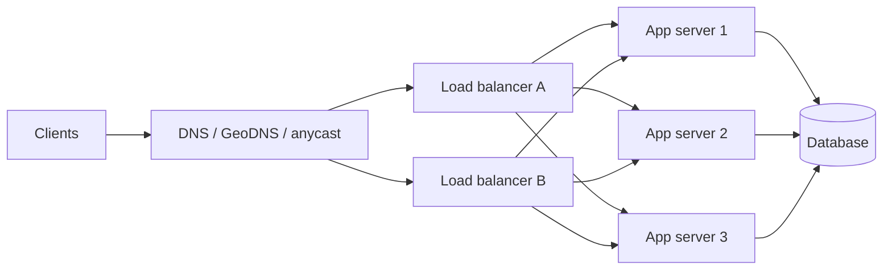

- **Layer 4** (TCP and UDP, sees IP and port): very fast, protocol agnostic. **Layer 7** (HTTP, sees URLs, headers, cookies): routes by path or host, terminates TLS, can add headers and do smarter health checks.
- **Algorithms:** round robin, weighted round robin (unequal servers), **least connections** (good for uneven request cost), **IP hash** (the same client reaches the same server), **consistent hashing** (cache servers, minimal remapping, 2.6).
- **Health checks** (active probes of `/health`, or passive failure counting) remove bad instances, **connection draining** lets in-flight requests finish during deploys.
- **Avoid sticky sessions** when possible: they unbalance load and make failures visible to users. Prefer stateless servers.
- **The load balancer must not be a single point of failure:** run a redundant pair (active-passive with a floating IP, or active-active behind DNS or anycast). Global traffic is steered with **GeoDNS** or **anycast** to the nearest region.

### 2.3 Caching and CDNs

- **Where caches live:** browser, **CDN edge**, API gateway or reverse proxy, **application cache (Redis, Memcached)**, database buffer pool. Each layer removes load from the one behind it.
- **The patterns, invalidation, stampede, avalanche and penetration problems** are covered in depth in Volume 5, Part 5. In a design interview, say: cache-aside with TTL, delete on write, jittered TTLs, a rebuild lock for hot keys, and fail open if Redis is down.
- **Worked hit-ratio maths:** with a 1 ms cache and a 20 ms database, average read latency is `hit x 1 + (1 - hit) x (1 + 20)`. At a **95 percent hit ratio** that is `0.95 + 1.05 = 2.0 ms`, and the database sees only 5 percent of reads. At **80 percent** it is `0.8 + 4.2 = 5.0 ms` and the database sees 20 percent, four times the load. **Hit ratio matters far more than raw cache speed.**
- **CDN:** a global network of edge servers caching static content (images, video segments, JavaScript) and sometimes API responses near users. It cuts latency, absorbs spikes and DDoS, and offloads your origin. Concerns: the **cache key** (which headers and query strings differentiate responses), **purging versus versioned URLs**, an **origin shield** layer so a cache-miss storm does not reach the origin, and **signed URLs** for private content.
- **What not to cache:** highly personalised data under a shared key, data that must be exactly current (balances, stock during checkout), and anything you cannot invalidate.

### 2.4 Databases: the scaling ladder

Climb only as far as the numbers require, in this order:

1. **Indexes and query fixes** (Volume 2). Most 'we need to shard' problems are really 'we need an index'.
2. **Vertical scaling** and connection pooling.
3. **Caching** hot reads.
4. **Read replicas:** writes go to one leader, reads spread across followers.
5. **Partitioning** a large table inside one database (range or hash) for pruning and retention.
6. **Sharding:** split data across independent databases.
7. **Specialised stores** for specific access patterns (search index, time-series, wide-column).

**Replication models:**

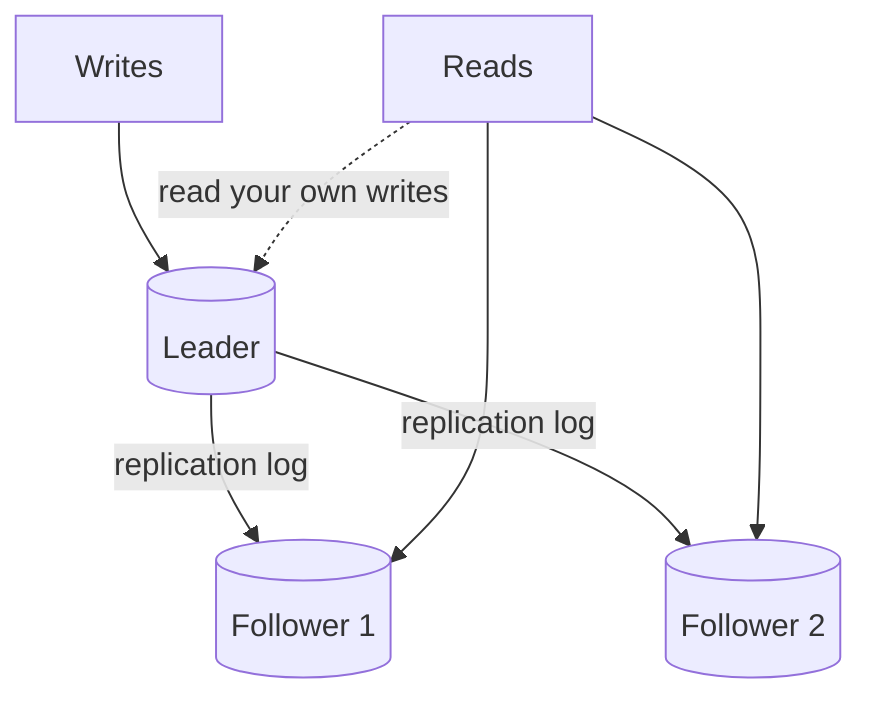

| Model | How it works | Strengths | Weaknesses |
|---|---|---|---|
| **Single-leader** (PostgreSQL, MySQL) | One node takes writes, followers copy its log | Simple, strong ordering, no write conflicts | The leader is the write bottleneck, failover needs care |
| **Multi-leader** | Several nodes accept writes (often one per region) and sync with each other | Local writes in every region, survives a region loss | **Write conflicts** must be resolved (last-write-wins loses data, or merge with CRDTs, or application logic) |
| **Leaderless** (Dynamo, Cassandra) | Any node accepts reads and writes, quorums decide success | High availability, no failover event | Eventual consistency, read repair and anti-entropy, conflict handling |

- **Synchronous vs asynchronous replication:** synchronous waits for followers (no data loss on failover, slower, a dead follower can block writes), asynchronous returns immediately (fast, but a leader crash can **lose the latest writes**, and followers **lag**). Many systems use one synchronous follower plus asynchronous others (semi-synchronous).
- **Replication lag problems and fixes:** a user writes and then reads from a stale follower and does not see their own change. Fix with **read-your-writes**: read from the leader for a short time after a write, or route the user's reads to the leader, or track a write position and wait for a follower to catch up. **Monotonic reads:** pin a user to one replica so time does not appear to go backwards.
- **Failover and split brain:** when the leader dies, a follower is promoted. If the old leader returns and still believes it is the leader, you have **two leaders** (split brain) and diverging data. Prevent it with a consensus-based leader election, **fencing** (the old leader's writes are rejected using an epoch number or token), and not promoting a lagging replica carelessly.

**Sharding (horizontal partitioning):**

- **Strategies:** **range** (key ranges per shard, supports range scans, risks **hot spots** like all new IDs hitting the last shard), **hash** (hash of the key picks the shard, even spread, range queries must hit all shards), **directory or lookup** (a mapping service decides, flexible, an extra dependency). **Consistent hashing** (2.6) is the way to make hash sharding easy to resize.
- **The shard key decides everything.** A good key spreads load evenly and keeps the common queries on **one shard**. Bad choices: a timestamp (all writes hit the newest shard), a low-cardinality value (a country, a status), a celebrity user's id (one hot shard).
- **Costs of sharding:** **cross-shard queries and joins** become scatter-gather or impossible, **cross-shard transactions** need sagas or two-phase commit, **resharding** moves data, **hot shards** from skewed keys, global unique constraints are hard, operational complexity multiplies. **Exhaust indexes, caching and replicas first.**
- **Global secondary indexes** (look up by something other than the shard key) are either local to each shard (queries scatter to all shards) or global (themselves partitioned, updated asynchronously).

### 2.5 Choosing a data store (the quick table)

| Need | Choice | Why |
|---|---|---|
| Transactions, constraints, joins, correctness | PostgreSQL or MySQL | ACID, mature, flexible queries |
| Very fast key lookups, sessions, counters, rate limits | Redis, DynamoDB | In-memory or key-value access at huge scale |
| Flexible nested documents | MongoDB, or PostgreSQL JSONB | Schema flexibility |
| Huge write volume, time series, linear scale | Cassandra, wide-column, time-series DB | Append-friendly partitioned storage |
| Full-text search, filtering, ranking | Elasticsearch or OpenSearch | Inverted index, as a **secondary** derived store |
| Relationship traversal | Graph database | Edges as first-class citizens |
| Files, images, video | Object storage (S3) plus CDN | Cheap, durable, huge |

The strong default is **polyglot persistence**: a relational database as the **system of record**, with Redis, a search index and object storage as **derived** stores that can be rebuilt. Justify each by its access pattern.

### 2.6 Consistent hashing: verified

**The problem.** With `shard = hash(key) % N`, changing N remaps almost every key, which destroys a cache and forces a massive data migration. **Consistent hashing** places both nodes and keys on a **hash ring**. A key belongs to the first node clockwise from its position, so adding or removing a node moves only the keys in its neighbourhood, about `1/N` of the data. **Virtual nodes** (each physical node appears at many ring positions) even out the load and let stronger machines take more.

```python
import bisect, hashlib

def h(s): return int(hashlib.md5(s.encode()).hexdigest(), 16)

class Ring:
    def __init__(self, nodes=(), vnodes=100):
        self.vnodes, self.keys, self.map = vnodes, [], {}
        for n in nodes: self.add(n)
    def add(self, node):
        for i in range(self.vnodes):                       # many ring positions per physical node
            k = h(f'{node}#{i}'); bisect.insort(self.keys, k); self.map[k] = node
    def get(self, key):
        i = bisect.bisect(self.keys, h(key)) % len(self.keys)     # first position clockwise, wrapping around
        return self.map[self.keys[i]]
```

Actual measurements with 20,000 keys and 5 nodes, then adding a sixth:

```text
adding a 6th node moves 83% of keys with hash % N, 17% with a consistent-hash ring (ideal 1/6 = 17%)
ring load per node (100 vnodes): [2765, 3213, 3418, 3434, 3573, 3597]     # fairly even across 6 nodes
ring load per node (1 vnode)   : [1721, 1952, 3513, 4502, 8312]            # badly uneven with one position per node
```

**Points to make:** modulo hashing moved 83 percent of the keys, the ring moved the ideal 17 percent. A single ring position per node gives a lopsided load (the busiest node held almost five times the least), so use **many virtual nodes** (100 to 256 is typical). Dynamo-style stores, Cassandra, many caches and some load balancers use this. **Redis Cluster** uses a related idea: 16,384 fixed hash slots assigned to nodes.

### 2.7 Consistency models and quorums: verified

- **Strong (linearisable):** behaves like one copy, every read sees the latest write. **Eventual:** replicas converge if writes stop, reads may be stale. In between: **read-your-writes**, **monotonic reads**, **causal consistency**.
- **CAP and PACELC** are in Volume 2. During a partition you choose consistency or availability, and even without a partition you trade latency for consistency.

**Quorums (leaderless replication).** With `N` replicas, a write succeeds after `W` acknowledgements and a read queries `R` replicas. If **`W + R > N`**, every read set overlaps every write set in at least one replica, so a read sees the latest write. I enumerated every possible write set and read set for N = 3:

```text
quorum N=3: probability a read touches a replica holding the latest write
  W=1,R=1: 0.33   W=2,R=1: 0.67   W=1,R=2: 0.67   W=2,R=2: 1.0   W=3,R=1: 1.0   W=1,R=3: 1.0
```

Only combinations with `W + R > 3` give certainty. Tuning: `W=1, R=N` (fast writes, slow reads), `W=N, R=1` (slow writes, fast reads, one dead node blocks writes), and **`W=2, R=2` for N=3** (balanced, tolerates one failure). Even with `W + R > N` the guarantee is weaker than it looks in practice (concurrent writes, sloppy quorums, clock-based last-write-wins), so mention **read repair** (fix stale replicas when a read notices a mismatch), **hinted handoff** (another node holds writes for a dead one) and **anti-entropy** (background syncing with Merkle trees).

**Conflict resolution** when concurrent writes hit different replicas: **last-write-wins** by timestamp (simple, silently loses data, and depends on synchronised clocks), **version vectors** (detect concurrency and keep siblings for the application to merge), and **CRDTs** (data structures like counters and sets that merge automatically).

**Clocks:** machine clocks drift and NTP corrects them in jumps, so **never rely on wall-clock ordering across machines for correctness**. Use logical clocks (Lamport timestamps, version vectors), or a consensus-ordered log.

### 2.8 Unique ID generation: verified

You need IDs that are **unique across many machines**, ideally **roughly time-sortable** (good for index locality and pagination) and generated **without a central bottleneck**.

| Approach | Pros | Cons |
|---|---|---|
| Database auto-increment | Simple, ordered | Single point of failure and bottleneck, leaks volume, hard to shard |
| **UUID v4** (random 128 bit) | No coordination | Not sortable, random inserts hurt B+ tree indexes (Volume 2), long |
| **UUID v7 or ULID** | Time-ordered, no coordination | 128 bit, still larger than 64 bit |
| **Snowflake style** (64 bit) | Compact, roughly sorted, generated locally | Needs machine id assignment and sane clocks |
| Ticket server or range allocation | Simple, each app server takes a block of ids | Gaps, the allocator is a dependency |

**Snowflake layout:** 1 unused sign bit, **41 bits of timestamp** (milliseconds since a custom epoch, about 69 years), **10 bits machine id** (1,024 machines), **12 bits sequence** (4,096 ids per millisecond per machine).

```python
import threading, time

class Snowflake:
    EPOCH = 1_700_000_000_000                         # custom epoch in milliseconds
    def __init__(self, machine_id, clock=lambda: int(time.time() * 1000)):
        assert 0 <= machine_id < 1024
        self.machine_id, self.clock = machine_id, clock
        self.last_ms, self.seq, self.lock = -1, 0, threading.Lock()

    def next_id(self):
        with self.lock:
            now = self.clock()
            if now < self.last_ms:                    # clock went backwards: refuse, never risk duplicates
                raise RuntimeError(f'clock moved backwards by {self.last_ms - now} ms: refuse to issue ids')
            if now == self.last_ms:
                self.seq = (self.seq + 1) & 0xFFF     # 12 bits
                if self.seq == 0:                      # sequence exhausted this millisecond: wait for the next one
                    while now <= self.last_ms: now = self.clock()
            else:
                self.seq = 0
            self.last_ms = now
            return ((now - self.EPOCH) << 22) | (self.machine_id << 12) | self.seq
```

Verified: four threads on two machine ids generated 80,000 ids with **80,000 unique**, and the clock-skew guard fired as designed (`clock moved backwards by 4 ms: refuse to issue ids`).

**Loopholes:** a **clock that jumps backwards** (NTP correction, VM migration) can duplicate ids, so the generator must detect it and wait or fail. Machine ids must be **unique** (assign them from a coordination service or configuration, never reuse them while the old holder may still run). IDs are **roughly** sorted across machines, not strictly. Sortable ids leak creation time, which matters if that is sensitive.

**Short codes (URL shortener):** convert a unique number to **base62** (`0-9A-Za-z`). Verified: `125 -> '21'`, `10**9 -> '15ftgG'`, and **7 characters hold 3,521,614,606,208 codes**, far more than the 9 billion needed.

```python
ALPHABET = '0123456789ABCDEFGHIJKLMNOPQRSTUVWXYZabcdefghijklmnopqrstuvwxyz'

def b62_encode(n):
    if n == 0: return ALPHABET[0]
    out = []
    while n:
        n, r = divmod(n, 62); out.append(ALPHABET[r])
    return ''.join(reversed(out))

def b62_decode(s):
    n = 0
    for ch in s: n = n * 62 + ALPHABET.index(ch)
    return n
```

A sequential counter makes codes **guessable and enumerable** (anyone can crawl all links), so for privacy mix in randomness (shuffle the alphabet, add random bits, or encrypt the counter with a format-preserving cipher). Hashing the URL with a **truncated hash** avoids a counter but needs **collision handling** (check and retry), and a hash gives the same code for the same URL, which is deduplication but also a privacy leak.

### 2.9 Queues, logs and Kafka

**Why queues:** decouple producers from consumers, **absorb traffic spikes** (load levelling), isolate failures, enable retries and independent scaling, and move slow work off the request path. Costs: eventual consistency, ordering and duplicate handling, one more system to run.

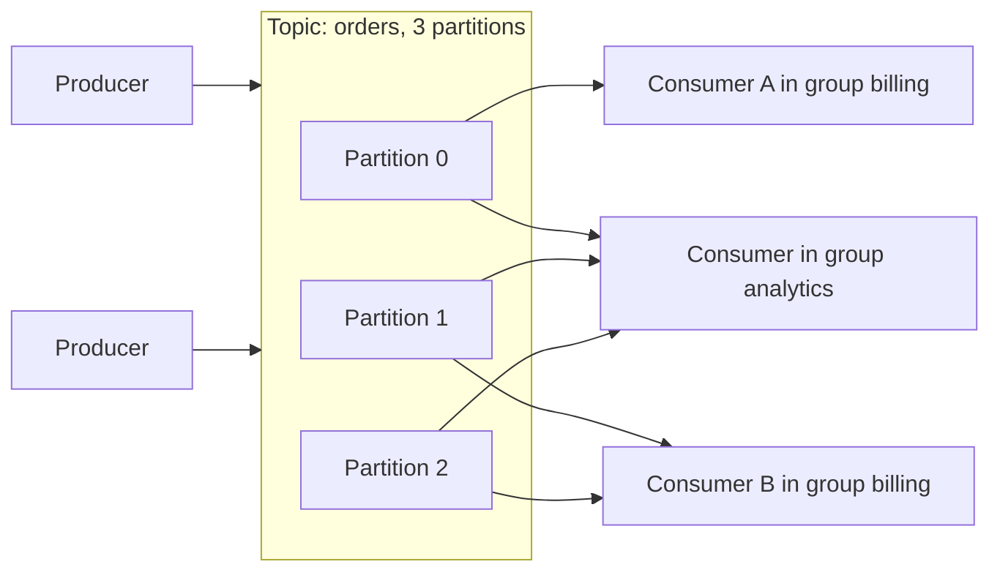

- **Queue (SQS, RabbitMQ):** each message goes to **one** consumer and is removed once acknowledged. Great for task distribution, with a **visibility timeout** (an unacknowledged message reappears) and a **dead-letter queue** for poison messages.
- **Log (Kafka):** an **append-only, partitioned, replicated log**. Messages are **retained** for a period and consumers track their own **offset**, so many independent consumer groups read the same data, and you can **replay**.
- **Kafka vocabulary:** a **topic** is split into **partitions**. **Ordering is guaranteed only within a partition**, so choose the **partition key** (for example `user_id` or `order_id`) so that events that must stay in order land together. Within a **consumer group**, each partition is read by exactly one consumer, so **parallelism is capped by the number of partitions**. Brokers **replicate** each partition (an in-sync replica set, with a leader), producers choose acknowledgement levels (`acks=all` for durability).
- **Delivery semantics:** **at-most-once** (may lose), **at-least-once** (may duplicate, the practical default, so consumers must be **idempotent**), **exactly-once** (really at-least-once plus idempotent writes or transactions, available within Kafka's own pipeline but not magically across arbitrary external systems).
- **Backpressure and consumer lag:** if consumers fall behind, **lag** grows. Monitor it, scale consumers up to the partition count, and shed or buffer load.
- **Hot partitions:** a skewed key (one celebrity) sends too much to one partition. Add a salt to the key or choose a better key.
- **Rebalancing:** adding or removing consumers reassigns partitions and briefly pauses consumption.
- **Choose a log when** you need replay, many consumers of the same events, high throughput and ordering per key. **Choose a simple queue when** you need task distribution with per-message acknowledgement and simple retries.

### 2.10 Distributed transactions and coordination

- **Two-phase commit (2PC):** a coordinator asks all participants to **prepare**, then to **commit**. It gives atomicity but **blocks** if the coordinator fails and holds locks across a network, so it scales poorly and is avoided across services.
- **Saga:** a business transaction is a **sequence of local transactions**, each with a **compensating action** if a later step fails (reserve stock, charge payment, and if the charge fails, release the stock). **Choreography** (services react to each other's events: simple, hard to follow) versus **orchestration** (a coordinator tells each service what to do: explicit, easier to reason about). Sagas give **eventual consistency**, so design the intermediate states ('pending') and make steps and compensations **idempotent**.
- **Outbox and idempotency** (Volume 5): atomic 'state change plus event', at-least-once delivery, idempotent consumers.
- **Distributed locks:** `SET key token NX PX ttl` in Redis gives a lock with expiry. The danger: a holder **paused** (garbage collection, a stalled VM) past the TTL loses the lock yet still believes it holds it, so two clients act at once. The correct safeguard is a **fencing token**: the lock service issues an increasing number with each grant, and the **protected resource rejects any request carrying an older token**. Often the better design is to **avoid the lock** and use an **atomic conditional update**, a unique constraint or optimistic concurrency (the compare-and-swap pattern from Volumes 1 and 2).
- **Leader election and consensus:** a cluster agrees on one leader and a consistent log of decisions using a protocol like **Raft** (or Paxos): nodes vote in **terms**, a candidate needs a **majority** (a quorum), the leader replicates log entries and commits them once a majority has them. A cluster of `2f + 1` nodes tolerates `f` failures (3 nodes tolerate 1, 5 tolerate 2). **ZooKeeper, etcd and Consul** provide this as a service for locks, leader election, configuration and service discovery. A minority partition cannot make progress, which is how split brain is avoided.

### 2.11 Probabilistic data structures: Bloom filter, verified

**Bloom filter:** a compact bit array plus `k` hash functions that answers 'is this item in the set?' with **no false negatives and a tunable rate of false positives**. Add an item by setting `k` bits. A lookup says 'definitely not present' if any of its bits is 0, otherwise 'probably present'. Uses: skip a database lookup for keys that **definitely do not exist** (cache penetration defence, 'username available?', crawler visited URLs, checking a malicious-URL list).

For `n` items, `m` bits and the best `k = (m/n) ln 2`, the false positive rate is about `(1 - e^(-kn/m))^k`. Verified with 10,000 items in a 100,000-bit filter (10 bits per item, `k = 7`):

```text
bloom: k=7, no false negatives=True, false positive rate measured 0.90% vs theory 0.82%, memory 12.2 KiB for 10000 items
```

About 1 percent false positives for roughly 1.2 bytes per item, far smaller than storing the items. **Limitations:** you **cannot delete** (a counting Bloom filter can), you cannot list the items, and the false positive rate climbs if you add more items than planned.

```python
import hashlib

class Bloom:
    def __init__(self, m_bits, k):
        self.m, self.k, self.bits = m_bits, k, bytearray(m_bits // 8 + 1)
    def _idx(self, item):                              # k positions derived from two hashes (double hashing)
        d = hashlib.sha256(item.encode()).digest()
        a, b = int.from_bytes(d[:8], 'big'), int.from_bytes(d[8:16], 'big')
        return [(a + i * b) % self.m for i in range(self.k)]
    def add(self, item):
        for i in self._idx(item): self.bits[i // 8] |= 1 << (i % 8)
    def __contains__(self, item):
        return all(self.bits[i // 8] >> (i % 8) & 1 for i in self._idx(item))
```

**Other sketches to name:** **HyperLogLog** (count distinct items, for example unique visitors, in a few kilobytes with about 1 to 2 percent error, Redis has `PFADD` and `PFCOUNT`), **Count-Min Sketch** (approximate frequencies, top-K heavy hitters).

### 2.12 Reliability maths and patterns: verified

**Availability arithmetic** (verified):

```text
downtime per year: 99.9% -> 526 min (8.8 h) | 99.99% -> 53 min | 99.999% -> 5.3 min
components in SERIES multiply:     three 99.9% components in a chain = 99.7003%   (worse than any one)
components in PARALLEL (redundant): two independent 99% replicas       = 99.99%    (much better)
```

**Lessons:** a request path through several dependencies is **only as available as the product of all of them**, so every added hard dependency lowers availability, which is why you remove synchronous dependencies from critical paths (use queues, caches, fallbacks) and **add redundancy** (multiple instances, zones, replicas) where you cannot. Redundancy only helps if failures are **independent**, so spread across **availability zones**, and regions for the highest tiers.

**Patterns (details in Volume 5, Part 5):** timeouts on every call, **retries with exponential backoff and jitter** for idempotent operations only, **circuit breakers**, **bulkheads**, **load shedding** and **rate limiting**, **graceful degradation** (serve cached or reduced results), **health checks and automatic failover**, **idempotency keys**.

**Disaster recovery:** **RPO** (recovery point objective: how much data you can afford to lose) drives backup and replication frequency, **RTO** (recovery time objective: how long you can be down) drives failover design. **Active-passive** (standby takes over) versus **active-active** (all regions serve traffic, requires conflict handling). **Test restores and failovers**: an untested backup is a hope, not a plan.

**Multi-region:** puts data near users and survives region loss, at the price of **replication lag, conflict resolution, data residency rules and cost**. Start with one region across several availability zones, and go multi-region only when latency or resilience requirements demand it.

### 2.13 Other building blocks to be able to name

- **API gateway and BFF (backend for frontend):** single entry point for authentication, rate limiting, routing, request shaping. **Service discovery** (DNS, Consul, Kubernetes services) so services find each other. **Monolith versus microservices** (Volume 4): start with a well-structured monolith and split along domain boundaries when team size or scaling needs justify it.
- **Search:** an **inverted index** maps each term to the documents containing it. Keep the search index as a **derived store**, fed from the primary database by an outbox or change data capture, and expect **eventual consistency** between them.
- **Geospatial:** **geohash** (encode lat and lon into a prefix-sortable string, nearby places share a prefix), **quadtree**, or S2 cells, to find 'places near me' without scanning everything.
- **Change data capture (CDC):** stream a database's change log (Debezium reading the write-ahead log) to keep caches, search indexes and analytics in sync without dual writes.
- **Time-series and analytics:** write-optimised, downsampled and retention-limited stores for metrics. **Lambda and Kappa** architectures combine batch and stream processing for analytics, which rarely come up unless the problem is analytics.
- **Authentication in designs:** TLS everywhere, tokens or sessions, OAuth for third-party access, authorisation per object (Volume 3), secrets in a manager, encryption at rest for sensitive data, audit logs.

### Interview questions on building blocks

- **How would you scale a read-heavy service?** Cache with a high hit ratio, read replicas, CDN for static content, then partition. Quantify with the numbers.
- **Consistent hashing: what problem and how?** Modulo remaps most keys when N changes (83 percent measured), the ring remaps about 1/N (17 percent), virtual nodes balance load.
- **What does `W + R > N` guarantee, and what does it not?** Read and write sets overlap so a read sees the latest acknowledged write, but concurrent writes, sloppy quorums and clock-based conflict resolution still bite.
- **How do you generate unique ids across machines?** Snowflake-style timestamp, machine id and sequence, with a clock-skew guard. Or UUIDv7.
- **Kafka vs a queue?** A retained, replayable, partitioned log with consumer groups versus a work queue where messages are removed after acknowledgement.
- **How do you do a transaction across services?** A saga with compensations, outbox and idempotency, not two-phase commit.
- **How do you stop two clients holding the same distributed lock?** TTL plus a fencing token checked by the resource, or avoid the lock with an atomic conditional update.
- **What is a Bloom filter used for?** Cheap 'definitely not present' checks that avoid expensive lookups, at about 1 percent false positives for roughly 10 bits per item.
- **How do you calculate availability of a chain of services?** Multiply, so redundancy and removing hard dependencies matter.

### Revise in 30 seconds: building blocks

- Stateless services scale horizontally. L4 versus L7 balancers, least connections, health checks, redundant balancers, avoid sticky sessions.
- Cache hit ratio dominates: 95 percent gives 2 ms average, 80 percent gives 5 ms with 4 times the database load. CDN for static content, versioned URLs, origin shield.
- DB ladder: index, vertical, cache, read replicas, partition, shard. Replication lag needs read-your-writes. Failover needs fencing against split brain. Shard key must spread load and keep common queries on one shard.
- Consistent hashing with many virtual nodes moves about 1/N keys (83 percent versus 17 percent measured). Quorums: `W + R > N`, N=3 with W=2, R=2.
- Snowflake: 41 bit time, 10 bit machine, 12 bit sequence, guard clock skew. Base62 with 7 chars is 3.5 trillion codes. Kafka: ordered per partition, consumer groups, offsets, at-least-once plus idempotency. Saga, not 2PC. Fencing tokens for locks. Bloom filter: no false negatives, about 1 percent false positives. Availability multiplies in series.

## Part 3: The ten designs

Each design follows the same shape so you can rehearse it in 45 minutes: **requirements, estimates, API, data model, architecture with a diagram, deep dive, failure modes, trade-offs, and a one-paragraph spoken summary**. Code snippets were run unless noted.

### Design 1: URL shortener

**Requirements.** Create a short link for a long URL (optionally a custom alias and an expiry), redirect fast, high availability for redirects, optional click analytics. **Out of scope:** user accounts and billing. **Non-functional:** redirect latency in tens of milliseconds, read-heavy (100 to 1), links must not collide, short codes should be hard to enumerate.

**Estimates** (from 1.5): about 60 writes per second (175 at peak), about 5,800 reads per second (17,000 at peak), 9 billion records over 5 years, about 14 TB replicated. **Conclusion:** the write path is easy, redirects need a cache and replicas.

**API.**
- `POST /v1/urls` with `{long_url, custom_alias?, expires_in?}` returns `201 {short_url}`.
- `GET /{code}` returns a redirect (`301` or `302`) to the long URL, or `404` or `410` if missing or expired.
- `DELETE /v1/urls/{code}` for the owner.

**`301` or `302`?** A **301** (permanent) is cached by browsers, so repeat visits skip your servers (less load) but you **lose analytics, cannot change or expire the target reliably**, and mistakes are sticky. A **302** (temporary) hits you every time, which gives accurate click counts and control, at higher load. Choose 302 when analytics or expiry matter, and say so.

**Data model.** `urls(code PRIMARY KEY, long_url, user_id, created_at, expires_at)`. The access pattern is a pure **key lookup by code**, so a relational table works (with the code as the primary key) and a key-value store works equally well. Click events go to a separate append-only store.

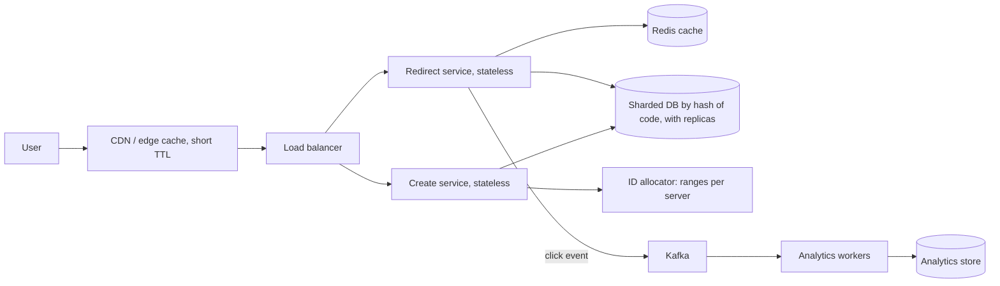

**Deep dive 1: generating unique codes.**
- **Counter plus base62** (verified in 2.8): take a unique number from a **range allocator** (each create server leases a block of, say, 1 million numbers, so there is no per-request coordination), encode in base62. Seven characters hold 3.5 trillion codes. Predictable, so mix in randomness if enumeration matters.
- **Hash the URL and truncate:** no counter, but **collisions** must be handled (check, then retry with a salt) and the same URL always yields the same code.
- **Custom aliases:** the **primary key constraint makes 'alias taken' atomic**, so you do not need a racy check-then-insert. Run verified:

```python
class AliasTaken(Exception): pass

class Shortener:
    def __init__(self, conn, start=1_000_000_000, clock=time.time):
        conn.execute('CREATE TABLE IF NOT EXISTS urls (code TEXT PRIMARY KEY, long_url TEXT NOT NULL, expires_at REAL)')
        self.conn, self.counter, self.clock, self.cache = conn, itertools.count(start), clock, {}

    def create(self, long_url, alias=None, ttl=None):
        code = alias or b62_encode(next(self.counter))
        try:
            self.conn.execute('INSERT INTO urls VALUES (?, ?, ?)',
                              (code, long_url, self.clock() + ttl if ttl else None))
        except sqlite3.IntegrityError:
            raise AliasTaken(code) from None          # uniqueness enforced by the database, atomically
        return code

    def resolve(self, code):
        hit = self.cache.get(code)
        if hit and (hit[1] is None or hit[1] > self.clock()): return hit[0]
        row = self.conn.execute('SELECT long_url, expires_at FROM urls WHERE code = ?', (code,)).fetchone()
        if row is None or (row[1] is not None and row[1] <= self.clock()): return None     # missing or expired
        self.cache[code] = row
        return row[0]
```

```text
codes: 15ftgG 15ftgH | resolve: https://example.com/a/very/long/path | https://example.org
alias collision -> AliasTaken 15ftgG
after expiry: None | permanent link still: True
```

**Deep dive 2: the read path.** Check the **CDN** (even 302 responses can be cached for seconds), then **Redis** with cache-aside, then a **read replica**. Links follow a **skewed popularity**, so a modest cache gives a high hit ratio (a link going viral is the hot-key case). Cache **negative results** briefly (unknown codes), and put a **Bloom filter** (2.11) of existing codes in front to reject random probing without touching the database.

**Deep dive 3: scaling storage.** Shard by **hash of the code** (consistent hashing), so lookups hit one shard. Expiry is handled lazily on read plus a background **cleanup job** that deletes expired rows in batches.

**Failure modes and abuse:** ID allocator down (servers keep using their leased blocks), Redis down (replicas absorb the load, fail open), a region down (replicate across zones, add regions later). **Abuse:** phishing and malware links (scan on creation and periodically, a blocklist), creation spam (rate limit, 2.12 and Design 2), open redirect abuse, and enumeration of private links.

**Trade-offs to state:** 301 versus 302, sequential versus random codes, strong consistency for creation (a code must not be issued twice) versus eventual consistency for analytics.

**Spoken summary:** 'It is a read-heavy key-value lookup. Writes are tiny, so I use a range-allocated counter with base62 for codes and a primary key to make aliases atomic. Redirects go through CDN, Redis and replicated, hash-sharded storage, using 302 so analytics stay accurate, with click events sent asynchronously through Kafka so they never slow a redirect.'

### Design 2: Rate limiter (as a shared service)

**Requirements.** Limit requests per client (user, API key, IP) per rule (for example 100 per minute on `/search`, 5 per minute on `/login`). Add negligible latency, work across many API servers, return a clear signal, be configurable, and **degrade safely** when the limiter itself fails. **Where:** at the **API gateway or edge** for coarse protection, in the service for business limits.

**Estimate.** If the API handles 20,000 requests per second, the limiter performs 20,000 checks per second, each a tiny operation. A single Redis node handles on the order of 100,000 operations per second, so one primary with replicas covers this, and **sharding by client key** scales it further.

**Algorithms** (Volume 4 has the code):

| Algorithm | Behaviour | Memory per key | Notes |
|---|---|---|---|
| **Token bucket** | Refill at a steady rate up to a capacity, each request spends a token | 2 numbers (tokens, timestamp) | Allows bursts. The usual choice |
| **Leaky bucket** | Requests leave at a constant rate | Queue or 2 numbers | Smooths output, no bursts |
| **Fixed window counter** | Count per window | 1 counter | Can allow **2 times the limit across a boundary** |
| **Sliding window log** | Store every request timestamp | Grows with the limit | Exact, memory heavy |
| **Sliding window counter** | Weight the previous window by the overlap | 2 counters | Accurate and cheap, approximate |

**Sliding window counter, worked example:** limit 100 per minute. The previous minute had 84 requests, the current minute has 36 so far, and we are 25 percent into the current minute. Estimated requests in the last minute = `84 x (1 - 0.25) + 36 = 63 + 36 = 99`, so **one more request is allowed**.

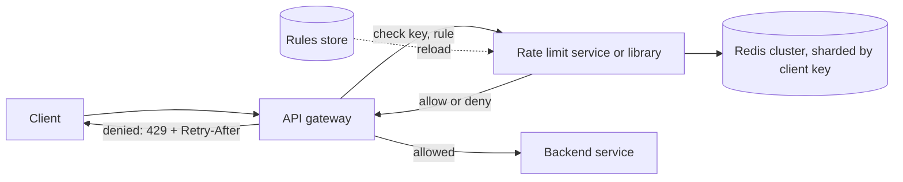

**Deep dive: correctness across servers.** The bucket state lives in **Redis**, and the read-refill-spend sequence must be **atomic**, otherwise two servers race (the same TOCTOU problem). Use a **Lua script** (Volume 4 shows the token bucket script) or Redis primitives that are atomic. Use **one source of time** (Redis `TIME`) to avoid clock skew between API servers. **Reduce Redis round trips** by checking a local in-memory counter first and syncing in batches, accepting slight over-admission.

**Deep dive: failure behaviour.** If Redis is unreachable, **fail open** (allow, favouring availability) or **fail closed** (deny, favouring protection). Public read APIs usually fail open, login and payment endpoints may fail closed or fall back to a conservative local limit. State the choice.

**Details worth mentioning:** responses use **HTTP 429** with `Retry-After` and `X-RateLimit-Remaining`. **Key choice:** user id after authentication, API key, or IP (shared NATs punish innocent users, and `X-Forwarded-For` is spoofable unless set by your own proxy, Volume 3). **Weighted costs** (an expensive endpoint consumes more tokens). **Tiers** (free versus paid limits). **Idle key eviction** (TTLs on keys). **Hot keys** (one abusive client hammering one shard) can themselves be rate limited at the edge or CDN first. Distributed denial of service needs network-level and CDN protection **before** the application limiter.

**Trade-offs:** accuracy versus latency and cost (exact global limits are expensive, approximate ones are cheap), fail open versus closed, centralised versus per-node limits.

**Spoken summary:** 'Token bucket per client key, state in a sharded Redis, checked at the gateway with an atomic Lua script and Redis time. It returns 429 with Retry-After, fails open for ordinary endpoints and conservative for sensitive ones, and rules are loaded from a config store.'

### Design 3: Notification service

**Requirements.** Many internal services send **email, SMS and push** notifications. Support templates, **user preferences and opt-outs**, scheduling, priorities (a one-time password must beat a newsletter), **no duplicates**, retries and provider failover, delivery tracking, and rate limits per user and per provider. **Non-functional:** high throughput during campaigns, at-least-once delivery, no loss of critical messages.

**Estimate.** 10 million notifications per day is about 115 per second on average, but a marketing blast of 1 million in 10 minutes is about **1,700 per second**, so the design must **absorb bursts through queues**. External providers rate limit you, which is the real ceiling.

**API.** `POST /v1/notifications` with `{recipient_id, type, template_id, data, priority, send_at?, idempotency_key}` returns `202 Accepted` with an id. `GET /v1/notifications/{id}` returns status.

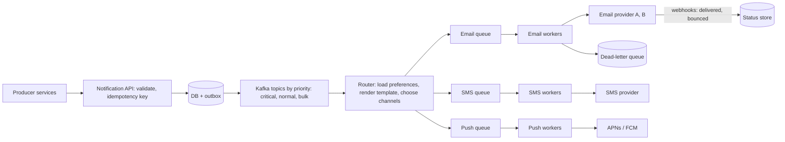

**Deep dive 1: reliability.** The API writes the notification **and an outbox row in one transaction**, then returns 202 (the producer never waits for the provider). A relay publishes to Kafka. Everything after is **at-least-once**, so **duplicates are possible** and the design must remove them: the producer's **idempotency key** (stored with a unique constraint) blocks repeated submissions, each notification has an id the worker checks before sending (a 'sent' marker updated atomically), and providers often accept an idempotency token too.

**Deep dive 2: priority and isolation.** Separate **topics or queues per priority**, with dedicated worker pools, so a flood of bulk email can never delay a login OTP (**bulkheading**). Critical messages get more consumers and skip digesting.

**Deep dive 3: delivery and provider handling.** Workers call providers with **timeouts, exponential backoff with jitter, and a circuit breaker per provider** (Volume 5), and **fail over** to a second provider when one degrades. They **respect each provider's rate limit** with a token bucket. Permanent failures (a hard bounce, an invalid token) are recorded and the address is **suppressed**, transient failures retry, and messages that keep failing land in a **dead-letter queue** for inspection. **Webhooks** from providers update delivery status (sent, delivered, bounced, opened).

**More details.** **Preferences and compliance:** per-channel opt-in and opt-out, **quiet hours** by the user's timezone, unsubscribe links, regional rules (store the consent record). **Templates:** versioned, rendered with escaped variables, localised. **Scheduling:** delayed delivery with a time-ordered store (a sorted set in Redis, or a database table polled by a scheduler, Volume 4 design 6). **Batching and digests:** combine many low-priority events into one message. **Fan-out for campaigns:** split a large recipient list into batches processed in parallel. **Security and privacy:** notifications contain personal data, so encrypt it at rest, restrict access, avoid putting sensitive details in SMS and push previews, and keep audit logs. **Observability:** queue depth and age per priority, send rate, provider error rates, bounce rates, end-to-end latency.

**Trade-offs:** latency versus guaranteed delivery, strict ordering (rarely needed) versus parallelism, multiple providers (resilience) versus complexity and cost.

**Spoken summary:** 'Producers get a fast 202 from an API that persists the request with an outbox and an idempotency key. Kafka topics split by priority feed a router that applies preferences and templates and fans out to per-channel queues. Workers call providers with backoff, circuit breakers, rate limits and failover, dead-letter what keeps failing, and webhooks update delivery status.'

### Design 4: Chat application

**Requirements.** One-to-one and group chat, near real-time delivery, message history, delivery and read receipts, online presence, media sharing, multi-device sync, push notifications for offline users. **Non-functional:** low latency (under about 200 ms), messages must **not be lost** and appear in a **consistent order** within a conversation.

**Estimate.** 50 million daily users sending 40 messages each is 2 billion messages per day, about **23,000 per second average and roughly 70,000 at peak**. At about 100 bytes per message that is 200 GB per day, 600 GB replicated, about 220 TB per year, so storage must be partitioned. If 10 million users are connected at once and one gateway holds about 100,000 WebSocket connections, you need on the order of **100 gateway servers** (a connection costs memory, not much CPU).

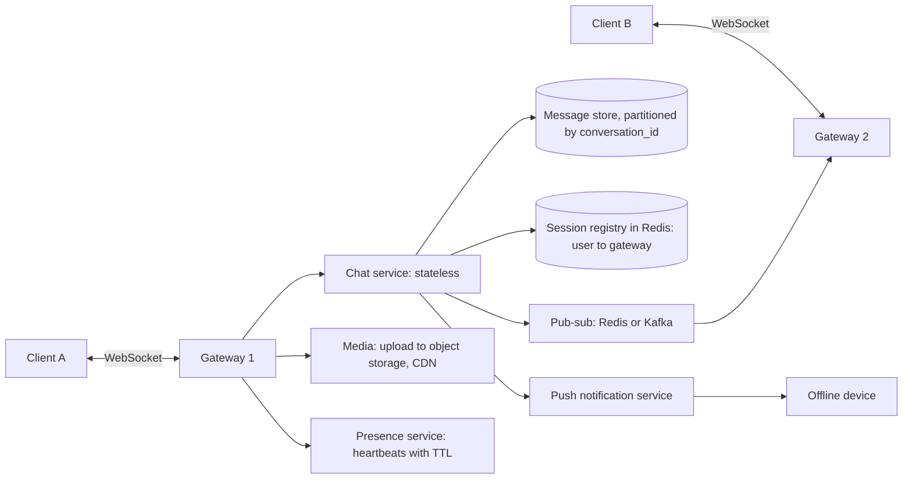

**Connection layer.** **WebSockets** (Volume 3) give a persistent two-way channel. Gateways are **stateful** (they hold connections), so a **session registry** (Redis) records which gateway holds each user's connection, and a **pub-sub** layer routes a message to the correct gateway. Clients **heartbeat** and **reconnect with exponential backoff and jitter**, resuming from the last sequence number they saw.

**Message flow (one-to-one):**

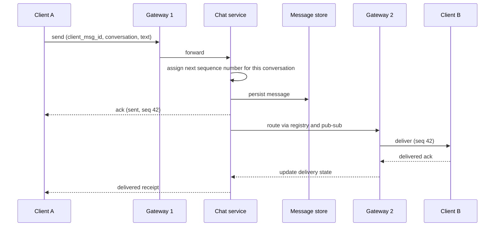

**Deep dive 1: ordering and duplicates (verified).** Order matters **per conversation**, not globally, so assign each message a **monotonically increasing sequence number per conversation** (one writer per conversation shard) and the client displays by sequence. Clients retry on a flaky network, so each message carries a **client-generated message id** and the server returns the **same result for a repeated id** (idempotent send). Verified with 8 concurrent senders, 800 messages:

```text
chat: 800 messages from 8 senders -> sequence gapless and unique: True
retry of u0-5 returns the original seq 6 | total still 800 | offline client catch-up since 795: [796, 797, 798, 799, 800]
```

```python
class Conversation:
    def __init__(self):
        self.msgs, self.seq, self.by_client_id, self.lock = [], 0, {}, threading.Lock()
    def send(self, sender, client_msg_id, text):
        with self.lock:
            if client_msg_id in self.by_client_id:                 # a retry of the same message: same answer, no duplicate
                return self.by_client_id[client_msg_id]
            self.seq += 1
            self.msgs.append((self.seq, sender, text)); self.by_client_id[client_msg_id] = self.seq
            return self.seq
    def since(self, last_seq):                                     # catch-up after being offline or reconnecting
        return [m for m in self.msgs if m[0] > last_seq]
```

**Deep dive 2: storage.** Messages are append-only and read by conversation in time order, so use a **partitioned wide-column or key-value store** keyed by `(conversation_id, sequence)` (Cassandra-like), which makes 'last 50 messages' and 'since sequence N' range reads on one partition. Users, conversations and membership live in a relational database. Media goes to **object storage** (a pre-signed upload, Design 5) with a **CDN**, and the message carries only a reference. **Hot partitions** (a huge group) can be bucketed by time.

**Deep dive 3: groups.** For small groups, the server writes one stored message and **fans out delivery** to each member's connection (and per-member read state is tracked separately). For very large channels, avoid per-member writes, store the message once and let clients **pull by sequence**, with push only as a hint (the same hybrid idea as Design 6).

**Presence and receipts.** Presence is a **heartbeat with a TTL** in Redis (online if the key exists), broadcast lazily only to interested contacts to avoid a storm. Receipts (sent, delivered, read) are small state updates sent back through the same path.

**Offline and multi-device.** If the recipient has no connection, store the message and send a **push notification**, and the client syncs by `since(last_seq)` on reconnect. Each device tracks its own cursor.

**Failure modes and details:** a gateway crashes (clients reconnect to another, the registry entries expire, undelivered messages remain in the store and are re-synced), a slow client (apply **backpressure**, drop or coalesce non-critical events), message loss (persist **before** acknowledging 'sent'), **end-to-end encryption** (the server routes ciphertext and cannot read it, which complicates search and multi-device key management), spam and abuse controls, and rate limiting per sender.

**Trade-offs:** ordering per conversation (cheap) versus a global order (expensive and unnecessary), at-least-once delivery plus dedupe versus exactly-once, strong persistence before ack (safe, slightly slower) versus ack-then-persist (fast, can lose).

**Spoken summary:** 'WebSocket gateways hold connections, a Redis registry plus pub-sub routes messages between gateways, and a chat service assigns a per-conversation sequence number and persists to a partitioned store before acknowledging. Clients dedupe by message id, catch up by sequence after offline periods, and offline users get push notifications.'

### Design 5: File storage and sync (Dropbox style)

**Requirements.** Upload, download and **sync** files across devices, large files, **resumable transfers**, versioning, sharing with permissions, conflict handling. **Non-functional:** durability above all (never lose a file), efficient bandwidth (do not re-upload unchanged data), scalable storage.

**Estimate.** 50 million users with an average of 10 GB is 500 PB logical, so **object storage with replication or erasure coding** is required and cost matters. Metadata operations (list, rename, share) are far smaller in volume but far more frequent than data transfers.

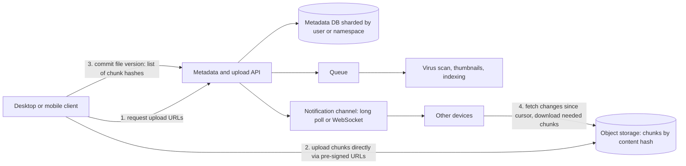

**Deep dive 1: chunking and deduplication (verified).** Split each file into fixed-size **chunks** (for example 4 MB), compute a **content hash** per chunk, and store each chunk **once by its hash**. A file version is just a **manifest** (ordered list of chunk hashes). When a file changes, **only the changed chunks** are uploaded, identical chunks across versions (and across files) are stored once, uploads can **resume** from the first missing chunk, and verification is easy (the hash is the checksum). Verified on a 180-byte file with a 16-byte chunk size and one chunk edited:

```text
file v1: 180 bytes uploaded 180; edited v2: 180 bytes, only 16 new bytes uploaded (9%), chunks shared 11/12
```

```python
store = {}                                                  # content hash -> chunk bytes (the object store)

def upload(data, size=16):
    manifest, new_bytes = [], 0
    for i in range(0, len(data), size):
        chunk = data[i:i + size]
        digest = hashlib.sha256(chunk).hexdigest()
        if digest not in store:                             # already stored? skip the transfer entirely
            store[digest] = chunk; new_bytes += len(chunk)
        manifest.append(digest)
    return manifest, new_bytes
```

**Limits to state:** with **fixed-size** chunks, **inserting bytes near the start shifts every later chunk boundary**, so almost nothing deduplicates. **Content-defined chunking** (a rolling hash picks boundaries from the data itself) fixes this. Cross-user deduplication has a **privacy side channel** (an upload that completes instantly reveals that someone already stored that content), so providers restrict it or require proof of possession. Deleting a file must **not** delete chunks other versions or users still reference, so chunks carry **reference counts** and a **garbage collector** removes unreferenced chunks later.

**Deep dive 2: upload flow.** The client asks the API for **pre-signed URLs** and uploads chunks **directly to object storage**, so your servers never carry the bytes (they would be the bottleneck). Large files use multipart or resumable uploads. After all chunks arrive the client **commits** the manifest, and only then does the new version become visible (an atomic metadata update), so a half-uploaded file is never seen. Downloads use a **CDN** with **signed URLs** for private content.

**Deep dive 3: sync protocol.** Each device keeps a **cursor** (a position in the account's change log). A **notification channel** (long polling or WebSocket) tells devices 'something changed', and the device calls **`changes since cursor`** to get a delta, then downloads only the chunks it lacks. This is the same 'catch up from a sequence number' idea as chat. **Conflicts** (two devices edit the same file offline) are resolved by keeping both: the loser becomes a **'conflicted copy'** rather than being overwritten silently.

**More details.** **Metadata** (a tree of folders and files, versions, ACLs, sharing links) lives in a relational or distributed SQL store **sharded by user or namespace**, with strong consistency for the metadata operations. **Versioning** keeps manifests, so restoring is just pointing back to an old manifest. **Permissions** are checked on every metadata and download request. **Durability:** replicate chunks across zones or use erasure coding, verify checksums periodically (**scrubbing**). **Encryption** in transit and at rest, optionally client-side. **Quotas** and abuse controls (scan uploads for malware asynchronously). **Hot data** (recently used) can sit in faster tiers, cold data in cheaper ones (lifecycle policies).

**Trade-offs:** chunk size (small chunks mean better dedupe and finer resume but more metadata and requests), strong consistency for metadata versus eventual for notifications, client-side versus server-side dedupe and encryption.

**Spoken summary:** 'Files are split into content-hashed chunks stored once in object storage and uploaded directly via pre-signed URLs, so only changed chunks move. A sharded, strongly consistent metadata service stores manifests and permissions, a commit makes a version visible atomically, and devices sync with a cursor-based change feed plus a notification channel, keeping conflicted copies instead of overwriting.'

### Design 6: News feed

**Requirements.** Users follow other users, post content, and see a **feed** of recent posts from the people they follow (reverse chronological or ranked). **Non-functional:** feed loads in under about 200 ms, new posts show up within seconds, tolerate **eventual consistency**, handle accounts with wildly different follower counts.

**Estimate.** 300 million daily users open the feed 5 times a day is 1.5 billion feed reads per day, about **17,000 reads per second** (about 50,000 at peak). If one in ten users posts once a day, that is 30 million posts per day, about **350 writes per second**. Reads dominate 50 to 1. Now the number that shapes the design: with an average of 200 followers, writing each post into every follower's feed is 6 billion inbox writes per day, about **70,000 per second**, which is fine. But **one celebrity with 10 million followers would need 10 million writes for a single post**, which is not.

**The central trade-off: fan-out on write versus fan-out on read.**

| | Fan-out on write (push) | Fan-out on read (pull) | Hybrid |
|---|---|---|---|
| How | When a user posts, copy the post id into each follower's inbox | At read time, fetch recent posts from everyone the reader follows and merge | Push for ordinary accounts, pull for celebrities, merge at read time |
| Read cost | **Cheap** (read one precomputed list) | Expensive (many lookups and a merge) | Cheap, plus a few celebrity pulls |
| Write cost | Expensive, **huge for celebrities** | Cheap (one write) | Bounded |
| Staleness | Inbox is precomputed | Always fresh | Fresh enough |

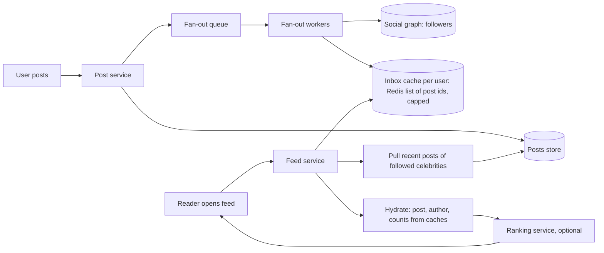

**Verified hybrid model.** The simulation below pushes posts from ordinary accounts into follower inboxes, **skips fan-out for celebrity accounts** (a follower threshold), and at read time pulls celebrity posts and merges by time:

```python
class Feed:
    def __init__(self, celeb_threshold=3):
        self.followers, self.following, self.posts = defaultdict(set), defaultdict(set), []
        self.inbox, self.th, self.tick = defaultdict(list), celeb_threshold, 0
    def is_celeb(self, u): return len(self.followers[u]) >= self.th
    def post(self, u, text):
        self.tick += 1; p = (self.tick, u, text); self.posts.append(p)
        if not self.is_celeb(u):                                   # push: write into each follower's inbox
            for f in self.followers[u]: self.inbox[f].append(p)
        return p
    def read(self, user, n=5):
        items = list(self.inbox[user])                             # pushed posts from ordinary accounts
        for u in self.following[user]:
            if self.is_celeb(u):                                   # pull celebrities at read time
                items += [p for p in self.posts if p[1] == u]
        return [p[2] for p in sorted(items, reverse=True)[:n]]
```

```text
hybrid feed for a: ['star2', 'bob2', 'star1', 'bob1'] | matches pure pull: True
```

The hybrid result is identical to a pure pull, while celebrity posts caused **zero inbox writes**. That is the point of the design.

**Deep dive details.**
- **Inbox storage:** a Redis list or sorted set of **post ids** per user, capped (the latest few hundred), not full post bodies. Posts, authors and counters are **hydrated** from separate caches, so an edit or deletion is reflected without rewriting inboxes.
- **Skip inactive users:** do not fan out to accounts that have not logged in recently, rebuild their inbox on demand when they return.
- **Pagination:** use **cursors** (the id or timestamp of the last item seen) rather than offsets, so new posts do not shift pages.
- **Ranking:** a chronological feed needs only a merge. A **ranked** feed adds a candidate-generation step and a scoring model (a separate service), applied to the few hundred candidates.
- **The social graph** (who follows whom) is a very large key to set mapping, stored sharded by user id with both directions (followers and following), cached heavily.
- **Deletes, blocks and privacy:** removing a post or a follower must hide it from feeds. Filtering at **read time** (check visibility during hydration) is simpler and safer than rewriting inboxes.
- **Consistency:** eventual is fine, a post appearing a few seconds late is acceptable, but a user should see **their own post immediately** (insert it into their own inbox synchronously).
- **Media** goes to object storage and a CDN.

**Failure modes:** the fan-out queue backs up (new posts reach followers later, monitor lag, scale workers), a celebrity post storm (pull path caches the celebrity's recent posts, since millions read the same data), Redis loss (rebuild inboxes lazily from the posts store).

**Spoken summary:** 'Read-heavy, so I precompute feeds. Ordinary users push their posts into followers' capped Redis inboxes through a fan-out queue. Celebrities are not pushed, readers pull their recent posts and merge. Feeds are lists of post ids hydrated from caches, paginated by cursor, and eventually consistent.'

### Design 7: E-commerce checkout and inventory

**Requirements.** Browse and search products, a cart, **checkout** that reserves stock, takes payment and creates an order, order tracking. **The hard requirements:** **never oversell** stock, **never charge twice**, never lose an order, and survive flash sales. **Non-functional:** catalogue pages are fast and cacheable, order and payment data are strongly consistent.

**Estimate.** Normal peak might be a few thousand requests per second, mostly browsing. A **flash sale** can send 100,000 requests per second at one product with 1,000 units in stock, so most requests must be **rejected cheaply and early**, and a hot database row must not be the bottleneck.

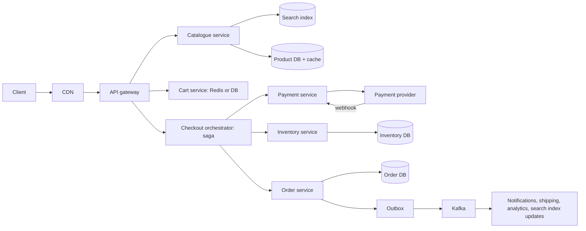

**Deep dive 1: not overselling (verified).** The wrong way is `SELECT qty` then `UPDATE qty = qty - 1` (check-then-act, TOCTOU). The right way is a **single conditional update** that checks and decrements atomically, then checks the **affected row count**:

```sql
UPDATE stock SET qty = qty - :n WHERE sku = :sku AND qty >= :n;
-- rowcount 1 = reserved, 0 = not enough stock
```

Verified with 20 simultaneous shoppers racing for 5 units (the table also has a `CHECK (qty >= 0)` as a last line of defence):

```text
oversell test: 20 shoppers, stock 5 -> 5 succeeded, final stock 0 (never negative)
```

**Deep dive 2: the checkout saga.** Checkout spans several services (inventory, payment, order), so there is no single transaction. Use a **saga** (2.10):

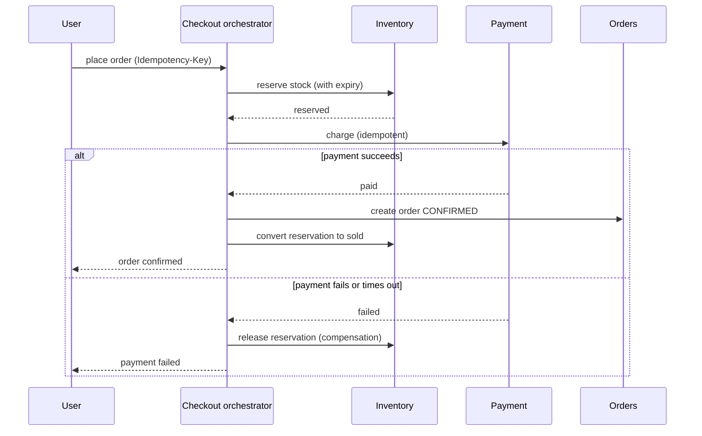

- **Reserve first, with an expiry** (like the seat hold in Volume 4 and the slot hold in Design 9), so abandoned checkouts return stock automatically.
- **Idempotency keys** on checkout and on the payment call, so a retry after a timeout never creates a second order or a second charge. Store the key with a **unique constraint**.
- **The payment outcome can be unknown** (a timeout after the provider charged the card). Treat the order as **pending**, and **reconcile** through the provider's webhook or a status query, rather than guessing. Never assume failure on a timeout.
- **Price snapshot:** copy the price, tax and discounts onto the order at purchase time. Never recompute from the live catalogue.
- **Order state machine** (Volume 4): `CREATED -> PAID -> SHIPPED -> DELIVERED`, with `CANCELLED` and `REFUNDED`, each transition an atomic conditional update.
- **Events through the outbox** (Volume 5) trigger shipping, emails, analytics and **search index updates**, at-least-once with idempotent consumers.

**Deep dive 3: flash sales.**
- **Edge protection first:** CDN, **rate limiting** (Design 2), and a **virtual waiting room** that admits users gradually.
- **A cheap first gate in Redis:** an atomic `DECR` on a stock counter rejects the 99,000 hopeless requests without touching the database. Only requests that win a decrement proceed to the durable reservation. Reconcile the counter with the database, since Redis is not the source of truth.
- **Avoid one hot row:** split a popular item's stock into **several buckets** (rows or keys) and spread requests across them, so updates do not all serialise on one row.
- **Queue the work:** accept the order request, answer quickly, and complete payment and fulfilment asynchronously.
- **Cache** product pages and keep inventory **out of** the cached page (show 'in stock' approximately, enforce exactly at reservation).

**Consistency split to state:** **strong** for inventory, orders and payments (relational database, transactions), **eventual** for the catalogue, search index, recommendations and reviews.

**Failure modes:** payment provider down (queue and retry, show 'pending', circuit breaker), inventory service down (fail checkout safely, do not oversell), double submit (idempotency), partial failures (the saga's compensations and reconciliation jobs that find orders stuck in `PENDING`), duplicate webhooks (idempotent handlers).

**Spoken summary:** 'Browsing is cached and eventually consistent. Checkout is a saga: atomically reserve stock with a conditional update and expiry, charge with an idempotency key, then confirm the order, compensating by releasing stock on failure, with the outbox driving downstream events. For flash sales I shed load at the edge, gate with an atomic Redis counter and shard hot stock.'

### Design 8: Distributed job scheduler

**Requirements.** Run jobs **immediately, at a later time, or on a schedule**, across a fleet of workers. **At-least-once** execution, retries with backoff, priorities, cancellation, visibility into status, and **no job lost if a worker or scheduler node dies**. Single-node design and code are in Volume 4; this is the distributed version.

**Estimate.** 10 million jobs per day is about 115 per second on average, but schedules cluster at round times (every job set for the top of the hour), so plan for **bursts of tens of thousands per second at minute boundaries**.

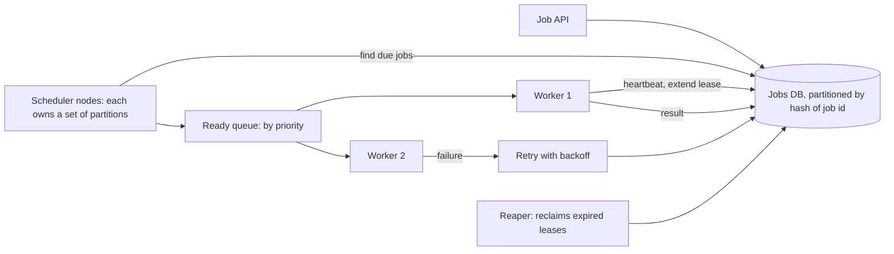

**Deep dive 1: claiming a job exactly once at a time (verified).** Workers must not run the same job simultaneously. Use a **lease**: claiming a job is one atomic statement that marks it running **until a deadline**. If the worker dies, the lease **expires** and another worker can reclaim the job, which is where **at-least-once** comes from.

```sql
UPDATE jobs SET status = 'running', worker = :w, lease_until = :now + :lease, attempts = attempts + 1
WHERE id = (SELECT id FROM jobs
            WHERE (status = 'queued' AND run_at <= :now)
               OR (status = 'running' AND lease_until < :now)      -- an expired lease: the previous worker is presumed dead
            ORDER BY run_at LIMIT 1)
RETURNING id, attempts;
```

Verified: **10 workers claiming 100 jobs made 100 claims, all distinct, none claimed twice**, and crash recovery worked as designed:

```text
100 jobs, 10 workers: claims 100 | distinct 100 | any job claimed twice: False
crash recovery: first claim (101, 1) | during lease None | after lease expiry (101, 2)
```

(In PostgreSQL use `SELECT ... FOR UPDATE SKIP LOCKED` inside the claim so workers never wait on each other's locks, Volume 2.)

**Deep dive 2: finding due jobs at scale.**
- **Polling a table** with an index on `(status, run_at)` is simple and works to thousands of jobs per second. **Partition the work** (each scheduler node or worker pool owns a hash range of job ids) so nodes do not scan everything or fight over rows.
- A **time-ordered structure** such as a Redis **sorted set** scored by `run_at` (`ZADD`, then fetch with `ZRANGEBYSCORE ... <= now` and claim atomically) gives fast 'what is due now' lookups. Persist the source of truth in the database, since Redis can lose data.
- **Hierarchical timing wheels** give O(1) timer handling for huge numbers of short timers.
- **Avoid the minute-boundary stampede** by adding **jitter** to schedules where exact timing is not required.
- **If only one scheduler may run a given schedule** (cron expansion), use **leader election** (etcd or ZooKeeper, 2.10) or partition ownership, with the lease and fencing ideas from before, or make scheduling itself an **idempotent** operation (a unique constraint on `(schedule_id, fire_time)` so a double-firing scheduler inserts the job only once).

**Deep dive 3: correctness and reliability.**
- **Idempotent handlers.** At-least-once means a job can run twice (a worker finishing just as its lease expires). Handlers must tolerate it, using the job id as an idempotency key.
- **Lease heartbeats:** long jobs **extend their lease** periodically. A job that stops heartbeating is presumed dead.
- **Retries:** exponential backoff with jitter, a cap on attempts, then a **dead-letter** state for human inspection. Distinguish retryable from permanent errors.
- **Priorities and fairness:** separate queues per priority, **per-tenant concurrency limits** so one customer's flood cannot starve others.
- **Cancellation:** a flag checked when claiming, and cooperative cancellation for running jobs.
- **Observability:** queue depth, **age of the oldest due job** (scheduling lag, the key health metric), run durations, retry rates, dead-letter counts.

**Trade-offs:** polling simplicity versus a purpose-built timer store, at-least-once (simple, needs idempotent jobs) versus exactly-once (not truly available), a database queue (transactional, limited throughput) versus a broker (higher throughput, separate durability story).

**Spoken summary:** 'Jobs live in a partitioned database. Schedulers find due jobs and workers claim them with an atomic lease, so a crashed worker's job is reclaimed when the lease expires, giving at-least-once with idempotent handlers. Retries use backoff with a dead-letter state, scheduling is partitioned or leader-elected, and I watch the age of the oldest due job.'

### Design 9: Appointment booking (your own system)

This is the design you have already built, so it is your strongest answer. Map each point to what you implemented, and be ready to say what you would change at scale.

**Requirements.** Providers publish availability as slots, patients browse and book, **no slot can be double booked**, abandoned bookings free their slot, reminders and follow-ups are sent, optional calendar sync, AI-assisted summaries. **Non-functional:** correctness of booking above everything, fast availability search, patient data is sensitive.

**Estimate (illustrative).** 1 million bookings per day is about 12 per second, tiny. Searching availability is far more frequent (say 20 searches per booking, about 230 reads per second), and **concurrency on a single popular slot** is the real hazard, not throughput.

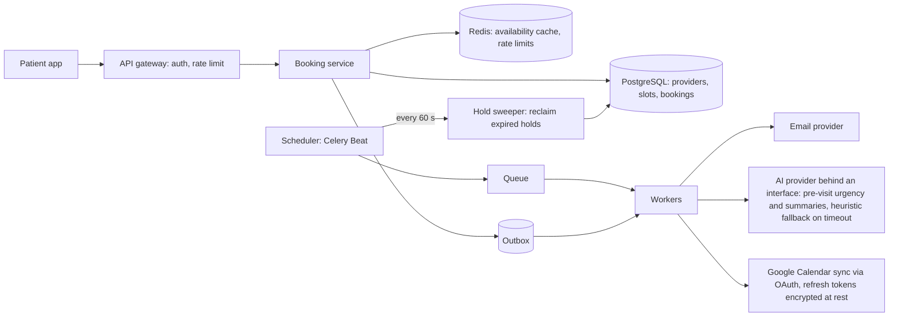

**Deep dive 1: the slot state machine.**

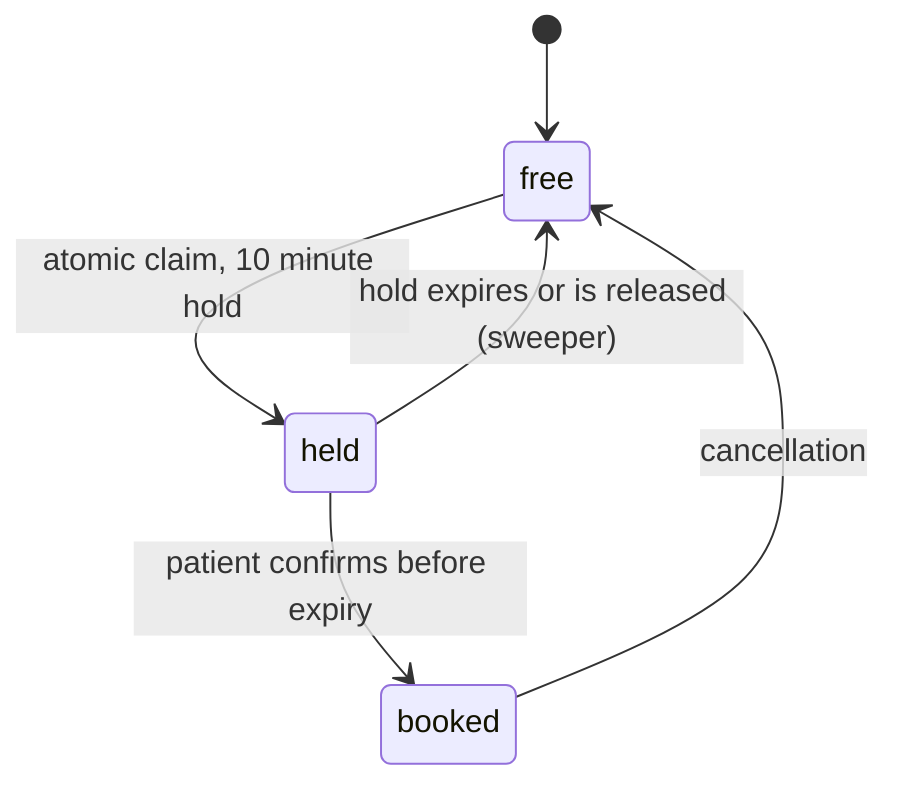

The booking uses a **lock-free compare-and-swap** on the status column:

```sql
UPDATE slots SET status = 'held', held_until = now() + interval '10 minutes', held_by = :patient
WHERE id = :slot AND status = 'free';
-- affected rows = 1: you got it. 0: someone else did, answer 409 Conflict.
```

Why this is correct (and the race it removes): a check-then-book in application code lets two requests both see `free`. In the Volume 5 test, a check-then-act version let between 6 and 10 of 10 simultaneous threads 'win' the same slot, while this conditional update let **exactly one** win every time. It works identically on SQLite and PostgreSQL, needs no explicit locks, and the database serialises conflicting updates on the row. Confirming a hold is the same pattern: `UPDATE ... SET status = 'booked' WHERE id = :slot AND status = 'held' AND held_by = :patient AND held_until > now()`.

**Deep dive 2: hold expiry.** A periodic task (every 60 seconds) runs `UPDATE slots SET status = 'free', held_until = NULL WHERE status = 'held' AND held_until < now()`. It is **idempotent** (running it twice changes nothing), so duplicate runs from at-least-once delivery are harmless. Pair it with a **check on confirmation** (`held_until > now()`) so an expired hold can never be confirmed in the gap before the sweeper runs. Run exactly one Beat instance (Volume 5).

**Deep dive 3: reliable side effects.** Emails and calendar updates go through an **outbox** written in the same transaction as the booking change, relayed to a queue, delivered **at-least-once**, with retries and backoff. Handlers are idempotent (a 'reminder sent' marker or unique constraint), so a retry never sends two. The booking endpoint also accepts an **Idempotency-Key**, so a client retry after a timeout returns the original booking instead of failing or duplicating.

**Deep dive 4: AI and integrations behind interfaces.** The AI provider sits behind an interface and is swappable through configuration. On timeout, a **deterministic keyword heuristic** produces a degraded but safe result (a **fallback**, and a circuit breaker stops hammering a failing provider). Calendar sync uses OAuth with a **refresh token stored encrypted at rest** (authenticated encryption), with key management kept separate from the data. Handle token revocation by marking the integration disconnected and asking the user to re-authorise.

**Deep dive 5: availability search and time.**
- **Search availability** by provider and date range with an index on `(provider_id, status, start_time)` (and a **partial index** on `status = 'free'`). **Cache** the availability per provider per day in Redis and **invalidate on any state change**, accepting that a stale 'free' is corrected at the atomic claim (the claim is authoritative). Redis failing **open** (queries still work from the database, just slower) is a deliberate choice.
- **Time zones:** store timestamps in **UTC** (`timestamptz`) and convert at the edge using the provider's time zone, which also handles daylight saving correctly. Never store local times without a zone.
- **Materialise slots** from availability rules (recurring weekly schedules) in a rolling window ahead of time, rather than computing availability on the fly, so every bookable unit is a row you can lock atomically.

**Privacy and security (health data).** Authenticate and **authorise every object** (a patient sees only their bookings, a provider only their patients, no IDOR), encrypt sensitive fields at rest and all traffic in transit, **audit log** access, log without personal data, minimise what notifications reveal, follow retention rules and the applicable health-privacy regulations.

**Scaling beyond one database.** Partition by **provider or clinic** (all slots of one provider live together, so the atomic claim stays on one shard), keep the booking path strongly consistent, scale reads with replicas and caches, move side effects to queues, add regions only when latency or residency demands it.

**Failure modes:** double submit (idempotency key plus CAS), expired hold confirmed late (the `held_until` check), sweeper not running (monitor 'holds past expiry', alert), worker crash mid-email (redelivery, idempotent send), AI provider slow (fallback), Redis down (fail open), duplicate Beat (idempotent sweeper makes it harmless).

**Spoken summary:** 'Slots are a state machine, free, held, booked, and every transition is an atomic conditional update on the row, so concurrent requests cannot double book. Holds expire through an idempotent sweeper, side effects flow through an outbox to idempotent workers, the AI provider sits behind an interface with a heuristic fallback, and sensitive data and tokens are encrypted and tightly authorised.'

### Design 10: Distributed cache

**Requirements.** A key-value cache shared by many services: **sub-millisecond reads and writes**, **horizontal scalability**, **high availability**, TTLs, a bounded memory with **eviction**, and graceful behaviour when nodes fail. **Out of scope:** durable storage (a cache can lose data by design).

**Estimate.** To serve 1 million operations per second with nodes that each handle about 100,000, you need at least 10 primaries, plus replicas and headroom, so call it **20 to 30 nodes**. Memory: caching 500 million entries of 1 KB is about 500 GB, so spread over nodes with about 64 GB of usable memory each is **8 to 10 shards**, replicated.

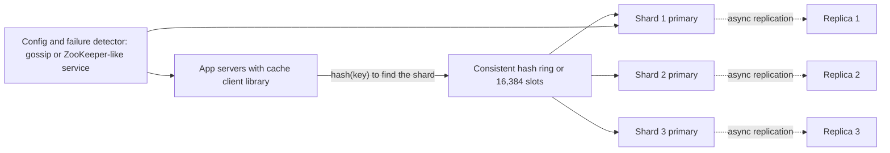

**Deep dive 1: partitioning.** **Consistent hashing with virtual nodes** (2.6, verified: about 17 percent of keys move when a node is added, versus 83 percent for modulo hashing). **Redis Cluster** instead uses **16,384 fixed hash slots** distributed over nodes, and resharding moves slots. Either way, the **client library** (or a proxy such as twemproxy or a service mesh) routes each key to the right node, so the cache has no central bottleneck. Use **multi-get batching** to reduce round trips.

**Deep dive 2: each node.** A hash table for O(1) lookup plus an **eviction policy** to stay within memory: **LRU** (a doubly linked list, Volume 4), **LFU** (keep frequently used), or approximated versions (Redis samples a few keys rather than tracking exact order) to save overhead. **TTLs** expire **lazily** on access and by a **background sweep**. Memory allocators and fragmentation matter at scale, and the value size should be bounded.

**Deep dive 3: availability.** Each shard has one or more **replicas**. A **failure detector** (heartbeats and gossip, or a coordination service) notices a dead primary and **promotes a replica**. Replication is usually **asynchronous**, so a failover can lose the most recent writes, which is acceptable for a cache because the source of truth is elsewhere. Clients **retry and fall back to the database** if the cache is unreachable (and the database must be able to survive that, otherwise the cache outage becomes a total outage, the **cache dependency trap**). A **cold cache** after a restart creates a miss storm, so warm gradually or use request coalescing.

**Deep dive 4: problems to be ready for.**
- **Hot keys:** one key attracts huge traffic and overloads its shard. Mitigate with a **local near-cache** in each app server (tiny TTL), **replicating the hot key** across several nodes, or key splitting (`key#1..key#8`).
- **Stampede, avalanche, penetration** (Volume 5): rebuild locks, TTL jitter, negative caching and Bloom filters.
- **Consistency with the database:** cache-aside with delete on write, TTLs as a safety net, and acceptance of brief staleness. Strong cache-database consistency is not a goal of a cache.
- **Rebalancing:** adding a node should migrate slots or ring ranges incrementally, in the background, without a miss storm.
- **Large values and serialisation:** compress, avoid cross-language pickling, cap size.
- **Security and isolation:** authentication, network isolation, no multi-tenant key collisions (namespace by tenant).

**Operational metrics:** **hit ratio** (the headline number, with the latency arithmetic in 2.3), eviction rate, memory use, latency percentiles, replication lag, connection counts, hot-key detection.

**Trade-offs:** LRU versus LFU, replication (availability, at the cost of memory and possible lost writes) versus none (simple, a node loss is a miss storm), client-side routing (fast, smart clients to maintain) versus a proxy tier (simple clients, an extra hop), write-through or write-around versus cache-aside.

**Spoken summary:** 'A sharded in-memory key-value store. Clients route by consistent hashing or hash slots, each node uses a hash table with LRU or sampled eviction and TTLs, replicas provide failover with possible loss of the latest writes, and the application treats it as a cache-aside accelerator that must be survivable by the database, protecting against hot keys and stampedes.'

## Part 4: The reusable checklist and common mistakes

### 4.1 One checklist for any design

Run through it aloud in the last five minutes:

1. **Requirements:** functional scope, out of scope, non-functional targets (scale, latency, availability, consistency, durability).
2. **Numbers:** QPS average and peak, read to write ratio, storage with replication and growth. Which component do the numbers say will hurt first?
3. **API and data model:** the main endpoints, the entities, the access patterns, the **shard key**, and the indexes.
4. **Diagram:** clients, CDN, load balancer, stateless services, cache, database with replicas, queue and workers, object storage. One write and one read walked through.
5. **The hard problem** (ids, fan-out, seat or stock claiming, ordering, hot keys) solved in depth.
6. **Consistency decisions:** which data is strongly consistent and which is eventually consistent, and why.
7. **Concurrency:** what is claimed by multiple actors, and the atomic mechanism (conditional update, unique constraint, lease, fencing token).
8. **Failure modes:** each dependency down, partial failure, duplicates (idempotency), retries (backoff, jitter, circuit breaker), data loss (replication, backups, outbox).
9. **Bottlenecks and scaling:** what breaks at 10 times the load and the next step (cache, replicas, shard, queue, CDN).
10. **Security, privacy, observability:** authN and authZ, encryption, rate limits, abuse, metrics and alerts (golden signals, queue lag).
11. **Trade-offs:** two alternatives you rejected and why.

### 4.2 The same ideas, reused

| Idea | Where it appeared |
|---|---|
| Atomic conditional update (compare-and-swap) | Slot holds, stock reservation, seat locking, alias uniqueness, job claims |
| Hold or lease with expiry | Appointment hold, cart reservation, job lease, distributed lock TTL |
| Idempotency key plus unique constraint | Checkout, notification send, chat send, outbox consumers, job handlers |
| Outbox plus at-least-once plus idempotent consumers | Notifications, e-commerce events, appointment reminders |
| Cursor or sequence catch-up | Chat sync, file sync, feed pagination |
| Hybrid push and pull | News feed, large chat channels |
| Cache-aside with stampede protection | URL redirects, product pages, availability, feeds |
| Consistent hashing | Distributed cache, sharded stores, partitioned queues |
| Queue to absorb bursts and isolate failures | Notifications, orders in flash sales, analytics, scheduler |
| Fail open versus fail closed | Rate limiter, cache, authorisation checks |

### 4.3 Common mistakes

- Jumping to boxes before clarifying requirements, or never doing the estimation.
- Adding Kafka, microservices and sharding to a problem that one database handles easily. **Justify every component with a requirement or a number.**
- Ignoring consistency requirements, or demanding strong consistency everywhere (it is expensive).
- Drawing a single point of failure (one load balancer, one database, one scheduler) without saying how it fails over.
- Forgetting **idempotency and duplicates** when using queues or retries.
- Choosing a bad shard key (timestamp, low cardinality, a celebrity id), or forgetting cross-shard queries and resharding.
- No story for **hot keys, thundering herds, or cold caches**.
- Treating the cache as the source of truth, or a design that collapses if the cache is down.
- Hand-waving the **hard part** (how exactly do you prevent double booking?).
- Not discussing monitoring, security, or what happens during a deploy.
- Speaking in one direction without checking in. Ask which area the interviewer wants to go deeper on.

### 4.4 Interview questions on the whole round

- **How do you decide between SQL and NoSQL in a design?** From the access patterns and consistency needs: transactions and relationships mean relational, huge simple key lookups or write throughput mean key-value or wide-column. Usually relational as source of truth plus derived stores.
- **How would you handle a 10 times traffic spike?** Autoscale stateless services, cache and CDN, queue heavy work, rate limit and shed load, protect the database with pooling and replicas, and have a plan for hot keys.
- **How do you make a distributed operation idempotent?** An idempotency key checked atomically (unique constraint), results stored and returned on retries, idempotent consumers.
- **Where could this system lose data and how do you prevent it?** Acknowledge only after durable persistence, replication or synchronous follower for critical data, outbox for events, tested backups.
- **How do you keep two systems consistent (database and search, database and cache)?** Single source of truth, change events through an outbox or CDC, idempotent consumers, delete-on-write plus TTL for caches, reconciliation jobs.
- **What is your approach when you do not know a number?** State an assumption, round it, show the sensitivity (what changes if it is 10 times larger), and move on.
- **Pick any one of the ten and defend its biggest trade-off.** Be ready for each: 301 versus 302 (URL), fail open versus closed (limiter), per-priority isolation (notifications), per-conversation ordering (chat), chunk size (storage), push versus pull (feed), saga compensations (checkout), at-least-once with idempotency (scheduler), CAS versus locks (booking), LRU versus LFU and replication (cache).

### Revise in 30 seconds: the ten designs

- **URL shortener:** read-heavy KV, range-allocated counter plus base62, primary key makes aliases atomic, CDN plus Redis plus sharded DB, 302 for analytics, async click events.
- **Rate limiter:** token bucket in Redis with atomic Lua and Redis time, 429 plus Retry-After, fail open or closed by endpoint, sliding window counter (84 x 0.75 + 36 = 99).
- **Notifications:** 202 plus outbox plus idempotency key, priority topics, router applies preferences and templates, per-channel workers, backoff, circuit breaker, provider failover, DLQ, webhooks.
- **Chat:** WebSocket gateways, session registry plus pub-sub, per-conversation sequence, client message id dedupe, persist before ack, partitioned store, push for offline, catch-up by sequence.
- **File storage:** content-hashed chunks, pre-signed direct uploads, manifests, atomic commit, cursor change feed, conflicted copies, refcount garbage collection.
- **News feed:** hybrid fan-out, capped Redis inboxes of post ids, hydrate from caches, cursor pagination, eventual consistency.
- **E-commerce:** conditional-update stock reservation (never oversell), checkout saga with compensations and idempotency, payment webhook reconciliation, flash sale gating and bucketed stock.
- **Job scheduler:** leases claimed atomically, reclaim on expiry, idempotent handlers, backoff and dead-letter, partitioned schedulers or leader election, watch the oldest due job.
- **Appointment booking:** free, held, booked state machine via compare-and-swap, idempotent expiry sweeper, outbox side effects, provider-sharded, encrypted sensitive data.
- **Distributed cache:** consistent hashing or hash slots, LRU or sampled eviction with TTLs, replicas for failover, hot key and stampede defences, database must survive cache loss.

## What Volume 6 covers, and what comes next

Volume 6 covers the system design items from your checklist in depth: the interview method, estimation with a runnable helper, scaling, load balancing, caching and CDNs, replication and sharding, consistent hashing (verified), quorums and consistency (verified), ID generation (verified), queues and Kafka, sagas, locks and consensus, Bloom filters (verified), availability maths (verified), and ten full designs with diagrams, numbers and verified code for the key mechanisms.

Next in the series is **Volume 7: ML and GenAI** (the ML fundamentals, metrics, leakage, pipelines, ensembles, RAG, embeddings, evaluation, hallucination, prompt injection, serving and drift monitoring), followed by **DSA patterns** and the **systems and programming** volume (C++, Linux, compilers, computer architecture).
